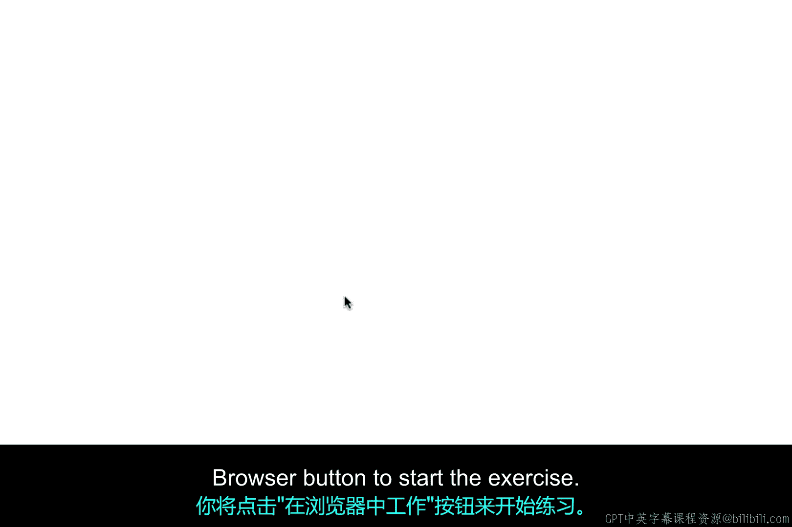
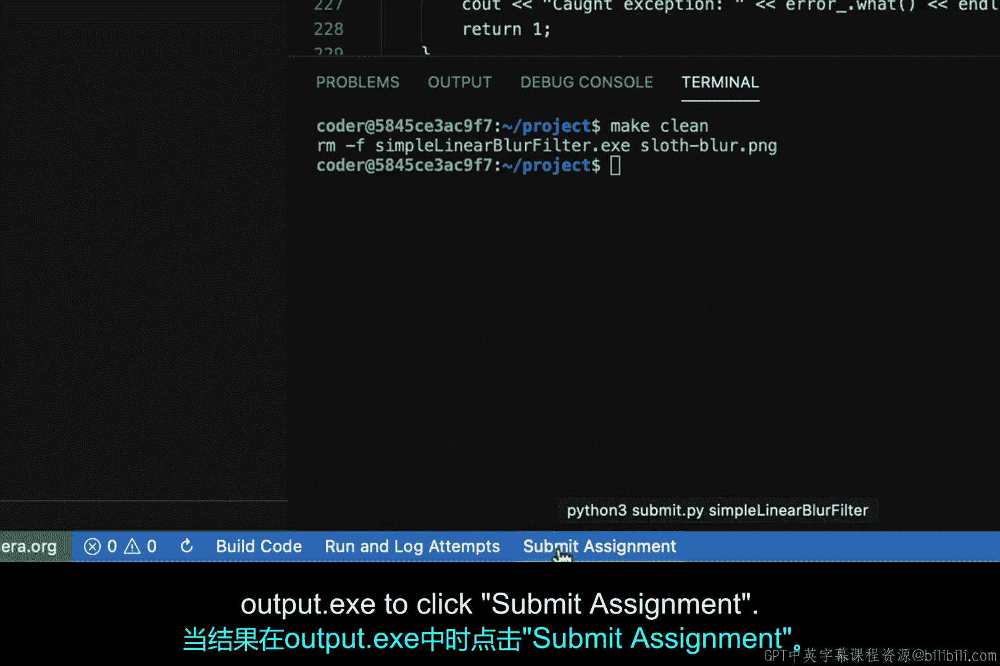

# 约翰霍普金斯大学《GPU编程（并发编程、并行编程、面向企业、CUDA高级库）｜GPU Programming》 p55 24_CUDA共享-常量内存图像处理作业指南.zh_en -BV1a1421r7vw_p55-

Let's go over the week 4 programming assignment， which is dealing with image manipulation using constant and shared memory。

 So in the instructions， you're going to see that the first thing you're going to do。

Is right code to deal with RGV values that uses constant memory。

 you'll have the CI arguments that you see， and it's going to turn an RGV image into a gray scale image。

 Then you'll click the build code button。😔，Followed by the run and log attempt button。

Look at the output that T XT file。And what you will see is a mean difference percentage of the output。

Which calculates the difference between the image that you've generated and a CPU generated image。

 Then you click the submit assignment button。Which will take that mean difference percentage and calculate your grade。

 Note the same bug that existed before， which I'll leave to you to fix Max is the grade you can get at around 90%。

 you'll click the work in browser button to start the exercise。 So now let's look at the main couda。

😔。

codeode。The kernel， the apply simple linear。😔，Pler F is the main kernel you'll develop。😔。

There are comments that describe each step of what。

Your your code is supposed to do initialization variables。 You have to sync thes because it's。

Shared memory and then applying a blur， which should use a constant value。

 but also note that you can use constant values for D_ rows and columns。

 and that's how the code is set up。😔，The compare color images takes the RGV values for two different images and compares that。

Then what it does is it for each channel R G and B。

 it defines the absolute difference between each pixel and then averages them for a pixel and then across the whole image based on the size of the image。

Then we will allocate device memory， which is basically setting up constant。

Memory symbols and shared memory。 it is up to you。 Then move on to the execute kernel script。

 which is a wrappper around applyly simple linear butter filter。😔，Then clean up the device。

 there's a command line arguments parser。Then we'll read the image from a file using Open CV。😔。

We've read it in as a vector of。RG andB values based on the size of that image。

 which is defined by rows and columns and then place that into this vector 3B construct。

 the next function is the apply blur kernel， which is a CP version of what you'll implement basically looking to the rat left and right of the pixel you're at。

😔，And averaging the values in RGB。 Lastly， we'll go over the main function。

 The first thing that's done is parseel the command line arguments to get the input and output images。

 the current par ID D and the threads per blocked。And then after the execute kernel。

 we're going read in。The color image that is generated from the blurring。😔。

And then place it into the color image。Object。And then write that out as a PNng。

Then we'll take the input image and apply upload a kernel， which returns three vectors for RGM B。😔。

We will use that to compare against the color image。 Finally。

 we use the compare color image to generate a scaled mean difference percentage by comparing the RGB of the CPU and GPU generated images。

 Then it is up to you to click the build code to run。😔，Make clean build。

 run and log attempts via runs H script， and then finally when the results are in output A Xc。😔。

To click Sub assignment。

