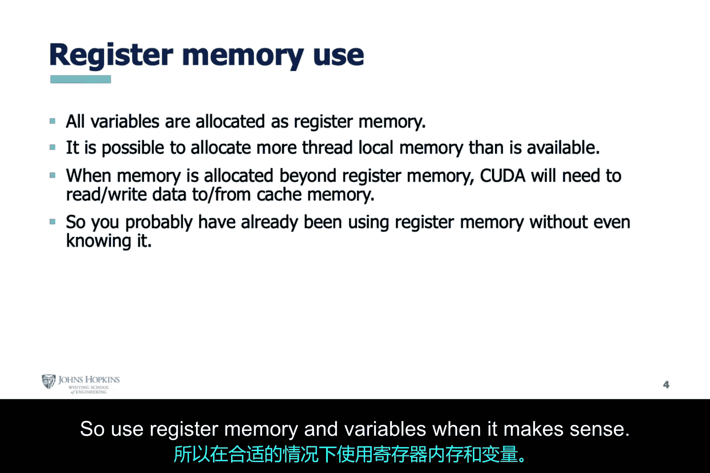
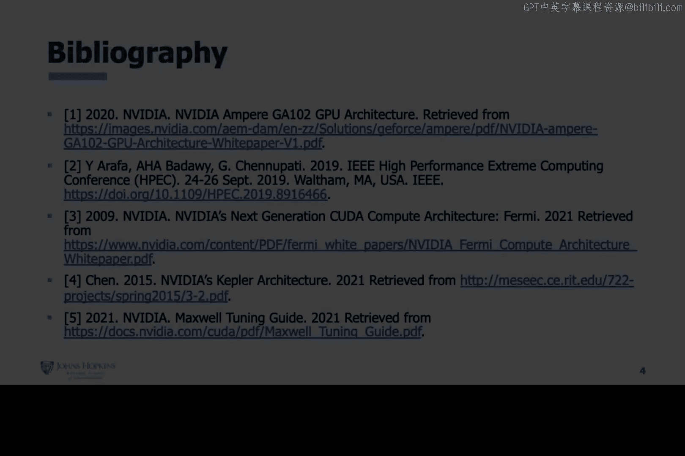
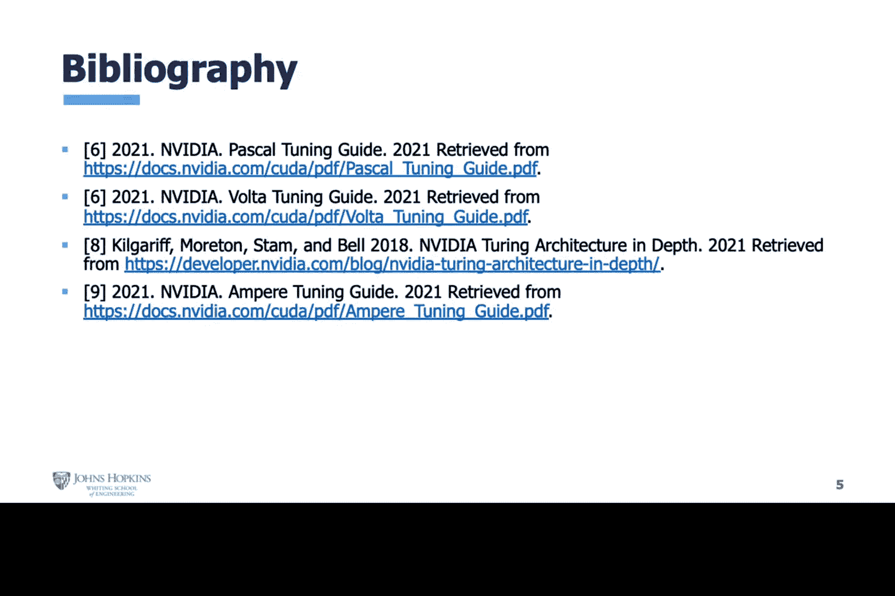

# 约翰霍普金斯大学《GPU编程（并发编程、并行编程、面向企业、CUDA高级库）｜GPU Programming》 p56 25_CUDA GPU寄存器内存机制.zh_en -BV1a1421r7vw_p56-

Hello and welcome to the set of Les。😔，On register memory。

 it will be the final type of device memory that we will discuss in this course。

So let's go back to our common diagrams of G V device layout， starting with one being the generic。

Overview and two on the right being a much more detailed image。

<|OTHER|>Showing from the host to the device that should be corresponding to the image on the top left and then down into a streaming multi processorcessor。

With regard to registers， registers are one。File。For intents and purposes， treat like a file。

That file is accessible to all the processing units。

 so the general cores that make up the threads and specific single and double floating point operation processing units。

And load in store registers note that the larger the number of cores in a streaming multi processor。

Does not mean you have more overall register memory， the register file is of a predefined size。

 often 60 kilobytes。So as I just finished stating， for the most part， in most architectures。

 the amount of memory in register file per streaming multi processor is static。

 There are some cases where early on it may have been lower。

 and there may be some high end versions of cards that have more register memory。😔。

But the best process is to， Unless you know the card you have has more memory to presume you have 64 kB for all the registers。

 a streaming multi processor。One interesting side effect of this that we will calculate later is that the amount of register memory per thread varies based on the hardware。

Though it doesn't vary wildly because that would make things really difficult。

 but you may want to find like a safe bound。For your register memory。

 So how do you use for register memory？We've pretty much been using the whole time。

 Any time you create a variable， whether it be a primitive or a few。

Create an array or pointer in your kernel， that's register memory。😔，You don't have。

Total control of if it's always going to be register memory。

 if you allocate more memory then it's available per thread。Then what will happen is it'll be cached。

Whi is slower， but is not terribly slow， so。😔。

Gs， register memory and variables。When it makes sense。

