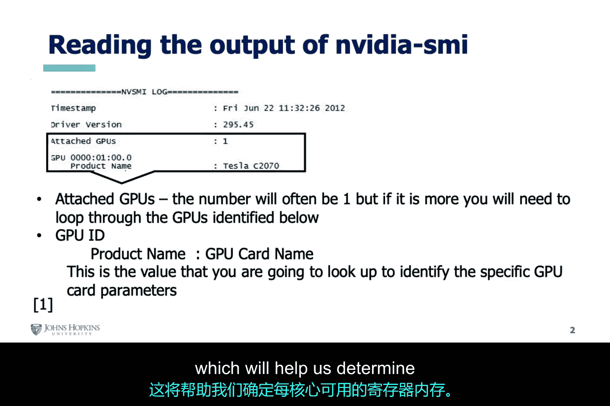
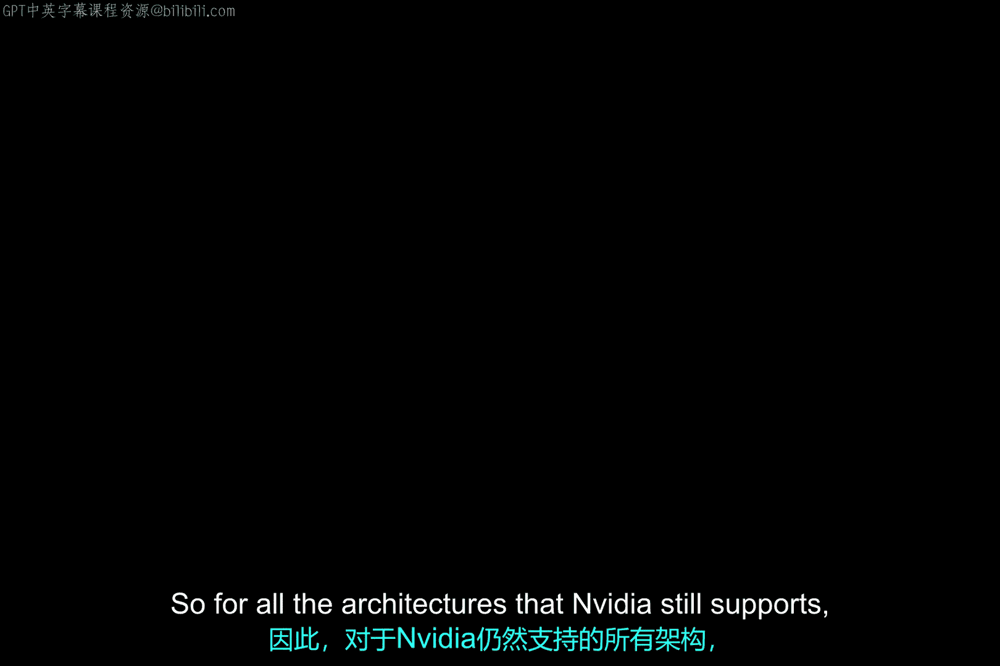
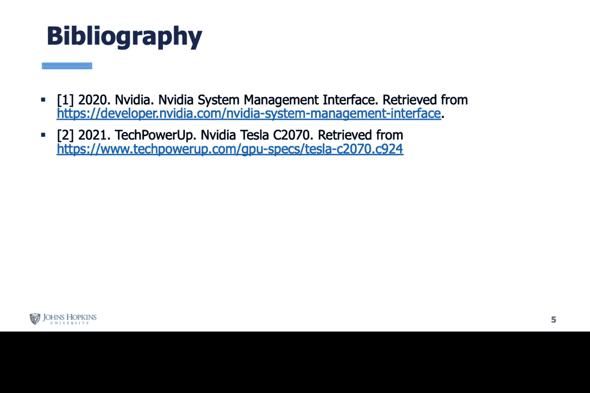

# 约翰霍普金斯大学《GPU编程（并发编程、并行编程、面向企业、CUDA高级库）｜GPU Programming》 p57 26_CUDA寄存器内存研究.zh_en -BV1a1421r7vw_p57-

<|OTHER|>In this video lecturer， we'll go over how to investigate the amount of register memory。

On your card and how the number of cores。😔，In streaming multi processor。

 determine how much register memory is available。 So just like with other types of memory or properties of your card。

😔，NVIDdia SMI can be a very useful tool。We won't go over all the properties that you can look at。

 but one of the most important will be the product name。

Cause you will use the product name to determine the number of cores in a streaming multi processorsor。

 which will help us determine the per core。😔。

Register memory available。So for all the architectures that Nvidia still supports， which were。

Produced over the last 10 years or so。And Va provides tuning guides。 Tuning guides provide numerous。

Types of ways to make your。Programs more effective on specific GPU cards。

So these are always good references and you should。

Look at them to know if there's different features available to different architectures。

 which you can compile your code for specific architectures if you wish。

Though as with other types of memory。The tech power up GP view database。

Is very valuable in determining the amount of register memory per core。Now note。

 this GPU database does not specifically say anything about the size of a register file you may have to look elsewhere for that。

But， the point being。That。It tells how many cores are available per streaming multi processor。

So given that number。You could say， okay， I have。The total course， which is more often what is shown。

Often referred to as shading units。So you take the total cores。

 you divide by the number of streaming multi processors， which is displayed。

In the database and note for this example， there are 448 shading units and 14 streaming multi processors。

 which means。32 cores per streaming multi processor with the 32。

Cos in a stream multi processorcessor， you then say， I know that there are 64 kB of memory。

Per streaming multi processors。So that means that each core has two kilobyte of memory associated with it。

Now， note you could have things like branching or other circumstances where variables are not instantiated。

In。Your kernels。 so this number can be higher or lower， but this is a good rule of thumb。

 So think about what you can fit into 2 kiloBs。Before。You。Create a lot of。

Variables that if you have more variable memory inside your kernel。

 which is attempting to be register memory， what will happen is just like on a CPU。

Memory will be shuffled in and out of those variables as needed in register memory。

You want to avoid this because this makes those variables and those specific accesses。

At the speed of global memory。

