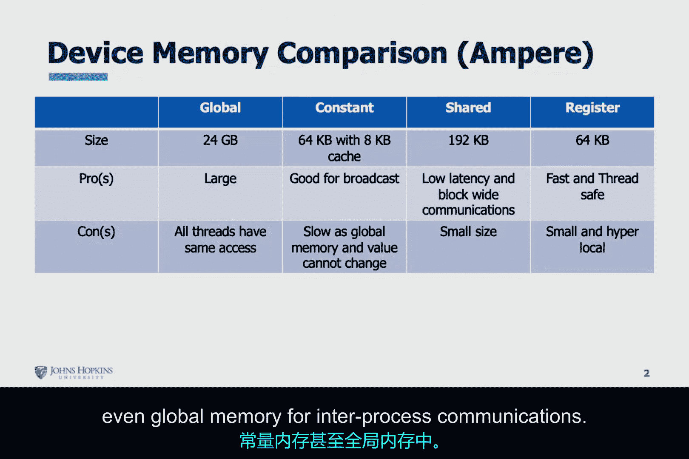
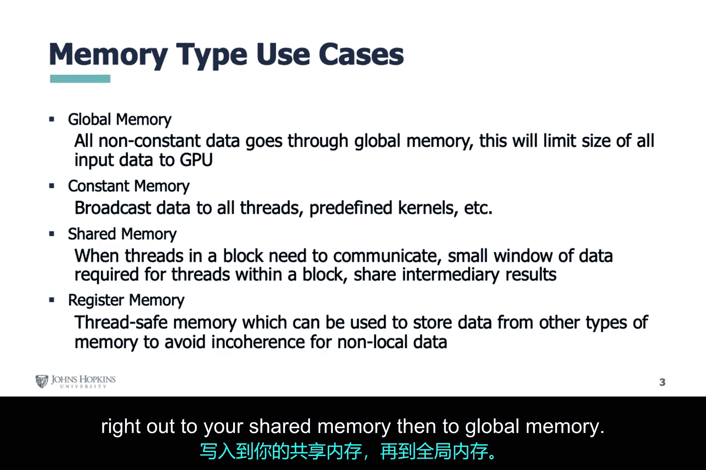

# 约翰霍普金斯大学《GPU编程（并发编程、并行编程、面向企业、CUDA高级库）｜GPU Programming》 p58 27_CUDA GPU内存评估方法.zh_en -BV1a1421r7vw_p58-

So now is the final lecture on device memory。 specifically， I'm going to give you some。😔。

General pros and cons to different types of device memory， some use cases。

 and hopefully this will act as a sort of guiding principle for how you allocate memory for which purposes。

 but use it as a rule of thumb， explore for yourself and determine what works best for you。😔。

So this table shows a simple comparison of different types of device memory。So。Based on size。

 global memory， increasing。And according to the amperre architecture。

 a good amount of memory is 24 GB。 So a pro it would be it would be very large。

 You could hold a lot of data in there， number of images。Specifically。

 if you want to do something like video or large data if it comes in a different form。

Now note that all threads have access to the same data。

 and so while you may be mapping it based on threadh ID。

 you will have to consider the possibility of race conditions。Constant memory cannot be changed。

It's about 64 kilobytes。Sometimes with an ain't kill by cash to help mitigate the effects of。

Misses Unreads。 It's good for broadcasts because it's significant in size。

 and all threads have access to the same memory。So the good thing about it is you can inform all of your threads of base information or use the same kernel I'm talking about that。

 I'm talking about image kernels。But it's slow as global memory。

And you can't change the data inside of constant memory after you've compiled shared memory can be up to。

 say，192 kilobys in the NPpi architecture。It the good for it is that it has low latency。 that means。

 you know， things get in and out of it fast。It can be useful for sharing information within a block as opposed to constant memory。

 which is useful for all threads。 This can be useful for both sharing， say。

 a whole image in a sequence of images that make up a video。

 or if you want asynchronous communications between threads。

That's a nice mechanism as long as it's within a block。

 it's relatively small in size compared to global memory。Register memory is the fastest。

 it's thread safefe because each thread only has access to its own register memory。

Now the bad things about it， it can be rather small， the more cores you have。

 the lower the amount of memory you have for each register。It's also hyperlocal。

 so there's no way to share the information directly from a register so if you have a variable。

 it's local， you would have to。Either add it into shared memory or into constant memory or even global memory。

For inter processcess communications。

Now let's talk about some use cases for the different types of memory that are available on the device。

 So first note that all memory transfers that are non constant。Go through global memory。

 so whether you create register or you shared memory。

 all of that data has to be transferred from the host to the device global memory。A note on that is。

嗯。This is the bottleneck for all memory transfers。Not just in speed。

 but on the size of the amount of data that can go through global memory。

 So if you have an image you need to process that is larger than global memory。

 you will have to break down that into different runs。Examples。

Would be having larger block sizes that handle more data。

 but that data is limited at the size of global memory。

So pretty much every use case will work with global memory， it just won't be great。

 but the sort of great use for it is get something large， put it in a global memory。

 and then move it into other types of memory as needed。

Constant memory is a great way to broadcast data to all threads。 It can be a predefined image。

 filter or kernel Sha memory will allow you to have different threads within the same block。

 communicate This can be a subset of the data that is in global memory for example。

 a par of an image or a single frame of video or some local data that matches the two or three dimensional layout of your threads in two or three dimensional or even more grid space。

 Register memory is threads safefe as I've said before。

 so you don't have to worry about race conditions or things like that。 It's fast。

It's sort of explicitly defined， so you don't have to worry about necessarily dealing with pointers or things like that。

 it's named so you know it has a lot of sort of programmatic positives to it。😔。

<|OTHER|>But a good practice is you know， take something from global memory。

 if everything in a block needs access， put it in shared memory， and then if you're going to modify。

That data in shared memory， then put it into。<|OTHER|>Have everything read it， put a sync threads。

 and put it into register memory， and then in reverse。You know， right out to your shared memory。

 then to global memory。

