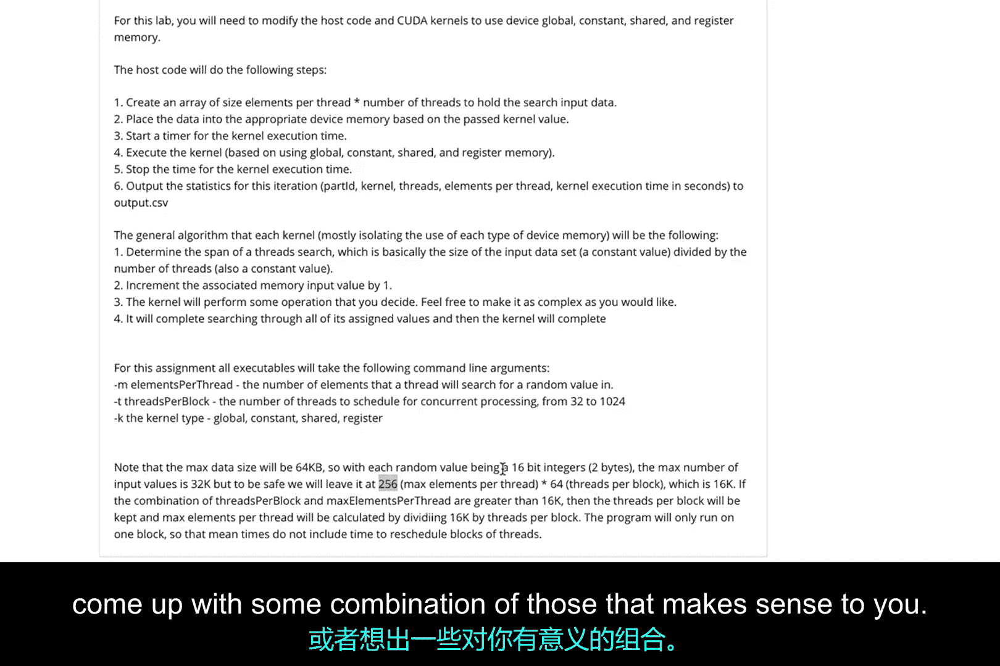
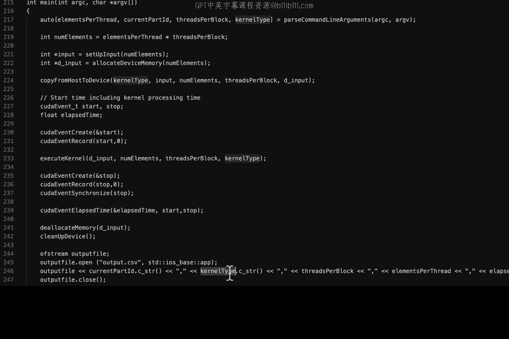

# 约翰霍普金斯大学《GPU编程（并发编程、并行编程、面向企业、CUDA高级库）｜GPU Programming》 p59 28_CUDA设备内存实验视频.zh_en -BV1a1421r7vw_p59-

So now let's look at week fives。Lab， which is on device memory in general。

So let's look at the lab instructions， note that there is a section that discuss hosts code and what the six steps that it will execute。

 This entails creating an array of size elements per thread which just passed in by the number of threads per block that will be your input data。

 The next step will be to place data into device memory as appropriate for which kernel you're running。

Then you can start a timer such that you can understand how long a kernel took to execute。Of course。

 then you execute the kernel base on whether it's accessing global， constant。

 shared or registered memory。 Sa I will stop the timer so you know the duration of kernel execution。

And then it will output statistics based on part IDD kernel。Aments per thread， threads。

Clonminnal execution time， itll output it to output that CSV。

The kernel itself will first determine the span of threads。

 which is the size of the input divided by the number of threads。 Both of those values are constants。

So it should be pretty quick to do that calculation。

 you'll have to do on each execution of the kernel。Then you'll increment a value。

 This is to ensure that some time is spent in memory access on the kernel。

Local memory and not somewhere else。Then you'll do whatever your kernel wants to do。

 if that's up to you， feel free to make it as complex as you would like。That is done。

You're going to assign values out it's。Vues youve searched for or some output variable or pointer。

Note there are three past CLI arguments that you can set M for the number of elements per thread。

 so that's the number of threads times by the number of elements each thread will use ends up with the amount of data。

 the number of threads per block from 32 to 1024。And then K for the kernel type。

 whether it's using global， constant， shared or register memory。

Note that based on the amount of constant or shared memory that there is going to be a max data size that will make things work。

 I calculate that to be 32K even though it can be 64 use a little bit of double fudge value there and then that just ends up being 256 elements per thread 64 threads per block which is 16K so you can double up one of those numbers or come up with some combination of those that makes sense to you but just be careful not to over stretch that number let's move on to the code you'll notice are four kernels for global shared constant and register memory each is pretty much blank inside aside from I determine the thread ID。

😔。

<|OTHER|>But have fun with whatever you decide to do。

 the next host code is to allocate random memory。It goes from 0 to255。

Another function is to allocate device memory。It does a simple kud for the input data。

 you can modify this as you want because you get to decide what your kernel does。

<|OTHER|>We move on to delocating memory， if you've executed your code。

 you want to make sure youve coda free any pointers that you have in device memory。

 another important capability is parsing command line arguments。

Which allows you to determine things like threads per v elements per thread kernel type。

 course you need a main function as it's a CR or C++。Piece of software。

This basically handles getting command line arguments， setting input variables for。Device memory。

And then there's copying to and from the host device and doing the timing around the execute kernel。

You'll delocate memory and clean up the device as always。

 and then you'll output a comma separated value。For analysis purposes。

