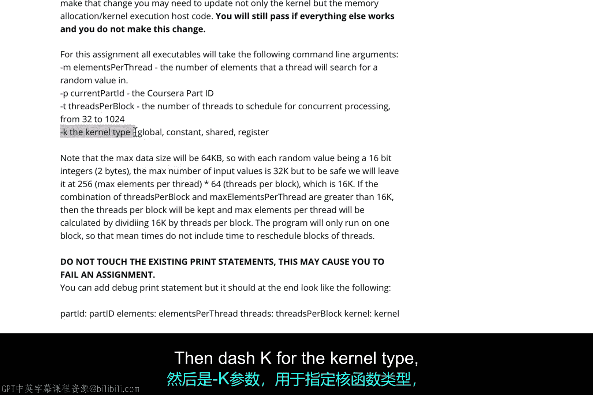
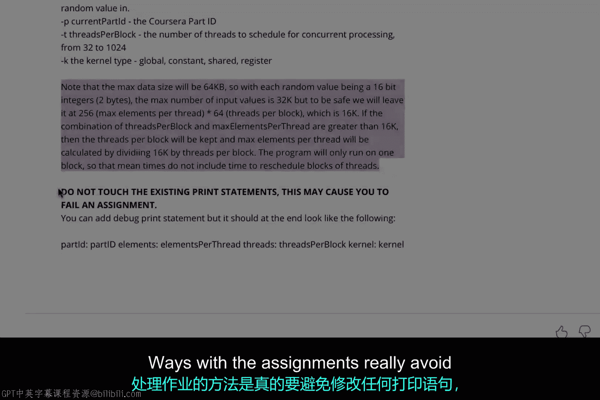
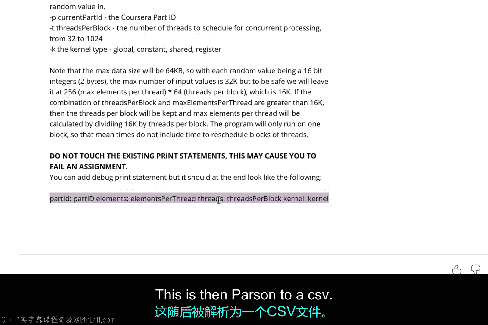
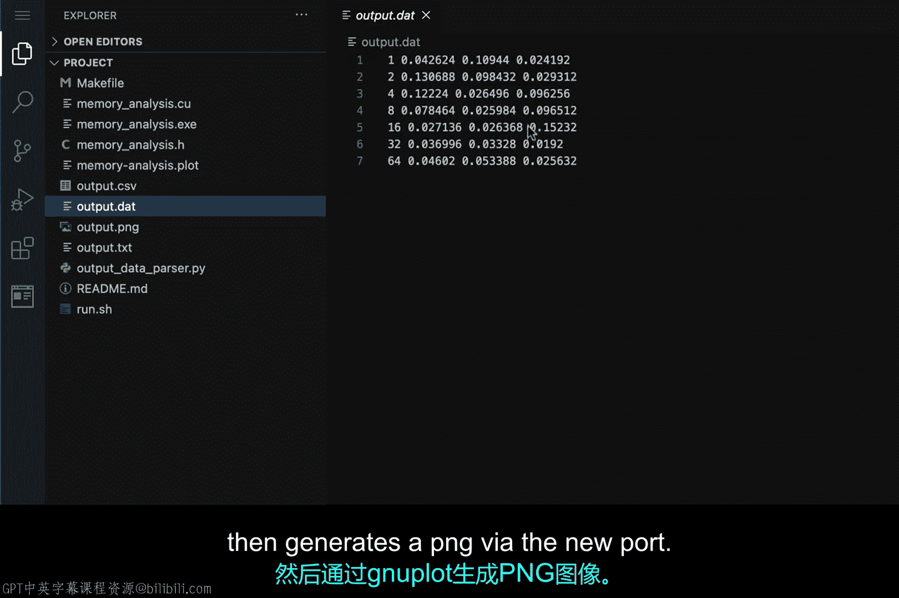
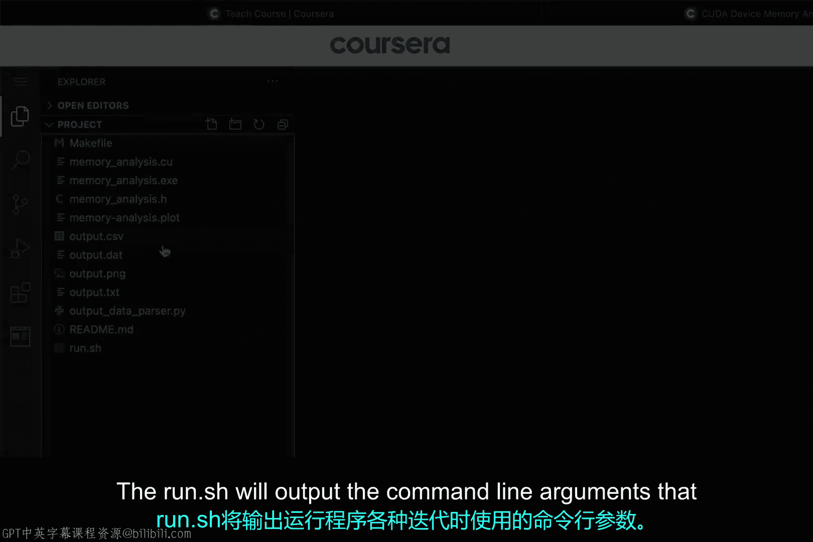
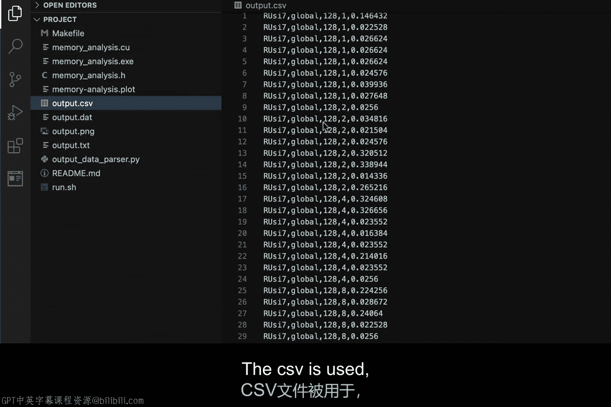
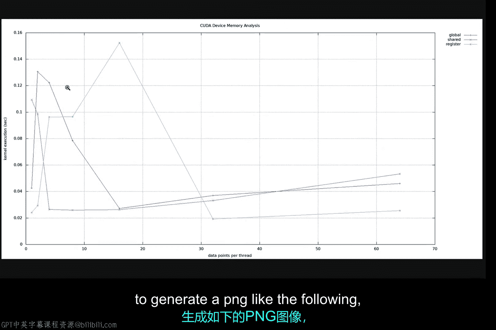
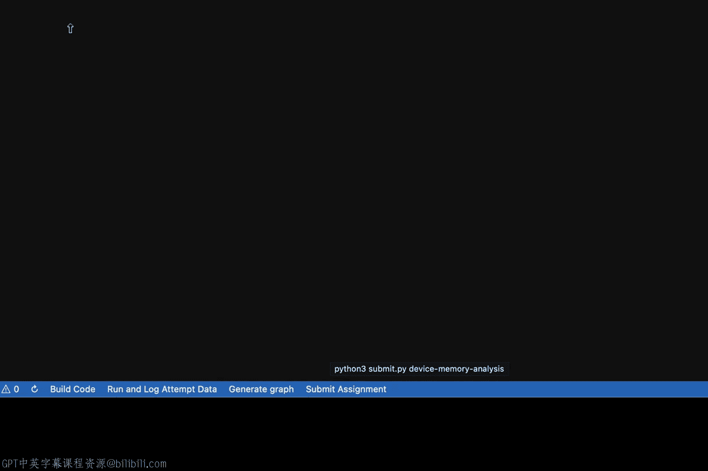

# 约翰霍普金斯大学《GPU编程（并发编程、并行编程、面向企业、CUDA高级库）｜GPU Programming》 p60 29_CUDA设备内存分析作业指南.zh_en -BV1a1421r7vw_p60-

Let's look at week 5's assignment。On memory analysis。So there are yet again。

 six steps your host code should execute。😔，As in the lab。The algorithm should have five steps。😔。

The same yet again， as in the lab。Where you determine the size of what you're searching for。

 you increment your memory inputs。Iterate through your input data。

Find it in this case and then set an output value。😔，So note that the runout S。

 which grades the assignment。Only runs global shared and registered kernels。And if you need to run。

The constant kernel to get 100%， you'll have to modify the line in the run out S to include。

Global shared constant and register memory。Everything else should pick up that it's there is passed in as an argument。

 this is the only way you get 100% so you can fix that but it's not required to pass。

 you'll get at least an 80 if you perform everything else correctly。

The assignment has a number of arguments that you passed for elements per thread。

 current part ID which you shouldn't modify， but is used by run。sh， the threads per block。

 it again this goes from 32 to 1024， it's a hard enforce。

 but you should keep it at that and thenk for the kernel type global constant shared register。

Always with the assignments really avoid modifying any print statements because it may cause you to fail the assignment。

 you can add debugging print statements， but your output should have a pattern somewhat like part ID elements。

 threads and then kernel。

This is then parsed into a CSV。

Now let's look at the code。You'll notice that there are four kernels for global。Shared。

And constant memory。When you look inside the kernel， it tells you what you need to do。Basically。

 it just handles giving you the right throat idea and making sure you don't go outside。

Then the host allocate pageable random memory， allocating device memory， copy from host to device。

And notice that。Basically， it needs that thread span and you will need to use that to determine。😔。

The input data。And also， you may need that for other types of device memory。

In executing the code based on the kernelel that's passed or different command line arguments。

 you'll note that the colons themselves do not have their arguments set for them。

 you'll have to do that accordingly。Pput。I determines the random memory that I'll be input and for the search value。

 but also note that the constant search value you。Symbol is always set。

 This is just in case something goes a little haywi andt forget to do it elsewhere。

<|OTHER|>Last but not least comes the main function， it operates very similar to the lab。

 it wraps around some timing around the kernel execution。It as always。

 will handle the allocation of memory， cleaning up the device and then。

Outputs CSV that can be read and generates。A thatt file that then。

Generates。A PNG via canoe plot。

The Rundot S H will output the command line arguments that were。

Used in running the various iterations of the program。😔，The CSV is used， as I said before。

 to generate a PNG， like the following that tracks global shared and registered。

Rnda SH iterates over the kernels they are going to be executed so note you'll have to modify the for loop there to be global share register and constant memory。

 the number of elements per thread and iterations， this is used to generate a mean value。

 by that may mean an average value。😔，And then the Python output of parsed WPY takes in the output CSV and generates the that file。

 as I've studied before then。You execute build code。😔，To build your code， run and log attempts。

 runs the Run。sh。Then generaterate Gph uses canoe plot to generate the plot。

 and then you submit the assignment。😔。

