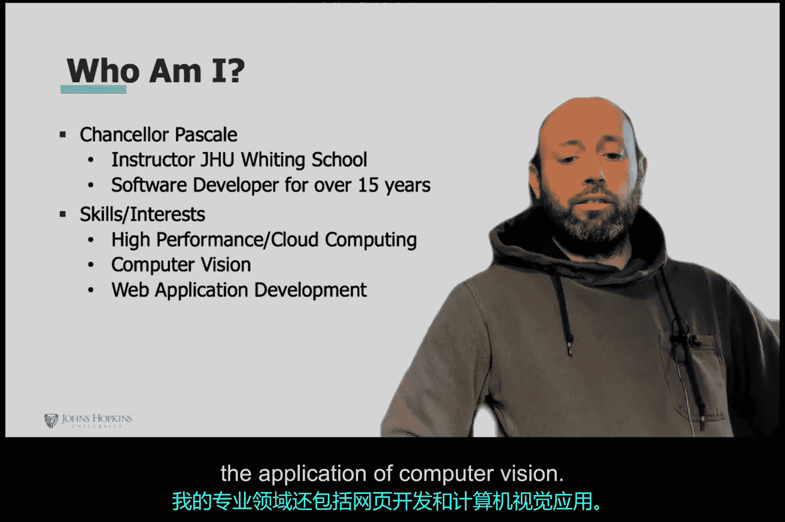
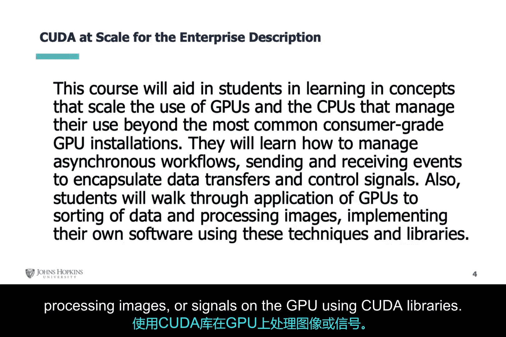
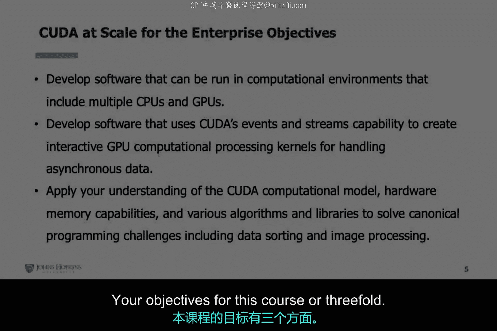
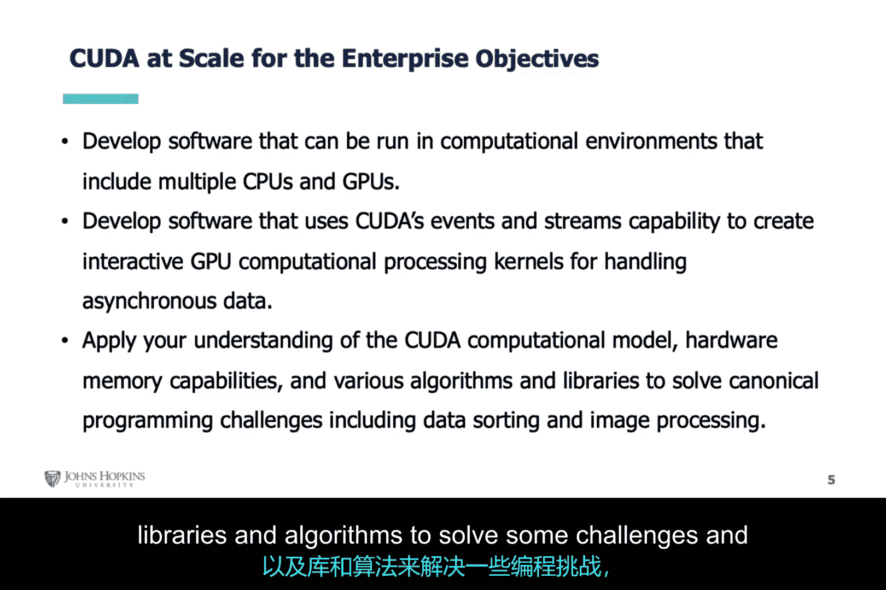

# 约翰霍普金斯大学《GPU编程（并发编程、并行编程、面向企业、CUDA高级库）｜GPU Programming》 p61 0_GPU专项课程总览.zh_en -BV1a1421r7vw_p61-

Hello and welcome to Kud at scale for the Enterpri。

 We're going to take what you've learned in the previous two modules and expand upon it and see how it will work with larger data。

 more complex algorithms in libraries that are made available by Kuta。 Well， who am I。

I am Chancellor Pascal。I' have been an instructor for 10 years at the Johns Hopkins。University。

 Whiting School engineering， a software developer for 15 years。

Hack performance and cloud computing are interests of mine。

Along with web development and the application of computer vision Now I would like to give you an overview of the Coursera GP specialization。

The first course， which you are currently in， is introduction to concurren programming with GPpss。

 which I will describe in more detail in the next slide。

The next course in this specialization is Intro to parallel programming with KUuda。

 This course focuses on the basic hardware and software capabilities that Nvidia GPus and the Kuda programming framework provide。

 The third course is Kuda at scale for the enterprise。

It goes into more complex capabilities of Kuta and how they can be applied to scale beyond the programmer's machine and on to enterprise hardware。

 The fourth and final course in the GPU specialization is Kutuda Advance libraries。

It exposes to the student a number of the most popular and powerful libraries that come with the KupaDevelop's toolkit。

So let's talk about the specifics of this course， so what you'll learn about is how to code for multiple CPUUs with single GPUs or multiple GPUs with single CPUUs or the combination of both。

 which is a common pattern for GPU installations。Then the next thing is you're going to learn how to deal with streams and events which allow for asynchronous workflows such that you can repeatedly run the same kernels on different data and control the execution order。

Lastly， we're going to focus in on some libraries and techniques that end up allowing you to do things like sorting of data。

 processing images or signals on the GPU using KUuda libraries your objectives for this course are threefold first。

 given an environment with either multiple CPUs and or GPUs develop software that utilizes them as appropriate Next use KUa streams and events to interact with the GPU and kernels asynchronously Lastly。

 apply your understanding of Kuta hardware GPU capabilities libraries and algorithms to solve some challenges in programming including data sorting and image processing。

Well that's it for this presentation。Hopefully I started you to think about what you'd like to do in this course and the GP specialization in general。

