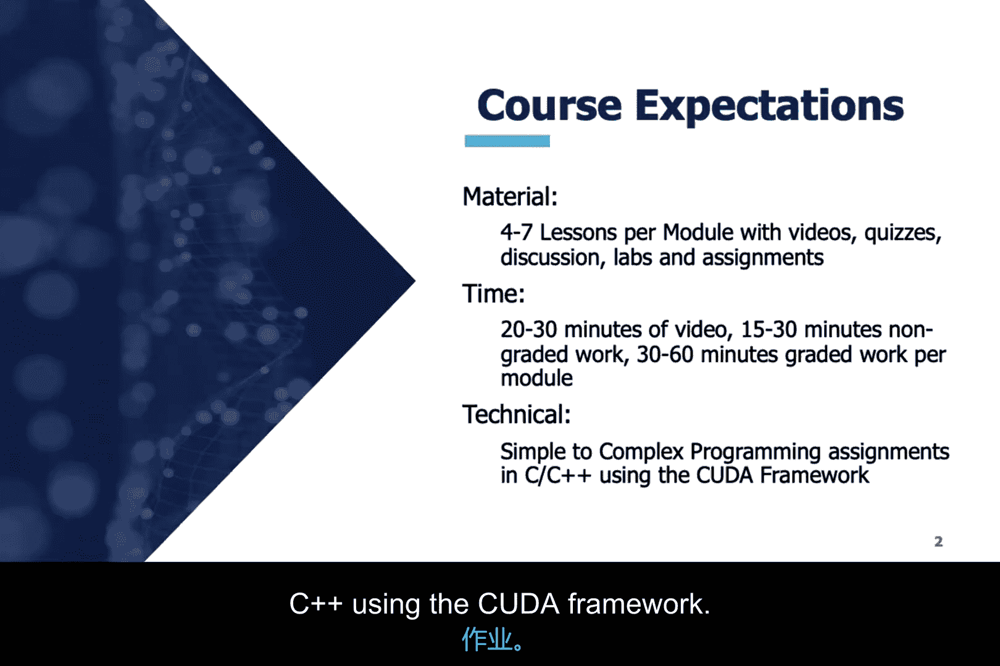
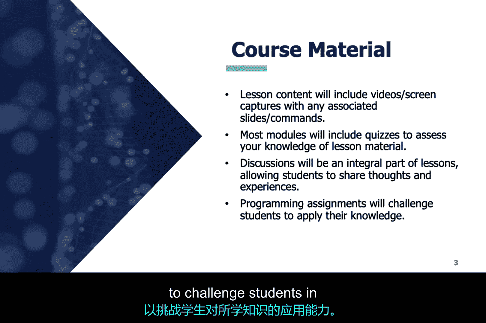
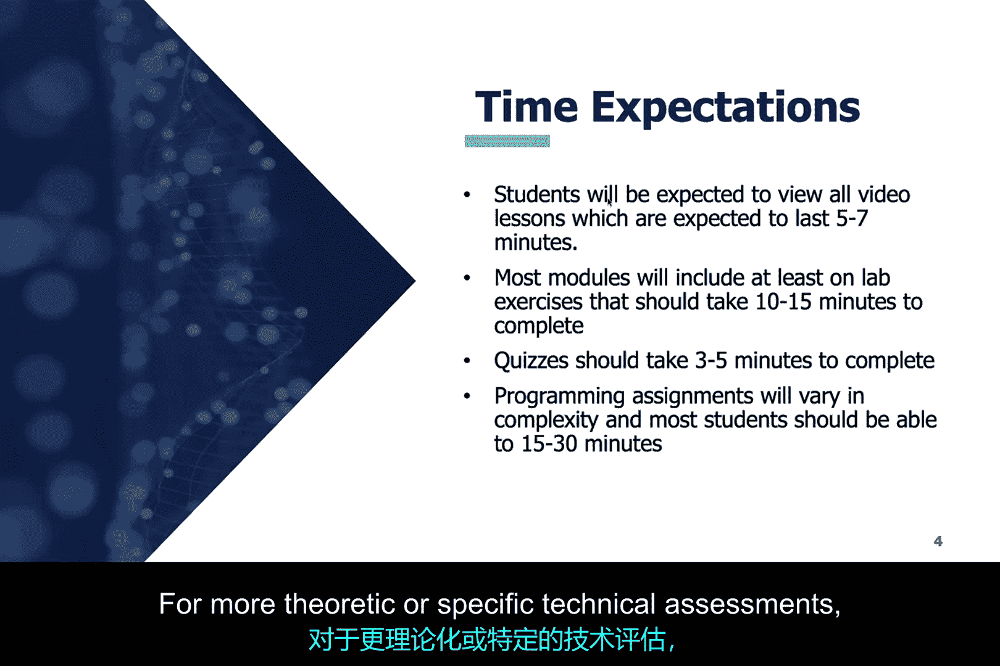
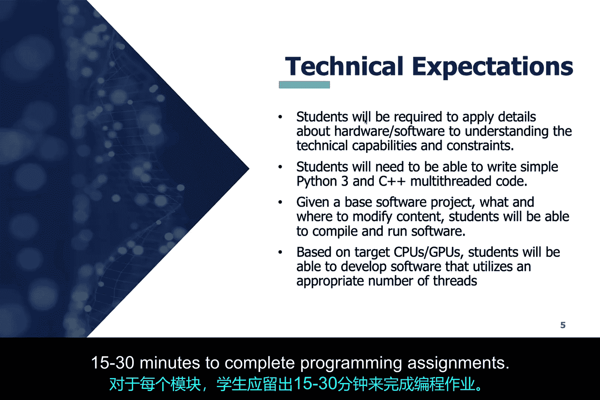
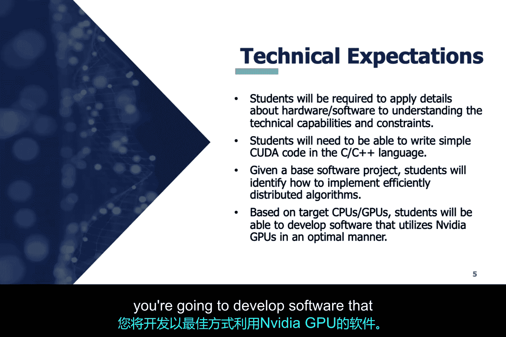
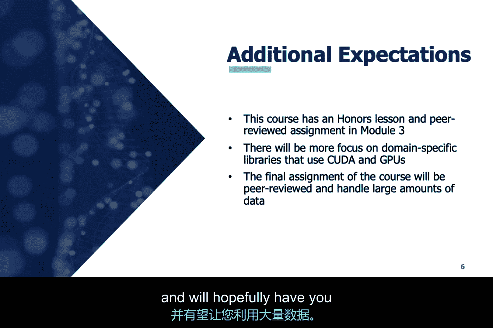

# 约翰霍普金斯大学《GPU编程（并发编程、并行编程、面向企业、CUDA高级库）｜GPU Programming》 p62 1_课程预期目标3.zh_en -BV1a1421r7vw_p62-

Hello， let's talk about the course expectations for the Kuda at scale for the enterprise course。

 So what are the course expectations from a material perspective。

 therell be 4 to7 lessons per module with video quizzes， etc ce。

 time perspective therell be 20 to 30 minutes of videos 15 to 30 minutes of nongraded work like labs and discussions and 30 to 160 minutes of grade work in the form of assignments and quizzes you will also be expected to write simple to complex programming assignments and C++ using the Kuda framework。

For each lesson， there will be video material in the form of slides or screen captures。

VoiceOver slide videos will be accompanied by PowerPoint slide files。Also。

 for those videos with screen captured content， the commands will be made available。

quizzes will be included in many modules to assess the student's knowledge of lecture material。

To encourage collaboration and sharing of thoughts and experiences。

 discussions will be part of each module， and students should consider them as an integral part of their learning。

To challenge and assess students understanding of technical topics。

 programming laboratory activities and assignments will be used in most modules to challenge students in the application of their understanding。

Each lesson will include lecture and technical application videos that will be required to gain a more complete understanding of course topics。

These videos will last between 5 and 7 minutes。Naboratory activities will allow students to explore technical topics in a realistic environment。

 They will often take 10 to 15 minutes to gain a mastery of the work's focus。

For more theoretic or specific technical assessments， students will complete quizzes。

 which should take3 to5 minutes to complete for each module。

 students should set aside 15 to 30 minutes to complete programming assignments。

So let's drill down into the technical expectations for the course。

 You're going to need to understand how to apply details of hardware software constraints and capabilities to your advantage。

 you're going to have to be able to write at least simple Kuda code in the C++ language。

I'll give you a base software project and then for the assignments you're going to have to identify where to put your code and how to most efficiently distribute algorithms。

Lastly， based on the target GPUs and GPUs of your own hardware or the Coursera La。

 you're going to develop software that utilizes NviIDIdia GPUs in an optimal manner。

There are additional expectations for this course as opposed to previous courses， First。

 there's an honors lesson and a peer review assignment in module 3。

So'll be focus more on domain specific libraries that are available。From Kuta to use GPs。

And the final assignment will include a peer reviewed aspect and will hopefully have you utilizing large amounts of data。

