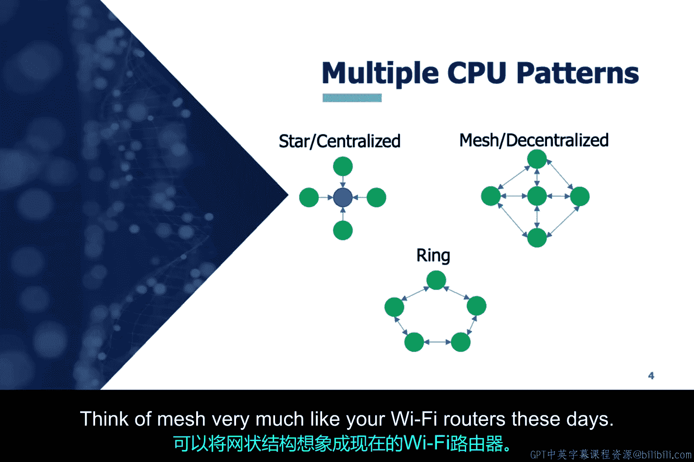
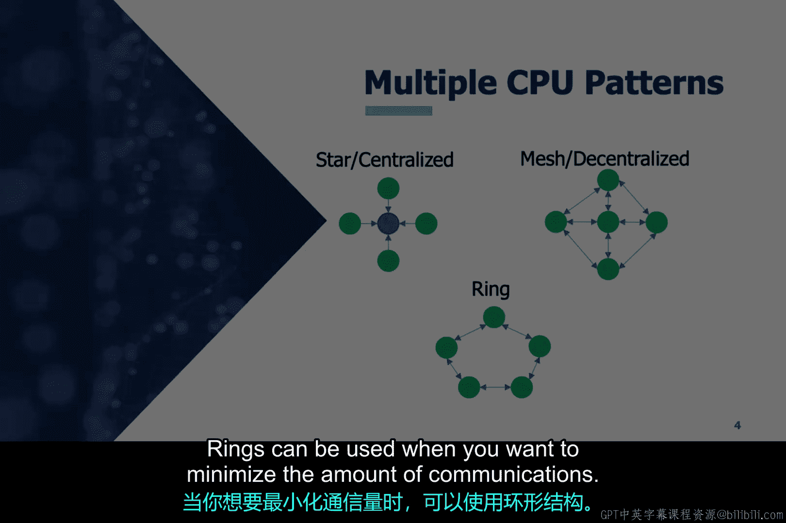
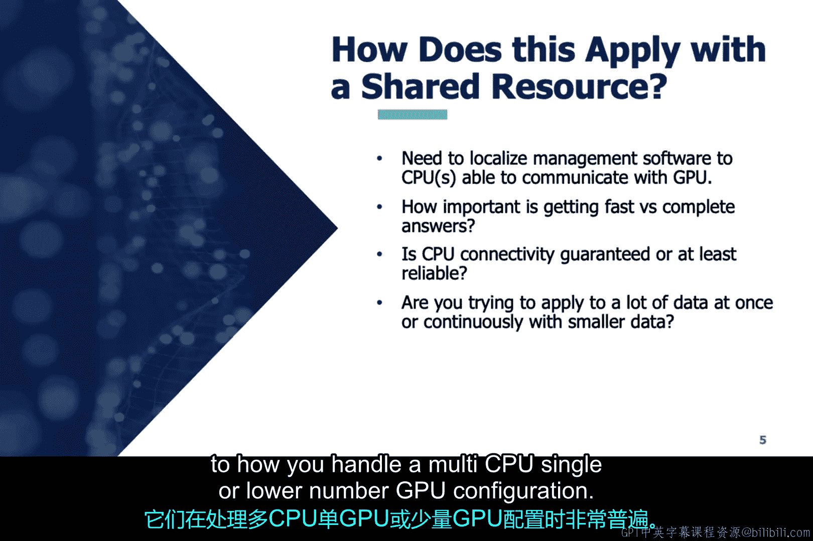

# 约翰霍普金斯大学《GPU编程（并发编程、并行编程、面向企业、CUDA高级库）｜GPU Programming》 p64 3_多CPU架构解析.zh_en -BV1a1421r7vw_p64-

Hello and welcome to the discussion of how to utilize multiple CPUs in a single architecture。

So in order to have multiple CPUs communicate， you're going to have to find a pattern or a technology you use a common one。

 especially in the past， was using the file system。

 using lock files or just using files on a remote server that，If you can think about it。

 that's how the World N Web started。Other concepts are sockets。

 which are predefined by directional means of communications that allow point to point communications。

There are message queuing systems， which can have something like a buffer or a queue that is filled up with messages。

 and on the other side， a processing system will pull them off and may communicate back via another messaging cue。

 Then there are more prescribed systems such as R PCC or rest。That communicate and via known methods。

Some important constraints or things to consider is。

If your system is asynchronous or synchronous in communications。

 will you expect responses immediately or can they be fired off and you look back later。

 is data coherency an issue？Will you be sending a lot of data in batch or constantly sending little bits of data in a stream？

How resilient is your connection and your network， and then are you concerned with security。

 will there be different access or roles for different processes or users？In this slide。

 I show three common patterns for multiple networked computers to communicate。

 there is a star or spoke or centralized communications。

 which means there is a central hub that all communications go through。

There is mesh or decentralized， which means that all nodes can pretty much talk to all their ones or maybe some level of connectivity to n number of neighbors and then ring where。

Neighbors communicate but only to one hop away， so it ends up being a little sparser in communications。

Think of mesh very much like your wfi routers these days。

 rings can be used when you want to minimize thematic communications。

So how does this work with when you want to have a shared resource like a GPU？Well。

 if you have a star。Pattern for your network。You might use that hub as where you put the GPU or conversely。

 if you know theres a GPU there， make that the hub， or if there are numerous machines that have GPUs。

 but they only have one then you might use something more like a decentralizer mesh network。嗯。

The speed of communications or your answers may make decisions for you。

 so do you want a lot of partial answers do you need them to be complete？

Do you know you'll always be connected between CPUs or is it can it be bursty so maybe something like a batch works better sending out batches as connectivity exists or if things getting lots of little responses important but missing part of them sort of like a UDP protocol for communications。

 you might use something like streams where you constantly try to connect and send things out with something it doesn't make it all the way there。

 it's fine， and then it sort of gets back to like do you need all of your data to be processed at one time。

 or can you get a small picture of say an image， you get you don't need all the image to be there or all the frames in a video so you just send you know say a frame at of time for video or a part of an image and then let the stream manage that。

So these are common patterns and they'll be very prevalent to how you handle a multi CPUU single or lower number GPU configuration。

