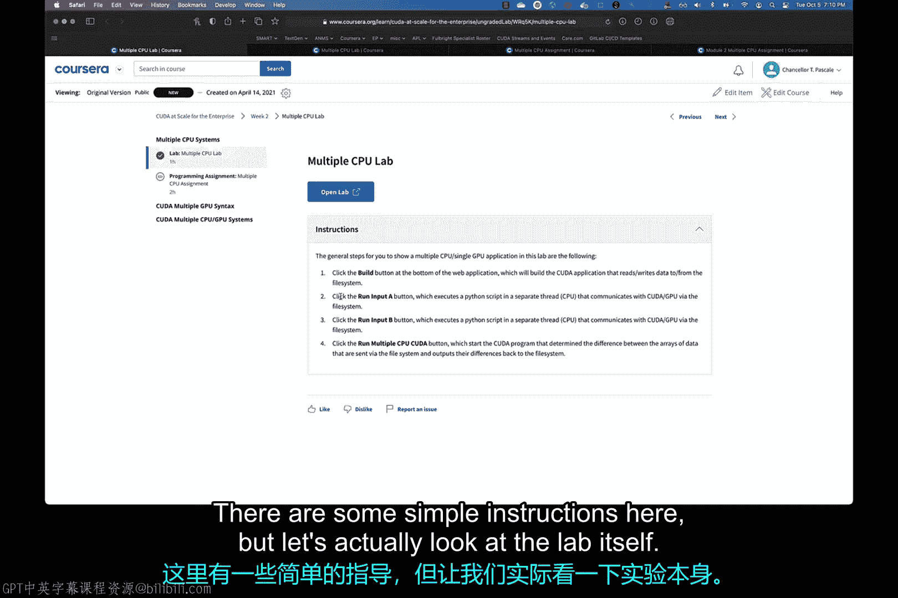
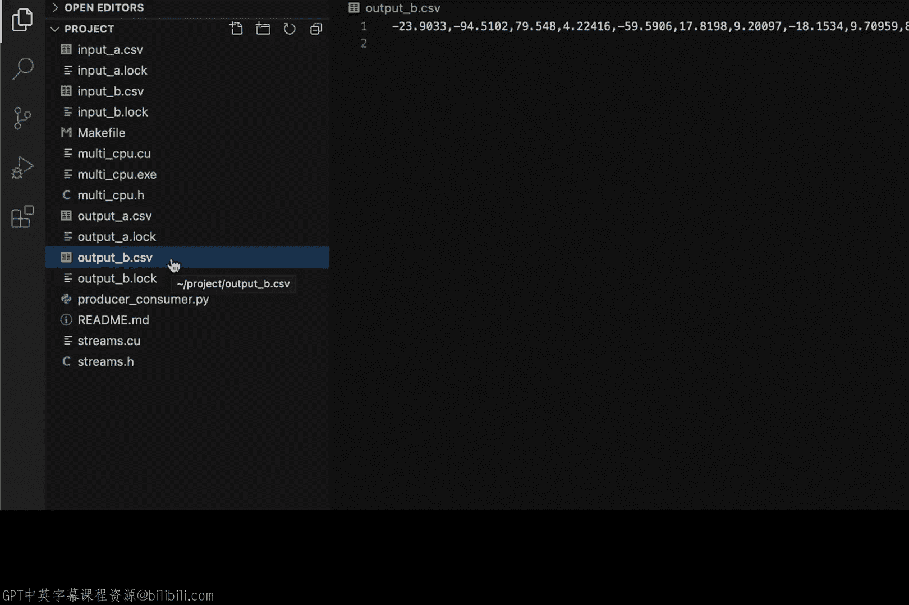

# 约翰霍普金斯大学《GPU编程（并发编程、并行编程、面向企业、CUDA高级库）｜GPU Programming》 p65 4_多CPU实验项目.zh_en -BV1a1421r7vw_p65-

Hello， I like to go over the first lab。For module 2， which is the multi CPUP La。

 there are some simple instructions here， but let's actually look at the lab itself。

So there are a number of files here based on。What state。

Your yourre running if your code is or writing of it， there'll be some input files。

 CSV and lock files and same thing on the output based on you know what of the different CPU scripts are running so just so you note the lock files are just used as a signal that something's being done there's not actually nothing in them。

 they're just used as a means for either the Python scripts that will be outputting。

A file with CSV content。 So floating point numbers to be compared so two。

Threads will be running and then they're going to output to CSV but。

They need to have a lock file such that your coa code isn't writing to them or reading from them at the same time。

 so it keeps things synchronized， same thing on the output， these tell the Python code。

 don't write anything until you see this lock file go away。And then you'll have your Cta code。

 so we'll go quickly over the producer consumer code。It's fairly simple， it outputs。To the input ID。

 which is the A or B。 you don't need to worry about modifying this。

 and it basically it will generate random numbers and output'll them to。The input input ID。

 so it'll be input underscore A， that CSV， and then a lock file。

And then it'll read back once content's written to it。😔，And then basically。

If you wanted to change this。What happens is you two arguments are passed its that。

Input IDd in our case， A or B， and then the number of elements。

 if you want to do larger or smaller data sets。So that's what run input A and run input B do for you。

The coa codes fairly simple， the main logic in the kernel is just the difference between the two。😔。

Items in the vectors that have been passed via the input CSVs。

There's some stuff here to allocate memory， both from the host and the device。

 then copying back and forth， and then the execution of。<|OTHER|>The kernel。

 which basically takes a number of threads per block and the amount ofadata it determines。

How many blocks need to be run？And then another point of interest is this place to files yet again you shouldn't have to modify this。

 this will just output to those output CSV files and then open and close the lock file and then retrieving does the same thing creates a。

A lock file saying I'm reading this。And then it reads it in and then it will once it's done reading things。

 then it' will remove all the output content。And then I'll right back out。

And then there's some content to code here to parse。Arays of floats， that past as strings。

 that's what the input CSV files do， so it just basically tokenizes it and creates an array of floats as opposed to strings。

And then the basic process by which this runs very similar to what you've done in the past。

 you allocate your memory。You retrieve your data， you copy it into the device。

 you execute the kernel。You get the results back out， you place them into files and on note。

 I'm using。Unified memory access at time， so there won't be copies back out necessarily from device to host。

I've simplified that a little bit， and then once that's done。

 you do the thing where you remove the lock for the input telling。

The Python code that it can read data， and then it's ready to output。

Its own random values back into the input CSV。 This can run sort of infinitely。

 That's what this while loop does。 It just will continually allow the Python and a code of multiple CPUs and GPU to communicate and execute。

Asynchronously， well asynchronously within themselves。

 but synchronize between them based on a certain pattern。So you'll build your code。

 run a input A and B， that'll just keep them going， and you'll run multiple CPU kuda。

 which runs this。Cud to file until you do control C， and that'll be the case for all these。

 they'll end up being in different terminals and you'll just have to go to them control C to stop them。

And then you can， what you can do is you can look at。

The output files and let's just let's first look at the output so 80。36 for one and 16。2019， so。嗯。

You're getting different。嗯。Output， on these are not necessarily synchronized at any point。

 so the comparison between A and B does not mean if you look at this file and。

The Python code is writing to this that these will represent the same value。

 they'll sort of be off sync， so when you end， that'll probably be the only time as long as everything's run and it hasn't restarted the' loop with Python that things will be synced。

 One thing you'll note though is that output A and output。B should be the opposite of each other。

 like negative of each other， and that's because it's the difference from perspective of A versus the perspective of B。

Hopefully this has been helpful， feel free to modify things you have a lot of options here。

