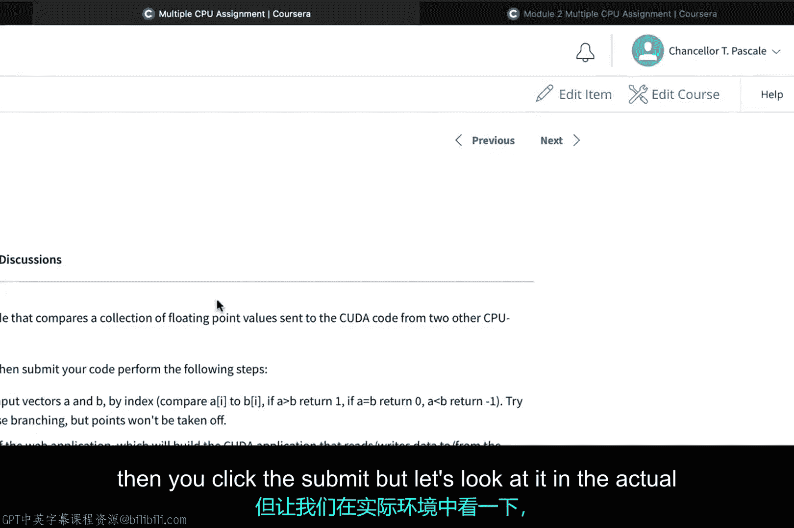
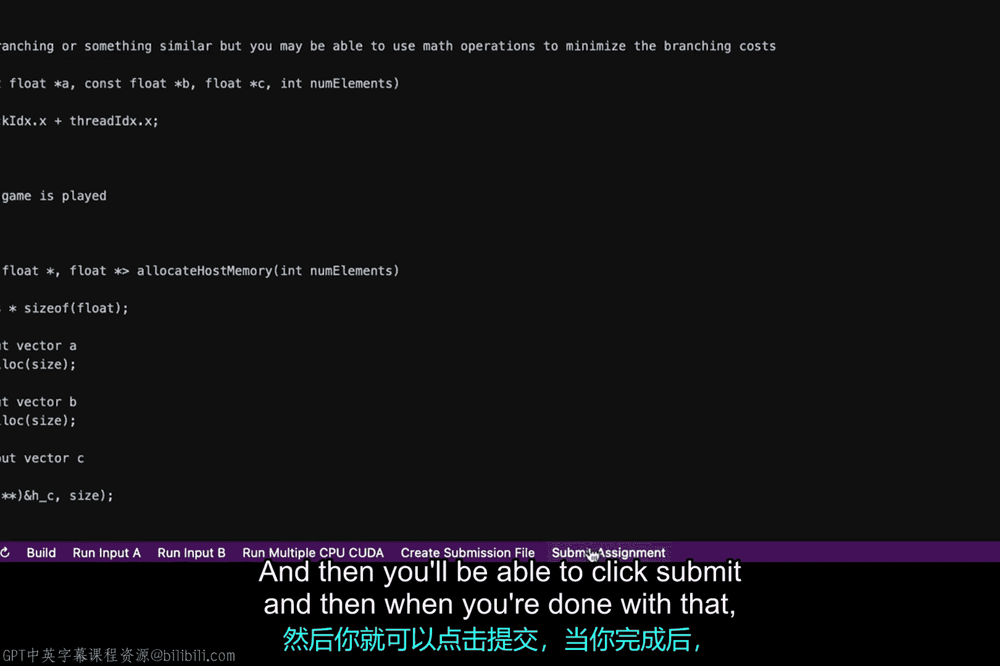
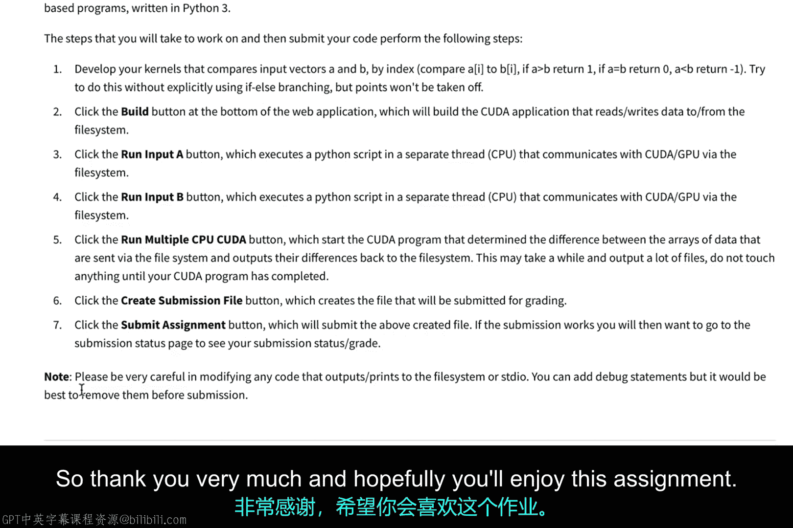

# 约翰霍普金斯大学《GPU编程（并发编程、并行编程、面向企业、CUDA高级库）｜GPU Programming》 p66 5_多CPU编程作业.zh_en -BV1a1421r7vw_p66-

Let's go over the multiC assignment for module 2。😔。

It's very similar in execution to how you did the lab， so steps two， three， and four， and even five。

😔，Are the same step one is just you developing a code。You might go from five back to one。

 you shouldn't have to modify the Python code， but you might want to stop the Python code running just so you don't get sort of。

You have a little bit more control over things though it could sit there and run。

 but if you do that you'll have to restart start from step three。And I'll go into detail about this。

The next two steps after you have your code running would be。Okay， it's run。Completely。

Click the submission file button which I'll show the important thing about this is I actually process the content of the output CSV files into a form that sort of brings everything together so it shows the whole of everything that's been run and then you click the submit button so let's look at it。

😔，In the actual environment。

So you'll see here as the multi CPU code there there's a lot of sort of commenting put here where you'll have to determine how you want to。

Alllocate code， copy data from files， execute the kernel。

 the kernel itself at the very top is slightly different than the lab in that the lab is just a difference whereas this is a comparison between the values。

In A and B， at specific indexes。So it describes it here and it's described in remi。

 but basically it's from the perspective of if a is greater than B， then it gets1 if a equals B。

Then zero is returned， and if A is less than B， the negative1 is returned。

 you'll have to do that here。I do really encourage you to explore。😔。

Doing this without conditional branching， but you don't need to。If you。

 the only way it's going to work is doing NFL statements， that's fine， but there there is ways to。

To return something like this， I'd even。To be honest， be fine if you return。You know。

 the one or zero or negative one or even， you know， the difference here， but then。

He basically said in the next step externally you wanted to process it or you wanted to subdivide this code up。

 but it's not required but it might be helpful， long term you don't want to do much conditional branching unless you have to。

😔，So as I said。Before we go into the code。These are the buttons that you've seen before the first four is create some submission。

File you can see it executes like a whole bunch of underlying bash scripting so don't miss with that and you know it'll end up with a result CSV file and then you'll be able to click submit and then when you're done with that you can go back to here and look at your submissions Currently there's nothing。

That have right now， I want to talk about something that's noted here。As always。

 be very careful with modifying。😔，Any print statement， Sir。Outputs to standard IO。That could affect。

How you're。Content your code is grade so really don't do that you can add to it。

 I would say still delete it when you're done， but I understand sometimes you need to add some debugging statements or you really don't want to have all the output that I'm output puttinging but make sure I put it back in there because some of those things are what is being looked at for grading。

So thank you very much and hopefully you'll enjoy this assignment。

