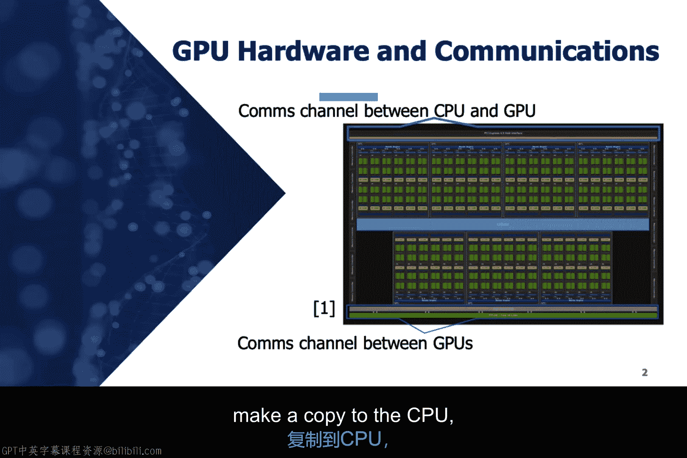
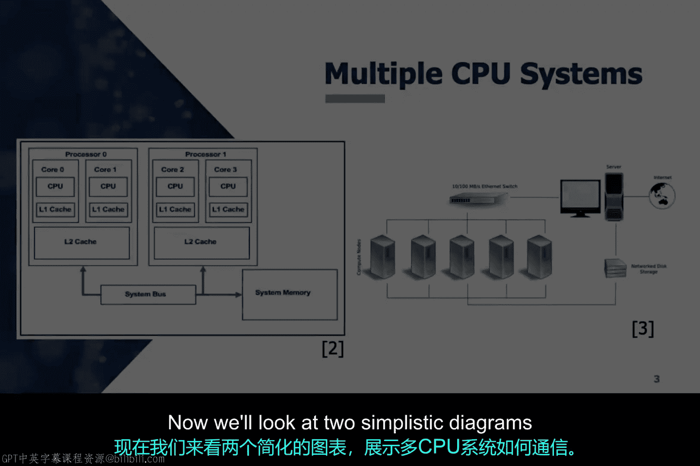
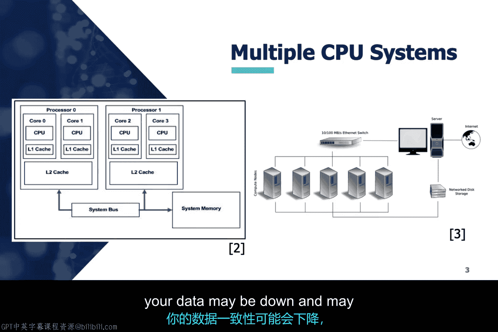
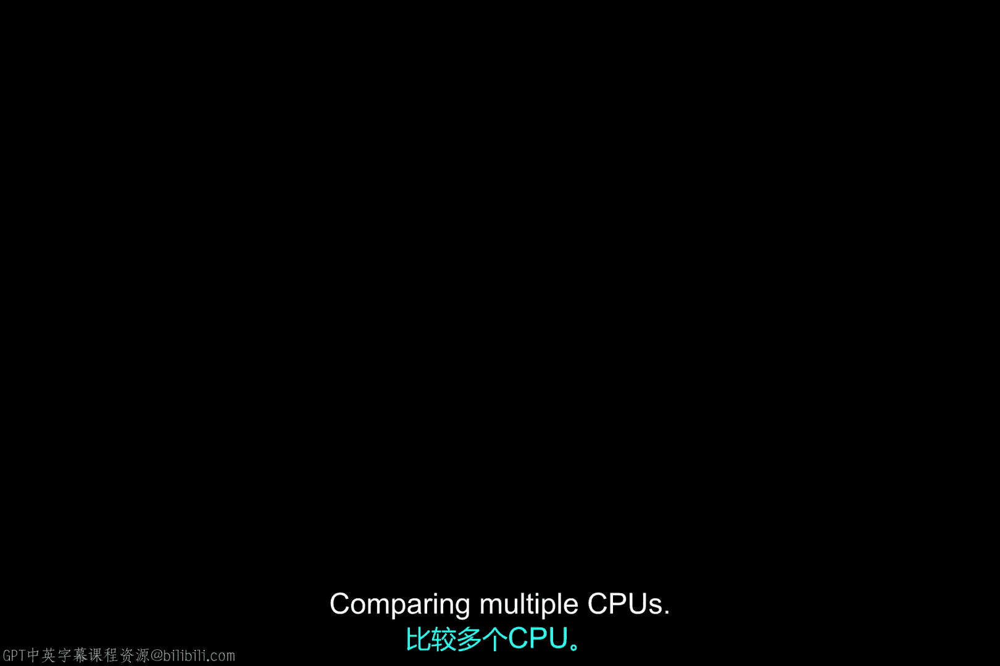
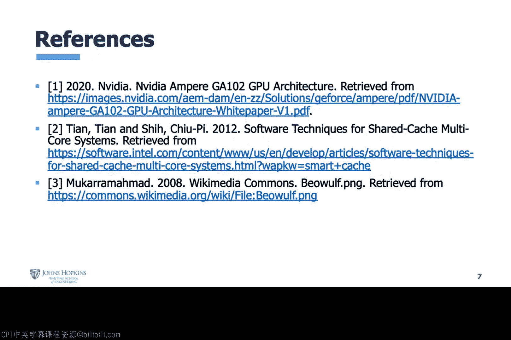

# 约翰霍普金斯大学《GPU编程（并发编程、并行编程、面向企业、CUDA高级库）｜GPU Programming》 p67 6_多CPU与多GPU对比分析.zh_en -BV1a1421r7vw_p67-

Now let's compare what we've learned in the past about multiple Cs。😔。

With what we could imagine a multi GPU set would be。

So we're going back to an image we've seen before diagram of a single GPU。

 and what you'll notice is on the top there is mechanisms for communicating between the CPU and GPU。

 which you use very frequently when you do memory copies。And at the bottom。

 something that you may not have seen or paid attention to。It's technologies like NV Link。That。

Act as a backbone to allow memory copies and communication between GPs as long as they're connected to the same bus on the same computer。

So that means you can do fast， almost seamless copies。

 so it makes that really a much better system because you don't have to go out and go make a copy to the CPU。

 go back to the next GPU which can really slow things down。

Now we'll look at sort of two simplistic diagrams of how multi CPUp systems communicate on the left is a diagram of。

Basically how a multi CPU multi core multi processor system works。

Possibly the laptop you're using or even the phone you're using。😔，So。

Basically CPUs on one or more core communicate via cache or the system bus， so it's fast。

 but it's determined as everything really by the distance in the copper that it's traveling upon on the right is a networked group of CPUs。

But at a higher level， so they communicate via network appliances like Ethernet switches across the internet。

 across intranets， things like that。You know， there's longer distances。

 there are issues with connectivity that you don't have being on the same machine。

 there are things that aren't necessarily all configured exactly the same。

 especially when you get the heterogeneous。Computing systems。 So in the left。

 you have better coherency， more control on the right。You have more power。

 you pretty of unlimited number of CPUs， memory， storage space。

 but the problem is you might not connect the same and your coherence of your data may be down and may take a while to get the complete answer to something。

Comparing multiple CPUs， like I said just recently， you have unlimited storage or memory。

You can do a lot of different things that are very complex。

 they don't all have to perform the same action and sometimes either you can move the data to where the computing power is or vice versa。

 you can say there's you know，I have this data and I'm going to run it here because it's closer。

 it can be costly to do calculations， you need to manage the network or however the Cs are communicating and the configurations between different。

Can vary widely。So with multiple GPU systems， some negatives are you have limited forms of communications and it's pretty much well defined ahead of time and everything does the same thing over and over again which is a positive and it means the cost is often lower。

And then， you know， if they're all in the same machine， the GPs。

 they can act sort of seamlessly and then the one last negative thing to consider is。

The calculations are limited by things like branching schemes or a more complex computing model。

 so it's not necessarily the best thing to do a few really large complex things it's much better to decompose a problem down but that doesn't necessarily make it easier for programmers hence you're in this class and I've been in similar classes before。

So what are the use cases？Multics work when you want to unleash like the whole world of computing at sort of a lower power edge computing level or just to because the data is everywhere you want to run your computing there if networking your different processor is easy。

 great， or if you have to do something it's really complex that is not easily decompposed on the other half。

Of things multi GPPUs can do lots， lots， lots， lots of simple computations and many problems can be solved that way。

 you can think of machine learning as sort of the main thing these days。

 Tensor flow and similar libraries break things down into these networks can be executed。

Frequently and it really can be very powerful if the computation that you're doing doesn't。

Get version that frequently doesn't change that much and if cost。And locality is important to you。

 you know where you're going to compute it and you don't want to spend a lot of money on a rack of computers。

 but you just want to put a video card in your system。

