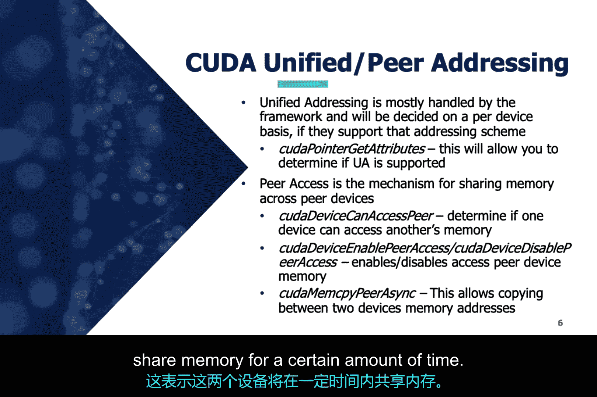
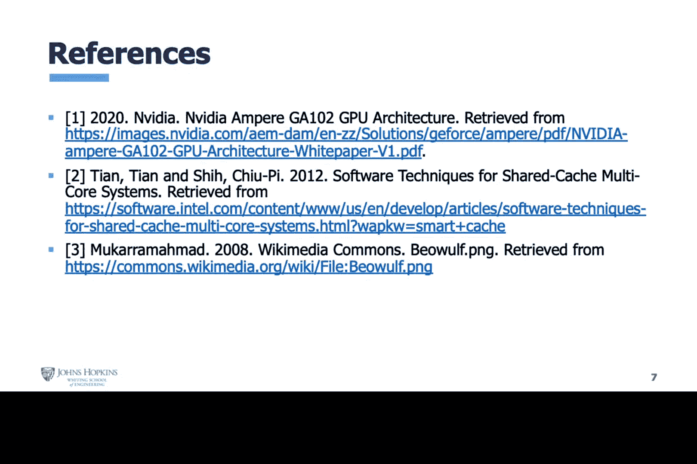

# 约翰霍普金斯大学《GPU编程（并发编程、并行编程、面向企业、CUDA高级库）｜GPU Programming》 p68 7_CUDA多GPU编程模型.zh_en -BV1a1421r7vw_p68-

Now we're going to talk about the computational model。😔，For multiG systems using KUDa。

So KudDa has a device management system that works whether you have a single or multiple devices。嗯。

The device you may want to decide between them based on naming conventions， versions of hardware。

 there's a lot of underlying methods that exist there。

 you can query based on properties like the amount of global memory。

 the speed of different types of memory you will also have the ability to set up interproces comms。

 which means that，Processors on different GPUs can communicate with each other。

 and then there are some schemes， methods that allow you to use one addressing scheme across all your GPUs and actually even across your CPU to make it easier to do just say you want to specify memory and you don't have to worry about where it is。

 the Kuda architecture handles it itself。One of the first things we're going to want to figure out is which devices do you want to use now if you're using a single one。

 you can do this by default， you don't have to specify a device。

 but if you know you have multiple or if you want to find out if you have multiple you can use co to get device count。

 which will give you a number of the number of devices then you can say give me the properties for this specific device and based on that。

Let's get that device that returns the index that you'll need to use to utilize a GPU when you're running your kernel Next。

 based on that previous information you have， you can choose a device based on matching certain properties such as the amount of global memory or you can set the device based on a very specific ID。

You can also set multiple devices and let Kuda handle which is being executed with which kernel that can be great or that can be an issue if you really do expect them to be on the same machine and share global memory if you're not using unified memory。

Now let's say you've set up multiple GPUs， what you might want to do next is share a memory handle。

 so you have to open and close it， that sharing a memory handle means that processes on different GPUs can do inter processed communications using that handle and other thing you can do is you can create events that are on a shared stream between GPUs。

We'll learn more about events as this course goes on， but they can be powerful。

 but sometimes you want to share actual data， which is what you do using the memory handle functions the last major chunk of functionality is using unified addressing or peers。

For the most part， unified addressing is handled by the framework see relation worry about it too much。

TheOne thing you might want to do is if you're。In using different versions of Kuda or different hardware。

 and therefore different versions of Kuta may need。To be used。

 you may want use this kupa pointer get attributes and ask specifically about。Unified addressing。

Let's presume that it says it's fine， you set up multiple valid devices， you start up kernels。

 then you can give access to peers。Based on I'm this ID and this is the idea of the。

Device I want to add as a peer that's done via the coa device enable peer access and you can disable it using that other method。

 you can find out if you have access to appear by using the KUDa device can access pi and then once you have you know you have the two devices。

You can say， I want to do a Mm copy between them using KutaMm copy Pier Async。

 which says these two devices will share memory for a certain amount of time。

