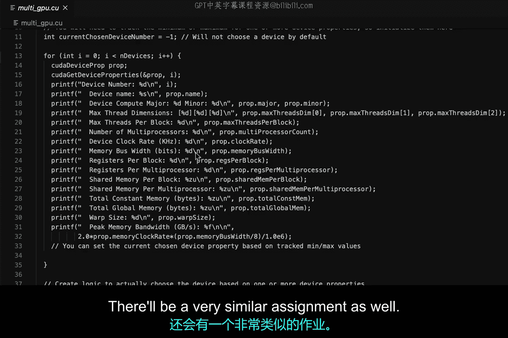

# 约翰霍普金斯大学《GPU编程（并发编程、并行编程、面向企业、CUDA高级库）｜GPU Programming》 p69 8_多GPU实践项目.zh_en -BV1a1421r7vw_p69-

Now we're going to quickly go through the multi GPU or GPU identification laboratory activity。

There are only two steps aside from messing out the code as much as you want to。

And they are to click the build button。Which runs make clean build。

Which will generate the multi GPU do EX file from the multi GPU。t C file， and then run， runs it。

 and outputposts it。It to output that Tx day， so let's open that up。

So this is the output do Txt， let's go on a little bit reverse， this is what you want to see。

 it says the number of GPUs。😔，And that gives the statistics for the number of for that index of GP device。

 and remember it's indexed by0。 So device number0 is the first。Devicicees available。

 there are multiple。😔，GP， you would see two or more as the number of GP here。

 I then you'd see this repeated over and over again。 Note that I output。The chosen GPU device index。

 which we use in。The assignment。<|OTHER|>So the code's pretty simple， basically。

 I needed to outputput the number of devices into。I set the chosen device number。

 which by default is negative1。And I create a loop to go through all the devices that is set in this。

Could I get device count？To get the properties I usually could I get。

Dvice properties and place it into a coed device prop。Value。

And so I am looking for certain things that are more than this。

 but these probably the most important properties， so I spit them out。You can determine。

If you want to choose certain ones by setting a min and max。Outside it and saying， oh， okay。

 this met the minimum。Right。Cut a compute version， or it has this number of threads per block available or something like that。

And then。Once it's done， you can find the best fit or all that fit in some mechanism。

 We'll leave out to you， and then you could。Choose it and then you can say which one you chose。

 and of course you can then execute kernel and it would run on that。

So that's pretty much all there is to this。😔，Lb activity， feel free to you know。

 look at some more properties are all documented in the couta。

Toolkit documentation and think about ways you would consider choosing between multiple GPs。

 You're not necessarily going to be in that situation。In this case。

 because the lab environment only allows you to have one。Device at a time。

But the logic that handles multiple devices and chooses one should always work for the single device。

allowow it to be flexible because of course you're not necessarily going to have。Many。😔。

Devices in certain environments。So just keep that in mind， this is the activity。

 there'll be a very similar assignment as well。

Hopefully， enjoy it。