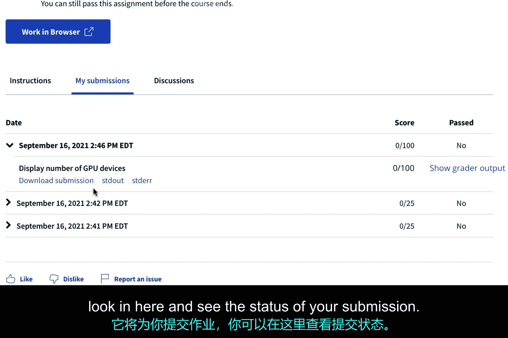
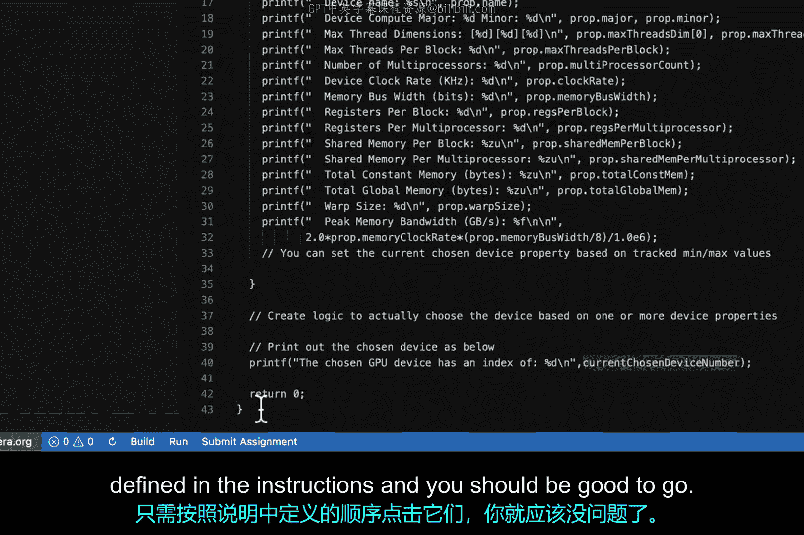

# 约翰霍普金斯大学《GPU编程（并发编程、并行编程、面向企业、CUDA高级库）｜GPU Programming》 p70 9_多GPU编程作业.zh_en -BV1a1421r7vw_p70-

Now let's go over the assignment for KUa GPU identification or multi GPU S。😔，So there's four steps。

Write your code or update the code that is in multi GPU CU。Click the build button。

 click the Run button， this will build the code and then run it。😔。

And then once that runs successfully， just look in your output do。TXT folder in your project。

Root directory。And then。😔，We can click the submit button。It will submit。Your assignment for you。

 and you can look in here and see。The status of your submission doesn't look like I'm doing that well。

 I guess back to the drawing board for me。

So now the code isn't that much different than what you've had before no note I don't even have。

Anything for setting up the kernel or anything like that。 that'll be up to you。

 I'm going give you full freedom to do whatever you want there。 The most important part is that。嗯。

You create a mechanism to choose。😔，Which device you want based on any of these properties？

<|OTHER|>And then you're going to set that device，'re then you're going to set it both in this variable。

 but also use this variable when you're setting it for the kernel to execute。And then。

This will print out which kernel， I'm sorry， which GPA device you're going to use。Note。

 don't mess with any of these print statements here。Used as part of the grading。

 you'd do some logic in there to determine which。Colonnel is being executed。

 which device is being executed based on this information， you can add more to it。

 I do my search intelligently。😔，So the buttons that I mentioned before are the build。

 run and submit assignment button。Nothing too special here。

 just click them in the order that they're defined。In the instructions and you should be good to go。

