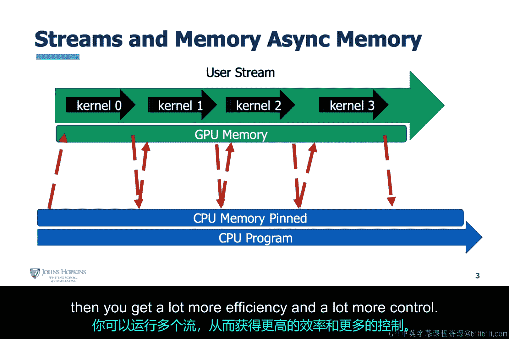
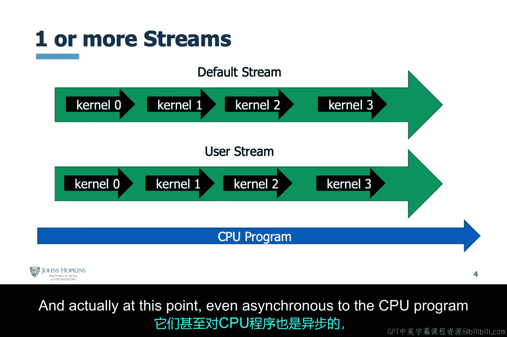
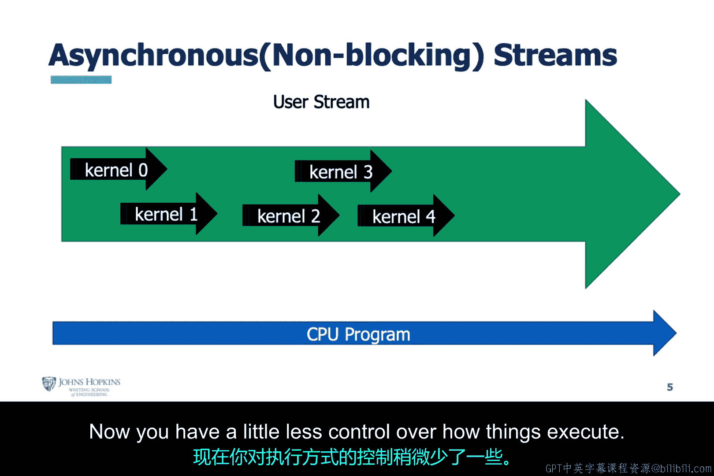
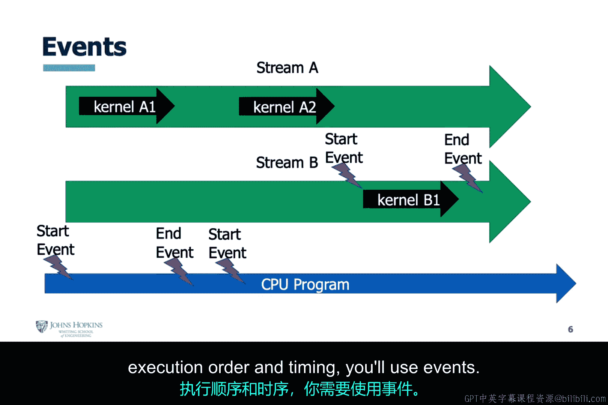
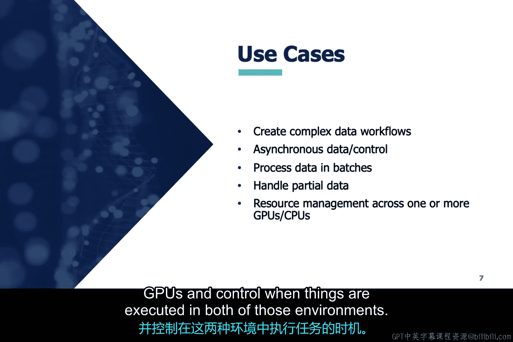

# 约翰霍普金斯大学《GPU编程（并发编程、并行编程、面向企业、CUDA高级库）｜GPU Programming》 p71 10_CUDA流与事件机制.zh_en -BV1a1421r7vw_p71-

Well， Holo， we're going to talk today about。Streams and events and how they work in Kuta。Up till now。

 this is what your stream programming looked like。 You use the default stream。

 All kernels are executed by default on this stream， and may be used pageable memory because。

It was a little bit easier to use from a certain perspective。

 what this meant was that your CPU program copied data into pageable memory。

And then when you wanted to execute。Your colonel， you had to copy that into dev memory。

 while to do that， it went through pin memory。And then on to GPU global memory， we're into。Symbols。

 textures， etc。The streams， once they got that starting call would continue。

 but each of them hasth to execute in sequence， and each of them goes through sea few memory that's pinned。

To get to back to your program。 So that's not necessarily efficient。

 It's very for being somewhat paraed within a kernel is very。Synchronized between kernels。 Now。

 your CPU P program can keep on going。 It doesn't wait unless it's told to for the kernels to end。

 So in that respect， it is asynchronous。 It's just not optimal。

 So now let's streamlined a little bit。 Sorry for the。Double entra there。

 But now you want to create your own stream。 What is referred to here as a user stream to do that。

 you need to use pin memory。And copy directly between this pin memory and the GPU。 Now。

 kernels still execute sequentially on a single stream。

 but you'll soon see that you can run multiple streams。

 and then you get a lot more efficiency and a lot more control。

Now， with multiple streams， you can use a default stream without specifying a stream along with using your own defined stream。

And let's just not show the memory copies because it's redundant。

Now you can have sort of two times the number of kernels running。 You may get more efficiency。

 It's not going to be linear。 It's more like when a kernel is。Has a cache miss。

 there's nothing else for any that it threads to do then it gives the other stream more power。

 So note that these two streams operate as now without events completely separate from each other and asynchronous to each other and actually at this point。

 even asynchronous to the CPU program to gain even more asynchronous capabilities in your streams。

 you can define them as non blocking。

That means you can specify a number of kernels on the same stream。And while they are running。

 if there is nothing for a stream to do， it will move to another colonel。

And then it'll make sure that the original one completed。Now there are limits to this。

 just like there's limits to a number of streams that can exist。'm using the same GPU。

 but yet again you're getting a little bit faster you're being a little bit more optimal now you have a little less control over how things execute so that's where events come in The purpose of events are to start and complete actions so you say okay stream a start。

Which then tells the CPU2。😔，Stop， wait for an end event from that stream or kernel。

So then what you can do is then string these along to control not just when the CPU executes and when it starts in subsequent kernels。

 you can have streams， have events that go between them that create dependencies and a stream and a kernel on that stream will not start until that's completed。

 If you want to have control over your streams and your CPU program execution order and timing。

 you'll use events。 some major use cases are waiting for a live data to come in and batch。

 send it to a kernel or conversely use stream processing， not like this， which is stream programming。

 but stream processing to send partial or small amounts of data continually to different kernels。

You can control。The way that different things execute you can create workflows that are complex。

 let's say， execute kernel0 then one then two on these different streams and be efficient。

 but sometimes fan out and bring it back together， it also helps you manage resources that are on multiple Cs or GPUs and control when things are executed in both of those environments。

