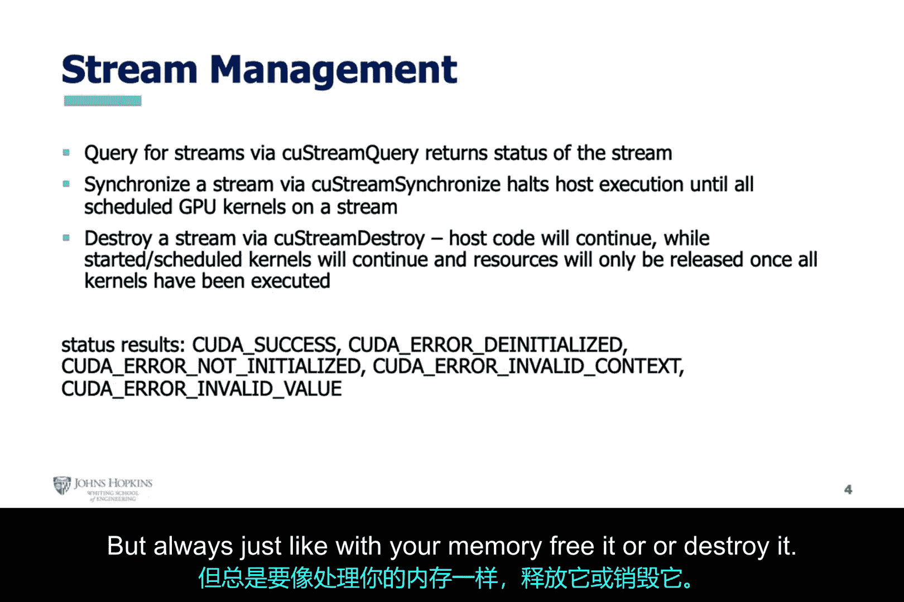

# 约翰霍普金斯大学《GPU编程（并发编程、并行编程、面向企业、CUDA高级库）｜GPU Programming》 p72 11_CUDA流语法解析.zh_en -BV1a1421r7vw_p72-

Now we're going to go through the syntax for kuda streams。Regardingre going to。

Figure out how you create streams， how you manage memory in streams。

 and how you manage streams in general。So to instantiate the kudo stream object， you just。

Create it with a name。Now there are three ways to create streams。You can。

Create them just by the variable， you can add flags。

 which will allow you to make it non blocking with respect to the CPU or blocking。

So whether you want the CPU to continue on or not。And then you can create streams with priorities such that。

The actions that are done， those streams themselves are given different priorities so you can actually over specify the number of streams if you want。

 and then the priority will bring them into being as you need。Then the next thing you'll want to do。

 possibly especially if you have very complicated workflows。

 is to create streams that have callbacks and what that means is the CPU can continue doing whatever it's doing and when that stream is completed。

That callback will be called， so that's a function pointer。In the CPU， so when it's done。

 it doesn't matter what it's doing， it will call that function。So， memory used。

By streams has to be either pin memory， as we've previously discussed or using unified addressing memory。

 so addressing memory across all the devices。You can attach a stream to memory asynchronously。

 which means it'll just be available at the point when you attach it as opposed to a copy。

You give it the stream variable， the device memory pointer， the length and the flags。

 and the flag can say it's available to all devices， all streams。

Or you can say it's only available to the host， which is useful for doing things。In the background。

 that are not visible necessarily to global memory on the CPU and then to a single。

Stream on a specific device， which is a default。Now。

Allocating memory using pin memory uses Kuta Malikhot if you're dealing with the runtime API or CoumMMalhot for the driver API。

Unified addressing uses the kuda malic managed。Function。

 and if at any point you want to make an asynchronous memory copy。In either direction。

 you do kuda mem copy async， you give a device， the host pointers， memory pointers， the size。

 the type。 So that's kuta like for kuta， that could be device to host， host to device。

 device to device， host to host。And then the stream that it works on。

So let's say you want to manage the stream。They've created。😔。

So the first thing to recognize is that all the stream management。APpiI calls， returnturn a status。

 so there's one statuskuup to success for when a stream is completed。

Or a series of error statuses that relate to whether it was initialized。

 did it have the correct context， things like that？

So if you want to find out if the status of a stream， whether it's completed or not。

 you use KoStam query with the stream variable and you get whether it's completed or not。

If you want to synchronize host execution。So stop it and wait for a stream to be completed so all everything that's been scheduled up to point to be completed。

 you would use the co streamam synchronize function。And then the last call。

 you should always use this。Is to destroy a stream。

 even if everything is' running it on it's complete， you want to exit， always call co stream destroy。

Because it lets everything continue， you can call it a point and anything that's been scheduled at that point will continue the only thing of note is that the host code is going to continue and if you're not doing an asynchronous memory copy at that point that last。

 you know everything that's been scheduled and still going to run。

You're not going to have access to that memory。Necessarily， so keep that in mind， but always。

 just like with your memory， freeray it or destroy it。

