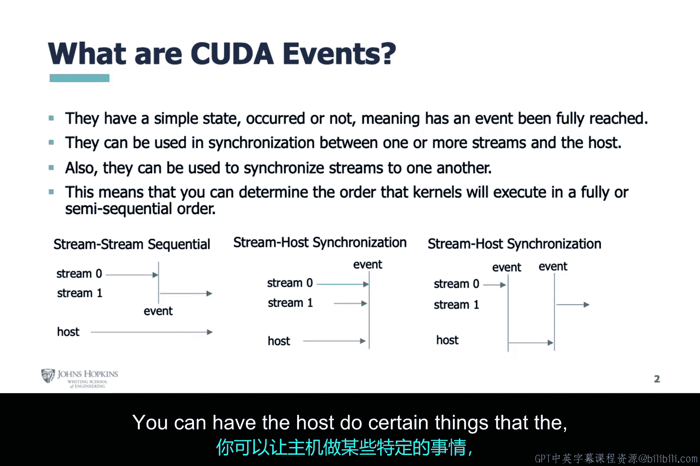
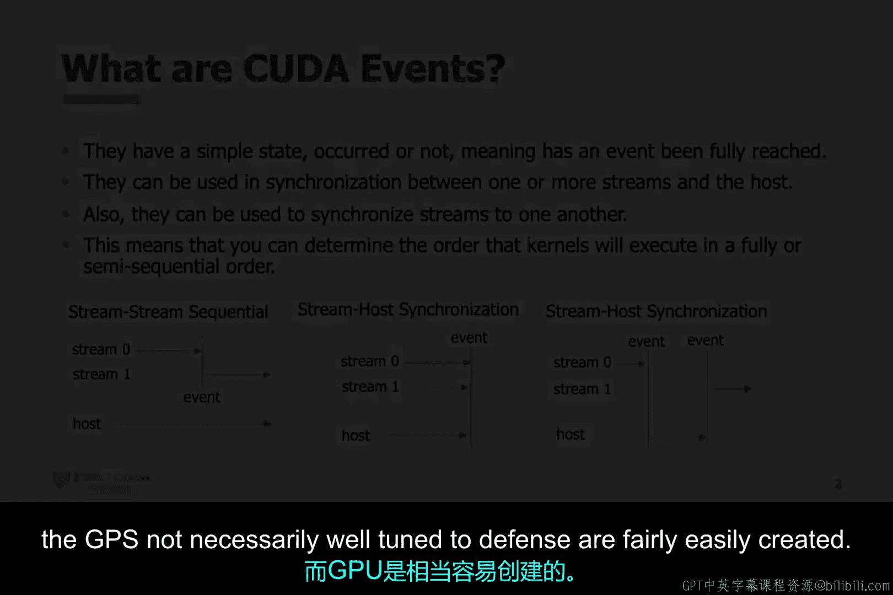
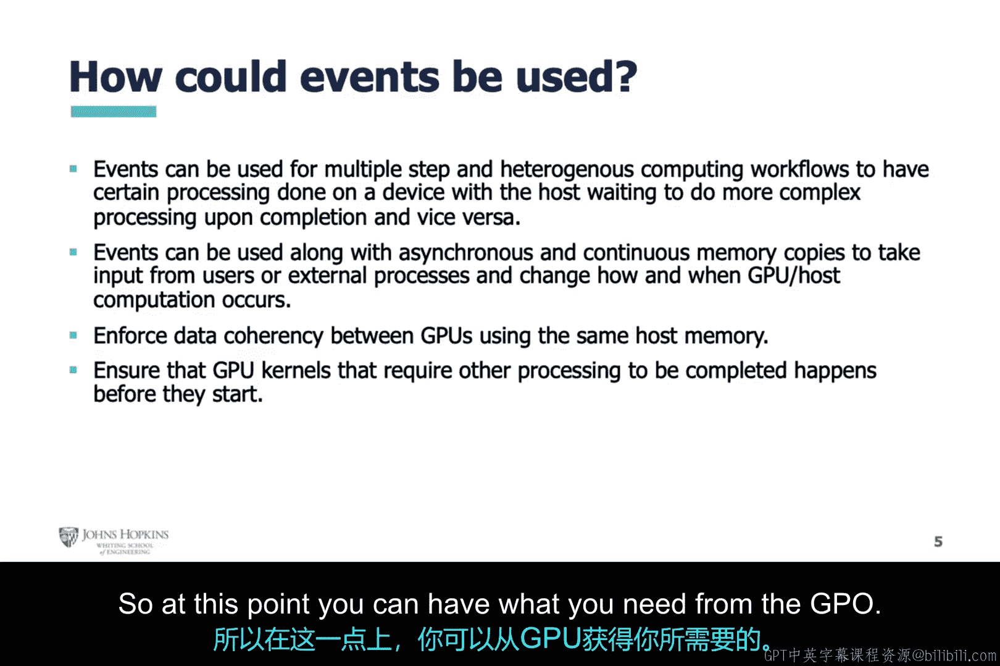
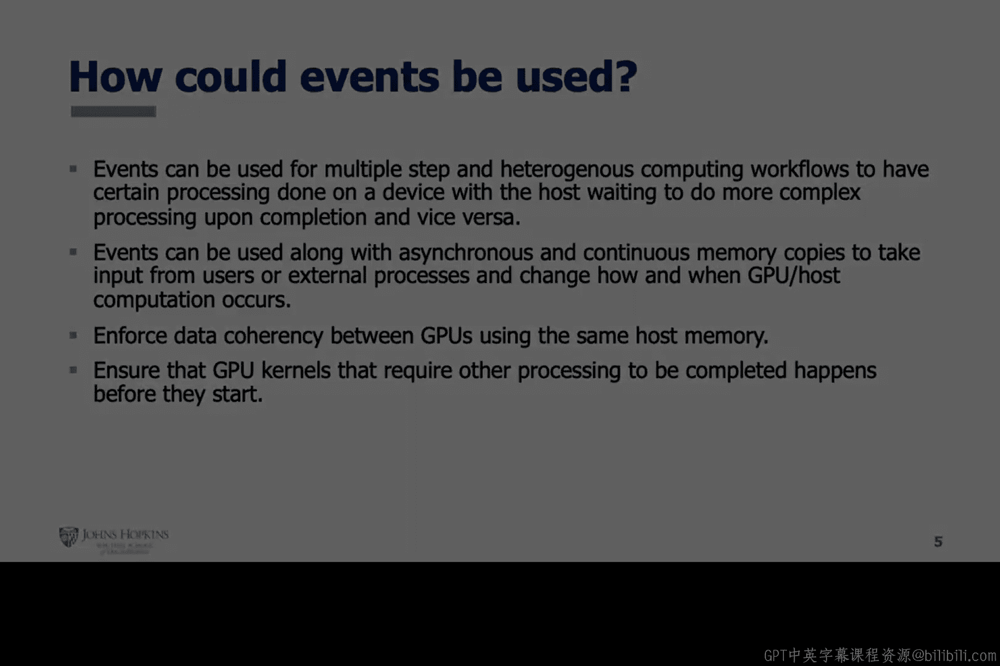

# 约翰霍普金斯大学《GPU编程（并发编程、并行编程、面向企业、CUDA高级库）｜GPU Programming》 p73 12_CUDA事件语法详解.zh_en -BV1a1421r7vw_p73-

In this lesson， we're going to go over how to utilize events。😔，Via the KUuda Event API syntax。

Streams in Kuta have a simple state There either have occurred or not。And when we say occurred。

 that means the event has been fully reached， so you set an event， but in reality。

 it's only occurred when say stream is reached that point。

They can be used to synchronize between streams， between the host and the stream。And you know。

 this really gives you a lot of control because you're allowed to control the order of streams now note that within a stream。

 what you've ined to be executed or scheduled to be executed as far as kernels，Between those events。

There's not a lot of control。Between streams or from the host。

 you in queuee them and they're executed in that order。

 maybe if you set them as asynchronous non blocking。

 then they will both complete the order that they complete will generally fall along the lines of this started and then this goes and then this goes now their order execution。

Or like when the next one starts does not have to right after one completed， it can be in the middle。

So here's some diagrams of how sequential stream to stream events can occur。

Using events as sort of a synchronization point across one or more streams。

Or a nice thing you can do is you can use events。To have a process by you start one stream。

 it completes the event fires， the host does some action。It then Cte starts an event that。

Starts the stream， another stream possibly running。

 and so you don't have to have things piled on top of each other。

 you can have the host do certain things that the GPU is not necessarily well tuned to。

Fents are fairly easily created， there's two steps。

 you instantiate the variable using the Kuda event T。Syntax。And then you create them。

 which actually creates them on the device and references them on the host using passing that event they've previously instantiated。

Now note you can use Kudastreamream synchronize for events。That's like a replacement for events。

That just holds the host for completion。But this allows you to synchronize a specific event and on a specific stream。

 we'll get to that， but just note that events are a little more fine tuned than。

Synchronizing a stream or blocking the host。Events are recorded or marked as not occurred via the coupa event record。

 so that basically says。Place this in a stream and I'll reference that later。When say。

 a kernel' is completed or a streams。Completteed up to that point。

I then you can query the state of an event and then the nice thing is that could allow you say， okay。

 it's still running， let me do something else。IYou don't necessarily have to have a tight coupling。

I want to make sure this is done， maybe you want to make sure you get like you need a ton and then you can either stop that stream or you can do something else based on that。

You can。Tell the Kuda stream to wait for an event。And that's just says once。I've set this。

 you will everything that's been in queue and all the kernels will wait till they've all been completed。

And then。And then the host can continue doing what needs to do。

Event synchronization is done via Kupa Even synchronize。Very unique naming。

 and that blocks the host for an event。And that means that。

All stream actions at that point have to be completed before the host can continue。

 so it is similar to other stream and general kernel synchronization capabilities。

It's very coarse grain at that point。So what are some of the uses of events in Kuta？😔。

So they can be used to synchronize data copies， make sure you have coherency in data before certain kernels are executed。

 you can wait to start a stream entirely based on an event。um。You can say， oh。

 I want this done by the host。But I need this， you know， I need this to be completed。

 I need to make sure there's a maybe a continual asynchronous copy of data the to the host that it does some processing so you can have sort of like。

I don't know， like sort of a mash up of all these different things running and you're not concerned with always having correct。

Coherent data， or maybe you really need to have that but of complex interwoven processes。And then。

Basically you can also say I need this stream in these kernels to be executing with the full power。

 or you can say I know that I'm only going to be allocating so much of this processor so at this point you can have what you need from the GPU。

