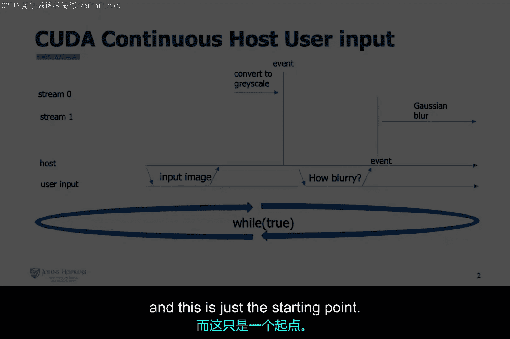
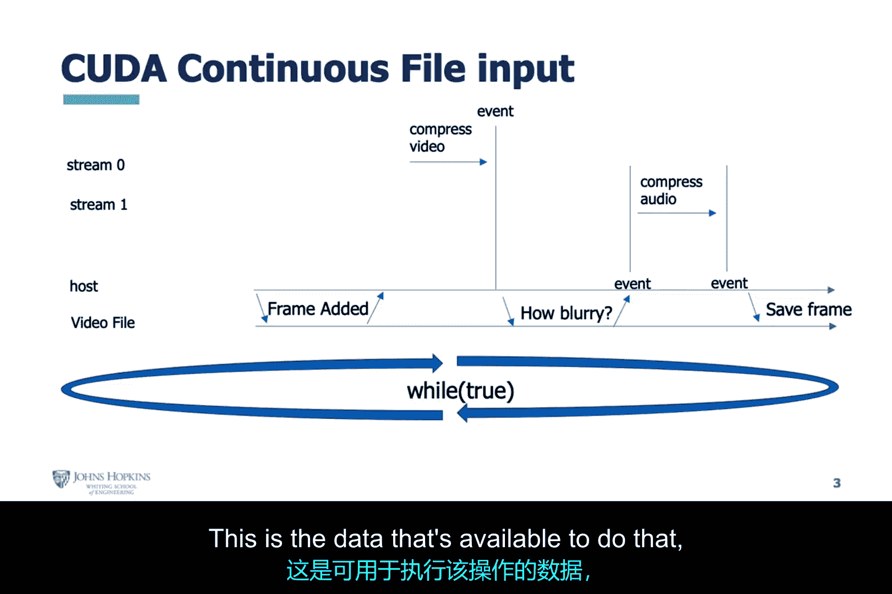
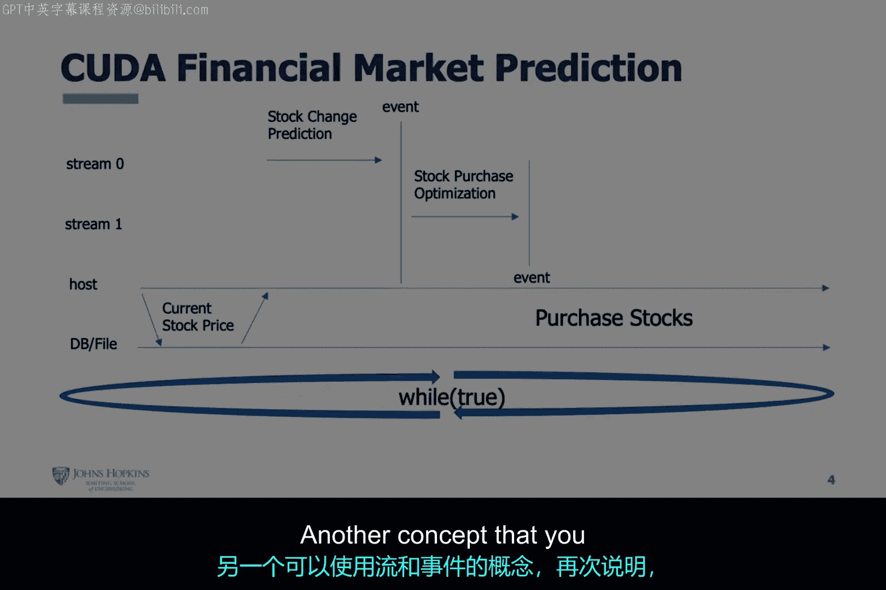
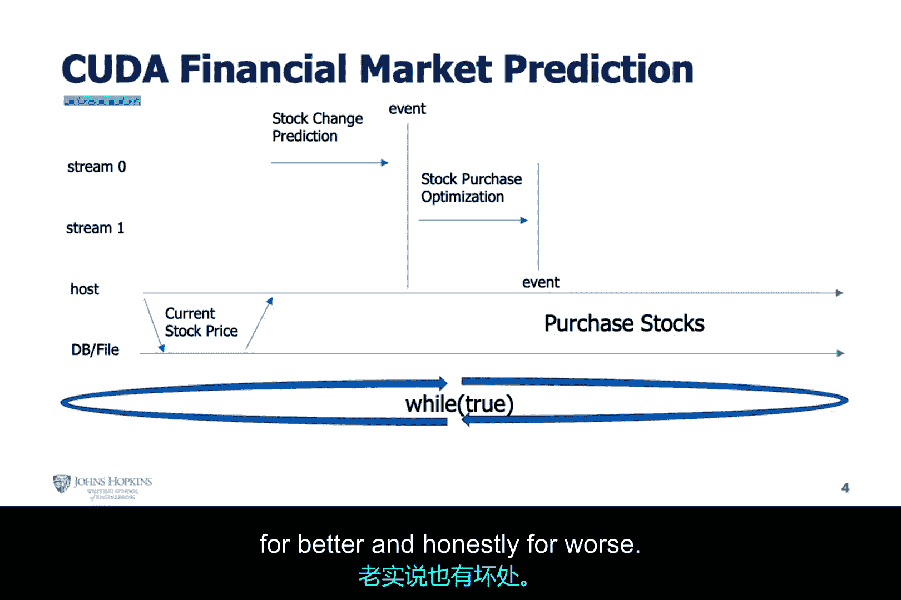

# 约翰霍普金斯大学《GPU编程（并发编程、并行编程、面向企业、CUDA高级库）｜GPU Programming》 p74 13_CUDA流与事件应用场景.zh_en -BV1a1421r7vw_p74-

In this lesson， we're going to go over some。Event and streams use cases， three major ones。

 just to sort of get your mind thinking about this and how you could use it， you know。

 there's not infinite， but there are a great number of ways you can use this and this is just the starting point。

One commoning use case using streams and events is。

When you have user input that's needed on a constant basis， maybe。

You're asking the user what's the image you want to process now and you know they type that in and when that's done you start a stream that converts it to grayscale。

 maybe you're in a orepia or some nice thing you don't really need to have the host do anything so you can sit there and wait for an event。

That is the completion of that conversion。Then you can ask。The users say，Do you want it more blurry。

 do you want lens flare， do you want mosaicing， any number of things？And the user says yes。

 no or some value and then that event。Once it's done， kicks off。

The Gaussian blur or something like that and then when that's done there's something that I don't know。

 puts it on the web or you know just puts it in the file system and this can keep on happening that's what this wild true sort of double loop thing is saying it's like continually I'm going to have user input and I can continually sort of synchronize and asynchronously。

Do different processing on different parts of the CPU and GPU。

A very similar use case is when you're not asking the user。To do anything。

It's just the file system may only have access to， say， a frame of video edit。Every so often。

 you want to compress the video one。Stream and you want to compress the audio。

 you have like highly tuned video and audio processes on streams now。Honestly。

 you could always be looking for a new frame in that file and you could even say， okay。

 I don't mind wasting。A little bit of processing， you could just you know。

 run that same compression algorithm or some other effects continually。

But the bad part about that is you management of that file system and when something's done might be an issue。

 you can use events to sort of time in when things are being done。

 make sure that there's no writing of files when one's being read。

 that's when events are really good for， especially if it's like a lot of processing。

This is a good tool for that and then basically you do different steps and I say how blurry but you know it doesn't necessarily it could be like what's the end file size that you want and thats brand it saves it so not that different it's just an interruptd process that okay I need to do this this is the data that's available to that but I can't modify this until I've done this。

So another concept of how you could use streams and events and again。

 I'm not you a financial market predictor or didn't write any large systems that do this。

 but I've had students in the past that have and haveve used coUa events in the streams so what？

The streams can do is they have different roles right one does prediction and one says， okay。

 what's the best thing to buy at this moment and what it needs to know is not。Like， okay。

 I'm going to wait for all these， you know， the end of the day And once the constantly I be determining should what's the thing is's going to go up the most or go down the most that I can make the most money on。

 So I predict the change and I say， okay， based on all the change on the current state of hundreds。

 thousands of stocks， commodities。What would give me the most bang for my buck？So。

know first stage does the prediction that on that stream and the second stage says okay。

 you know based on some modeling and simulation what would give me the most and how long should I hold on to it and that's done via events and then honestly you purchased stocks and that has some effect on the system makes it go up or down a little bit and actually there's a whole stream of or。

Seet of financial market applications that even take advantage of how quickly you can make purchases and predict change and actually influence the system。

 as we've seen for better and honestly for worse。

