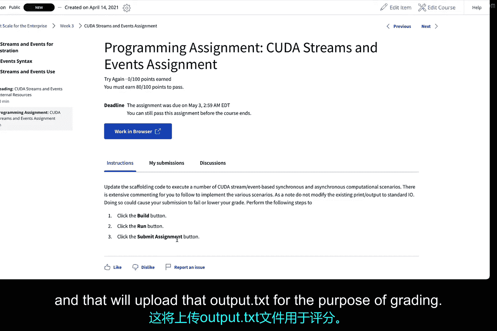
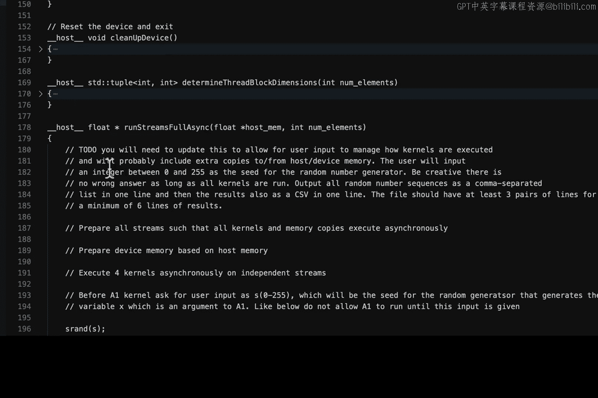

# 约翰霍普金斯大学《GPU编程（并发编程、并行编程、面向企业、CUDA高级库）｜GPU Programming》 p75 14_CUDA流与事件作业指导.zh_en -BV1a1421r7vw_p75-

So I'm going to walk you through the Cuta streamreams and eventss assignment。😔，There's。

 not much to know aside from， you should really follow the comments and I'll go over that。In the。

When we look at the assignment code itself。😔，But there are three major things that you'll have to once you're done running your code。

 you can build it and run it as always with the build and run buttons。

 there's make capabilities for doing this as well and once you're done with the code and you feel confident about your output。

 TxT having the host inputs and outputs represented so you should have six combinations of those are three pairs。

Based on which scenario you're running at a point。You're going to want to click to Sub assignment and that will upload that output touch DXD for the purpose of graiding。

 so let's move on to the code。😔。

So the main structure of your programming assignment has three major parts。

 There is running false asynchronous streams。 There is running a blocking kernel。With two streams。

And then there's an optimized version of blocking the kernel。 So remember。

 fully sync means that anything running on your streams will run independent of each other and independent of。

Your CPU program。Now when you have a blocking kernel。

 that just means that the kernels may have vent that synchronize between them and the knifeive versus optimal means if you aren't thinking necessarily of optimizing。

Your kernels and streams， versus using。Events optimally。So， one。

M to think about here is this printhot memory do not modify this。

 This is what is executed around each of these stream execution scenarios that you'll be building up。

 and so this is actually used as part of the grading process。

So there are sort of three scenarios with each with a function。

I have lots of comments about all the steps you should take， like in this full async stream。

 you know you have to do things prepare memory， preparing the streams。

 then you want to execute all the kernels， which we'll show in a second asynchronously on say two different streams actually the number of streams doesn't matter。

 but two should really be your sweet spot because certain hardware may be able to accept more。

Others have a maximum of two， but always have two。And then I actually discuss specifically what should be done in each of the cases using A1 and V1 and we'll get to the kernels in a second。

Actually， while we're at， let's go up there and we can go back to the scenarios。 So are four kernels。

 there's a1。Which， basically。Adds a value from the outside into。All the variables sorry。

 values in a floating point， array。Then， there's。😔，For each of the。

Ements in the array up to a certain value。 you're going to。Put them to the power of two。

A2 will' subtract the value and yourll notice is。That B2。Dividedes and that number of times。

 So this is very similar。To what you've seen before。

 or we're taking a certain block of memory and we're multiplying it by two or dividing it by  two。

 and they're paired up A1， B1。And。So there's different ways to execute them and the resulting memory may differ。

 so just follow the scenarios and you'll just see different values and that's fine。Okay。

 so the second。Function slash scenario is the Run streams blocking kernel。

 two streams naive right here， Ill almost point out the wrong one。And it says， you know。

 execute to the kernels asynchronously and then you're going to execute the other ones so you。

Aren't doing anything optimally just saying I want to use events to execute things in a specific order。

And actually you can do some of this。Using synchronization outside of events。

 but events are really what you want to do。So yeah， you run two different kernels on the same。

On two different streams， then you can do it again on two different streams。

And then the last one is optimal， and I describe how to make it optimal。

 and that just is based around the fact that。You are're synchronizing between those streams because you could have a situation where you not you're synchronizing between the host and the streams and not the streams himself。

 you could have sort of unintended ordering issues occur。

Make sure to read all the sort of copious amounts of comments I have and note like okay。

 prepare all the streams， I'm going to look for that method， prepare device memory。

And so you have functions up here， which I'll go over quickly。Braicating device memory。

You've seen this before， nothing special here。Allocating host memory and one thing to note here is that you're using pin memory。

 which is a requirement， you could also use unified addressing memory， but this is just as easy。

And then doing copies both synchronized and asynchronous in both directions。

 so note that those copy schemes exist and you should of course tie if you're doing the fully asynchronous。

 you should be using the asynchronous copies if you're doing synchronized copies。

You use the synchronized version of these copy functions。

D allocatecate memory and cleanup memory is normal。Function to determine based on your the inputs。

The number of blocks that need to be run。And things that say。

 so you'll figure this out the thing to know is I don't。Prepare the streams for you in code。

 you'll have to do that yourself but you have a very good example。

With your lab to prepare you for that， so hopefully this has been informative and you enjoy your programming assignment。

