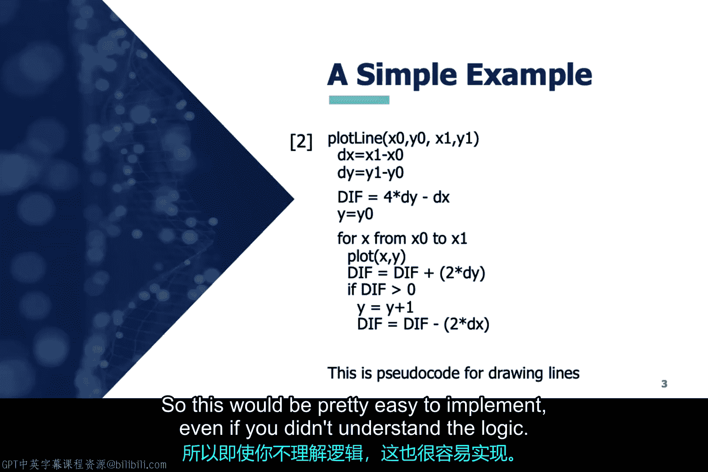
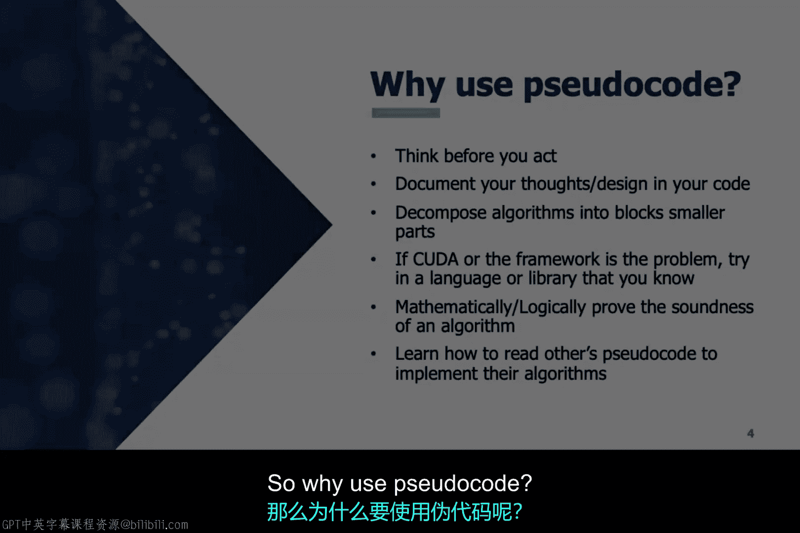
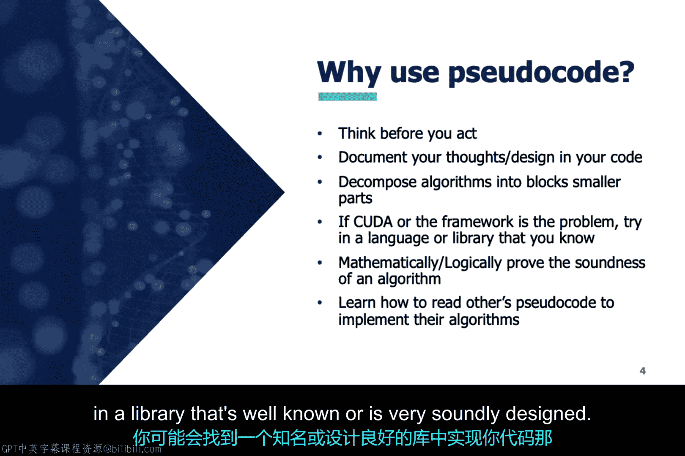
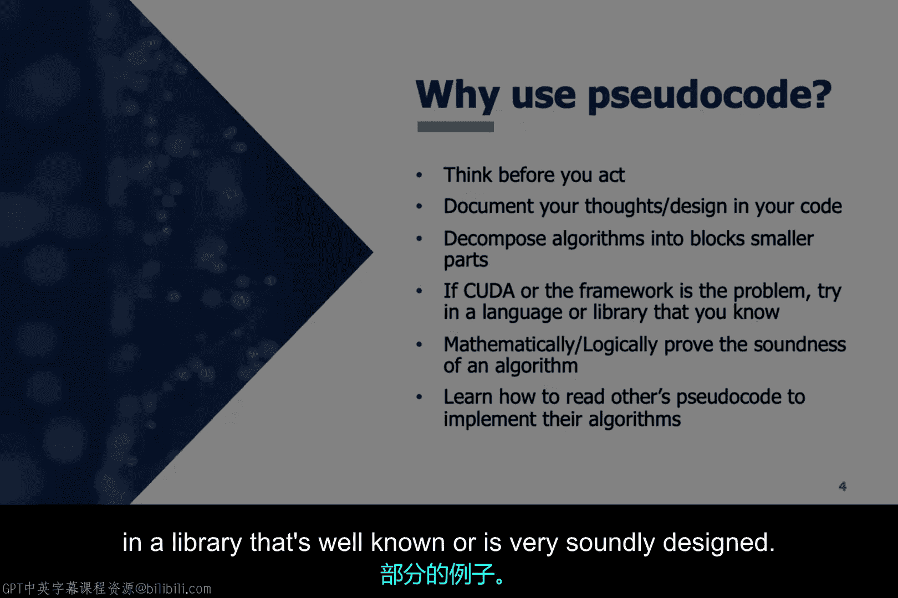
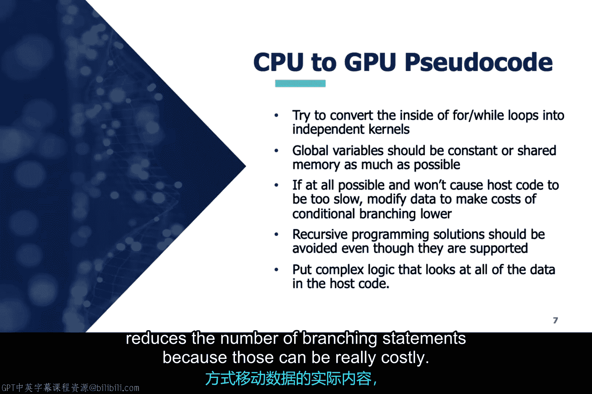
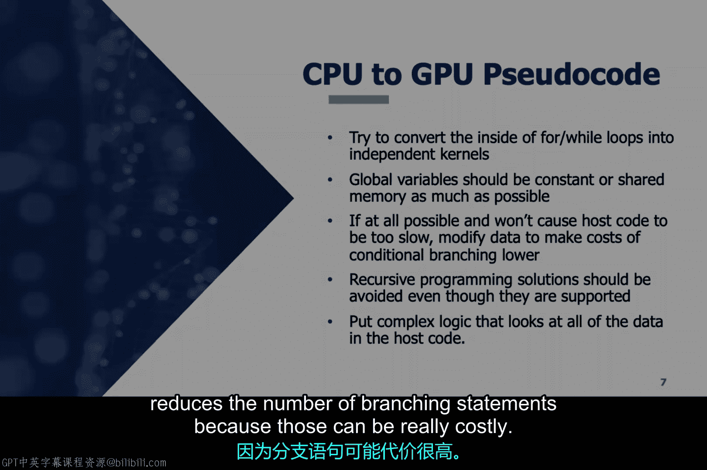

# 约翰霍普金斯大学《GPU编程（并发编程、并行编程、面向企业、CUDA高级库）｜GPU Programming》 p76 15_基于输入数据的GPU伪代码开发.zh_en -BV1a1421r7vw_p76-

Hello， in this lesson we are going to go over how you can take input data to develop GPU pseudocode。

😔，A good definition for what pseudocode is comes from interfacing pick micro controllers from Martin Bates。

It sayssecode shows the program as a text outline， using higher level language constructs to represent the basic processes of sequential processing。

 selection and repetition。So it's a common way of describing an algorithm in a manner that is not specific to a language。

 but does incorporate some very common language constructs like four loops do while。

 So if a language not， not that Kudo does this。 But if a language doesn't support。4 loops。

 there's probably a similar construct in the language。 So while there's no standard format for it。

There is a format that's often used in textbooks or in academic papers。

 I have seen where Leslie Lamport of Microsoft create a way to translate that into actual code。

But the most important thing is that。You can actually sort of take what you're doing when you're designing it and creating the pseudocode and make it into comments that sort of self document your code so you don't lose your pseudocode along the way。

 and it can be very helpful。So this is a simple example pseudo code for plotting a line in the graphics program。

It takes the start， and end。X and Y values， and iss going to plot。

 The first thing it does is it looks to find the delta or D of x and Y based on the difference between the start and n values。

4 x and Y respectively。Then it wants to define what the difference in the in any step is by multiplying the difference in y by 4 in subtracting X。

 This must be a threshold。 This only changes。The X and Y value when they're whole numbers。

 not when they're partial numbers。So you start off with y being the initial value。

 and then you do a four loop of x going from its initial to its final value at each step。

 you plot the current x and y value。Then you update the difference。

By adding the difference plus two times the difference in y， if that number is greater than 0。

 then you increment the y value， then you will change the difference to be the difference。

Of the previous iteration minus two times the difference in x。

 So things you can notice about this are that there are。Common constructs， like four loops variables。

And conditional branching using if。 So this should be fairly easy to implement。

 And it's actually pretty much written as C or Java code， just with you know。

 things like memory management and typing。So this would be pretty easy to implement。

 even if you didn't understand the logic， so why use pseudocode Well some things that lets you do are think or design before you implement something。

And that that the thought process or design can be incorporated as comments in your code。

It allows you to make code that doesn't necessarily only work in the language that you're thinking about or using。

You can do things like mathematically or logically prove parts or all of your code。

 anyone who's taken like a theory of computation course or an algorithms course。

 probably of seeing this in the form of completeness testing or O of N notation。

 it also allows you to use other people's pseudocode for parts that you're going to implement。

And if you break down your pseudo code into say chunks。

 you can create functions that do parts of your logic， so they're more easily debugged。

 but also if you look very good on the internet or on a forum you may find an example of an implementation of that chunk of your code in a library that's well known。

 or is very soundly designed。

So why does the input data affect the algorithm you're going to develop？ Well。

 there are a number of ways that you have to think about the data such that you know how the algorithm will interact with it。

 I it simple or primitive like integers or strings or chars or floats。

 Is it flat like an array or hierarchical like a data structure or a dictionary。

 does it represent a lot of memory， something like an image file or that's a small objects like an array of integers。

 if it's hierarchical， maybe it's multidimensional， like does it have X， Y。

 Z or can you think of it like it has X， Y， and Z， multiple dimensions。

Which will help you think about how you might use it in grids， blocks， threads。

Does the actual content change over time， think about if it's multidimensional or some parts of it non exististent。

 can values be null。You have to consider that to not depend on those values or have a strategy for when that happens。

Are there algorithms that can do part or all of what you're doing for that type of data？

The major thing is if they don't， but you can transform your data to work in that algorithm。

 maybe that's something you do then。Create a way to transform either just a solution or all of the data。

 if it's transformed in some way， think of an image that goes to gray scale and then back because it needs to do something with black and white。

Or maybe you have to do this all from scratch。So here are some tips to algorithm design。

 break down your algorithms into smaller parts if possible， try to use existing libraries。

Especially those are well known or documented to solve part or all of your problem。

Find design patterns and avoid anti patterns in your code。And always use representative example data。

 even when you're designing your code and sort ofcing。Okay， I have an array and these are the values。

 don't pick simple values or things that are either like。

If reverse in order if you're sorting or vice versa， consider edge cases。

 don't just consider the main problem or the easiest example data。

Some specific tips for converting CPU to GP pseudocode is where you see 4 or while loops。

 Consider having each of those run on a thread or an independent kernel。

You should use shared memory when you have blocks of threads that are going to operate on the same data。

If you have global variables， use constants， try it to avoid recursive programming。

 I know there's a lot of really good solutions to problems that use recursive programming but avoid it。

 even though it is supported put complex logic that sort of deals with the solution or the larger data structures and doesn't decompose well in the host code。

 another strategy would be to try to move the actual content of data in ways that optimizes the speed of the GPU and reduces the number of branching statements。

 because those can be really costly。

