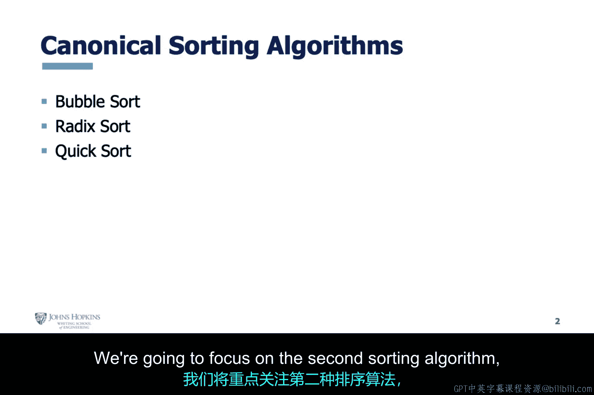
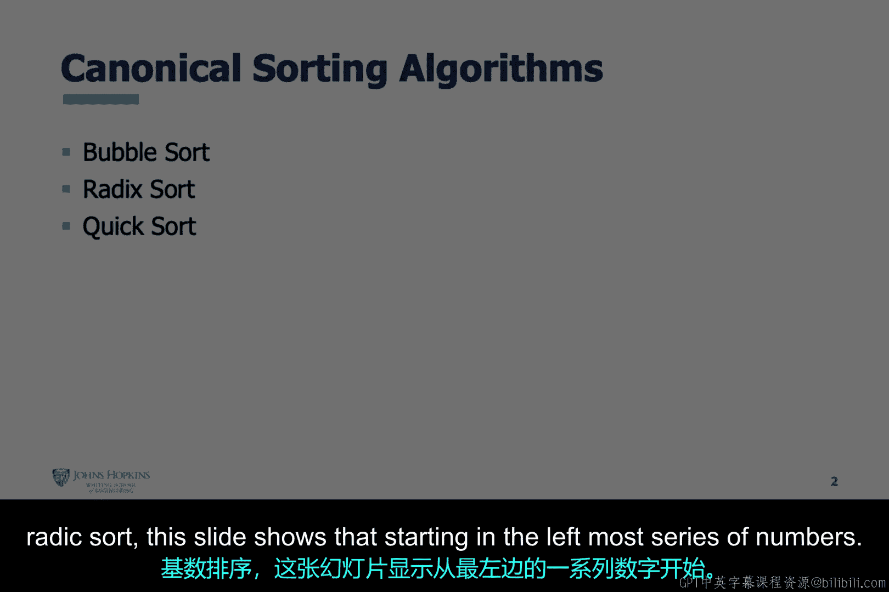
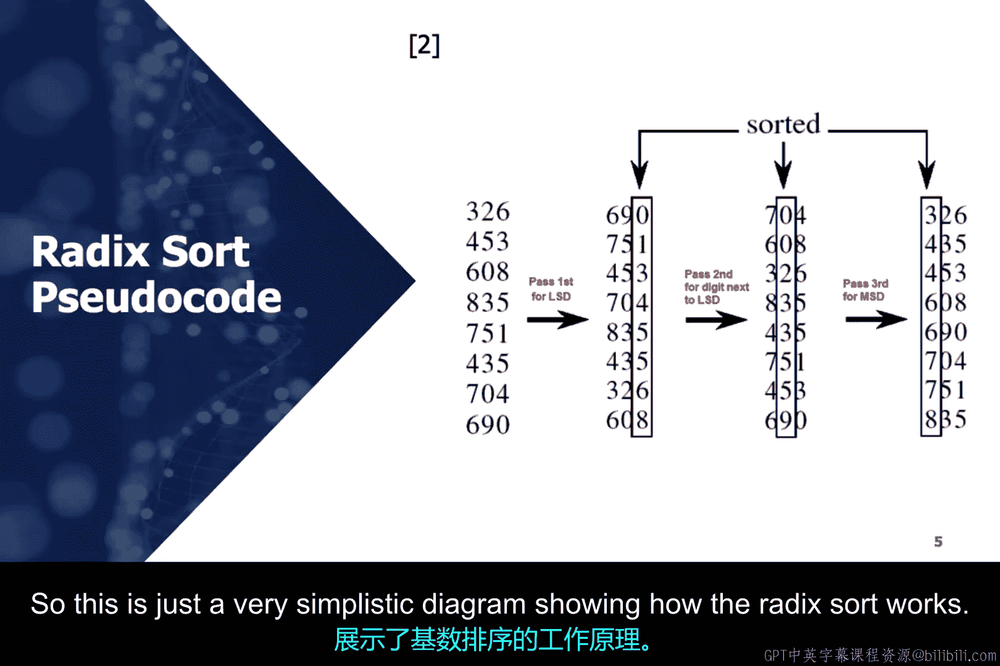
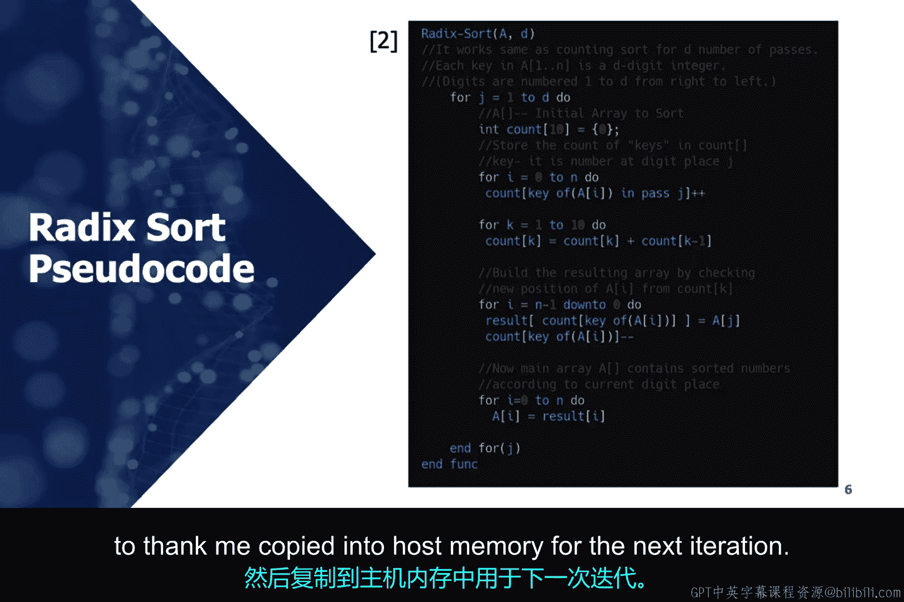
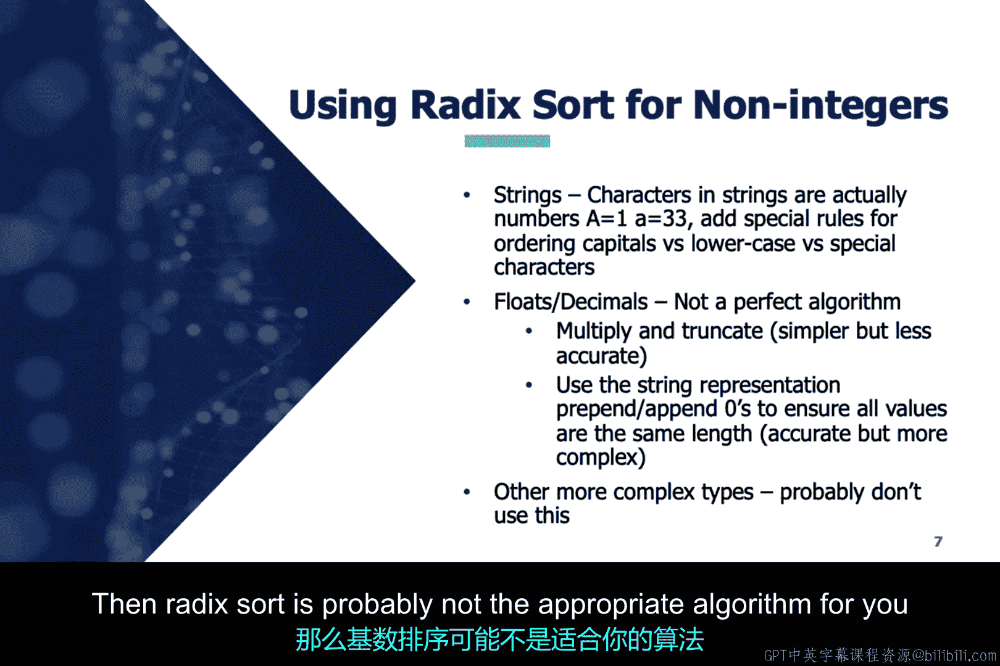

# 约翰霍普金斯大学《GPU编程（并发编程、并行编程、面向企业、CUDA高级库）｜GPU Programming》 p78 17_GPU排序算法伪代码-基数排序.zh_en -BV1a1421r7vw_p78-

So let's continue our discussion on sorting algorithms and creating and using GPU pseudocode。

We're going to focus on the second sorting algorithm， Raatic sort。

This slide shows that starting in the leftmost series of numbers。

What we're going to do is sort the least significant。 So is the first digit， the rightmost digit。

In a series of numbers， we're going to say， okay， let's get 0 to 8。

 order the the whole values by them。 So in the first case，6，90 has the lowest。First， digit。

 which is 0， and 608 has the largest。So it goes through and says order by that。

Then it goes to the next column and then 704 has the smallest number。

 and what you're doing is when numbers， when columns have the same value。

 you're ordering and you're doing sort of subordinate sorting along the way。

And then when you get to the final column， you end up with the most significant。Digit。😔，Column。

In this case， the third column。Or soaring there。So along the way。

 you've sorted that 704 is before 751 because it was。It was sorted before that， so。

This is just a very simplistic。Diagram showing how。The Radatic sort works。

 so let's look at the actual pseudocode。 Now let's look at the pseudocode for Raatic sort。

The first thing you should notice is that there's a for loop。4 J equals 1 to D。

 D being the number of digits or columns。In the values that you're sorting。In the example。

 that was three。That should be an external host。Loop。

 you should not be executing because those are passes it even says here a number of places。

 uses the term pass and a pass when you see that means。Everything runs and then it really runs。

 and then reallyrun。 So the nice thing about Ra sort is that each time you go through a column。

 that column。Soting can be done。In the one pass or one execution of a colonel across numerous threats。

Then the next thing you want to figure out now this is sort of hardwired for count 10 because there are 09。

 10。Cos that you're going to have and you set it to initially just be0 and in reality you're going to have sort of index0。

 how many things are in have the column you're at， the pass you're at have that。

Value 0 in that column。Then you have a  four loop， the 4 I equals 0 to n。

 and being the number of values that you're going to sort。 And basically。

 what you do initially is you're just going to loop through and say。

For whatever that value in that column you're looking at， that J。

You're going to say what is the value at that。 And so if you have three items that have。

0 in the you know， the J column， which let's say0， then count for0 would be3。

 You're just going to iterate through that。 So this is actually a really nice place。

To execute a colonel that all it does is go through all the values and increment account。 Now。

 note you're going to have to have a way to synchronize the value of count in a moment。Then K。

 what it does is it actually loops or again， it says。Well， I'm not just looking for the value at0。

 but I want to know the value of anything below So if I'm at 1。

 then I'm going to take the count of that column I'm at and the column before So if I'm at one it be the count for comm。

Values of 1 and0 and combine them， so add them together。

Thinking of another loop that pretty much does a lot of what the sorting is and reading the pseudocode。

 it says that you're going to build the result array from checking as you are going through and knowing the count。

 you're going to say I know that a of I， which is currently you know you're going from the highest value to the lowest value of the previous sort of that previous column you're going to say。

 I know there are eight say， like there's eight items with the one。In this specific slot。

 I can then count down the values as I order that that section of things that have that value。

 It's a little complex to think about。 But definitely look at the that image before where you've sorted a column。

 you go to the next one。 And when you sort that， you've base。

Sort of the subordinate sort like the okay， I I say， okay， this。

 this moves up because it has a higher value in this column。

 but I also have to consider the previous value。So you go through this for loop， of course。

 this 4 eye， like all the for loops here can be separated out into its own kernel。As always。

 I'll be memory synchronization concerns and at the very end you copy out the values into the overall or global value。

 so that would be the return of that final for loop。

 you can even actually remove that when you're doing it on in GPU because by the time you've done that 4i equals n minus1。

 you've actually copied it back into device global memory that then can be copied into host memory for the next。

Iteration。

Let's step aside for a second to discuss， how would this Ra sort apply when you're not dealing with integers。

 right， The first thing to consider are。Maybe floats or decimals， floats。

 the actual decimal point moves around， so you can't strictly use。

The left or right column organization that we've had in the previous serial code。

 you're either going to have to multiply by like1s to get the decimal point all the way to the right and know how many times you've multiplied that。

 keep them back if like in a global variable and then do the comparison。

And then move to the right again， because then you've sort of incorporated where the decimal point is。

That's fine， it's not necessarily the most accurate because you might be losing some precision in how things are represented。

 the other way to do this is actually to consider a string and we'll talk about how the strings are sorted in a second。

But consider a string by padding it with zeros on either side to get them to be the same length and to the same precision。

Then you can just do a sorting using strings。 Strings nicely work because an actual string is nothing different than an in in。

Encoded。From a system that takes upper lowercase characters， special characters and。

Creates numbers out of them， so a capitalize a or uppercase A is a one whereas a lower case A is a 33。

 you can even consider special characters different than that number。

 you can have certain rules because certain characters might actually be before them when you're considering the encoding。

 but you may want to have them afterwards like you might want to say lowercase numbers are actually ordered before uppercase or you could lower case all the values and consider all of them the same。

If you're concerning。Values and data to sort that doesn't neatly fit into mapping to a numeric value。

 It's multidimensional or something like that。Then random sort is probably not the appropriate algorithm for you。

