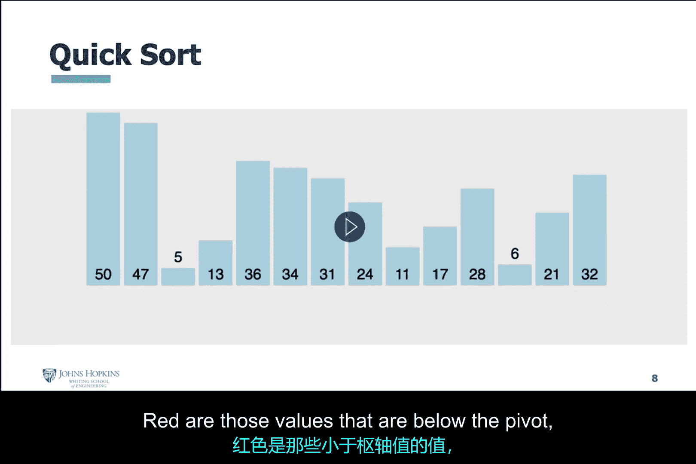
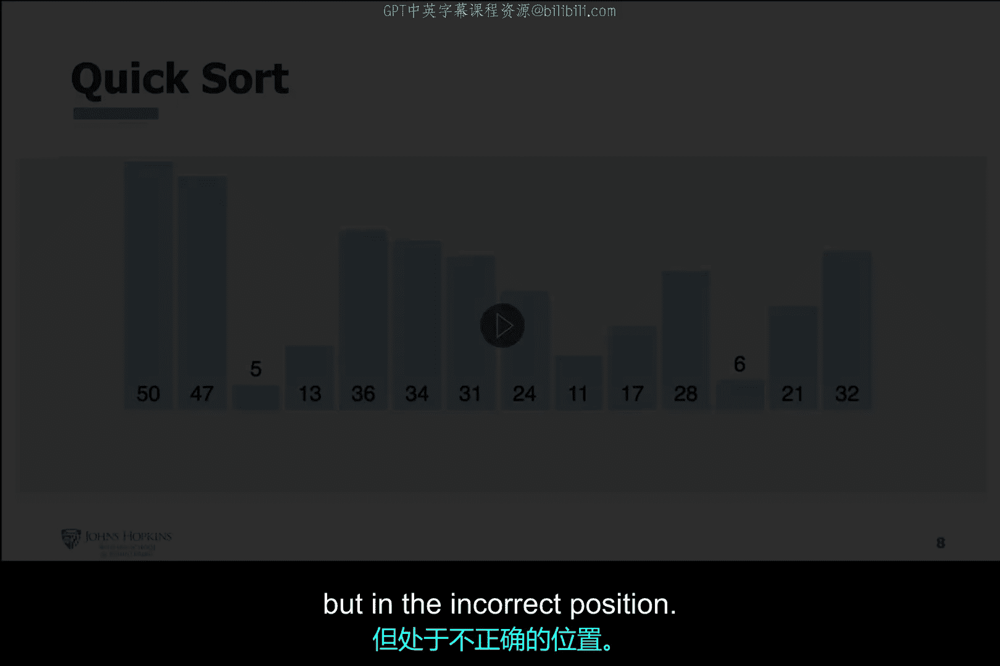
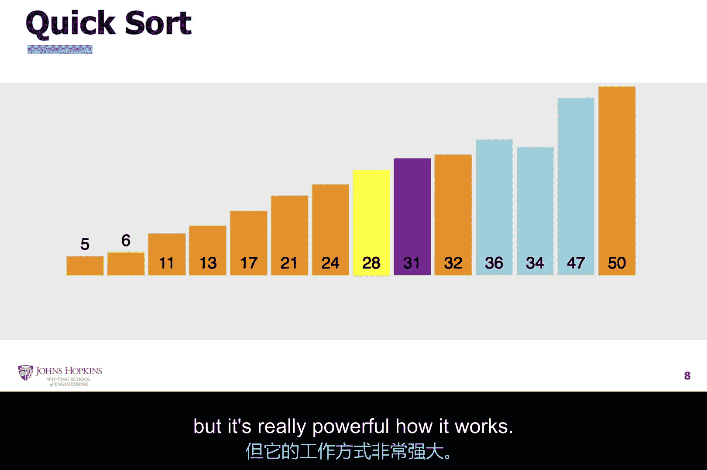
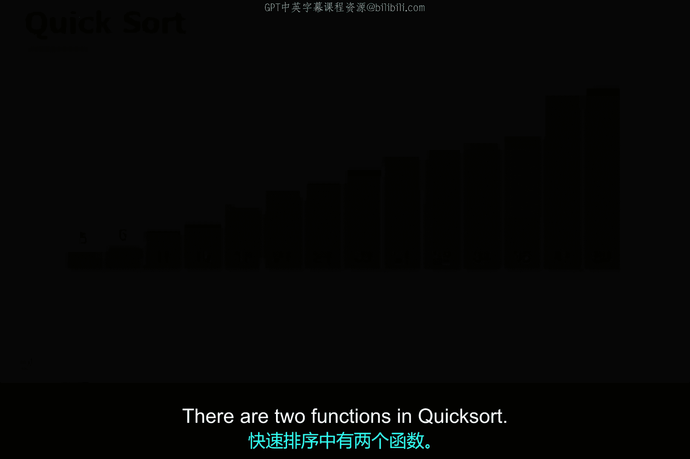
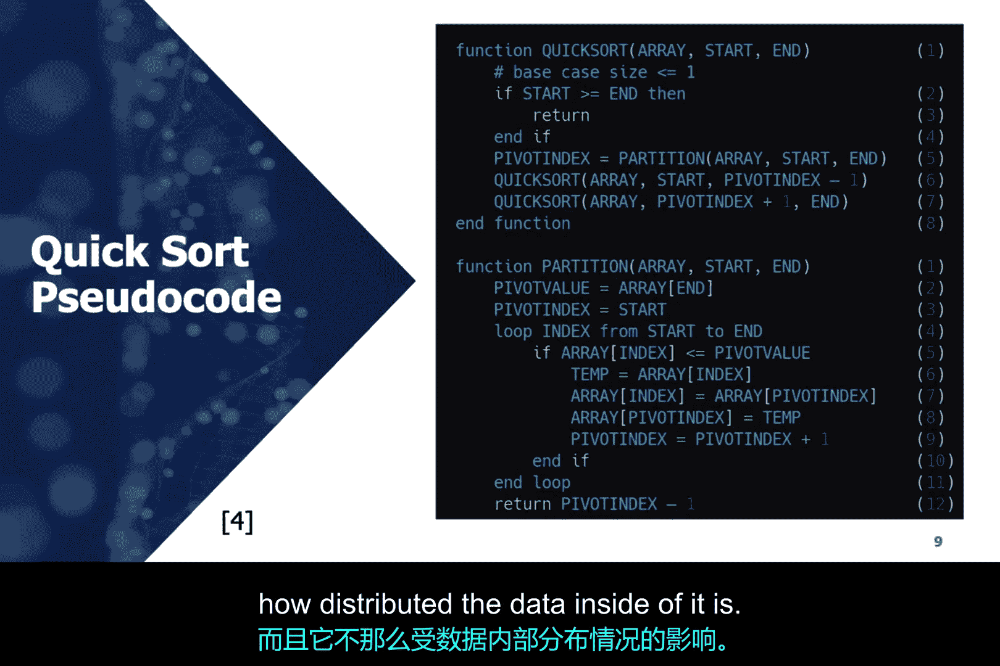
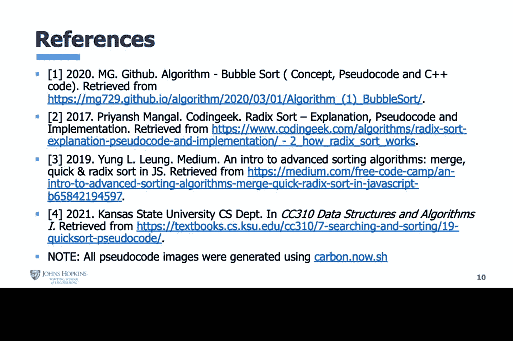

# 约翰霍普金斯大学《GPU编程（并发编程、并行编程、面向企业、CUDA高级库）｜GPU Programming》 p79 18_GPU排序算法伪代码-快速排序.zh_en -BV1a1421r7vw_p79-

We're going to now go into the last of the sorting algorithms。😔。

Then we're going to look at the GPU pseudocode 4， which is Quick sort。

So before the animate gift starts going and it gets a little complicated quickly。

 I'd like to give you a verbal legend to what the colors mean。In the gif。Blue means。😔。

Currently unsorted and not being looked at at this point。Amber or orange。

Means that it is in the correct， sortrdid position。

And then how this works is the algorithms going to go into parts of the whole so subsection or partition。

😔，And those。Are going to be colored based on what the pivot value is。

 and the pivot value determined when we look at the pseudo quote。

 you'll have a better idea about that。<|OTHER|>But yellow will be the pivot value。

Green will be those values that are determined to be less than the pivot value。

Purple are the values that are greater than it。And。As it's going through， you'll see things turn red。

And then， turned green。And what that is is。When a value is red means it's less than the pivot value。

 but below an index， the halfway point or pivot point in。The array。

So keep that in mind things will starve all being blue。

 slowly but surely you'll see more and more values that are beige。

 and those are values that are in the correct position and generally they end up being at halfway points or powers of tool within the algorithm ass that's running。

 yellow is the value that things are being compared to green are those values。

That are below the pivot value， purple are those that are above it， but in the correct position。

 and render are those values that are below the pivot value， but in the incorrect position。

 So in quick sort， you're going to pick a pivot point。

 usually the leftmost value when you start or at an index。 and you're going to move it to the right。

 trying to find its position along the way， you will do swaps to find。

What things it should be lower than the pivot point to get them at least going left。

And you'll slowly literally make progress as you go through。

ll the value the pivot point will move to the right， things will get swapped on the lower side of it。

And it's a little complex， but it's really powerful how it works。

There are two functions in Quicksort， there is a quick sort function itself， which has。

Sort of two roles it。Partitions the data and then executes。

The quick sort on those subordinate partitions that come out of the pivot indexes generated from the partition。

And note that this is a recursive algorithm。 So our alarm bells should be going off and saying， w。

 this might not work for the GP。 Let me think about how I could do this on。Ina。

And maybe find a library does this， which well sort of do， but just you know， this does actually。

 it can be implemented in Kuta。So it's recursive， it goes until it finds that the down to the base case。

 which is that you are now trying to sort an index that's like the start and end on the opposite side of each other。

 which means you have sorted everything above a certain value and so you pop out and that's what that return in that if start is greater than equals n does。

 just as you've reached the base case， you've sorted。The section that you're responsible for pop out。

 and this will recursively go up the stack。So the partition。

 what it does is it determines the pivot value from the rightmost value in the portion of the array that it's looking at。

Based on the start and end。Then it sets the pivot index to be the leftmost value。

 and it's going to loop from the first value to the last value。

And it's going to compare the value of the current index to the value of the pivot value if。

That value is in the wrong portion。 it's left of the pivot value。 it's less than the pivot value。

 it will push it to where the pivot index is。And then move the pivot index over one。

This isn't making that part of the。Aray before the pivot index is making it more sorted than it was before。

 but not sorted。And so basically， what ends up happening is the pivot value finds its place and everything less than or greater than it is put into bins that are appropriate。

And then。😔，TheWhat's returned is the value of the pivot in one less than the pivot index。

 And it's saying that left part should be sorted。And the right part。

 which would be two more than that the value of this return should be sorted because the value at that index is in its appropriate place for that section。

So。That's why you have two quick sort calls。 You then call Quick sort on the left part of the array left of the pivot index and then right of that pivot index。

 And why this is faster than bubble sort or other sorting algorithms under many conditions I that you're doing far less comparisons。

 your sorting things generally as you go， Theyre not completely sorted。

It can be broken down into smaller parts， and each time you do that smaller part。

 you're not necessarily operating on all the data。And so it's not as redundant。It sorts。

More efficiently based on the size of the input array。

 and it is not as determined by how distributed the data inside of it is。

