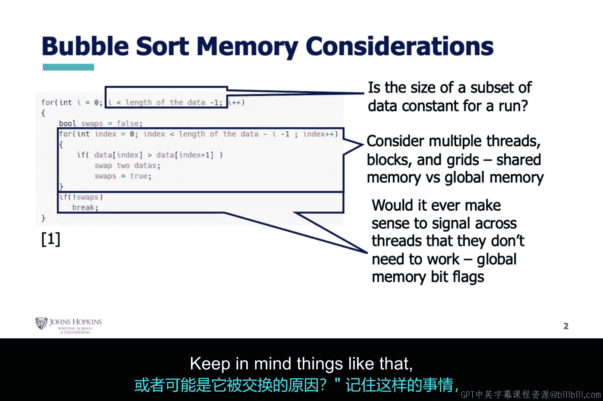
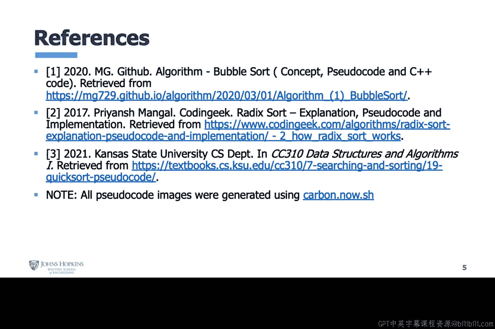

# 约翰霍普金斯大学《GPU编程（并发编程、并行编程、面向企业、CUDA高级库）｜GPU Programming》 p80 19_内存管理与GPU伪代码-冒泡排序.zh_en -BV1a1421r7vw_p80-

Now we're going to take that pseudo code we started to get an understanding of for the GPU and think about how that would actually be applied to memory usage。

Where do we want to use global memory， where do we want to have constants and so forth？

So let's look a bubble sort。The first thing， obviously I've said this， but when you see a for loop。

 that should be。An execution of a kernel does not mean that the kernel only executes home one or two pieces of data。

 so if it's multiple pieces of data，What happens when you have， you know。

 let's say you have 100 pieces of data and you have 64 threads running on it。

 and so maybe you have each。Thread handles two pieces of data it doest swap and it's done。Well。

 the thing to consider under that circumstances and any circumstance where a thread is handling two or more。

Pieces of data is。How do I keep the data consistent and is there a place where things like the current index could be a constant the size of the index。

 things like that？Now， in the inner for loop。You're going to have to do that portion in the thread as opposed to the outer for loop。

 which can be done。In the housecoat。The inner for loop。

 what you might have is that a thread has 50 items to look at。

And what you'll note is you may sort a subordinate section。

 let's say you have thousands of threads and tens of thousands of pieces of data。

 you may end up with like， you know。Thousands of subars that are sorted。

 but then you have to sort between all of those arrays arrays or a situation， right？

So what you want to do then is you might want to have a synchronization step and then share data。

 like change the indexes that are being looked at a very inefficient way of doing this would be。

To sort of shift everything over by one in either direction。Um。

 or in because the left and right most values in the you know， across all the threads will be。

Sored that sort of fits along with bubble sort that it looks for everything it does multiple sorts。

 but you might want to consider how to take advantage of memory， both shared memory。

 global memory and any constant under that circumstance Lastly there's this bullolean swaps and you know you're not going to share one bullan to say whether you're going to swap values within all the threads one bullan。

 but you might have something like array of bit flags。

 which basically say is a swap happening with this index。Or maybe you have all。

 you have like the same index。 I'm sorry， same array。 and you say， I swapped it to this position。

 and that indicates something to another thread at a higher value。 or maybe what it was swapped for。

 So keep in mind。Things like that。 And maybe you come with like the better version of bubble sort。

