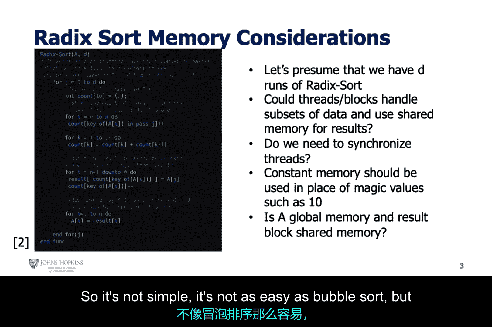

# 约翰霍普金斯大学《GPU编程（并发编程、并行编程、面向企业、CUDA高级库）｜GPU Programming》 p81 20_内存管理与GPU伪代码-基数排序.zh_en -BV1a1421r7vw_p81-

Now we're going to discuss memory and some hints on how to use it。😔。

When looking at the pseudocode foradtic sort。<|OTHER|>So some things to can when you're looking at racks or considering memory is first off like I've said before the 4j equals 1 to D。

That loop is probably。The pass as they're executed by the host and inside of that are a set of for loops that they themselves are each executions of very simple kernel threats。

 Now that4 I equals n minus1 is probably the most complex， but we're going to start with ones。

I equals 0 to n and K equals1 to 10。 Those are pretty nice。

 They can actually be performed using global memory。

 or even if you want to use shared memory and then combine the shared memory to global values for the count There's multiple strategies that work for that。

Now， actually doing the swaps or moving things around and sorting within。The input data。

 that's pretty complex。AndYou're probably going to want to have a strategy that says。You know。

 this is the previous order and have that global memory and then。

Banks of threads working as a block or even a grid。

Can look back at that to do subordinate swaps so they would go out to， of course。

 get the count that could be a constant possibly or maybe in this case because it's decremented。

 you might want to have that in memory that's global， but the actual result。You can， you can do with。

Shared memory。So that's a way to make this go faster。 And the great thing about。

If you do everything global memory， is that last four loop for I equals0 to n that's done automatically。

The way to handle this， if you're doing shared memory and you're， like I said before。

 you're doing the sorting within those， you might have to have multiple passes within。

J equals I to D would be to also copy back to host memory do the combination there and then run it another pass。

 so it's not simple， it's not as easy as bubble sort。

 but it's actually not that hard to implement this on a GPU。

