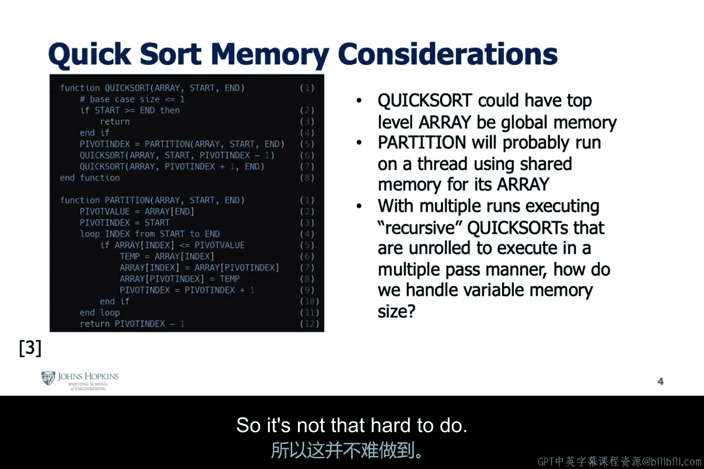
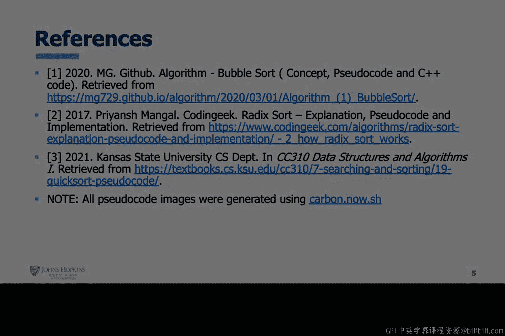

# 约翰霍普金斯大学《GPU编程（并发编程、并行编程、面向企业、CUDA高级库）｜GPU Programming》 p82 21_内存管理与GPU伪代码-快速排序.zh_en -BV1a1421r7vw_p82-

<|OTHER|>And last and most assured not least， in the terms of complexity of the pseudocode。

Will be our description of how to use memory and quick sort。

So now let's talk about the complexity of memory when you're implementing Quick sort or even writing pseudocode that's not based on generic C code。

😔，Or algorithmic generic code for Quicksp。So yes， generally you're going to have to use a lot of global memory。

 especially at if you're going to follow the quick sort and partition function。

Paraigm with those two functions， then you'll have to have global memory。

But there might be a way to take a recursive algorithm and have it act。Sequential。

And the way you might do that is。At each level。Each pass might be a。

 so let's say the first time through， cut it in half。

So that would just be maybe two blocks would work on that。And then。

It would calm down in maybe one thread in a block， actually executing it。

 then the next pass when it's done doing its part would subdivide it。

 you could basically subdivide everything down to the point where it's a single thread working on。

You know， some small subset of data that's shared。Data and then have threads。😔。

Acting on in synchronization， maybe using streams and events to。

Work only on sections when they're available to say， oh， okay， I'm this thread。

 I'm meant to sort you know， one through 20 and。I'll signal when I've done my part of the sort。

 such that。Something that would be doing another thread that would be doing a smaller subset， maybe。

3 through8。Could do its part。 you'd have to share memories such that across a block。

 you would be sharing the same memory。Another thing to consider is you'll probably have to have a lot of synchronization points and if you're having using streams and events。

 there'll be a whole。Slew of ways to do that。But the other thing to consider is。

How do you handle when the input？Aay。It is variable and in reality you would probably handle that by dealing with the start and end index and always using either the same shared memory or global memory。

 and actually the array is just a pointer that you're not going through all of you going through a subset of。

 whereas in this implementation it was more thinking you were being passed。

An array and that start end were almost fixed。For each pass， so it's not that hard to do。

