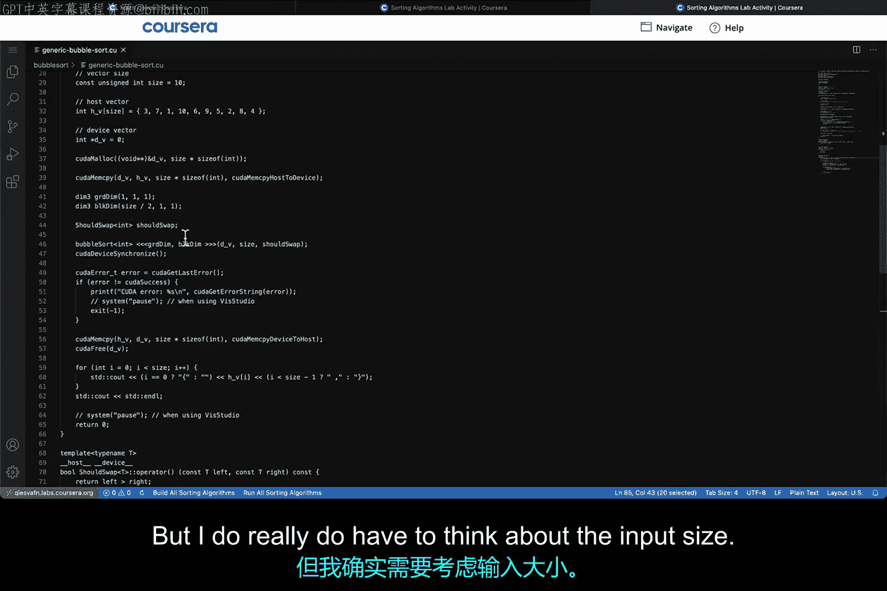

# 约翰霍普金斯大学《GPU编程（并发编程、并行编程、面向企业、CUDA高级库）｜GPU Programming》 p83 22_排序算法实验-冒泡排序.zh_en -BV1a1421r7vw_p83-

So I'm going to walk through the sorting algorithms lab activity and give you a better idea of how each of the algorithms work or maybe not work。

😔。

In the implementations I've found， we're going to start by walking through the bubble sort implementation。

The main。Function pretty much has everything aside from some functions that do the bubble sort in the swap。

 Now the first thing I'll tell you is that the input data is rather small and I'd be interested to see and I challenge you。

😔，To make this much larger， one of the major things to consider is 1 thousand。Values in here。

 see what happens。But it seems to do you， pretty decent job， simple code， it， breaks things。

 you know， determines the size of a block and a grid。嗯。It copies data around as it should。

 it specifies the should swap function， which basically says you know if the value in the left is greater than the value in the right and the left right。

 and then there's a swap function that basically does you the temporary variable so you can swap between A and B and then the bubble sort itself。

 the kernel and what that does is it's a loop through the values that have been made available to it so the size and this is the actual GiHub project and you can look up this person to see。

This project to see how well it's written in general。

 but I've pulled this out because it was interesting to me so basically it does a you know。

 goes left to right， determines the index going left to right specific to the thread and does the swap and then syncs the thread so it's using global memory and basically it's going through and it's saying you know I'm going to swap left to right within the number of values that I'm concerned with now。

😔，This is perfectly fine if n is the size of。The imp， Well what happens when？And is。Smaller。

Then the input array or you want to have multiple threads。

 in this case he gets around it or they get around it by making the number of threads one for all intents and purposes and has it run over all of the data。

But what happens if n is really large thousand and the number of threads maybe you only have 32 run on this？

Then each of them， you'd have to specify this with。And they'd only。Sort the specific part of the。

codeode。Like that specific part of that array。That applies to that thread。

 So then you'd have sort of like sub swaps that are needed to be done across threads。

 So this is not a bad start， but I bet you can work on this to make this。Work across threads。

 maybe you need multiple。Iterations， I think I've mentioned this before。

 so just consider that and this is not a bad implementation。

 but you really do have to think about the input size， so mess around with this and have fun。

