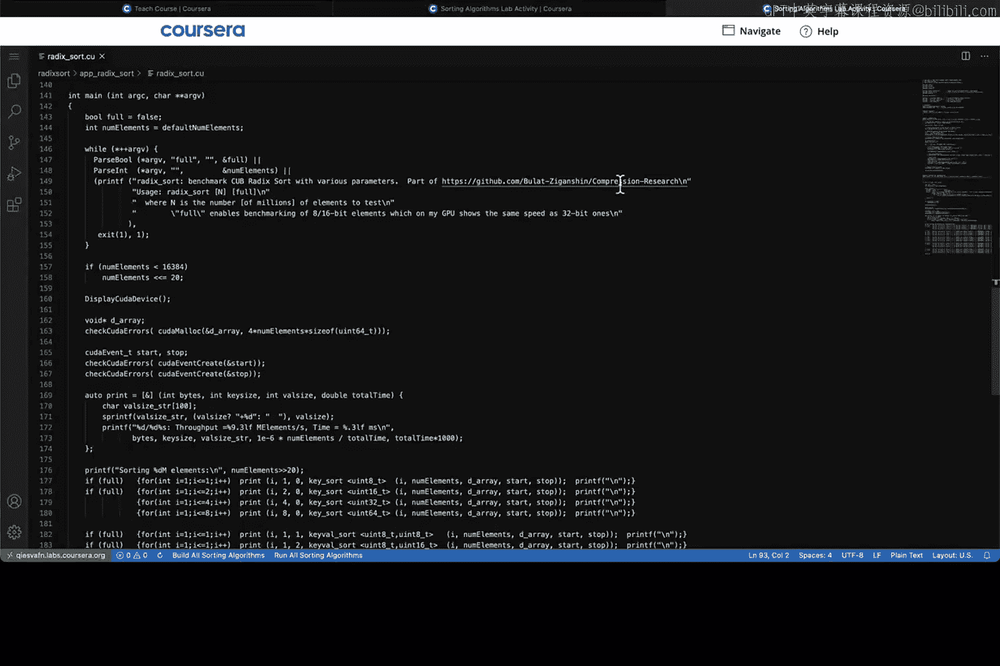
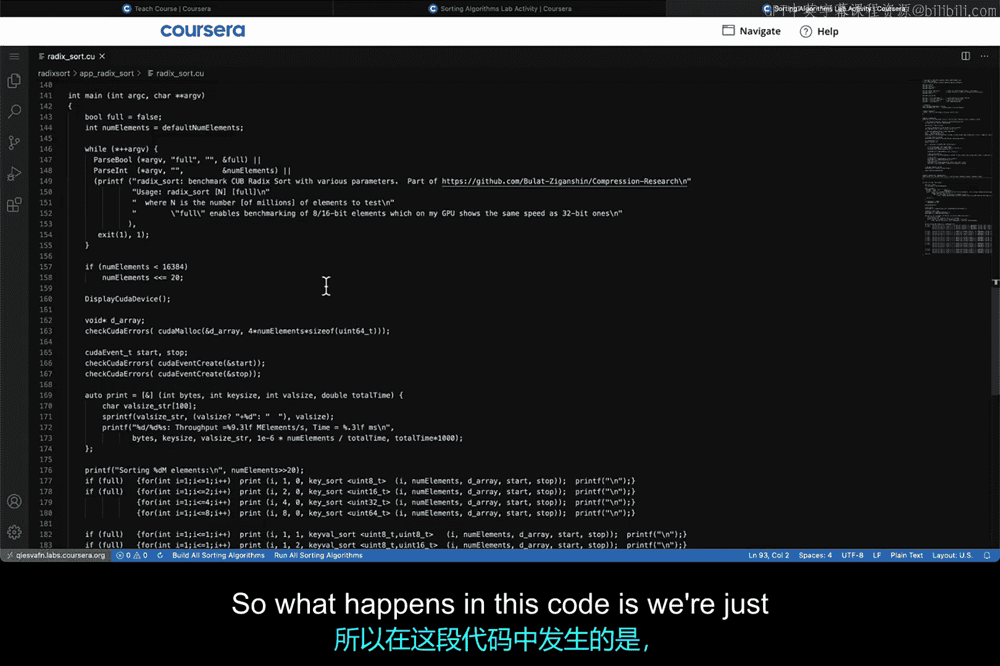
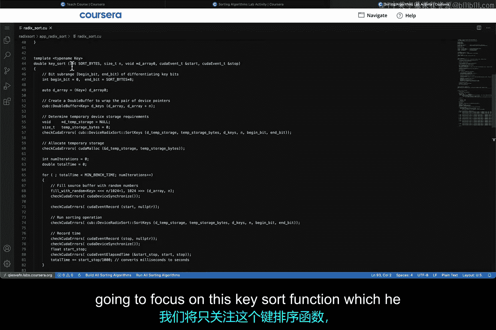
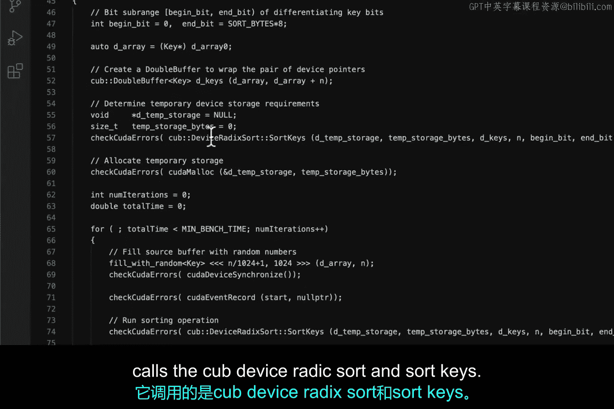
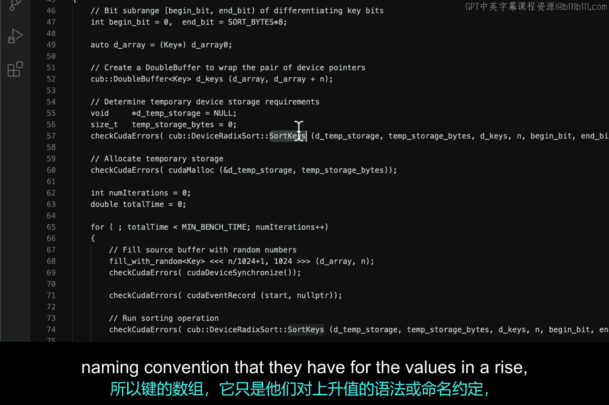
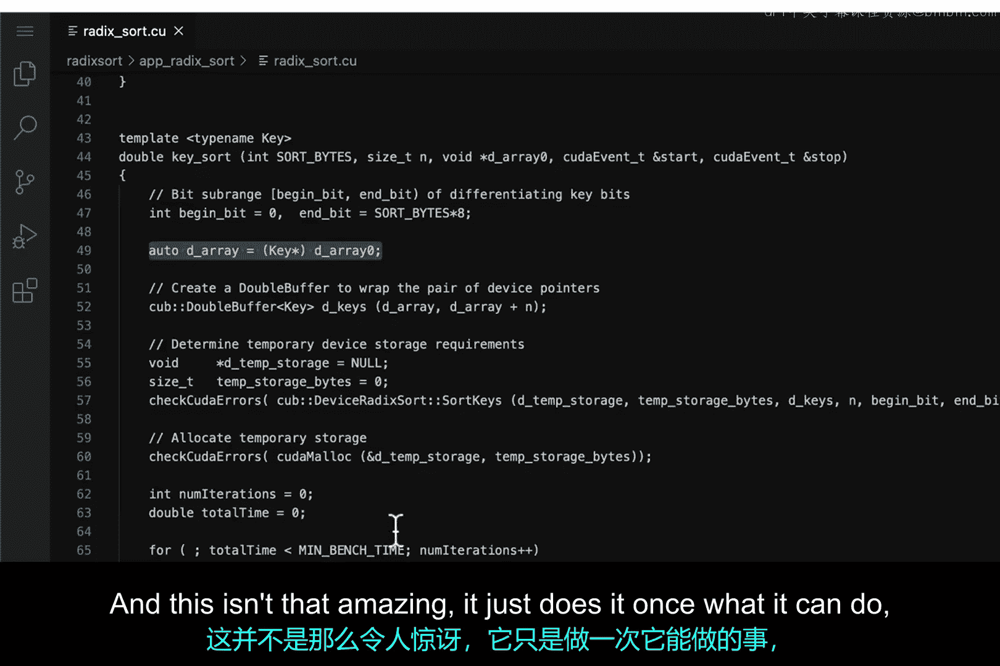
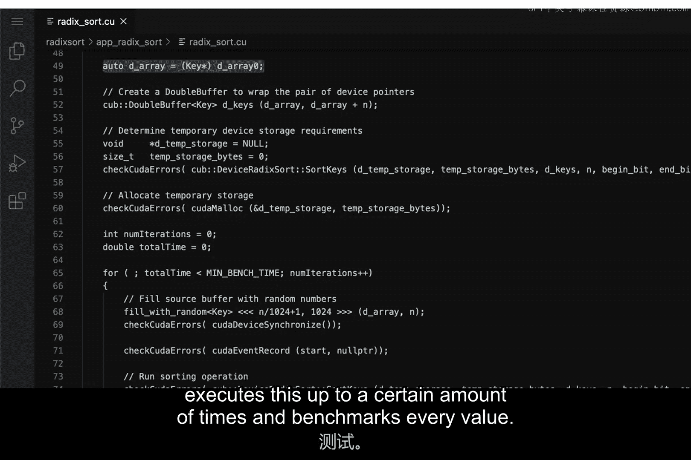
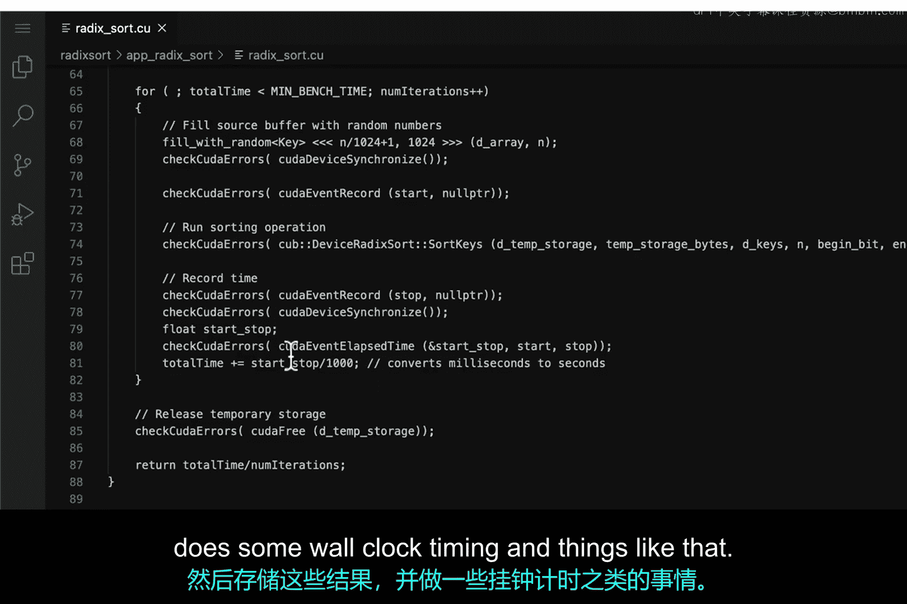

# 约翰霍普金斯大学《GPU编程（并发编程、并行编程、面向企业、CUDA高级库）｜GPU Programming》 p84 23_排序算法实验-基数排序.zh_en -BV1a1421r7vw_p84-

Now we're going to look at an algorithm。That basically is in an algorithm。

 it's just a test harness that does benchmarking of the cub。

 which is anvidia labs capability that's similar to thrust。

So what it does is it's just going to benchmark two ways of doing sorts。One。

 they're both usingratic sort， but one as a key so just the value itself and the key value。

 and that key value might confuse you。The keys are what are being sorted。

And the values are not being sorted and this is a common practice when you have dictionaries and you actually want to sort not the values in the keys。

 but the keys themselves， it can work there verse way。

 you can have keys that are unsorted in value in sort。Values。

 but the only thing about that is it's a little strange because you have to have a reference back。

From the value to the key， usually you have reference from the key to the value。So。

What happens in this code is we're just going to focus on this key sort。

Function， which。He calls the Cb device Ra sort and sort keys， remember sort keys means。

In all reality， it's just taking an array and sorting it。 So the array is of keys。 It's just the。

Syntax or naming convention that they have for the values in right so you create this。

Aray of values that are keys。Which is done here。You create a double buffer of it。

 and that's just so you can handle the fact that you might have。

Changes are occurring and things are pointing at it at simultaneously。

 so don't worry about that too much。 it's handled for you。

 it also wraps around so the advantages you can like。

You can actually access it from either the start or the end。

And so you call this sort keys function and this isn't that amazing， you know， it just does it once。

What it can do， that's sort of more interesting is it goes through and executes this。

Up to a certain amount of times and benchmarks every value and then stores those results。

And does some you know， clock wall clock timing and things like that， so that when you run this。

 it'll actually not just sort it， but it'll give you fairly precise results。

For that specific function in the print is done here。

It will also do the same thing for a key value pair， so think of that as like。A dictionary or a map。

And you basically sort the keys and then the values， they're not changed。

 it's just that the pointers are to the sorted key and no longer the original can， in reality。

 it doesn't affect the original data structure， what it does is it gives you a copy of the keys。

 the thing you can better than pointed to correctly。So this， you know。

 might be nice if you modify it， it deals with a lot of data like millions of elements。

 but maybe you want to stress it out even further or even just you know， do some of the。

The meaty work that it didn't do and implement it yourself。 You can always look at the cub。

documentation and source code and see what they did and maybe you want to sort of implement it yourself。

 but otherwise just explore how fast this can do sorting for you。

 maybe the solution its a sorting sometimes is I understand how it's done but now I want to use something that's faster at it。

