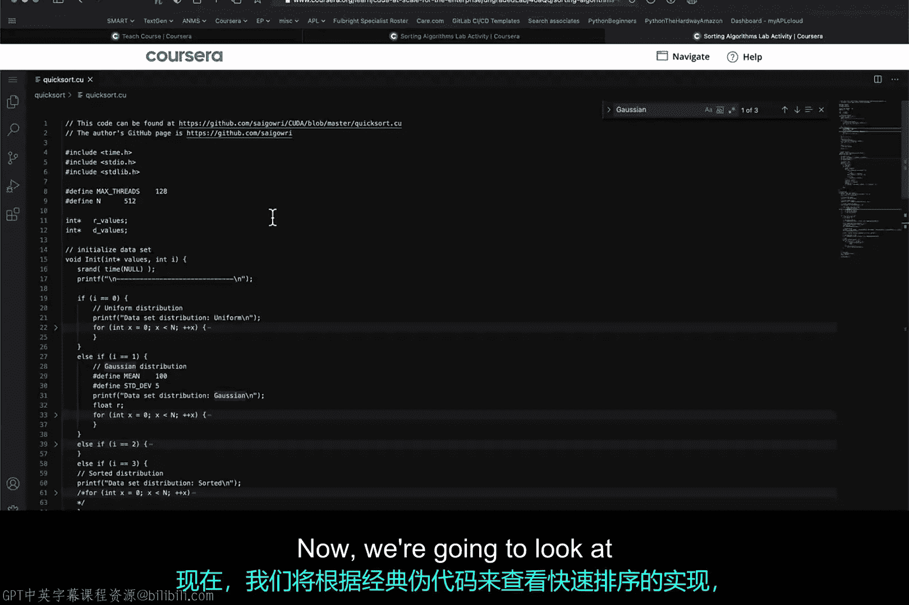
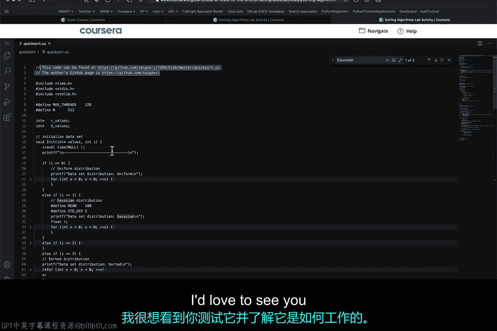
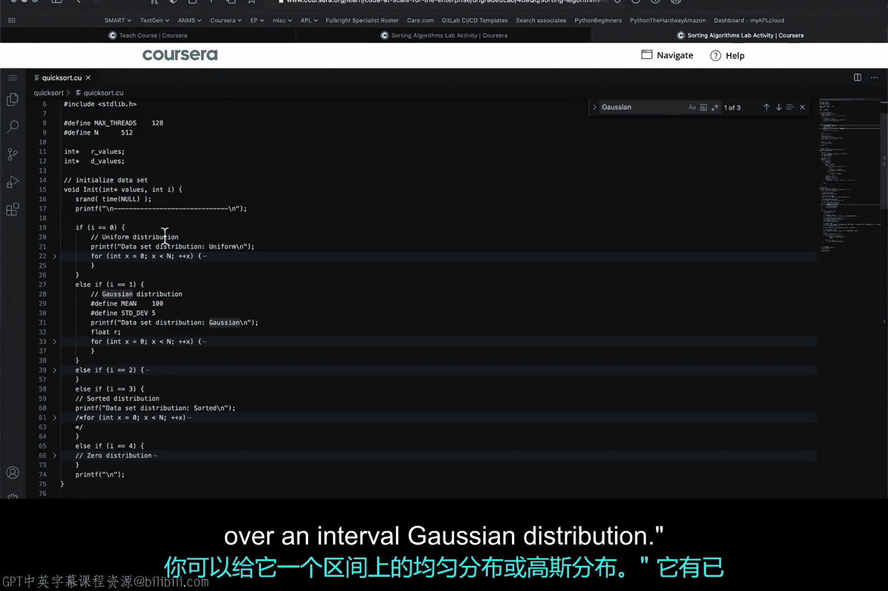
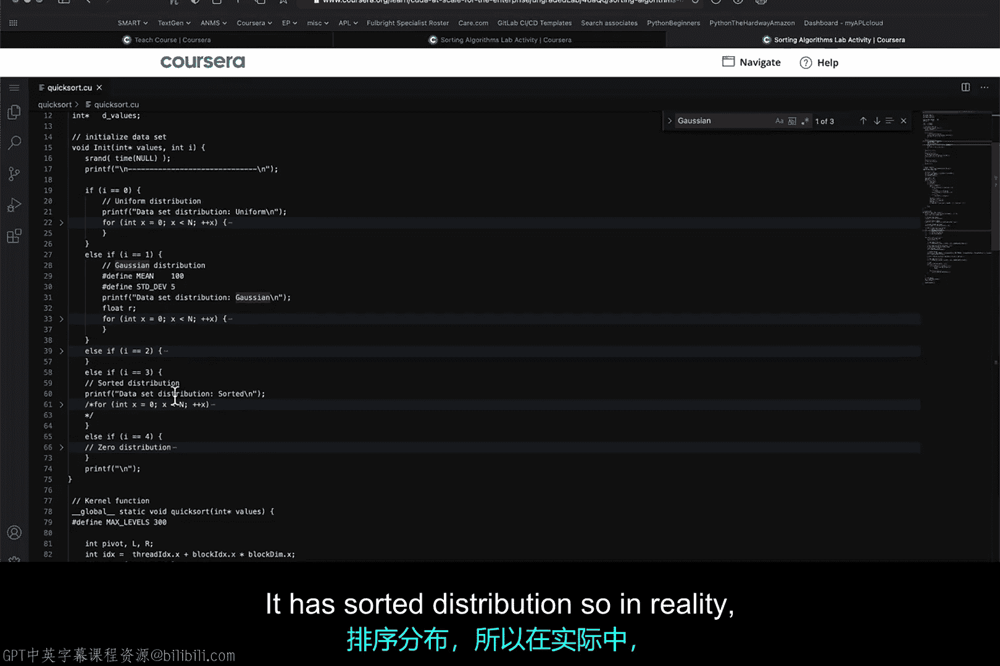
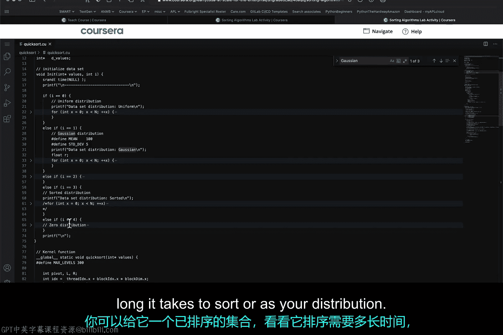
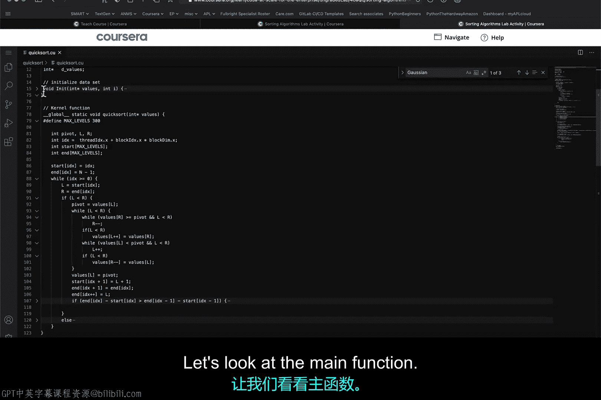
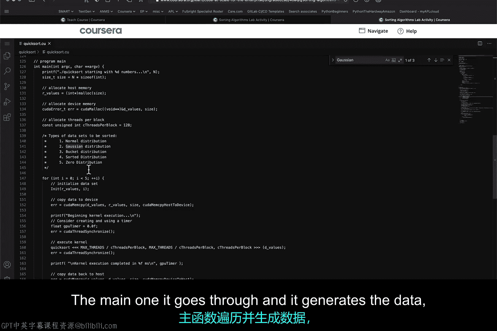
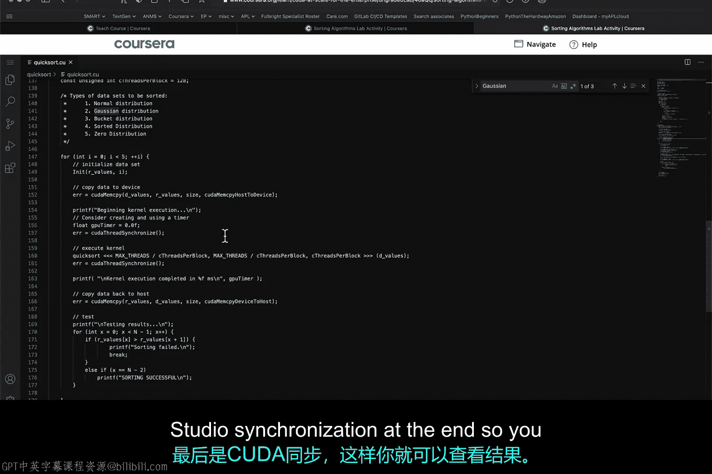
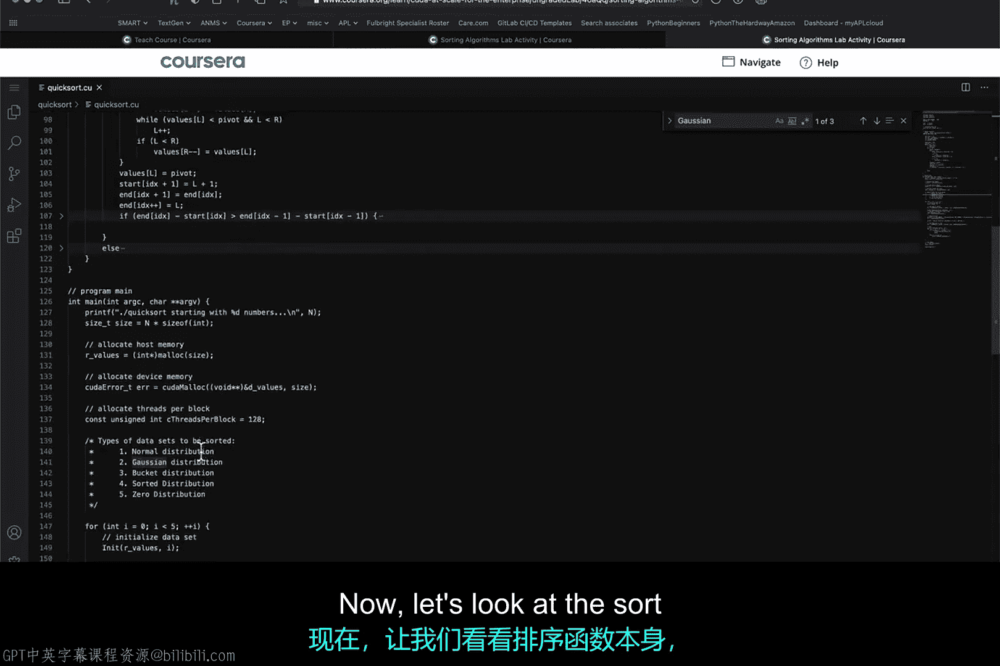
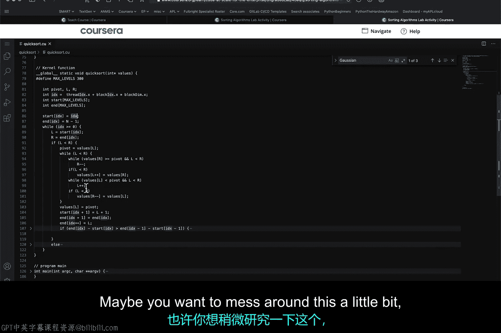

# 约翰霍普金斯大学《GPU编程（并发编程、并行编程、面向企业、CUDA高级库）｜GPU Programming》 p85 24_排序算法实验-快速排序.zh_en -BV1a1421r7vw_p85-

So now we're going to look at the implementation of Quicksort based on that sort of classic pseudocode and note。

That up is the project and Author's GiHub page and I'll say this is a pretty well written bit of code and I'd love to see。

You you know put it through its paces and see how it works first thing I really like about it is that it even considers。

The input data。Not just making it a static value or just a random value。But it actually says， okay。

 you can give it a uniform distribution over an interval， a Gaussian distribution。

 it has sorted distribution， so in reality you can give it a sorted set and let's see how long it takes to sort or a zero distribution。

So that's pretty nice。But let's look at the main function。

It's the main once it goes through and it。

Generates the data， it does a sort of typical thing it says。

Above it said that the number of threads is 128 and then the size of the data is， 512。

 it generates that data and then it applies， you know。

 it actually says go out and do the kernel based on the number of threads and the threads per plot。

 pretty typical stuff and it knows to do aynchronization at the end so you can look at the results。😔。

So now let's look at the。The sort function itself and we'll see how it compares to the pseudo code we saw earlier。

So it uses predefined constant max levels of 300， so that's the maximum。

The number of times it will go through and do。The sort， you know。

 you Im remember there are multiple passes through this。嗯。Through this path。

So the next thing it needs to do is it needs to determine what the pivot index is and then give you the left and right partition right that's there's before you actually do the the current iteration of。

A quick sort you need to know the left and right。Index is and actually that's done by means of using the。

The partition function。 So the index of your thread is defined and then。We basically make an。

Two arrays for the start and end。嗯。For all those max levels so you know at any point。

 what is the portion of the。Whole input that you're dealing with and the interesting thing about this is this actually allows a thread to work。

And any point of global or shared memory， because it's it's just going to work on。

TheWhat it's given for its start and end indices。So。Basically， at the start。

Your current thread the start is the value。Is your index。

 so if you're zero it would be 0 and then the end is n minus1， so n being 512 it's set above。

 so you're given the whole thing to deal with right？So note that if you're in a threat。

 you're dealing with everything。To to the right of that right you're at index1 and you do n minus1。

 so you do the rest of the。You right。So。The left and right is partitioned along that current index of your thread。

And then。If， you know， it does that base case of， well， what if that left value is left？

I less than the right right， and under that circumstance that means you are going continue to move the pivot。

So the pivot now is the value at that index and you continue to go。

And while that the value L is less than R。And then when that happens。

 you're going to move the right index down if right。The viat at R is greater than the pivot。

 which is what you should expect， so you're shortening the size of the array you're dealing with and then if the left is less than the right。

 this is the third time we've actually looked at this， then what happens is，You look at the value。

 you set the value at the index。One more than the left。

 so the left and right will be at the extremes of the input right and it' going to shrink down and where the left and rightarrow is going to vary a little bit。

But in this case， it's moved one to the left and you actually set。That to be the value at R。

So now you've set that pivot value。And then you can now loop through。😔。

Baate consistently saying is the value at that left index less than the pivot？

And is it less than R if that happens then you're just going to move the left index over。

 the only thing that happens is at certain times you're going to say the value at L is less than R so I need to swap the values in so this going to be really complex and I wouldn't say this is the most intuitive implementation it uses almost completely。

 but it does use some memory that's local to。That's shared at times。

And then basically to note is that you're going to have to do a synchronization after each run of this because now you've changed a state of so many things and shared global memory。

 they get to synchronize such that。Every thread now has its subordinate its coherently。

Maintained data at that。Moment in time。So maybe you want to mess around this a little bit。

 see how it works in large data。

