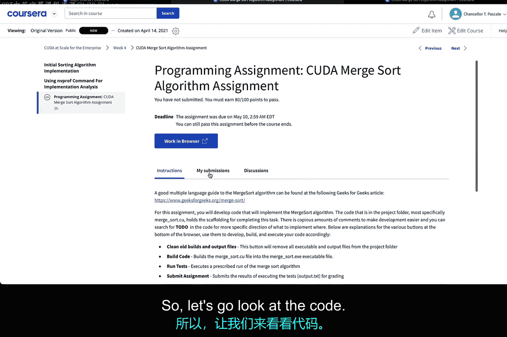
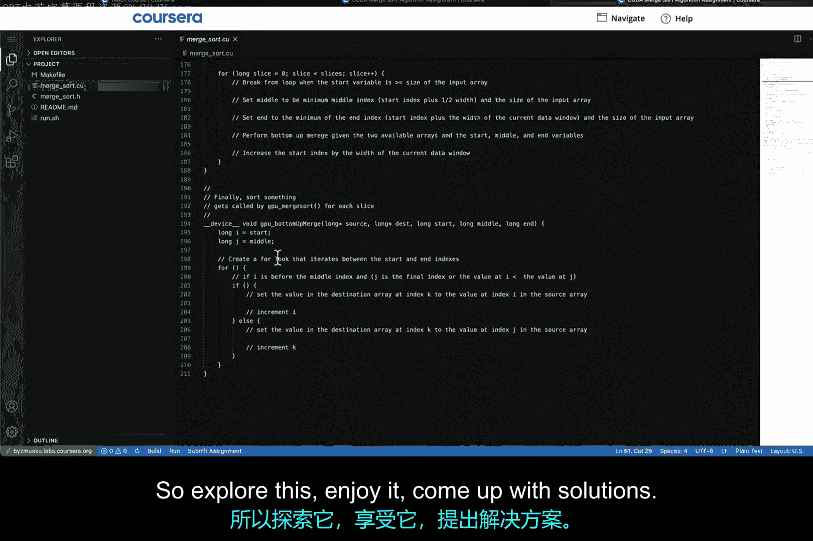

# 约翰霍普金斯大学《GPU编程（并发编程、并行编程、面向企业、CUDA高级库）｜GPU Programming》 p86 25_排序算法作业项目.zh_en -BV1a1421r7vw_p86-

Now we're going to quickly go through the merge sort assignment。😔，So that's obviously for module 4。

There are a series of buttons that do things like clean builds。Build code， run tests。

 submit assignments， Okay， that's pretty。Common， and there's a good description here of what each does if it's not self explanatory。

 Now， note that this is based。On。A nice overview of。

Multiple language implementation of merge sort from geeks for geeks。

 so you can look at it there to get an idea of the pseudocode。There are。

Arguments for threads per block in all the dimensions and the same thing。For blocks for grid。

 if you want to try to use this in a multidisal way right now， it's not really built。

To handle that too well， but it's worth it。Exploring the algorithm。

 the pseudo code for the algorithm， to see if that works。

 and then you can define the number of elements that will be randomly generated。

So let's go and look at the code。

All right， so here's the code， it has a main function that does things like par the command line arguments that I've previously stated。

Grate' an array of longs or the size you've passed in。Prince in the host memory from before the sort。

 and then it performs the merge sort and then prints it out。Note， this is the GPU merge sort。

Here and what it does is。It it' given a slice and that slice initially is rather small because you're going to sort down at the bottom of the tree of all if you're thinking of this recursively and as you bubble up as you've completed rounds of this merch sort。

 you're going to be given larger and larger slices Now less threads will be used。

As you go higher up that tree recursive tree， right it's not recursive in reality， we've unrolled it。

For all intents and purposes。So。Basically。What it does is it gets。

And you'll see that COcode here of exactly what it says to do。

 but one thing it does is it actually does this bottom up merge here which calls this bottom up merge sort and that itself does a loop so that's not optimal and it does some conditional branching but it's not bad implementation。

 especially first implementation of merge sort so explore this， enjoy it， come up with solutions。

