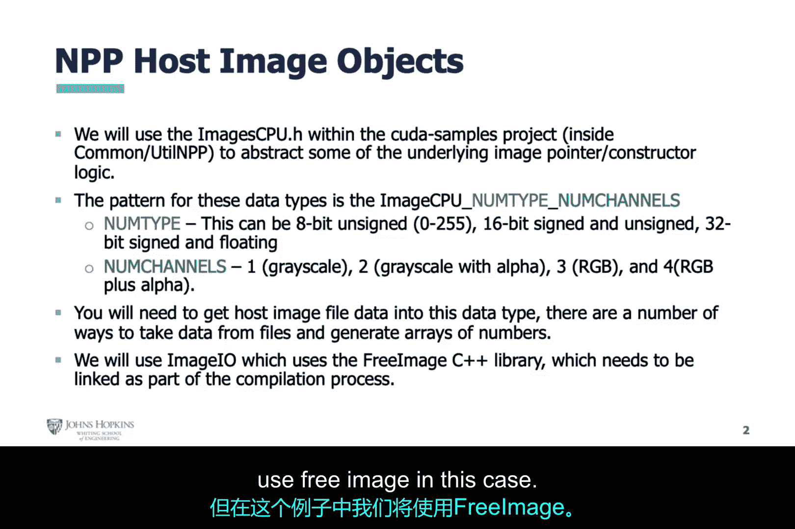
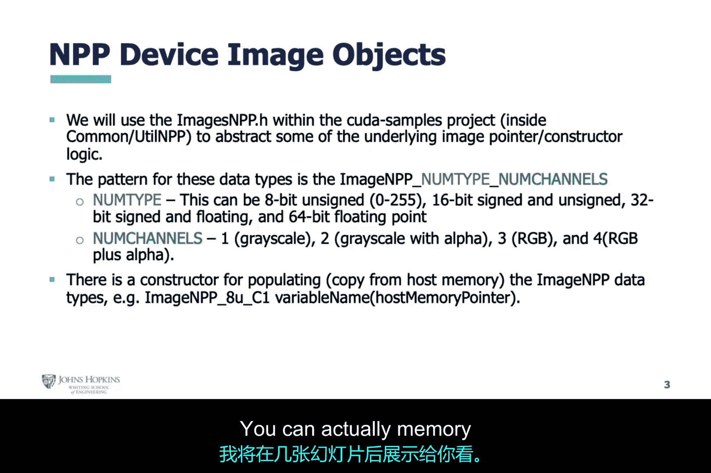
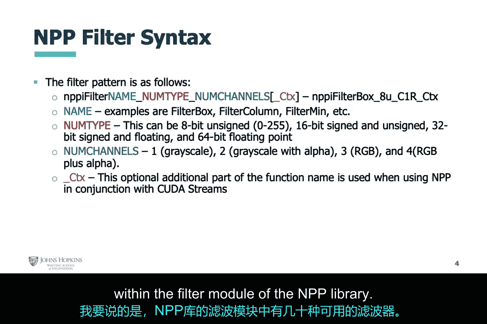
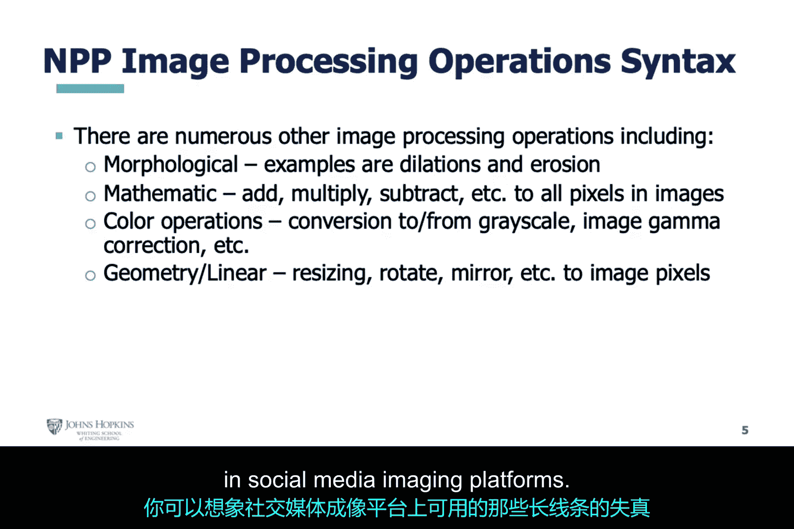
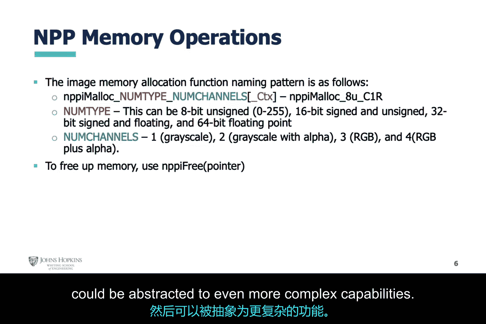

# 约翰霍普金斯大学《GPU编程（并发编程、并行编程、面向企业、CUDA高级库）｜GPU Programming》 p87 26_NPP图像处理语法解析.zh_en -BV1a1421r7vw_p87-

Now let's talk about the NviDdia。😔，Performance， primitives。Library or NPP。We'll focus on this lesson。

On the image processing capability， syntax that developers utilize。😔。

To make importing images into host memory。😔，More simple， we're going to use。

The image CPU capability within the common。UTil NPVP directory as part of the KUa samples project。

 it's a very good bit of code that abstracts away the very specifics of how the underlying data is represented。

Now there's a pattern for the objects or data types。😔。

It starts with image CPU underscore then the numb type。

 so it can be an8 bit integer 1632 signed or floating。

And then the next part is the number of channels。 So number of channels are the number of channels in the color spectrum。

Either there's one for gray scale， you can have two with gray scale in an alpha channel。

3 is RGB and4 is RGB。With an alpha channel， and when I say RGB， I mean red， green， blue。

So this is the data type， but you need to get。Data into that data type and the way you tend to do that is use library like free image。

 which is a C+ wealth library or you can use open CV or other libraries。

 but you'll have to make sure there's an easy way to get like the bits into。NPP。

 there are a number of ways of doing that， but we'll use frameage in this case。

With device memory， you have similar objects or data types。 They follow the same pattern。

 and we're going to go to the same place to get the slight abstraction around them， which is。

In images NPP in the U NPP folder。The major thing to consider here is that unlike the constructor for the host image objects。

This type of our class of data types is populated from host memory， so in the example its images。😔。

NPP 8 U C1， then you give it the variable name and you give it the host pointer。

 and then it does all the handling of like Malik or things like that。 You can actually memory。

 I'll show you that in a few slides， number of libraries inside of MPP for image processing。

We're going to talk right now about filtering capabilities。

So how the naming convention works for the functions is they'll startth MPI， the I being for image。

Then filter and then the name of the filter。The numb type numb channels and this underscore CTX underscore CTX is for when you're using kUuda streams。

 you don't necessarily have to include it。So the example that's here is MPP I filter box8 U C1 R CT TX。

 So this is a box filter running on。An eight bit unsigned。Image。😔，That has one channel。

 and the R is just， you don't have to worry about that so much。

 That's always going to be there for single。Channel images。The name can be any of the， I would say。

 dozens of filters that are available within the filter module of the MPP library。😔。

In addition to the filter capabilities， there are a number of other libraries。

Like if you need to rotate or resize an image， you can use the geometry or linear。

Filtering capabilities。You can do color operations to convert between grayscale and RGB。

Modify the gamma。For viewing in different ways， you can form mathematical operations such as if you want to。

Boost a channel， say adding more red to an image you could add。One to all the pixels in an image。

Under the red channel， and then there's morphological changes， which are a little bit more complex。

 but they you， might give you some nice。Looking images。

 you can think of that sort of along lines of the distortions that you get available in to you in social media imaging platforms。

 and now we're at the sort of most primitive。

Of these primitive performance capabilities， which is memory management。Using the MPP I Malik。

 and then that same pattern that you've seen。Well numb type， numb channels and CTX。

 you can define the low level memory for 8 to 64 bit。Images with one to four channels。And then。

When you're done， use the MPPI free and give it the pointer of the image。

 and that can actually be the pointer of the higher level abstraction。 it handles that for you。😔。

So note this， this is not a complete suite of everything you'd want to do with images。

 this is meant as fast performant。Computation done on images at a lower level and then could be abstracted to even more complex capabilities。

