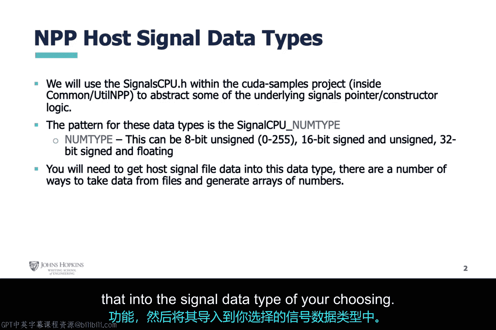
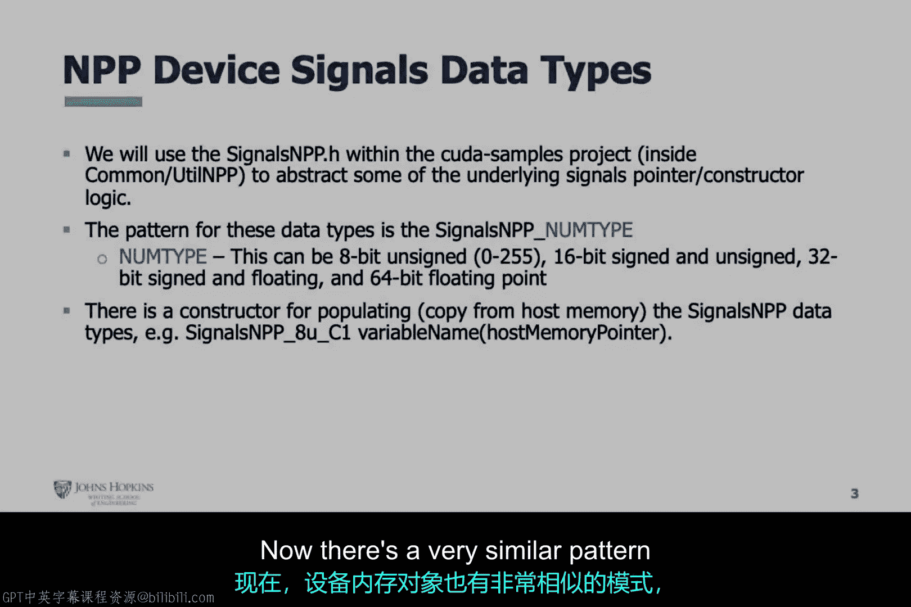
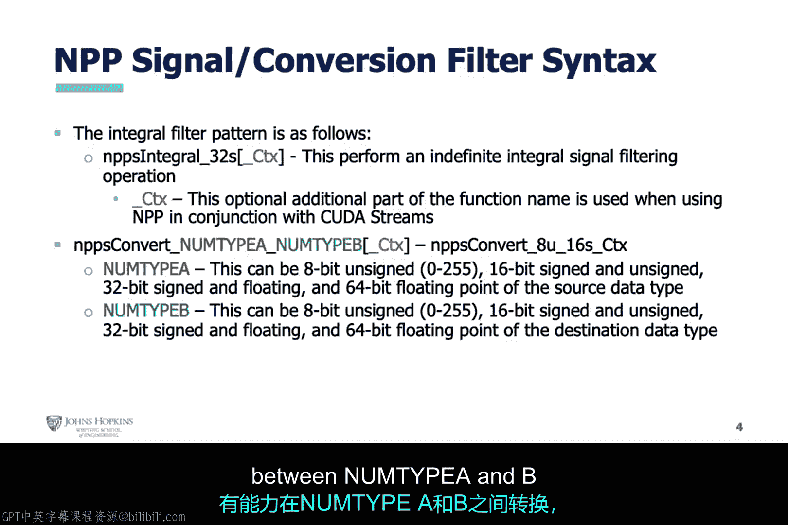
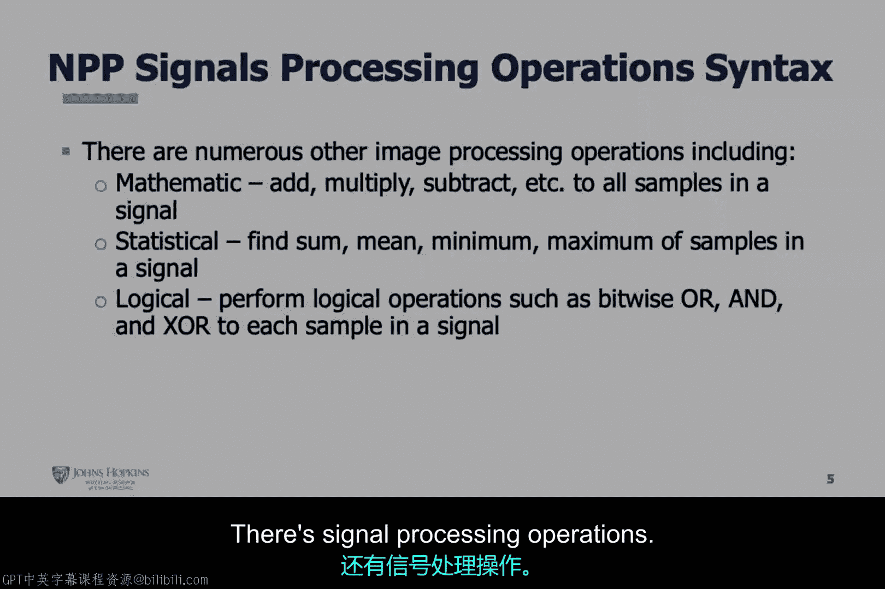
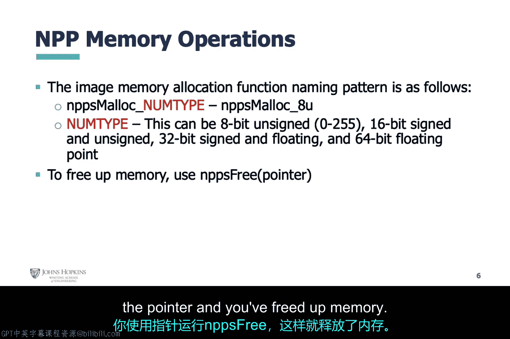
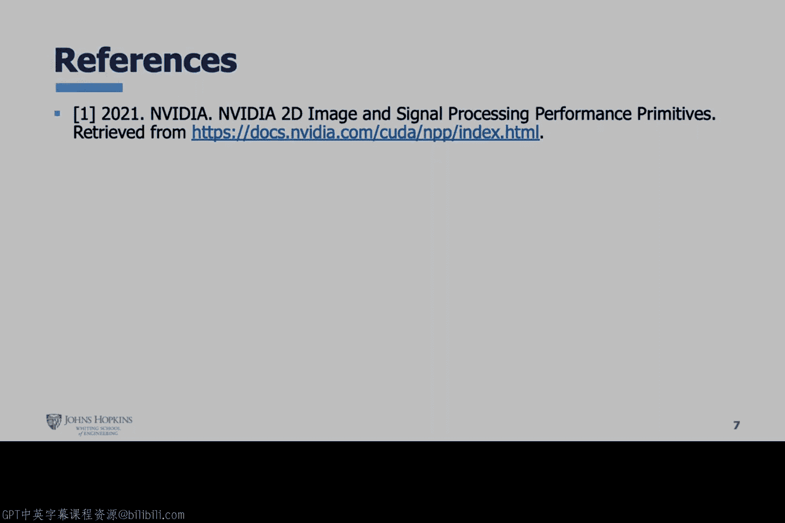

# 约翰霍普金斯大学《GPU编程（并发编程、并行编程、面向企业、CUDA高级库）｜GPU Programming》 p89 28_NPP信号处理语法详解.zh_en -BV1a1421r7vw_p89-

Moving on from what we've seen with MPP with images。

 we're going to find a very similar section of this library with a number of modules。 Now note。😔。

This part of the library is not as popular or might be hard to find。Examples。

 and the documentation is a little bit skimper here。But it's a common use case。

 so I did not want to disregard it。So just like with the image。😔。

Caapities we're going to use the U NPP Commons that's provided with kUDa samples。

It makes things a lot easier。 so specifically we're going to use signal CPU for the host data related to signals。

 so the data types are much simpler than with images。

They start with a signal CPU underscore and then the numb type。 and again。

 that's from 8 bit up to 32 B signed and floating and unsigned included in there。

 And so that's just the size of the signal and note that。

That you're dealing with a sample of that signal at different intervals。

So you're going to have to figure out how to get that data in based on the type of。

Data type you choose， whether it's unsigned and int a floating point。😔，And unlike with images。

 there's not a lot of libraries to support bringing in known image signals。 So you're going to look。

For。Caappailities to convert things like wave files。Into their sort of array of integers。

 and then bring that into the signal data type of your choosing。

Now there is a very similar pattern with device memory objects， so unlike signals and CPP。

 you'll use Sign NPPP， and these are the rinse primitives that NPP gets its name from。

So there is a mirror between the data type naming for CPU and device data types。😔。

They have signals MPP， as opposed to signal C P U。 and then they have the name type。

 There should be sort of a mapping 1，1 between them。

So you choose their data type from one and then choose。For what you're doing on the device。

 And then note you give it just like with。MPP image data types for the。Devicice memory。

 you pass the pointer to host memory。 so it's very similar when you look at the code。

 it would be very similar to the image processing code for getting data into different places in memory the number and variety of capabilities within MPP for signals is a little bit smaller。

 So from the filtering perspective you basically have an integral 32 bit signed capability。😔。

And then for conversion， have the ability to convert between nu type A and B。

 and it will deal with that for you another signal processing operations。

 there are some more things you can look at like mathematical operations。

 boosting or reducing the signal via add multiply subtract and similar mathematicalematic operations。

😔。

Statistical operations， finding the sum， the minimum。

 the maximum of a number of samples within a signal。

 and then a logical set of operations such as bitwise or and exclusive or or any of the sort of。

Basic logical boolean operations performed on all the bits within a sample of the signal。

 Then there are the memory operations very similar what's some with。Images， it's NP Malik。

 and then the nu type， yet again， somewhere between 8 and 64 bits。<|OTHER|>An unsigned。

 signed and floating based on the number of bits。 And then when you're done with everything you run NP free with the pointer and you've freed up memory。

