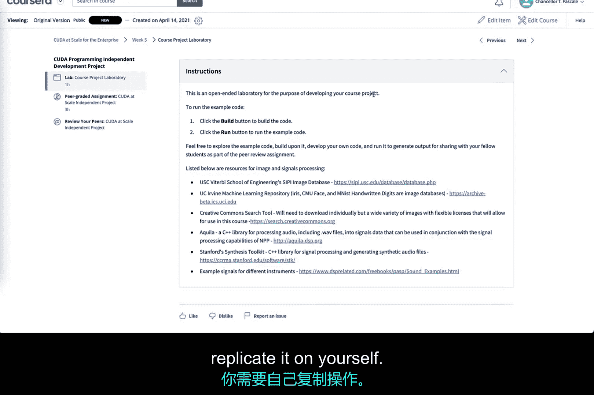
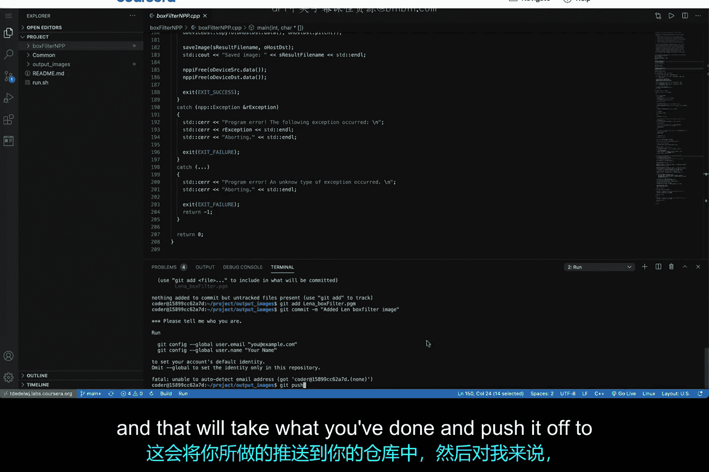
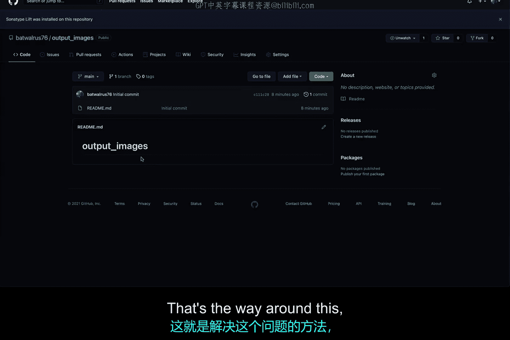
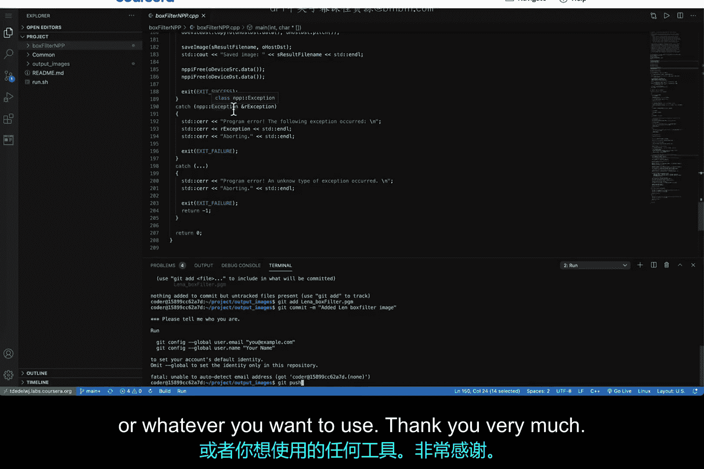

# 约翰霍普金斯大学《GPU编程（并发编程、并行编程、面向企业、CUDA高级库）｜GPU Programming》 p91 30_独立项目实验总览.zh_en -BV1a1421r7vw_p91-

So now we're going to go over the courseur project Labor。😔。

It's pretty much a sandbox for you to develop code， there is example。😔。

Libraries and stuff and sold and。Your awesome code。For。Running some rudimentary。Image processing。

 I want you to take it further， but this is sort of a sandbox。

 so you're going to get to do what you want here。The actual example code。

 which I'll show in a second at a high level， really you just to run it。

 you need to build it using the build button， and then the run button needs to be clicked to run it。

um。Some major things to consider is that， yes， this is something you might you want to use to just learn more about MP。

 but you might want to build upon it。 You might want to start your own code from scratch。um。

You might use the same build and run capabilities to generate output。😔，Now。This course project。

The assignment is a peer reviewed assignment and I'll go over how that works。

 but I want to make sure you know that I'm not creatingd this necessarily and that you know you want to show something that's interesting。

 something that makes sense to you。😔，And there are some nice places to get data that I list here for getting data for image processing and signals processing。

A constraint or something interesting about how you use the Coursera lab。

Is that there is no way to strictly download files directly from。The Vig studio server。Now。

 if you output things that like in the example code， I output a PGM。

 which is sort of well known image processing data type， especially for。Things that are， you know。

 sort of low complexity。The downside to that is while it it actually is written， sort of in English。

To certain Senate and header。The browser doesn't necessarily understand how to use it。

So you can look at it， you can see differences and that's the extent of what we're going to do for the image processing lab activity。

 what this is， but when you're writing your code here。

What you're going to need to do is run out your code do whatever you need to do on the GPU。😔。

But when you're done with it， you're going to need to have a git repository。That you've cloned into。

The lab such that you can add the output files and then。Push。😔，Those changes。

 so it's not easy for me to present， but I'll sort of walk through it and you'll have to replicate it on yourself。

<|OTHER|>So this is what the lab looks like， like I said there's aBuild in Run button at the bottom。

I had some example gray sloth images。here's our friend， the sloth。AndWhat you're going to want to do。

 is you can see also in this box filter example is。You're going to run this code。

 you're going to give it an image， unfortunately this can't be open because it's rather large。😔。

<|OTHER|>And same thing when you look at the PGM file， when it loads。

 it's going to say it's a 52 by 52 pixel image， 255 chat。Bits or value 0 to 255。

 So that means its you know， it's a single channel image。But this is binary information， it's not so。

 useful for you， but it actually has some filters occurred with it。

So what happens is let's look at the code here。It's a C++ it code。 It's not co。

 I remember because it's actually， for the most part， just doing things using the underlying。

MPP library， and I've shown you much of this， the only thing that's different is。That。

You can pass an argument for the input。And， you know。

 we won't go into too much detail because it's very similar to what you have had before。

But you pass an argument for the input。<|OTHER|>And then with the dash dash input。

 and then it will take that file， find it otherwise。

 it'll just find this is a technique that finds a file in this case uses this classic image。

<|OTHER|>Capability， it'll open it up， it'll tell you if there's a problem with it opening up。

And then。It's going to output a file， which is this underscore box filtertered。 PGM。

And then it'll make sure that the。That there's an argument that says where that file should go by default。

 it will just add that into this and then it'll just store it locally。

<|OTHER|>It does the loading of the image conversion into gray scale if it needs to be。

 and then it's actually sort of done automatically because if it's not a gray scale image and it's R GPP。

 when you give it this data type， it downselects it to one channel。And we've。

 we've gone over the syntax here， and then it will save the file and then then。

It will give you any errors if they exist。 So click build。

<|OTHER|>You'll see this little build that may take a little while。No problems。 And then。

It's gonna run。And it does this based on the。Lina image and outputs it to there。 Now。

 what you're going to need to do is in your project， I'm going to jump up a little bit。

 So we're going to。Change directory up。Two of just above the project。So let's see we have here。 yes。

 some Course folders。 Maybe it makes more sense to push down into。The project。

 because the project isn't。Check that from Git。 It's actually using。A predefined image。

So you're going to have to do select gi。Cown， and then I have。I've created my own little output。

Repository， you're going to clone that。And then you're going to one to。Like something like copy。Copy。

 say。This and。Box filter PGM file， which is the output of the。Box filter， you're going copy it into。

That repository， that kid repository just created。<|OTHER|>And then I used pushed to could change direction。

Down into the output images。And then you can do some like gi status to find out the status says you have an un tracked file so you'd have to get add。

And if I'm only a decent Git user， so feel free to do things better。

And then you want to maybe do a message for your commit， which is。Something I got it。Later。

Box filter。Image。And then if you haven't， it's going to ask you to。Update your， your configuration。

 so。You'll put in your email address there。 You'll do the same thing with your username， and then。

Once that's done， you run， commit， and it's successful。

I'm not going to show you my personal email address。

 then you're going to do a git push and that will take what you've done and push it up to your repository。

😔。

And then it would， for me， under my Github user， it will show up here。So that's the way around this。

 you'll just have to use GitHub if you have suggestions， feel free to send me。

 put them in a discussion and then I will look at them and see if there's alternatives。

Unfortunately， most of the download。Plugins for Vi Studio code server didn't have a really good background I didn't understand where they were coming from side rather。

Have you managed this via Git in Gitthub or Gitlab or you want to use。So， thank you very much。

