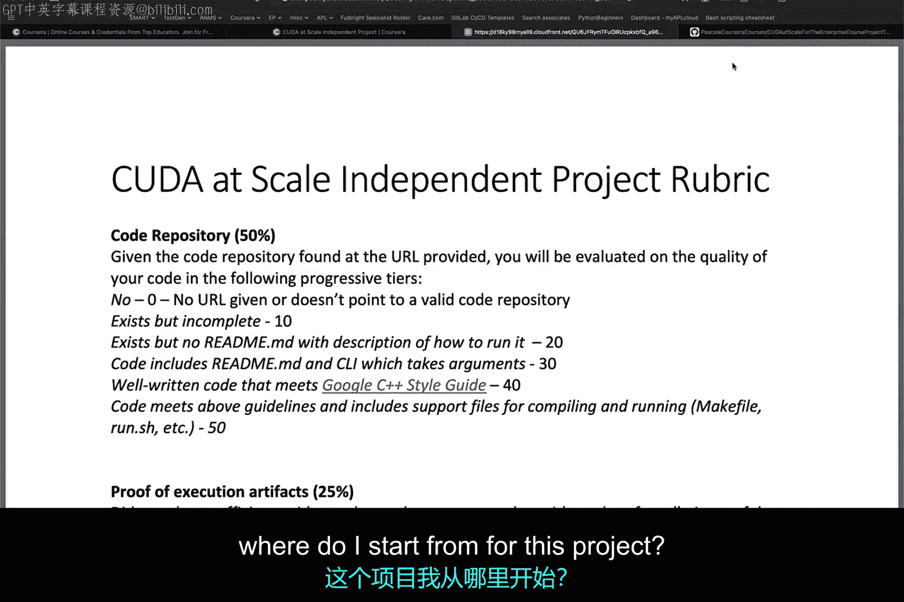
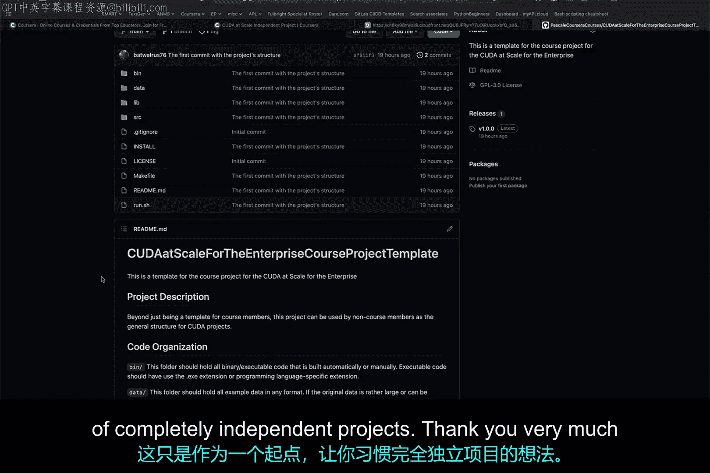

# 约翰霍普金斯大学《GPU编程（并发编程、并行编程、面向企业、CUDA高级库）｜GPU Programming》 p92 31_独立项目总体说明.zh_en -BV1a1421r7vw_p92-

So I want to go over。What this independent or course project for the Kutat scale course is。

It's peer graded， I have a discussion specifically about the peer grading。

 I'm going to quickly go over the instructions yet again just in case。

 and then I'll show you the submission and then I'll show you how I think you should progress through developing your own project。

😔，So the first thing is all the review criteria are described sort of generally here that a code repository。

 the proof of execution and short text description of your work is very helpful。

<|OTHER|>And will be used to grade you， so there's some discussion here about some alternative data sources that you can look at and use and there's the rubric。

 which I'll show you really quickly。<|OTHER|>And basically the code repository is 50% of your grade now all I say is that it's a URL。

I would prefer that it is a git or similar repository that conceivably， you know。

 even the other students could clone it， it has to be publicly available。

Now you could include a URL for something like a Google Drive folder or box folder that is shared。

Only for that folder and that it has its structure， it has to be publicly available yet again。

And then there's some things about specifically what's needed in there and some coding style things。

 so basically this is about your code your code repository。

The proof of execution is showing that you've done some work。

 the more sort of interesting it is with images， videos or signals。

I focus a bit on images throughout， but you I want it to be clear that， you know。

 if you're willing to go the route of converting like a wave file or other audio file into you know the right structures。

 which I go over a little bit in the videos for this。Module then is perfectly fine。

 There's no problem。 I would prefer that the proof then go all the way back out to an audio file and I understand that might be strange if you do certain effects。

 but that would show the difference between the inputs and outputs So basically the last part is this code project description now this should actually reside also in your readme。

md， especially if you have a Gitthub or Gitla。com project， but you're going to take the text。

For the description and put it into there and it has to describe what you wanted to do。

 the work that you did， any thoughts that you have on after you've completed or been unable to reach all of your goals。

 this isn't about creating the best application in the whole world it's just showing that you've learned and help students get context for possibly a new use case。

 so all those things get make up your grave。Now you might say。Well。

 where do I start from for this project， so what I've created。

Under the basically where I create all of my projects for this course the Summer private Summer public is under Pascal。

 that's my last name， courseursera courses and then could at scale for the enterprise and then it's the course project template。

 it's public， it doesn't actually have a lot in it。

 it has this readme that describes where things generally should be placed that has a short description。

 it says things like well， there should be a readme here， the source folder， you know an install。

 if you're going to have the human actually install it。

 another thing is make file or SeeMake lists or anything like that that will built it and then a script to run it。

 or at least you know this document here should describe how it's used。

You should have something similar if you're going to go the route of something like a shared folder that you share Now I think I'm of the minds that the sharing your code is very helpful so I would prefer though I won't change your grade in any based on this I would prefer that you use Github Gitlab co or bit bucket or something like that that allows you to publicly share your code now we're all under an honor code and so basically what I'd like to see is like you could fork this or you could even fork another repository but the one thing I want to see is under insights as both the reviewer and you you should be seeing things like whether pull request。

 if you're really good you know are there。Things like active issues now I don't necessarily expect that。

 but that's a good sign especially if it's taking you a few weeks。

 but really here it's like they give you this little synopsis of what's happened so I'm the one author I've pushed two commits and then it says like you I haven't changed any of the folders on main since then and there's this main additions and deletions and you can actually even go back to the code and you you could look at the branching scheme but just so you have an idea of what's happened。

 you don't have to create or release know I mean you could keep the same GPL3 license which pretty much says。

That， you know。Aside from certain uses that people can fork your code and develop your code and that's exactly what I have and also notice that it has a commit。

Hash here， it says this commit， it was executed 18 hours ago and how many commits there have been overall you can actually。

Jump to those commits， and it'll tell you what happened in them。 So I'd like to see， you know。

 when you do。You do the reviewing if someone gives you a GitHub or Gitlab project you figure out how much work was done and it should be fairly easy but you know sometimes it's good to see that not a lot of work was needed to have a really large output and I don't have any example code here these files are all aside from the Gitgno and the Giign ignores are under and the Git keeps that are under each of those directories to keep the structure for a Git I do not put anything here I'm just giving you like aside from really the reading me I'm just giving you the structure that's why it's called the template and not like a base project。

😔，So so this is you know， this is really just the start what I want you to think about what might be good to putting a read me is especially on a project description is you know what am I trying to do here。

 you know you're trying to， you know I want to see if converting between gray scale and color and then back。

 what effects do I see what are the differences you can even calculate those differences and actually you know。

 I do a。😔，It's not that hard and you can even do it if you choose a either in your code or externally。

 there are tools to show the difference in two images by pixel。

So that's one thing you could do you could say well， I want to perform different filters on it。

 but explore NPP， or if there's something else we've gone over that you really feel strongly about。

 you can also do that just because MPP is the module that this exists in。

 I just want to get you used to doing something a little bit more free form and also being able to perform a peer review because the next module is going to be much more geared towards that and the project is going to be a little bit more extensive so the other thing you could think about is if you are interested in NPP or you have a topic you're interested in this could be like the start and then we'll move on to like something a little bit more complex or you know the codebasal grow。

 things like that but。Really just start with the description， Think about a little bit。

 Think about what you've done already。 you know， don't go too far you know what's already been done。

 This isn't you know， a weeks， weeks long project or you know， you shouldn't be spending 24 hours。

16 hours on this。 I just want you to spend a few hours taking some code you've already been writing or something you want to try out and just try it out。

 you know， do the minimum that you think will show that you understand the coding that you're doing that it has an effect that's recognizable because you you know your fellow reviewer is going to look at it。

And then put it in a package， right the other thing is this has to be sort of packaged up。

 So you have to have the URL for wherever the code and possibly the input data is being shared。L the。

Actual artifacts， both inputs and outputs。 if you want it the to show the difference between images or signals。

 you want to package them up using a zipper， a tar G zip or something along those lines。

 And then a good description。 and not just the description。 It's here because the purpose of。

This material is such that someone coming to your project who wants to go beyond like the very high level description here understand some more details about your project。

The project description is going to include things that you wouldn't normally put here。

 like things that have failed or things that really worked really well more about your experience with doing the project。

 So if want you to enjoy this， I won't your gradingness to see this one has put in effort and appreciate that effort that they've put into it。

 Give them good feedback there is a place to give freeform text feedback and use that as like a real good way to tell someone you don't even know whether you like or dislike parts of their code or issues that you had or things that you thought were really good or you hadn't thought about doing but be constructive。

 professional and concise。 So hopefully this has gotten you starting about how I'm going to develop the project。

 Don't take it too heavy。 This is just meant as a sort of launching board and getting used to the idea of completely independent projects。

So， thank you very much。