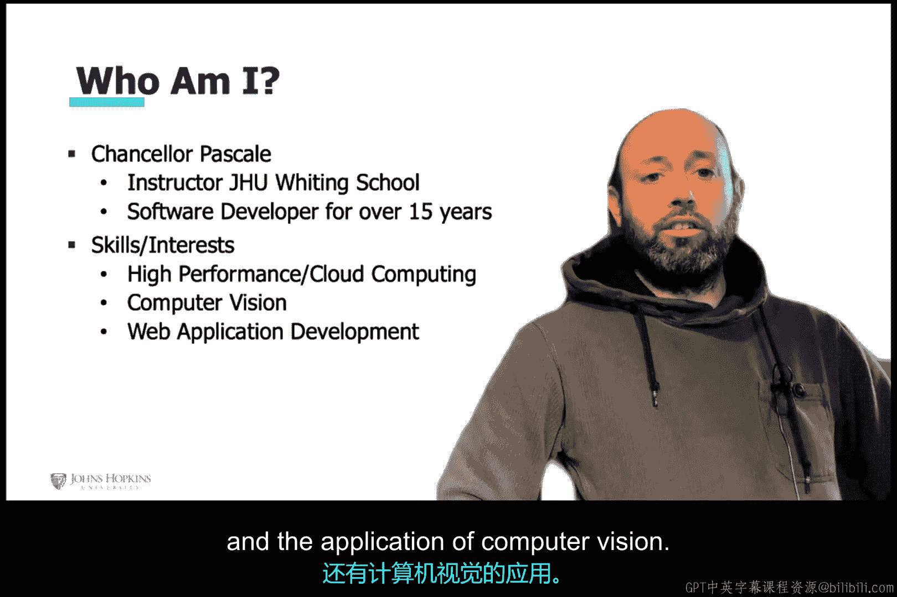
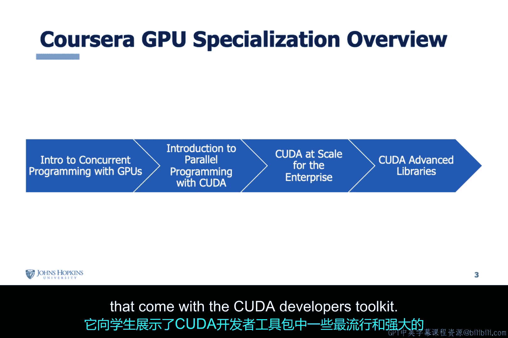
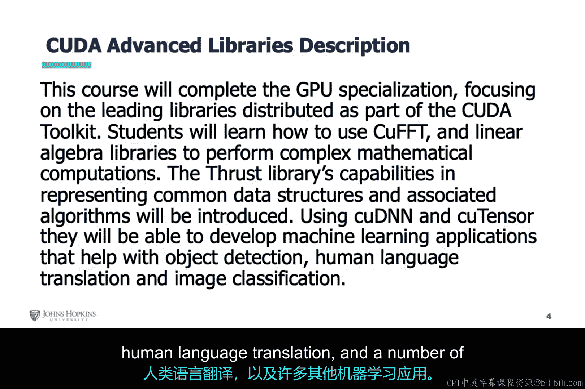
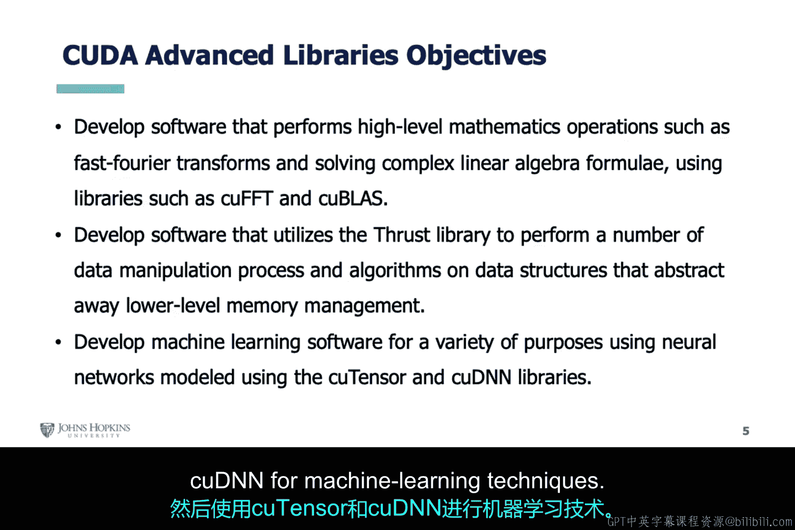

# 约翰霍普金斯大学《GPU编程（并发编程、并行编程、面向企业、CUDA高级库）｜GPU Programming》 p94 0_GPU编程专项课程视频4.zh_en -BV1a1421r7vw_p94-

Hello and welcome to the KUDa Advanced Lib's course。

We're going to go over the GPU programming specialization and how this course fits into it。我 who买。

I am Chancellor Pascal。I have been an instructor for 10 years at the Johns Hopkins。University。

 Whiting School engineering。A software developer for 15 years。

Ht performance and cloud computing are interests of mine。

Along with web development and the application of computer vision Now I would like to give you an overview of the Coursera GP specialization。

The first course， which you are currently in， is introduction to concurren programming with GPs。

 which I will describe in more detail in the next slide。

The next course in this specialization is In to parallel programming with Kuda。

 This course focuses on the basic hardware and software capabilities that NviDdia GPus and the Kuda programming framework provide。

 The third course is Kuda at scale for the enterprise。

It goes into more complex capabilities of Kuta and how they can be applied to scale beyond the programmer's machine and on to enterprise hardware。

 The fourth and final course in the GPU specialization is Kutuda Advance libraries。

It exposes to the student a number of the most popular and powerful libraries that come with the KupaDevelops toolkit。

So let's talk about the CUD Advanced Lib course， it's the final course in the GP specialization。

 and it focuses in on some advanced libraries that KUDa ships with。

Some of them are for doing higher level maths， such as fast forwardator transforms or linear algebra。

Then there's the thrust library， which abstracts away some of the pointer mathematics and memory。😔。

Cappabililities and also gives you some core libraries。And then finally， we'll do some。

Machine learning， applicable libraries in QoDNN and Coo Tensor， which。

Can be used for things like object detection， human language translation。

 and a number of other machine learning。

Applications so what are the objectives of this course？Sort of three main ones。

 one is to allow you to develop higher mathematical。Caapbilities using CoopLs and coFFT。

We'll move on to using thrust to learn how to manipulate data at a higher level。😔。

And then using Qo Tensor and QDNN for machine learning techniques。

Well， that's it for this presentation。Hopefully I started you to think about what you'd like to do in this course and the GP specialization in general。

