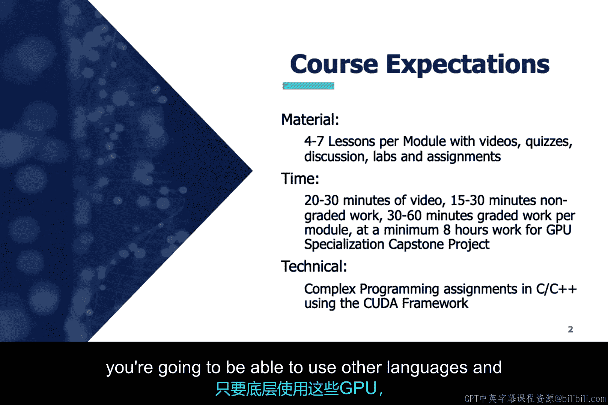
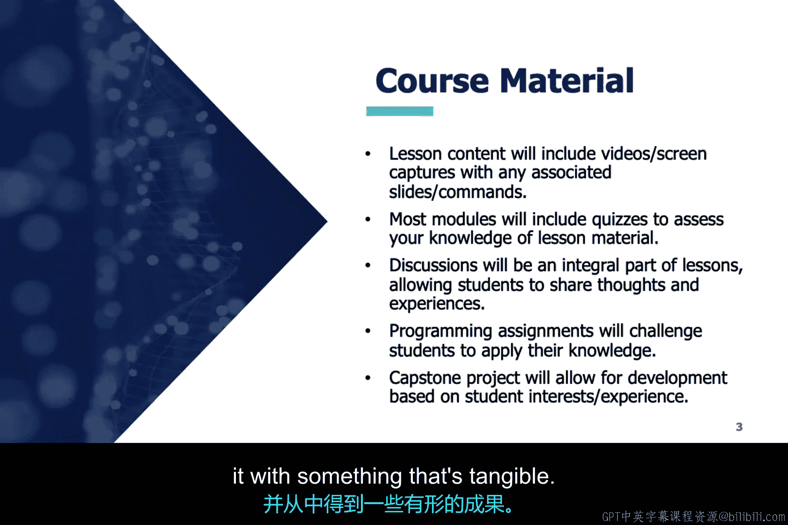
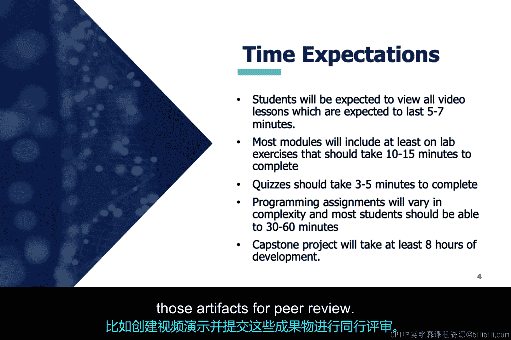
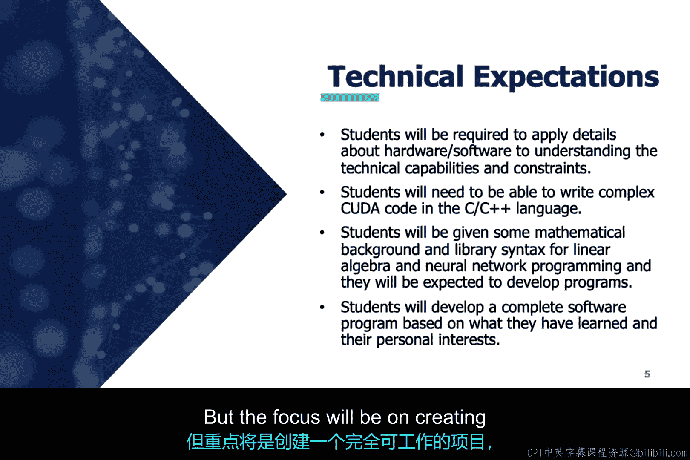
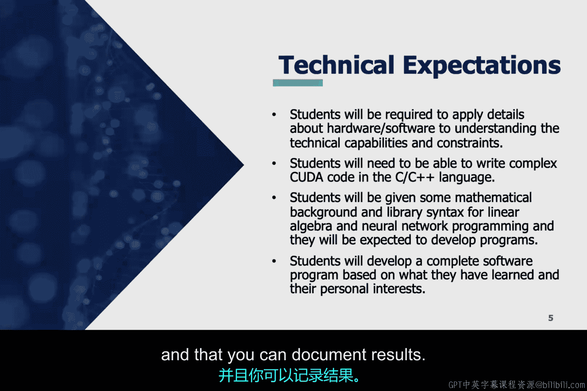
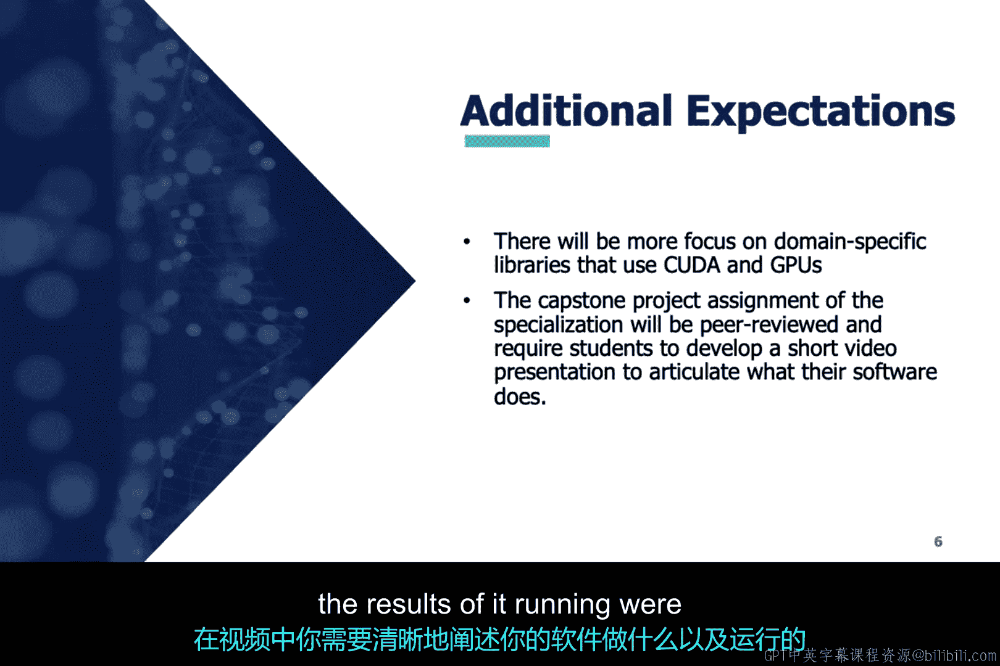

# 约翰霍普金斯大学《GPU编程（并发编程、并行编程、面向企业、CUDA高级库）｜GPU Programming》 p95 1_课程期望视频4.zh_en -BV1a1421r7vw_p95-

Hello and welcome to the discussion of course Expations。😔。

For the KUa Advanced Library's course as part of the GP specialization。

Now let's discuss the three categories， of course， expectations， material。

 time and technical expectations。So material hasn't changed much between other courses in this specialization。

 you have four to seven lessons per module， and they'll have things like videos， quizzes。

 assignments， labs and discussions。For each module。

 you can expect to have somewhere between 20 and 30 minutes of videos。

15 to 30 minutes of or even longer if you want nongraded work。And then based on the assignment。

 the module。😔，You'll have 30 to 60 minutes of grade work。And at the fifth module。

 you're going to have a eight hour at minimum project that's a capstone for your coursework。😔。

And from a technical perspective， we're moving from simple programming to complex programming assignments。

They incorporate other things to know like math and such。And， you know， we're developing and see。

Plus plus using the Kudter framework， but in the capstone project， which we'll discuss in the video。

 you're going to be able to use other languages and other frameworks as long as under the hood they use GP use。

So for material， the expectations are that there'll be videos and screen captures with slides and commands that go over the lesson material。

Many modules will have quizzes to assess your knowledge。😔，哦。

Modules will have discussions which allow you to share your thoughts about an integral part of the lesson material。

😔，You'll then move into programming assignments which。

Give you an opportunity to apply your knowledge。😔，And then the capstone project is going to give you a lot of freedom it's going to allow you to explore。

Your interests and experience and come out of it with something that's tangible。

From a time perspective， you're expected to watch videos。That cover the material for a lesson。

 and each of them will be targeted at five to seven minutes， some will be shorter。

You'll have a lab in all modules and you can take 10 to 15 minutes or longer if you want to explore further。

Then maybe quizzes， they're fairly short。😔，And I'd expect you to be able to complete him pretty quickly。

 programming assignments yet again， you have some freedom as to how far you want to take things。

But they're aimed at being able to be completed in 30 to 60 minutes。

The major effort from a time perspective will be your capstone project。

I'm thinking it'll take you at least eight hours because you have to go with that design in your head。

 implement this。And then sort of do things with the artifacts。

 like create a video presentation and submit those artifacts for peer review。😔。

So what do I think you need to do from a technical perspective while you're going to take lessons that have。

Details about software and hardware and apply them to。Programs that you make。

And you're going to have to understand the technical capabilities and constraints of GPs。

You'll be writing complex Kuda code and C++ and C as we've done in the past。😔。

I'm going to give you some small mathematical background， some information about a library syntax。

 and you're going to complete programs that apply those lessons。😔，And then for your capstone project。

You're going to need to create a complete piece of software that applies something you're interested in or have experience with。

 but the focus will be on creating something that completely and that you can document results。

So there are two additional expectations， one being that as opposed to core。

 KUuda and GPU programming， you're going to learn domain specific libraries。And topics。

 and you may have to explore outside the content that I provide。

 but I will give you references and there's tons of places you can look for interesting explanations of very specific characteristics of libraries。

😔，And then for the capstone project on top of developing code and maybe outputting content or data。

 you're going to need to develop a short video and in that video you need to clearly articulate what your software does and what the results of it running were。

😔。

