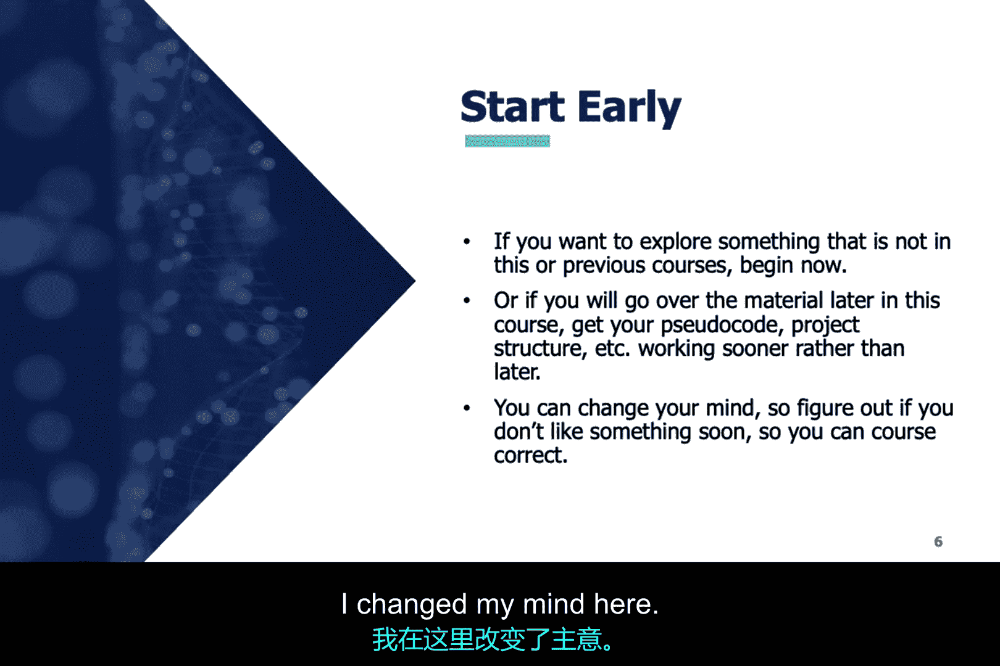
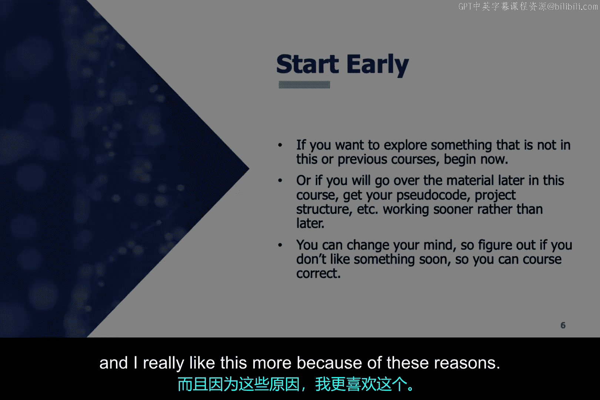

# 约翰霍普金斯大学《GPU编程（并发编程、并行编程、面向企业、CUDA高级库）｜GPU Programming》 p97 3_GPU专项毕业项目视频.zh_en -BV1a1421r7vw_p97-

In this video， we'll discuss the capstone project for the GPPU specialization。

Which will be due at the end of module 5。So the goals for the capstone project are that you've gone through four courses。

And now we want to apply them。😔，In a nontrivial manner。So。

You can look at anything we've already done and go in more detail， where you can take on a new topic。

 a new technique， a new framework， even a new language。

Even if it's never been discussed in any of the courses。

 but the point is that you're going to apply what you know about GPUs。😔，And see what you can do。

 you want to develop code that's something you're interested in or you have experience with or even can apply at work。

And you want to show that to your peers， you're going to help educate them as well。

So you're going to need to deliver four things for this cap project。

 one being a URL for a code repository that can be Github， Gitlab。com， Bit bucketet。

 a can Google Drive box， or Dropbox location， something that others can。😔，Anonymously look at。

So it has to be public。Y'all need proof of execution in the form of different artifacts with Earths。

CSV files， images， things like that。You'll need to be able to clearly describe what your project is and what it does。

😔，And then finally， you're going to create a video presentation that conclude demonstration probably should include include demonstration of。

What you're trying to do， you can include results and things along those lines。😔。

So the focal point of your peer reviewed。Project will be a presentation。

 it should be relatively short，5， 10 minutes。Maybe you make it slightly longer if you need to。

 it should include slides， code。A demonstration of what's being done and any mixture you want of those。

You want to say where you started。 So what were your objectives。If there are any algorithms。

 technologies， languages， you can give a background。

 set of slides on that or just describe it in general。😔。

Say where you ended up and where you'd want to go。 and what's great is if you can show something visual if there are graphics。

 charts。Demonstrations are interactive or visualizations， images， that's awesome。

 though that shouldn't be the only thing that you're going for。

 do something you're interested in no matter what the artifacts are。

So what I think is most important about this capstone project is that you do something that you care about。

 It's not about my or the peer of yours interests or expectation。It's about yours。

I want you to feel you've accomplished something that the time spent in these four courses。

Was worth it。Maybe if it's something you're trying to do that's risky that may not work。

 that's perfectly fine， you know try， try， explain why things didn't work。

 or at least why you think they didn't work。And that's a lesson for others on top of that。

 I would really encourage you if you want to explore something。Choose a new topic， right， say， okay。

 I haven't done this type of thing and don't be worried about the results。😔，Try to learn something。

 don't cram something in， try to， you know， get to a point you've learned something new whether it's。

A new algorithm， a new framework， a new language that's probably hard to do in eight hours。

 but if you want to apply it to a new language that's awesome so make sure you enjoy yourself when you do this one thing I I encourage students to do is to start thinking about what you want to do for that project now it doesn't have to be like you're coding you know right now but you can be doing things like you know the list of topics we've gone over the libraries we're going to go over in this course and say do I have interest in that or do I want to explore something different you can do。

😔，An implementation in a CPU organized。😔，All way or you can start reading pseudocode。

 you could come up with a project structure， the more you do now the less of our hurry you'll be in later and the more you'll get out of it。

And let's say you're a quarter of the way through。😔，And you understand that I really don't like this。

 this is why I really thought it was so I want to look at another topic feel free to change your mind。

 the one thing I would say is keep notes on what made you change your mind because in your presentation it's perfectly fine and will help you by saying this is where I started at I changed my mind here this is why I did this and I really like this more because of these reasons。

😔。

