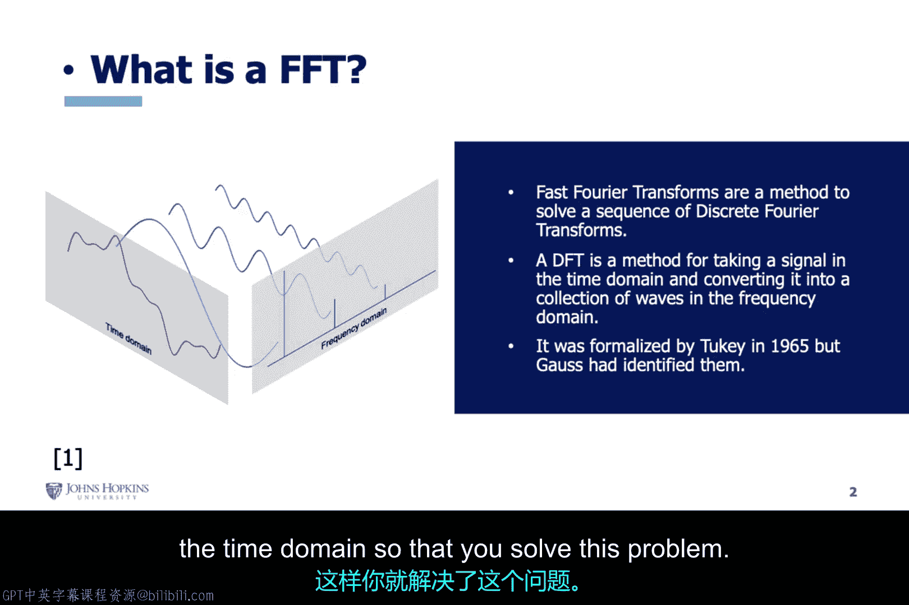
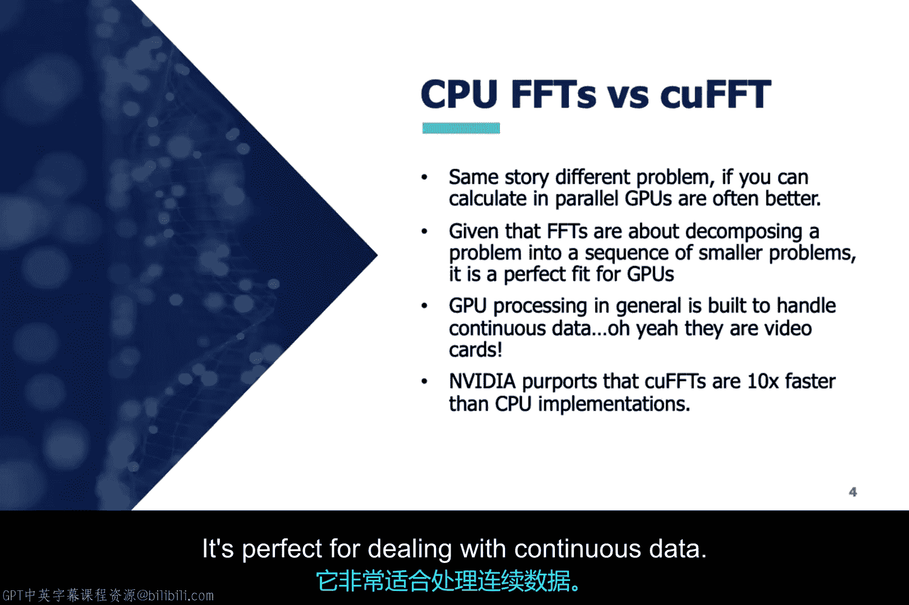
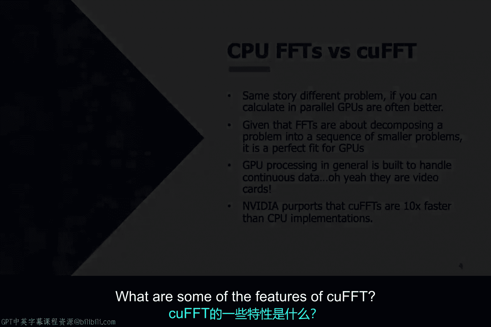
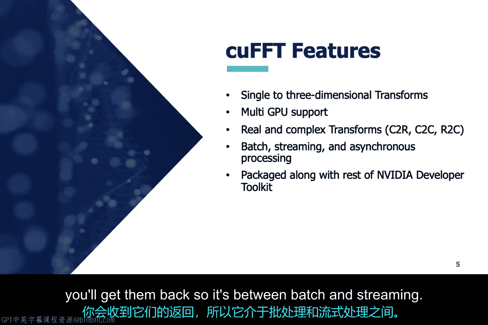

# 约翰霍普金斯大学《GPU编程（并发编程、并行编程、面向企业、CUDA高级库）｜GPU Programming》 p98 4_CUFFT库性能与特性视频.zh_en -BV1a1421r7vw_p98-

Hello and welcome to the wild world of Fast Forrier Transforms and the Kup FFT Library。

 specifically its performance and features。So let's talk about fastforier transforms。

They were discovered。Pretty much by Gauss， but formalized into a paper by Tki in 1965。

So if you look at the diagram on the left， signal on the left when it's transformed into the frequency domain。

Via a forward transform。It can then be decomposed into a set of signals in the frequency domain that are then combined to then be inversely transformed back into the time domain so that you've solved this problem。

Why should you care about this well， first off， unless you're really good at math calculus is pretty hard。

And from the perspective of the time to solve these problems， generally。

 they work to the order of n squared， which is not。

Necessarily a good thing to have you want polynomial time， right？So we use FFTs。

It transforms the problem into O of n log n， which is much faster。That might seem minor。

 but it really does make a difference when you're considering things like continuous video。

 continuous audio and you want to make。Those calculations in line。

 no major delays between the time a signal comes in and when it goes out。

So this often happens in high quality hardware。 Now。

 why do we care about doing this on a GPU versus a CPU？Supposedly。

 NviDdia says that it is 10 times faster to do these computations using the Q FFT library versus the CPU implementation。

But let's just think of the problem of a single signal。

That needs to then be decomposed and calculated into a series of signals。

So what is the main reason you use GPUs， well you decompose large problems into smaller problems。

 so that seems like a good idea， another thing about GPUs that are really good for this。

 especially if speed is your concern is that GPUs because they're built for video cards。

 and what do video cards do， rapidly render scenes， video， audio， things like that。

Perfect for dealing with continuous data。 So it's a perfect fit。

So what are some of the features of Q of FT well first is its。😔。

Package along with other libraries in the NviIDIdia Develop toolkit that comes along KUa。

It handles multidimensional transforms。Both from single。

 which are fairly easy to very complex and dimensional transforms。 now， of course。

 the higher the number of dimensions。The more complex it is， the slower it is。

 So there is a relationship between the dimensions。In the speed of computation。

More recently it started to support multiple GPUs， so this is really really helpful if you have a cluster or if you set up a rig that is for video processing and you need to perform these transformations。

The transforms that handles are real and complex in between them。

 and that's very important because not all of the computation is in the real domain。

Then it has three major processing modes， the first being batch。

 so this would work under the circumstance where you're not real time processing data。

 but you want to process more efficiently a lot of data。

Streaming is very helpful when you're dealing with trying to as in close to near term near time。

Processed data。 And there are many， many use cases for that。 And the last is asynchronous processing。

 which means。If you have a bunch of signals that you're receiving from say a file or from some sort of network call。

 you can send them out and as they're processed， you'll get them back so it's sort of between batch and streaming。

