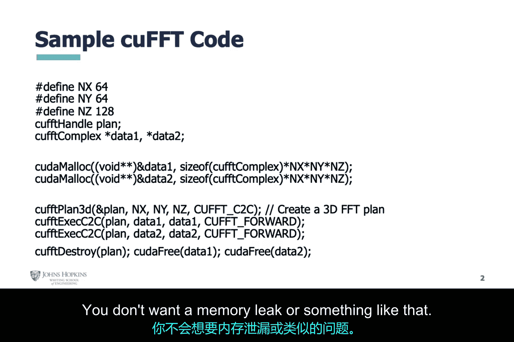
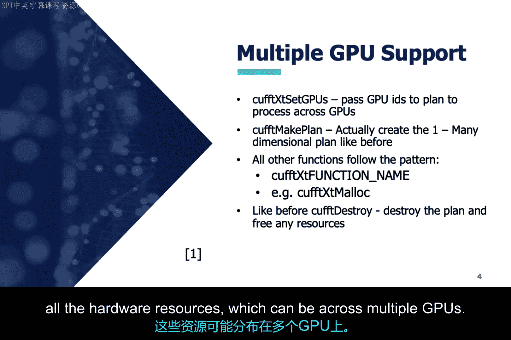
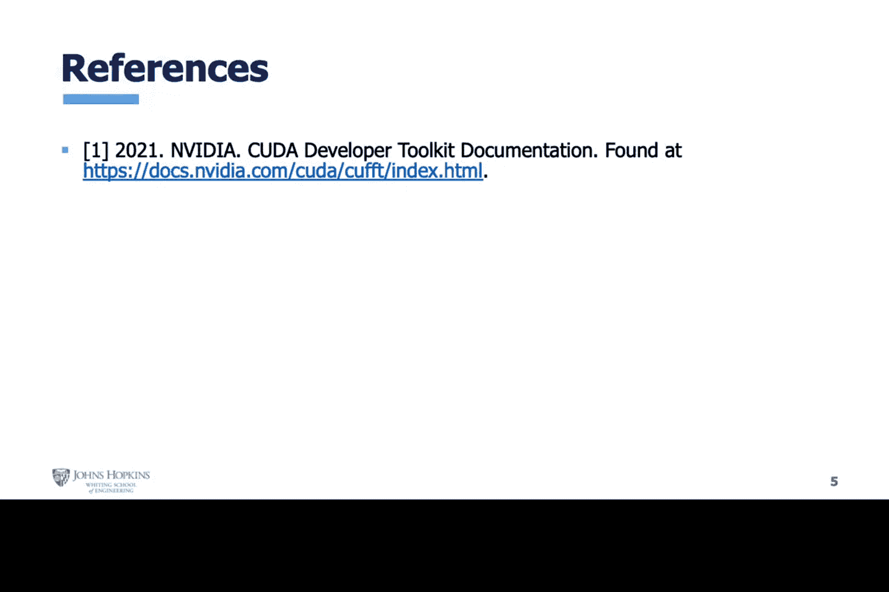

# 约翰霍普金斯大学《GPU编程（并发编程、并行编程、面向企业、CUDA高级库）｜GPU Programming》 p99 5_CUFFT库语法解析视频.zh_en -BV1a1421r7vw_p99-

This video lecture will dive into the syntax for using with。

FFT we're going to walk through a simple example， not complete。

 but enough to give you an idea of the steps that are going to be taken in a co FFT software application。

😔，So we want to define the X， Y， and z， the number of elements in our three dimensional。Pointters。

 so that's why we use these defines。You。😔，create a co FFT handle by practice we call them plan。

 notice that when you use other advanced libraries， you're going to see a similar handle。

 which is used to manage what the advanced library is going to do。

Now we have to make pointers for complex data， so we use the QFFT complex data type as the pointer type。

Then as with any kupa。Library we're going to allocate memory using something like ka malic。

 we tell it what we're going to where we're allocating the memory， that symbol。

Data 1 and data 2 in this case， and then we calculate the size。The next step is to create the plan。

And you do that using QFFD plan 3D， if it was 2D， B 2D， etc。So you pass it plan， the size in X。

 Y and z， of course if this was a 2D you would have x and Y。

 and then the type of plan you want to create in this case， you're going from complex to complex。

 so's Q FFT underscore C to C。And then。We're going to do two。C to C transforms those transforms。

 you need to execute the C to C or complex to complex plan。

 So you do that via the Q FftT exact C to C note， it would be if it was real to complex。

 it would be R to C or complex surreal would be C to R。So you pass it to plan。

The data to and from in this case we're just going to。

Do the transformation from data1 to data 1 and then the direction or type of transform that your plan will execute。

 which in this case for data 1 and data 2 are Q FftT forward note。

You would do a calculation and then you would do an inverse transform back into the time domain。

 but I'm just trying to keep this a little simple here。

And the last thing you should definitely do is destroy your plan and frame memory this。

Freeze everything on the hardware， which you don't want to keep that sort of thing around。

 you don't want to memory leak or something like that。

 Now quickly want to go over this table that comes from the QFFT documentation。😔。

And it goes over the inputs and output sizes for data。For one dimension。

 two dimensions and three dimensions， when you're doing complex to complex， complex tore。

 and real to complex， fast forward transforms。The thing to note is that when you're going from complex to complex。

 you shouldn't have an issue， your input size and output size are the same。

But when you go from complex to real and real to complex。

 note that the size of the inputs or outputs will vary。 And， and generally。

 what happens is in at least one of the dimensions。😔，The complex。

Input or output is half of the data size for the output in real or input in real。😔，So this。

Slides will be available and you should look at this or look at the documentation to get a good idea of where data should be。

 you should note that。😔，You can always malic a larger data size or smaller。

 you really want to always include the larger size， but there may be null values in there。

Really keep atttive eye to that。So you can do multidisional transforms 1 to 3D。

 as I was shown in the last slide。Yet again， note that the inputs and output sizes can vary。

 but based on the x， Y， and z for 1，2 or three dimensional。😔，The size of data is the product of them。

That the size in either direction can vary based on the type of transform。

Another interesting thing you can do is you can specify parts of the input or output to be processed。

 and this can allow you to do batching， which is helpful， especially multidimensional data。

 multi GPUus， to be more effective， especially if you're under the circumstance where not all of the data needs to be transformed。

At the same time， so this can help you solve larger problems。Now。

 how do things work when you have multiple G viewss， So what you'll notice is there's a pattern。

In the naming convention of the functions， it's Q FftT capital X T， and then the function name。

 which is analogous to the single GP version。 So in the example here。

 QFT X T Malik is the equivalent of Q FFT Malik。4。Single GPPs。

You can set the number of GPUs based on ID， it's a one up number so it starts probably at 0，1， 2，3。

 and you can specify them by ID button in reality， the ID is just a one up number。

You always have to make a plan， and in this case， the command is QFFT make plan。

 and that function allows you to make a plan。In one to many dimensions。Now。

 especially in this circumstance， you want to always call QFFT destroy。

 because not only do you destroy the plan， but you're going to free all the hardware resources。

 which can be across multiple GPs。

