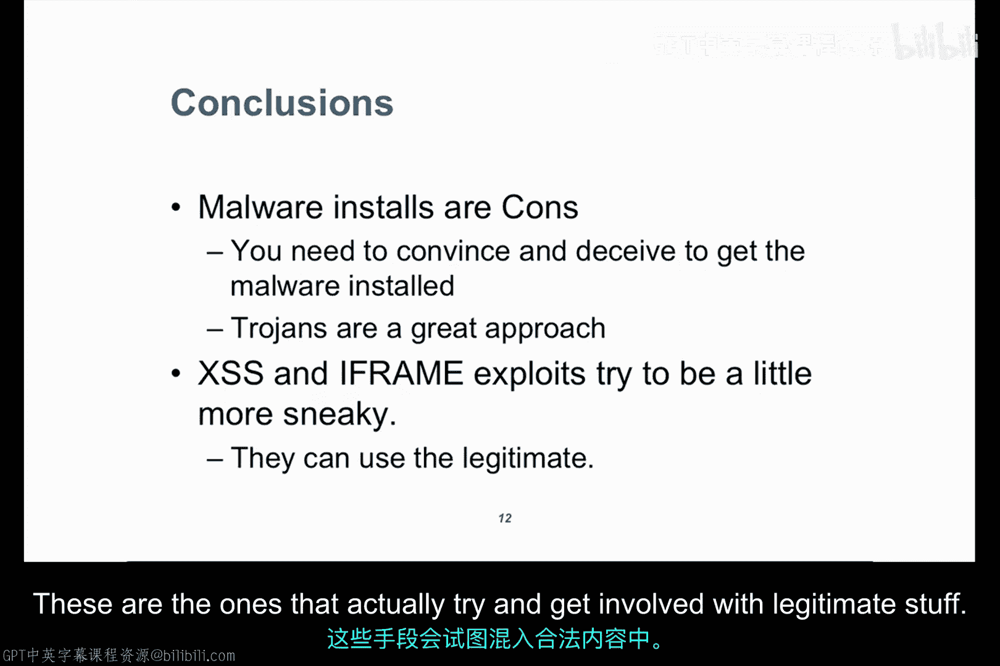

# 002：恶意软件分析入门 🦠

在本节课中，我们将学习几种不同类型的恶意软件及其基本工作原理。目标是能够识别这些恶意软件的行为特征，并具体说明它们的作用和一般运作方式。

## 木马程序 🐴

上一节我们概述了课程目标，本节中我们首先来看看木马程序。木马是“特洛伊木马”的简称，这是一个老派的术语，指那些伪装成提供某种功能，但实际上具有恶意行为的应用程序。

一个典型的例子曾在第3.6讲中讨论过，即那些自带后门的免费钓鱼工具包。关键在于，木马程序通常会履行它们声称的功能，但在此之外还会执行额外的恶意操作。例如，钓鱼工具包能建立看起来非常逼真的网站，诱骗个人安装本不该安装的应用程序。许多工具包还预设了垃圾邮件机器人，便于攻击者使用。问题在于，除了这些功能，它们还包含后门，允许恶意代码的作者直接侵入系统。在这个案例中，这或许是件“好事”，因为“受害者”本身也是试图伤害他人的人。但大多数情况下，并没有这种“正义”的结局。

木马是一个简单概念的最基本实现：你需要让恶意软件进入某人的系统，并确保他们执行它。大多数恶意软件（如病毒）要造成实际损害，必须被“放行”或安装。因此，攻击者专注于设计完美的骗局，让受害者觉得必须下载并安装这个新软件。就木马而言，攻击者实际上是让受害者自己完成下载和安装的所有工作。

然而，情况并非总是如此。接下来我们将探讨一些无需受害者亲自安装的情况。

## 网页植入攻击 🌐

HTML 提供了一种植入恶意软件的绝佳机制。我们可以从最简单的 **iframe** 开始。

以下是其核心概念：
*   **iframe** 是一个 HTML 标签，它可以在网页中打开一个框架。
*   攻击者可以让这个框架指向一个恶意网站。
*   如果结合缓冲区溢出等漏洞，攻击者就能在用户仅仅浏览某个特定网站时，在其系统上执行代码。

另一个无需用户察觉即可安装代码的方法是 **跨站脚本攻击**。

这是一个经典例子，其基本流程涉及将动态内容（如 JavaScript 命令）发送到原本期望接收纯数据的地方。攻击者实质上是让他们的可执行代码被放入一个“合法”的网站。任何允许他人在其网站上发布内容的站点，都必须确保所纳入的内容不是将在该站点上运行的代码。这是 Facebook 以及所有允许用户发表评论的网站都必须处理的问题。关键在于，当你展示用户发布的评论时，必须在允许这些内容显示在页面上之前，对数据进行“净化”处理。

更值得注意的是，在某些情况下，这种攻击甚至可以编码到 URL 中。例如，上方的这个 URL 片段，我们可以在其中嵌入将被执行的 JavaScript。因此，URL 为攻击者执行跨站脚本攻击提供了极好的途径。

因为许多系统会解析 URL，尝试解释其中的内容。跨站脚本攻击之所以有效，根本原因在于浏览器本身就是一个功能完整的图灵机，它想要执行指令。所以，攻击者只需设法将这些指令传递到你的浏览器和系统并得以执行即可。

所有这些（缓冲区溢出、SQL 注入、跨站脚本）本质上都是关于在期望数据的地方插入可执行代码。我们处理的是**控制平面**（决定执行什么指令）和**数据平面**（包含需要存储和操作的数据）之间的重叠。当这两者开始交叉混淆时，就处于非常危险的境地。这就是为什么始终对数据进行净化处理至关重要的原因。

## 防御措施 🛡️

针对上述攻击的防御措施其实相当简单。

如果你允许他人在你的网站上发布内容，至少应该尝试识别并移除所有带有恶意内容的标签。不要允许人们随意上传未经你检查的随机代码。如果他们得逞，他们就是在利用你的网站进行攻击。你的网站是合法的，但他们已将其变成了恶意实体。因此，采取主动的安全防护方法比被动反应更为重要。如果你能稍微主动一点，仅仅执行移除网站上帖子中所有标签这一步，就能为自己挽回大量声誉，避免许多麻烦，也省去了在发现被黑后不得不清理网站的精力。

## 社会工程学与诱骗 🎭

现在，让我们从防御讲台下来，开始谈谈恶意软件本身，或者说如何将其传播给他人。这通常需要受害者自己安装，打开门户，并允许其系统以某种方式被你利用。这意味着你需要进行诱骗。这时，了解心理学知识就非常理想了。这本质上就是操纵，是一场骗局，而且往往是一场短平快的骗局。

让我们站在攻击者的角度思考：你想要模仿一个权威人物（无论是友善的还是严厉的），在人们意想不到的地方发起攻击。例如，向某人的个人邮箱或 Gmail 账户发送邮件，诱使他们点击链接，或从你为钓鱼设置的特定网站下载文件。一旦进入他们的系统，当他们开始连接公司 VPN 或内部网络时，你现在就拥有了一台已入侵的、位于目标网络内部的机器。从此，你可以进一步行动。事实上，RSA 攻击就采用了类似模式。攻击者没有针对 RSA 的 CEO 或技术人员，而是针对低级员工，说服他们在自己的系统上安装恶意软件。当这些系统接入公司内部网络时，就成了攻击者向 RSA 服务器发起实际攻击的跳板。

请注意，我们这里讨论的只是几种简单的攻击机制。每当你想要诱使某人做某事时，都可以利用这些方法。操纵并迎合人们的心理是一种非常有效的方式。

我之前提到过，你可以尝试让人们安装他们自己的“更新”——只需假装成官方实体，说“嘿，你需要更新 Adobe”。或者，就像大家还记得的，那些弹出免费病毒扫描程序广告的情况。当然，还有假装成朋友。这是一个久经考验的方法。如果你能伪装成他们的密友，他们就更可能信任你让他们做的任何事情，也更可能照做。

## 总结 📝

本节课中，我们一起学习了恶意软件传播的基础。总而言之，恶意软件的安装是一场骗局。你需要通过说服和欺骗来让恶意软件得以安装。木马是一种很好的方法，但不是唯一的方法。同样，你可以说服某人你是一个更新程序（即使你根本不是），让他们下载。如果你想做得更巧妙、更隐蔽，跨站脚本和 iframe 漏洞利用就是这类方法。它们试图更隐秘地行动，并试图与合法的内容交织在一起。