# 003：动态HTTP、XML、SOAP与REST架构 🧩

在本节课中，我们将要学习动态HTTP技术。这包括CGI、XML、SOAP和REST。我们的目标是让你能够理解并讨论动态HTTP的工作原理。回想上一模块，我曾提到HTTP既是我们处理的最简单的协议，也是最复杂的协议。其根本原因在于我们附加到HTTP上的所有额外内容。真正的起点，即HTTP开始变得复杂混乱的时刻，是动态HTTP的发展，以及XML作为通用格式化语言的结合使用。这有效地导致了TCP/IP栈在HTTP内部的复制。结合用于创建动态可调用HTTP站点的各种技术，如SOAP和REST，在本模块中，我们将讨论它们是如何发展的、它们之间的哲学差异，以及它们如何使事情变得复杂。

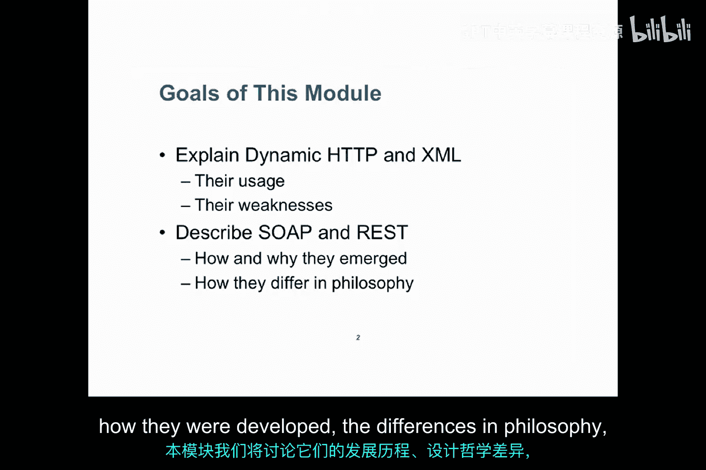

## 动态HTTP的基石

上一节我们介绍了动态HTTP的起源，本节中我们来看看其核心机制。动态HTTP的基石是GET和POST消息。更具体地说，是GET和POST消息中包含参数这一事实。根据你使用的消息类型，这些参数要么编码在URL中，要么作为消息本身的一部分发送。这尤其强调了HTTP的无状态性。通常当我们谈论HTTP时，我们说它是一个无状态协议。这意味着每次你发送一个HTTP请求，所有必要的信息都包含在该请求中。对于GET请求，这些信息是明确可见的。例如，如果你曾经使用过书签小工具，它们会告诉你“收藏此页”以便能够调用网站并执行某些功能，这就是通过GET完成的。你所做的就是创建了一个包含特定参数的书签。

我们可以通过查看一个动态网页来理解这一点。

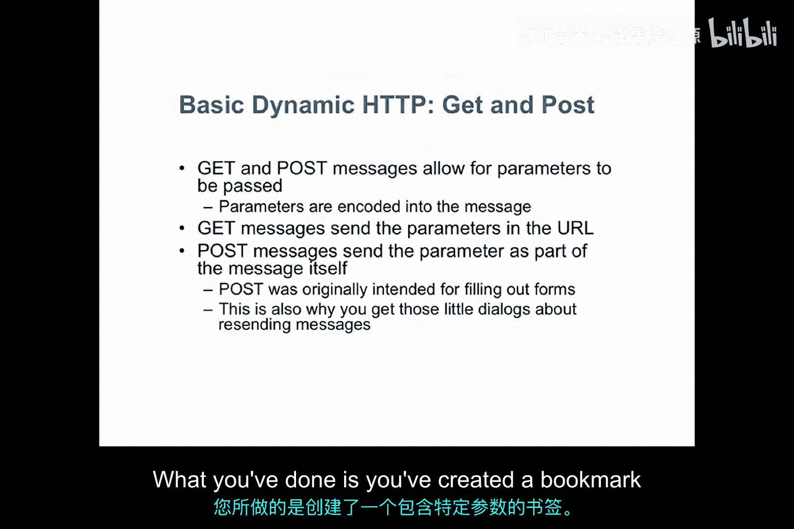

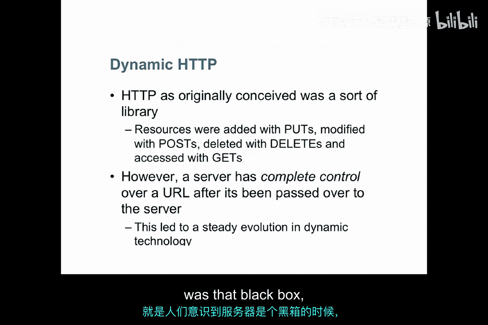

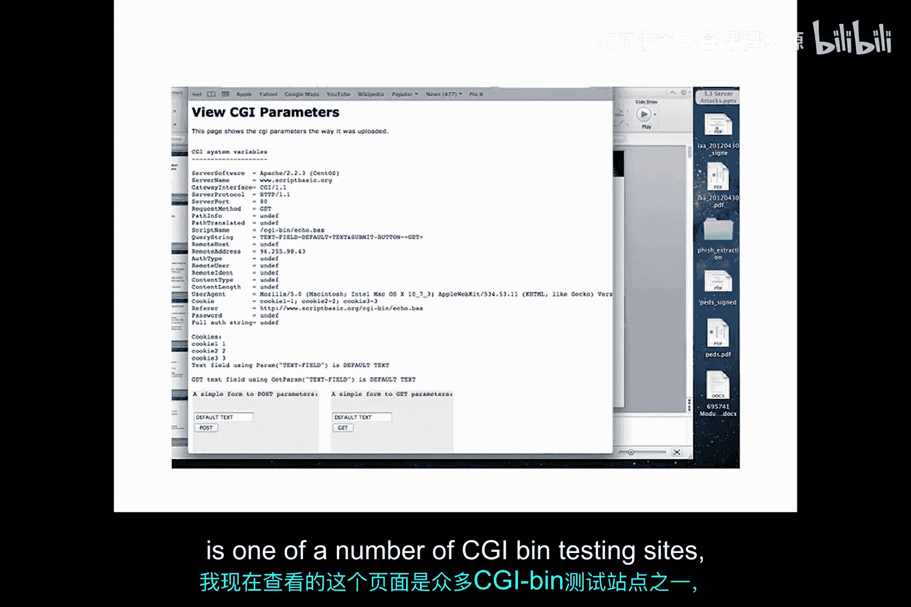

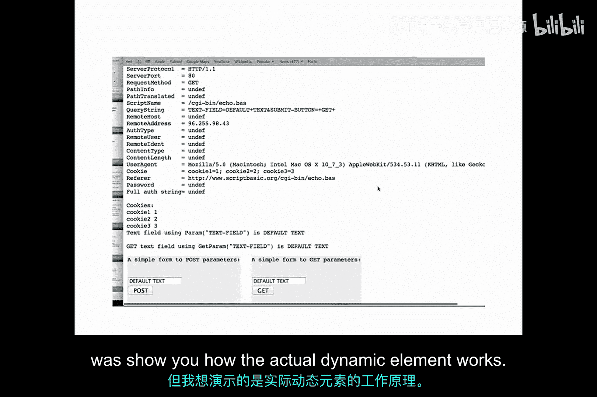

我在这里查看的页面是众多CGI bin测试站点之一，它并不比其他站点特殊。然而，我想展示的是实际的动态元素是如何工作的。你会注意到上面的命令`echo`后面有一个问号，它将URI与参数分隔开，然后是一堆赋值、提交按钮、文本字段等。你可以看到这些在查询字符串中被精确复制了。

此外，你还会注意到我们讨论过的其他一些东西，例如用户代理字符串在这里。还有引用来源。然而，关键是你可以在那里看到动态元素。这里的这个值被传递下来并存储在这里的这个值中。这个东西所做的只是显示值，但你同样可以设置它来做一些动态的事情，比如修改文本、反转它或开始玩Galaga克隆游戏。

## CGI：动态HTTP的第一个标准

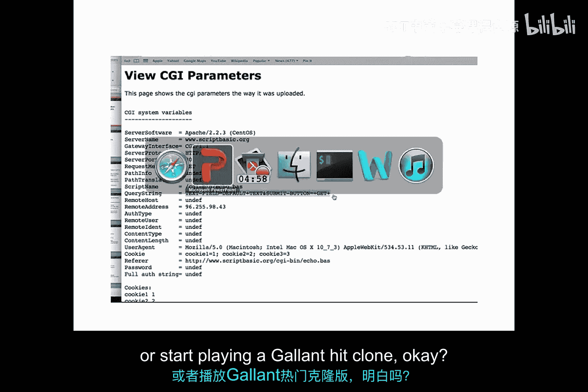

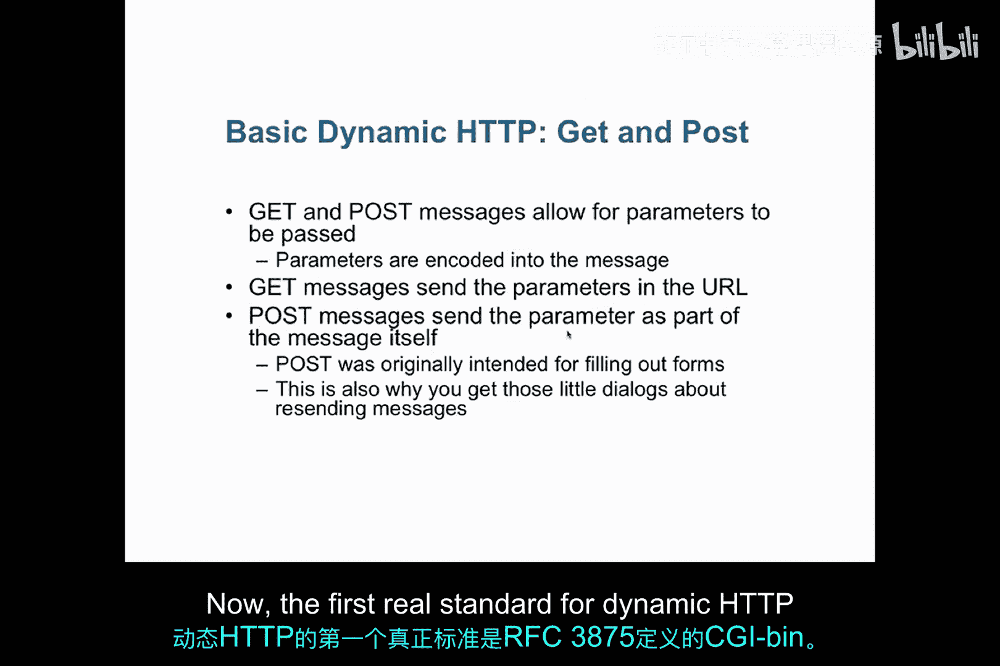

理解了GET和POST的参数传递后，我们来看看第一个正式的动态HTTP标准。动态HTTP的第一个真正标准是CGI，在RFC 3875中定义。CGI代表通用网关接口。这是动态HTML的“T型车”。CGI的工作方式是：GET或POST中发送的参数作为环境变量传递给一个shell脚本。因此，需要理解的重要一点是，CGI本身不是一种语言或技术。它是一种解析URL、提取信息，然后将其作为环境变量传递给另一个应用程序的方式。

这恰好是Perl语言的增长点。事实上，很多早期的CGI bin都是用Perl编写的，Perl和Web确实是携手发展的。然而，Perl是一种非常糟糕的语言，不适合做任何严肃的事情。如果你曾尝试维护Perl代码，那么你既知道这一点，也值得同情。这种情况在90年代末、21世纪初加剧了，当时每个人都在构建自己的网络浏览器，比如Internet Explorer、Netscape、Firefox、Mozilla、Opera、Safari、Links、W3等。每个浏览器都以略微不同的方式渲染HTML。例如，IE在表格构造方面往往非常宽松，而Netscape对语法要求更严格。

这导致了动态架构的使用，我们称之为CMS（内容管理系统）。内容管理系统允许你将任务分开，让开发人员专注于开发，让编写页面的人专注于页面，而不必担心开发的细节。这些细节的驱动因素之一是，正如我所说，我们有许多不同的浏览器，必须为不同的浏览器进行略有不同的渲染。如果你只想做一个表格，情况已经够糟了；如果你想做任何涉及JavaScript的事情，就必须进行极其复杂的配置操作。

因此，CGI这种临时凑合的方案逐渐消亡，被像PHP、Django这样的架构所取代。与此同时，JavaScript本身也从一种非常简单的存储变量技术，最终发展成为成熟的ECMAScript，成为一种相对成熟的编程语言。这导致了AJAX环境的出现，JavaScript、XML等所有这些东西协同工作。

以下是关于内容管理系统的一些关键点：
*   **功能**：它们通常与Web服务器绑定，但许多会包含自己的Web服务器。市面上有各种工具，如PHP、Django、Rails、Zope、MediaWiki、DokuWiki等。
*   **核心优势**：CMS与临时凑合的CGI脚本的关键区别在于，它们管理不兼容性，并将内容与呈现分离。这是一个关键特性。没有这种分离内容与呈现的能力，你必须自己编写所有这些东西，开发所有功能，并时刻跟踪浏览器不断进行的所有微小更改。
*   **插件架构**：关于这些系统需要记住的另一件事是，它们具有插件架构来支持功能。例如，如果你要进行图形可视化，可以为Django获取一个插件来支持科学可视化。如果你想创建一个留言板，它们都有可以为你创建留言板的插件。

## 模块化架构与安全隐患

上一节我们介绍了CMS如何简化开发，本节中我们来看看这种模式带来的复杂性。关于这一切，它确实打破了经典的客户端-服务器模型。在你的经典客户端-服务器模型中，你有一个客户端，它基本上只能与服务器通信；还有一个服务器，它完成所有工作。现在，计算被分散到各个地方。有些由服务器完成，有些由CMS完成，有些由浏览器完成，有些由数据库完成，有些由插件完成。因此，我们创建了这个极其复杂的模块化架构，坦率地说，它充满了漏洞。

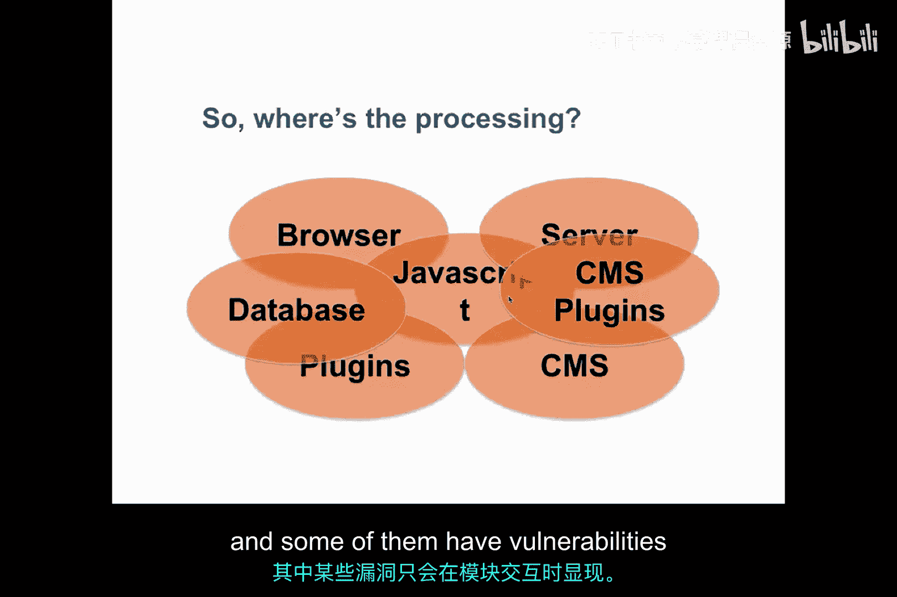

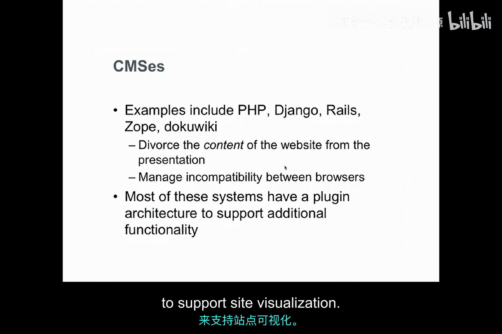

这些不同的椭圆中的每一个都可能拥有自己的漏洞家族，其中一些漏洞只有在它们相互交互时才会真正发生。

当我谈论所有这些事物中的漏洞时，还存在一个我们可以在工程世界中称为“零件清单”的问题。理论上有很多选项可用。我的意思是，如果你想，你可以编写自己的留言板软件。然而，在实践中，通常只有少数几种实现。当我在研究生院从事卫星设计工作时，我曾有过一个令人心碎的时刻，当时我意识到我所有的机械工程训练都毫无意义，因为卫星只有四种发动机类型可用，而且没有人会再制造另一种。所以只有四种选择。许多这些动态技术的情况非常类似，因为存在插件架构，某些插件成为默认选择，你会一遍又一遍地看到它们。攻击者知道这一点，他们知道某些应用程序很常见，他们会寻找针对这些应用程序的攻击。

我们实际上所做的是在计算之上重建计算。我的意思是，在过去的30年里，模块化软件一直是开发社区的圣杯之一。有几十种技术：套接字、RPC、DCE、CORBA、RMI、MOM。我们现在谈论的是Web服务，我们正在再次重建软件和服务。

## XML：通用数据格式

那么，这次有什么不同呢？最大的不同是XML。首先，让我告诉你，XML并不能为你解决问题，它只是重新格式化了问题。XML是SGML（标准通用标记语言）的一个有限重新实现或有限约束版本。XML相对于SGML的优势在于XML是可理解的。它是纯ASCII文本，基本上看起来像HTML，具有这种简单的分隔标签格式。另一方面，它会占用巨大的空间。

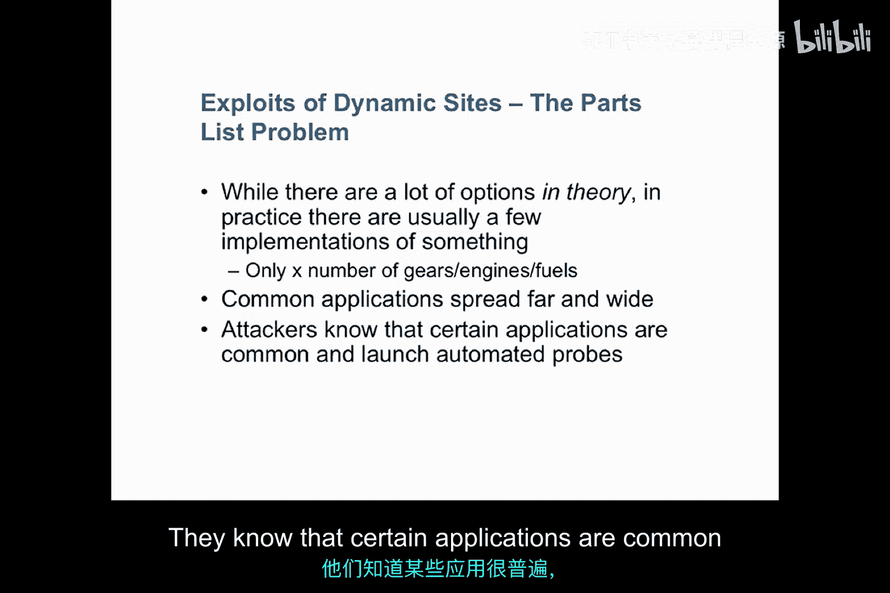

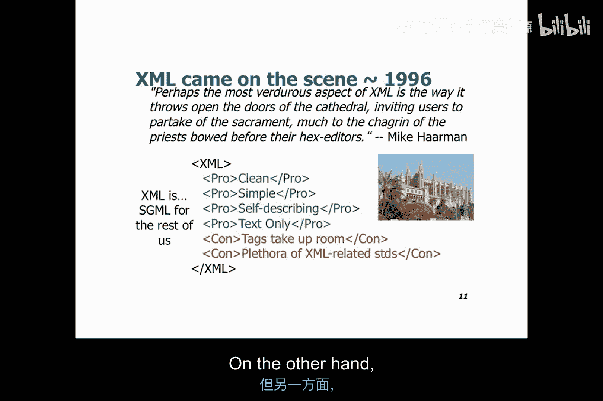

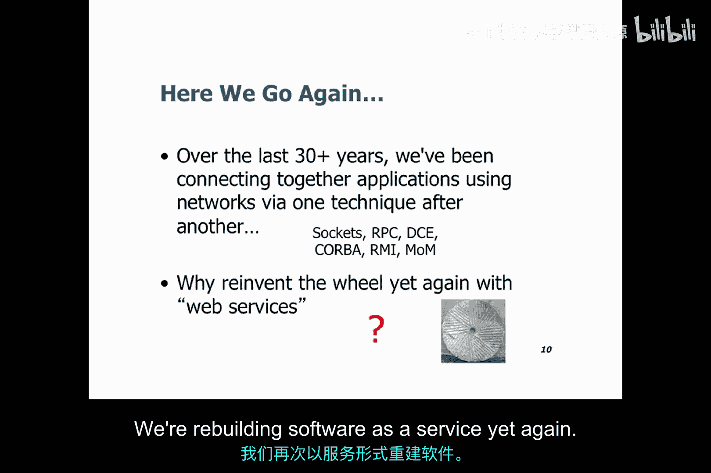

那么，XML有什么令人兴奋的呢？在XML出现之前，如果你想在系统之间来回传输信息，你必须自己想出数据将如何来回移动的定义。在XML中，你创建一个DTD（文档模板定义），然后，任何可以访问该DTD的东西都知道如何处理你来回传递的数据。所以一旦我们有了这个，我们就有了在网络上的服务器或主机之间发送消息的方法，这样它们就能相互理解。现在你可能会想，我不能只用CGI做这个吗？问题在于，CGI你只是发送信息，你不知道这些信息意味着什么。XML帮助你定义这些信息的含义。这当然引出了下一个问题：那么我们如何通信呢？如果是在1992年，我会使用套接字，或者使用DCE，或者微软那周称之为ActiveX的任何东西。

但现在我们有了HTTP，端口80是开放的。为什么端口80是开放的？我们别无选择。一切都通过端口80。所以我们可以做的是，开始讨论使用HTTP来回发送XML消息。这导致了端口80成为今天巨大的信息高速公路。现在，当我们审视信息安全时，实际上我们创建了一个巨大的堡垒，有防火墙、守卫、保护、护城河，然后我们建造了一条八车道的高速公路，称之为HTTP，并让它直接穿过房子的中间。

我们在HTTP上重新实现了一切，我们引入了全新的不安全领域。有像Quadraasesis、Reactivity和Checkpoint这样的各种公司，它们正试图在HTTP上创建防御，因为HTTP既简单又方便。

我们构建了HTTP这个超级服务，我们在HTTP之上构建了一个全新的TCP/IP栈。如果你曾经使用过像Citrix这样的东西，Citrix允许你在HTTP上进行客户端-服务器会话。与此同时，HTTP不仅是一堆协议的调解者，而且一堆协议实际上就是HTTP。例如BitTorrent，用于与跟踪器通信的协议就是HTTP，它是一个CGI脚本。

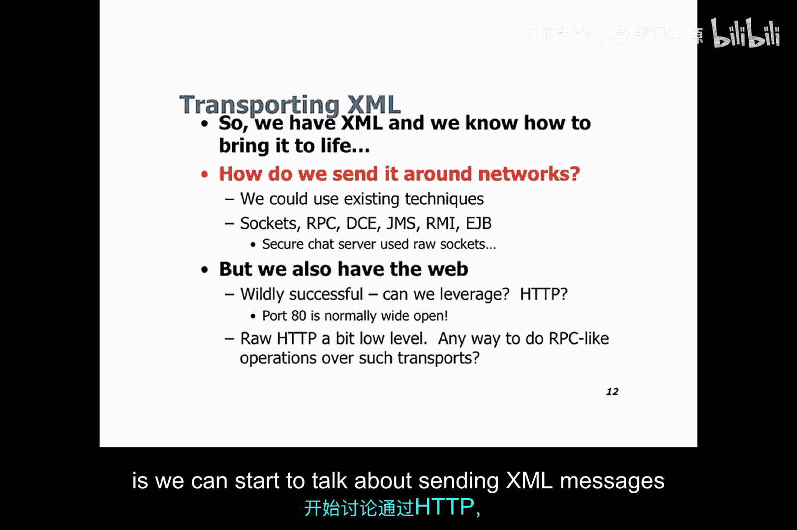

## SOAP：基于XML的远程过程调用

因此，大约在这个时候，某个聪明人（这个聪明人很可能是Dave Weiner）意识到，嗯，我可以这样做：与其发送这种自定义格式的数据，既然每个人都在开放端口80，我就编写一个发送XML的东西，它接收XML作为POST中的数据，并用XML响应。然后我就可以发送命令，我可以用XML实现远程过程调用，这就是SOAP（简单对象访问协议）。Web服务器现在可以使用XML来调解远程过程调用。

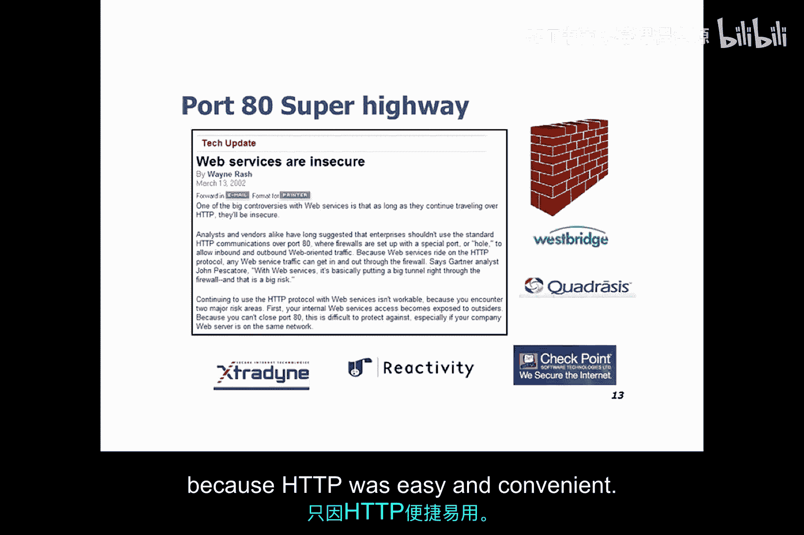

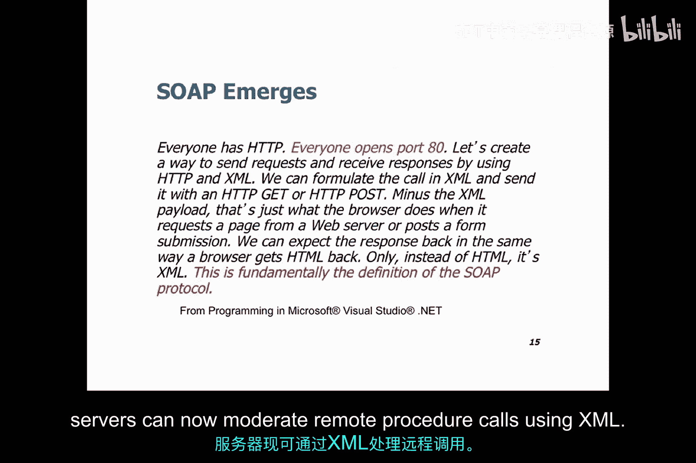

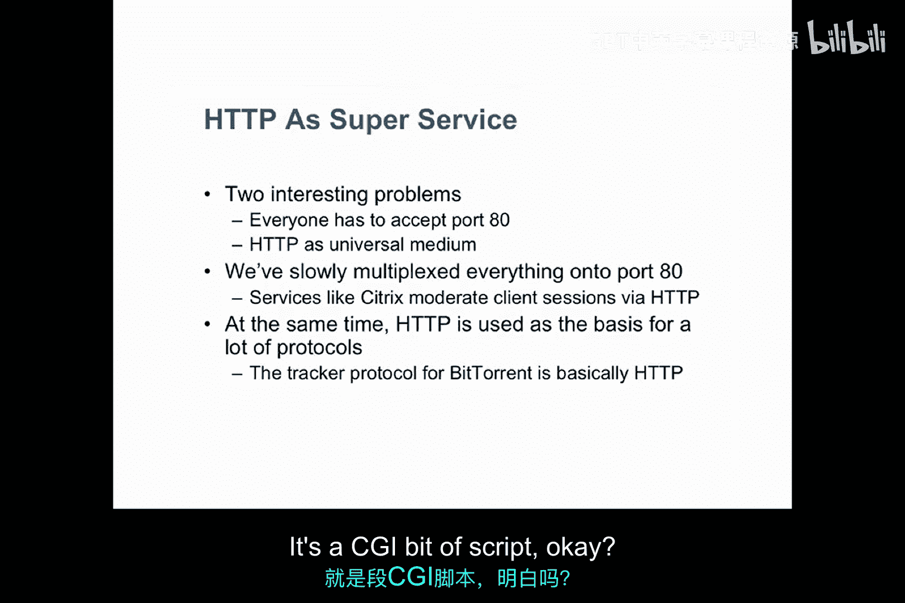

于是，SOAP，下一个RPC，杀死了CORBA。如果你在2001年或2002年左右四处看看，你会读到很多关于CORBA的东西。CORBA是公共对象请求代理架构。CORBA是一种极其复杂和精密的协议，它允许你远程访问不同机器上的对象，并通过发送远程调用来操作它们。所以CORBA标准是令人生畏的。与此同时，几个人凑在一起，拼凑出这个基于XML的通信标准。突然间，每个人都在做像Google Maps、MapShops这样的事情。还有Walk Score，那些告诉你附近有多少墨西哥卷饼摊的东西。所有这些都由XML调解。这之所以有效，基本上是因为XML RPC将所有任务都推回给了开发人员。开发人员基本上被告知网站的API，这是API的调用方式，你如何找到这个。每个网站都想办法告诉你。没有安全检查，没有反射，没有完整性检查之类的。你可以编写这个。如果出了问题，上帝也帮不了你。但它编写起来非常快，一个XML调用，一个XML响应。而CORBA则在耻辱中消亡。

## REST：表述性状态转移

这导致了一种我们称之为REST（表述性状态转移）的范式。REST是那种奇怪的野兽，它并不是一个真正的API，更像是一个用于无状态传输信息的框架。所以它更像是一种“如何做”的API指南。特别是Google，一直在广泛使用REST来创建工具，例如我在这里使用REST创建的动态图表。这是Web 2.0的开始：XML消息，以及那些动态到实际上只是API的网站。

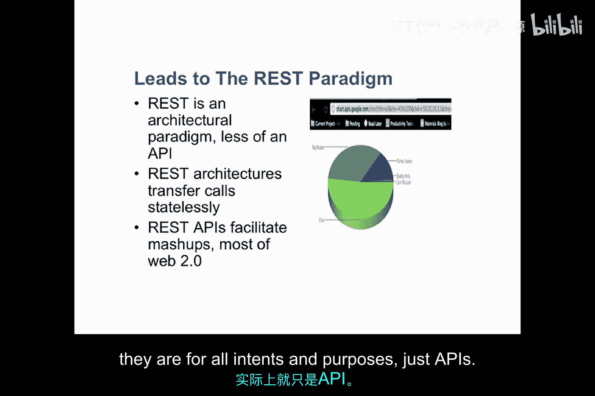

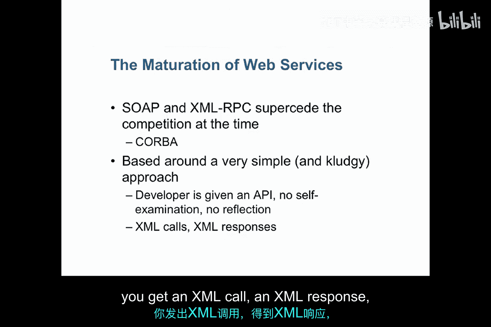

截至去年，这一发展的顶峰是Facebook的Graph API，你可以通过来回发送XML消息来基本上操作整个Facebook系统。

## 面向服务的架构与信任问题

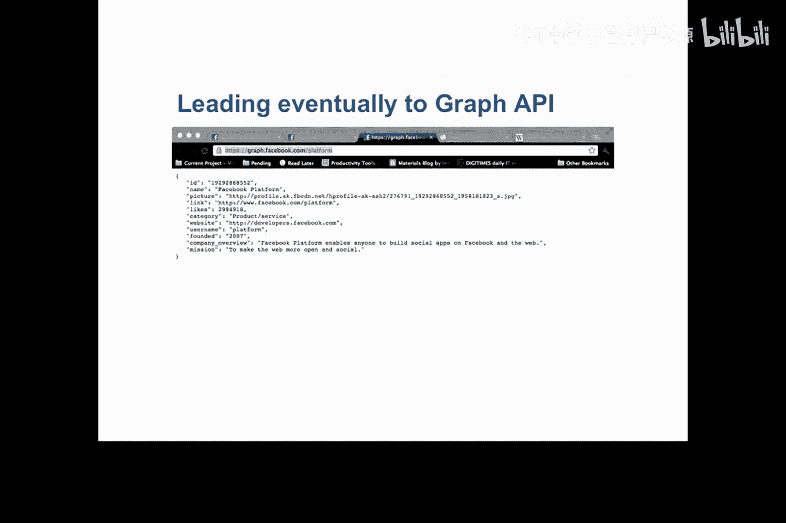

那么，这些是做什么的呢？关键点在于，这些都是面向服务的架构，它是一个移动的目标，也是一堆字母缩写：RPC、XML、SOAP、Graph API。所有这些都将网站转变为基于XML的数据库前端。你通过XML进行通信，基本上你不是去抓取页面，而是在生成函数。一个关键点是，许多信任问题由服务器本身处理。你可能已经注意到的一件事是，例如，最近查看评论网站时，它们开始利用规模经济。所以过去拥有自己评论认证系统的网站现在只使用Facebook。所以正在发生的是，我们开始看到其中一些网站成为通用网关。这意味着什么？这样看：如果你访问一个网站，它在角落里为你拉取一些Facebook信息或一些Google信息，这意味着你访问了Google。这意味着他们知道，这意味着Google知道，你刚刚访问了那个网站。有一个来回的引用。有一些像Google和Facebook这样的网站，我毫不怀疑，你查看的每两个网页中就有一个涉及与它们的通信。

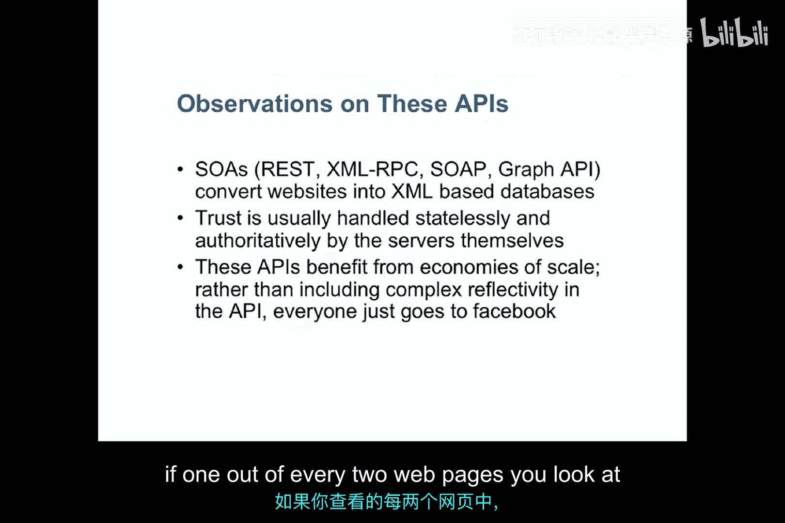

## 总结

本节课中，我们一起学习了动态HTTP技术的演变。我们从CGI这个最初的动态网页标准开始，了解了它如何将参数传递给脚本。接着，我们探讨了内容管理系统如何通过分离内容与呈现、管理浏览器兼容性以及提供插件架构，解决了CGI的许多问题，但也引入了复杂的模块化架构和安全隐患。然后，我们深入了解了XML作为一种通用数据格式，它如何为数据交换提供结构定义。在此基础上，我们学习了SOAP如何利用XML和HTTP实现远程过程调用，从而简化了分布式计算。最后，我们探讨了REST作为一种无状态通信框架，以及面向服务的架构如何将网站转变为API，并带来了新的信任和隐私挑战，例如通过Facebook和Google等通用网关进行的大规模数据交换。