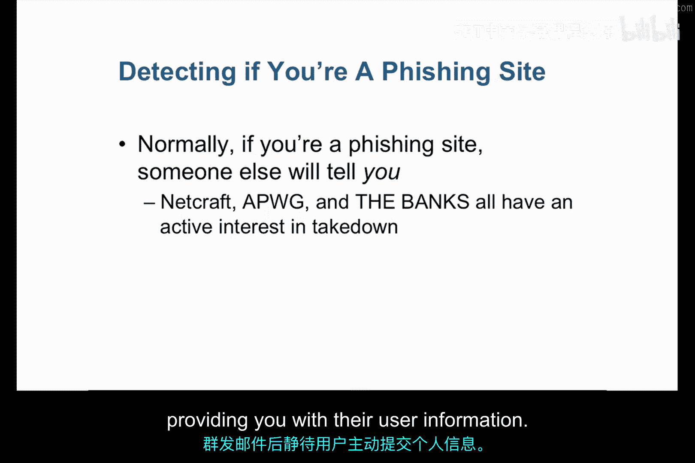

# 004：网络钓鱼攻击 🎣

在本节课中，我们将学习网络钓鱼攻击的原理、实施步骤以及防御者面临的挑战。网络钓鱼是一种通过伪装成可信实体来诱骗受害者泄露敏感信息（如密码、账户信息）的攻击方式。

## 攻击准备与实施

上一节我们介绍了网络钓鱼的基本概念，本节中我们来看看攻击者如何具体准备和实施一次钓鱼攻击。

网络钓鱼攻击分为两个阶段。第一阶段是发送包含指向攻击者控制网站的链接的垃圾邮件。第二阶段是受害者点击链接，被引导至一个旨在窃取信息的伪造网站。

因此，为了使攻击成功，攻击者需要让网站和电子邮件看起来合法可信。

首先，攻击者需要找到一个地方来托管钓鱼网站。显然，他们不希望使用自己的机器。正如在之前的课程中提到的，目前存在多个列出当前存在漏洞的网站列表。攻击者会入侵其中一个，并将其用作钓鱼网站。如果行动迅速，这个网站甚至不会被任何人怀疑，因此邮件服务器常用的黑名单上不会有该网站的记录，从而不会封锁该网站。

此外，如果我们在那里设置服务器和钓鱼网站，由于该服务器没有不良声誉，基于网络的过滤也可能失效。因此，攻击模式是：先入侵一个脆弱的服务器，然后利用它通过钓鱼攻击入侵更多人。有证据表明，攻击者确实会利用声誉良好的服务器来建立钓鱼网站。

以下是关于攻击者选择宿主服务器的分析：

这里有两张图。左边的图代表了当前被报告的钓鱼网站与僵尸网络的交集。右边的图代表了钓鱼网站与常用报告列表的交集。X轴是前缀长度（用于最大匹配），Y轴是网络区块的总数。可以看出，之前被报告为钓鱼网站、现在又是僵尸网络一部分的服务器，其交集远高于随机情况。而被报告为钓鱼网站的服务器，与僵尸网络的交集则较低。

原因很简单：攻击者希望使用那些仍然拥有良好声誉的服务器来建立钓鱼网站。一旦这些服务器失效，不再适合用于钓鱼，它们就会被用作僵尸网络进行其他活动。

## 网络钓鱼的商业模式与目标

了解了攻击的实施方式后，我们来看看驱动这些攻击的动机和目标。

需要理解的是，网络钓鱼在很大程度上是一门生意。运营钓鱼攻击的人通常并不关心具体攻击谁。和任何其他生意一样，其复杂程度也各不相同。顶端是有组织的犯罪集团，底端则是使用免费钓鱼工具包的人。这些免费工具包通常质量低劣，攻击者需要付出大量努力才能建立起有意义的攻击，并且他们往往在第一轮垃圾邮件过滤中就被拦截。

然而，这里有一个有趣的转折。在《没有免费的钓鱼》一文中，Cova及其同事解释了免费钓鱼工具包通常包含后门，会反过来入侵钓鱼者自己的系统。因此，这些试图利用他人的、毫无经验的钓鱼者，在安装这些“精良”的钓鱼软件时，自己反而成了受害者。

那么，钓鱼者在追求什么呢？很简单：凭证。通常是小额账户，因为大多数钓鱼受害者并不富有，因此直接入侵他们的账户本身价值可能不大。真正的价值在于**密码**。由于人们倾向于在多个网站上使用相同的密码，获取一个密码可能比获取个人信息更有价值。如果他们入侵了你一个账户的密码，那么很可能也入侵了你80%甚至所有账户的密码。这就是他们的目标。

此外，还存在一种网络钓鱼的子类别，称为鱼叉式网络钓鱼。鱼叉式网络钓鱼其实就是定向钓鱼。攻击者发现了关于特定目标的某些信息，并利用这些信息试图入侵这个特定目标。例如，美国在2010年遭受了一次重大的鱼叉式钓鱼攻击，此前一年也有针对西藏活动家的攻击。现在，这类事件在新闻中已屡见不鲜。

## 攻击者的伪装与隐藏技术

在明确了攻击目标后，我们接下来探讨攻击者如何巧妙地隐藏自己，使攻击更难被察觉。

网络钓鱼最致命的一点在于，它经常使用名称操纵技术。一个有趣的现象是，攻击者会使用像西里尔字母这样的字符进行替换。例如，西里尔字母中的“A”看起来很像标准拉丁字母中的“A”。钓鱼者会利用这一点，使他们的URL看起来与你期望的一模一样。

以下是几种简单的欺骗方式：
*   在电子邮件中放置一个超链接，显示文本是“ebay”，但实际的链接地址指向一个恶意网站。这是最简单的方法。
*   使他们的URL看起来几乎合法，但实际指向他们自己的域名。例如，`www.ebay.com.evilsite.com`。
*   使用重定向，声称将带你前往一个网站，但随后立即将你弹到另一个网站。

除了简单的名称操纵，钓鱼者还有其他巧妙的方法来隐藏他们的活动地点。例如**快速通量**技术。这非常有趣：一个域名被分配给多个IP地址，并且每个IP地址的分配时间都非常短。这意味着受感染的用户不是全部前往一个主机，而是前往大量不同的主机，并且这些主机还在不断变化，它们都托管着相同的恶意软件或再次重定向到另一个托管地点。这使得追踪变得非常困难。

像Rock Phish这样的组织就使用了类似的技术，这是一套复杂的组合拳。他们使用网站作为代理来隐藏真正的指挥服务器，进行了各种有趣的DNS操纵。但归根结底，他们是在托管一个恶意网站，并且这个网站不断跳转，使得追踪活动、弄清发生了什么变得非常困难。简单的趋势分析技术，例如寻找流向一个或一组特定站点的流量，可能无法产生好的结果。事实上，大多数时候，这对我们来说效果不佳。

## 防御挑战与应对策略

面对如此狡猾的攻击技术，防御者面临着严峻的挑战。本节我们将分析这些挑战以及可能的应对策略。

为什么攻击者需要在命名上使用更奇特的技术？核心问题在于黑名单机制。攻击者为已知被入侵的主机支付的成本更低。正如在本讲第三张幻灯片中所示，如果一个服务器已经被标记为僵尸网络的一部分，你就不希望再把它用作钓鱼网站，因为它已经被识别了。

我们的核心问题是，我们采用的是黑名单而非白名单策略。因此，我们正处在一个需要不断添加所有被入侵服务器的境地，并且还得想办法在它们恢复后将其从名单中移除。你怎么知道一个曾经是坏的东西现在变好了？更重要的是，你怎么知道它现在变好了以后不会再变坏？我们面对的是一个开放的系统，由构成互联网的各种协议组成。构建有效的白名单远比决定尝试阻止过去做过坏事的东西更具挑战性。

通常，判断你是否是一个钓鱼网站的最简单方法是有人会告诉你。如果你被入侵并被用作钓鱼网站，网上会有很多站点开始大声疾呼。有很多公开的黑名单可供查询，你可以检查你的所有IP信息，看看你的网站是否已被入侵并正被用于钓鱼。

那么，你怎么知道自己被钓鱼了呢？去易趣网看看？不，你通常不会知道自己“被约会”了。在这种情况下，通常会有别人告诉你：你的银行可能会突然打电话给你，或者有人打电话告诉你你的账户已被清空。这类事情是发现被钓鱼的最简单方式，当然，这也是最糟糕的情况。

因此，最佳行动方案是对收到的所有电子邮件保持高度怀疑，并首先努力避免被钓鱼。

## 总结

本节课中我们一起学习了网络钓鱼攻击的完整链条。总结来说，网络钓鱼攻击者是为了赚钱，而不是为了搞破坏。他们试图获取你的账户信息和密码，并尽可能多地在不同地方使用这些信息。他们会撒下尽可能大的网，因为只需要有一定数量的人点击链接、访问网站并输入他们的账户信息即可成功。攻击者并不指望每个人都点击他们的链接。

因此，攻击流程就是：购买一个尚未出现在任何黑名单上的、新近被入侵的僵尸主机，建立站点，制作一个看起来合法的网站，制作一个高效的垃圾邮件发送器，向所有人发送垃圾邮件，然后坐等人们上门并提供他们的用户信息。

