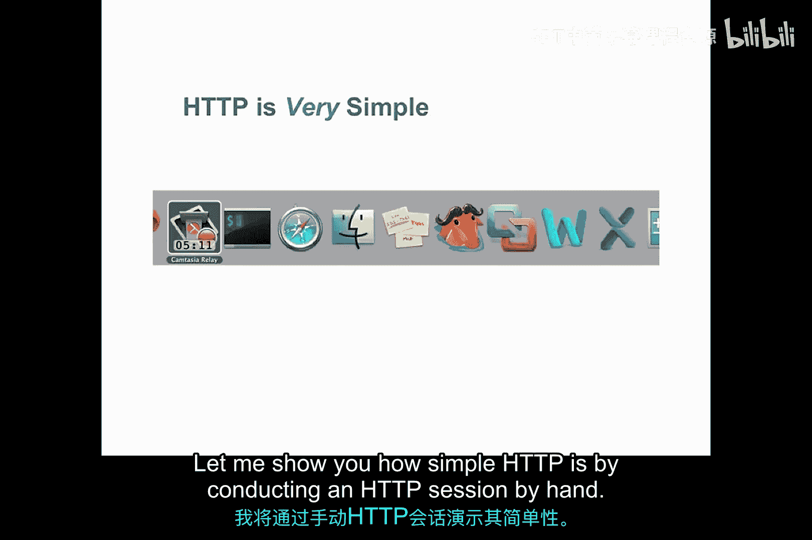
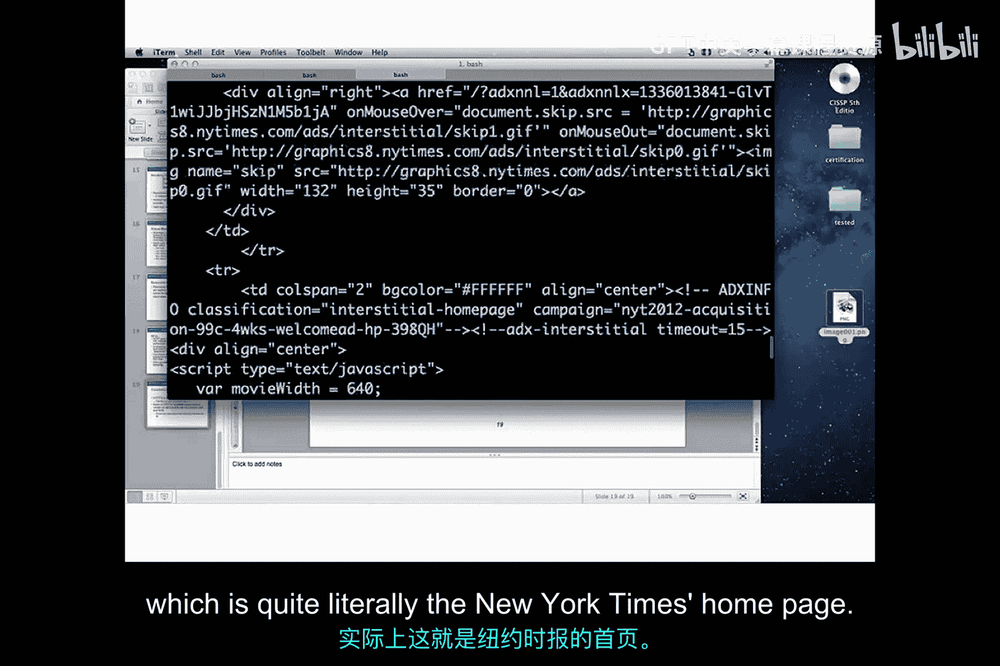
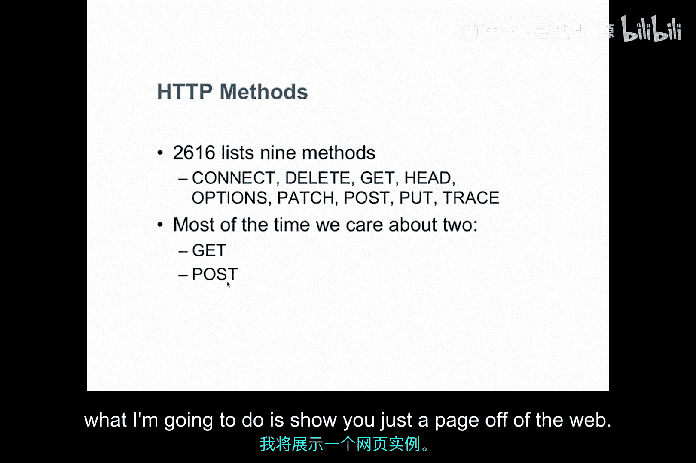
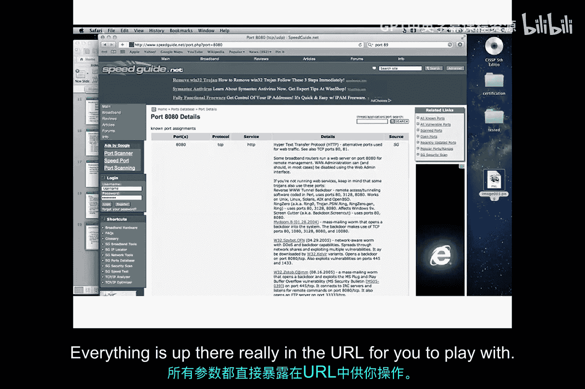
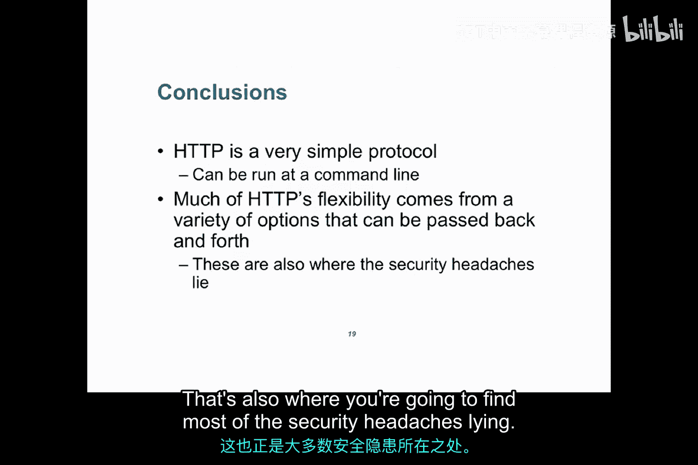

# 005：基础HTTP协议 🧩

在本节课中，我们将要学习HTTP协议的基础工作原理。HTTP是一个看似简单甚至粗糙的协议，却意外地成为了当今互联网上最重要的协议。我们将了解其数据传输方式、状态码的含义以及可选头部字段的使用。

## HTTP的起源与背景 🌱

上一节我们介绍了课程目标，本节中我们来看看HTTP的起源。HTTP是“超文本传输协议”的缩写。HTTP和HTML（超文本标记语言）由欧洲核子研究组织的研究员蒂姆·伯纳斯-李于1990年开发。CERN和许多美国能源部的超级计算中心是万维网的无名英雄，早期的许多网络开发工作都在那里完成。

伯纳斯-李创建了一个非常精简的超文本版本，旨在快速共享研究论文。虽然我们常在网络语境下谈论超文本，但从超文本理论家的视角看，HTML是一种非常原始的超文本形式。网络环境中的一个主要问题是链接可能是单向且可能失效的，而理想的超文本环境中的链接是双向且指向确定存在的资源。

## HTTP的简单性演示 🖥️

了解了HTTP的背景后，本节我们通过手动操作来展示HTTP的简单性。我将演示一个简短和一个较长的HTTP会话。

通过`telnet`命令连接到`cnn.com`的80端口（HTTP默认端口）。连接建立后，输入`GET /`命令，服务器会返回一个网页。例如，可能会收到`301 Moved Permanently`的状态码。

同样，连接到`nytimes.com`并输入`GET /`，会收到一大段HTML代码，这就是《纽约时报》的主页内容。这表明仅通过输入简单命令即可完成HTTP会话。

## HTTP协议规范与模型 📜

上一节我们手动进行了HTTP通信，本节中我们来看看其官方规范。HTTP协议由一小部分RFC文档定义。核心规范是RFC 2616，它定义了HTTP/1.1。另一个关键的安全相关文档是RFC 4229，它定义了大量HTTP头部。

由于HTTP协议简单原始，人们很快开始为其添加功能，并用它替代互联网基础设施的其他部分。这也导致了协议中存在许多特定于服务器和实现的特性。

HTTP基于一个非常简单的 **“打开-请求-响应-关闭”模型** 运行。客户端打开一个到服务器的TCP连接（目标端口通常是80或8080），发送一个请求消息，服务器返回响应，然后连接关闭。

HTTP/1.1增加了旨在提高吞吐量的功能，如**会话持久性**（可以在一个连接上发送多个请求-响应对）和**管道化**（可以一次性发送多个请求，然后一次性接收多个响应）。然而，在现代交互式网络环境中，管道化并不常用，因为后续请求往往依赖于前一个响应的内容。

## HTTP请求详解 🔍

上一节介绍了HTTP的通信模型，本节我们深入看看请求的构成。一个HTTP请求由三个关键部分组成：**方法**、**URI**和**协议标识符**。

*   **协议标识符**：通常是HTTP/1.0或HTTP/1.1。
*   **URI**：通常被称为URL，是你试图访问的数据地址。
*   **方法**：客户端试图在服务器上执行的操作类型。

RFC 2616列出了9种方法。在现代网络中，我们主要过度使用其中两种：`GET`和`POST`。

*   `GET`方法用于获取页面。它允许通过URL传递参数，格式是在URL后附加`?key1=value1&key2=value2`。`GET`本质上是无状态的。
*   `POST`方法用于提交表单数据或发送消息。它通常用于发送大量数据（超过64KB）。

`GET`请求的一个例子是访问一个带有查询参数的网址，例如 `http://www.speedguide.net/port.php?port=155`。更改`port=`后面的值，页面内容会动态变化。

## URI、URL与URN 📍

我们一直在谈论URL，但在规范中更准确的说法是URI。URI是“统一资源标识符”，它是一个更广泛的概念，包含了URL和URN。

*   **URL**是“统一资源定位符”，表示资源在空间中的位置。
*   **URN**是“统一资源名称”，旨在作为一个永久名称，例如ISBN号或社会安全号码。

URI的格式遵循`协议:路径`的约定，路径的构造方式由协议定义。例如：
*   `mailto:president@whitehouse.gov` 属于邮件协议。
*   `http://www.example.com/path/to/page` 则使用斜杠表示路径，通常对应文件系统。

在HTTP中，我们处理的是URL。一个HTTP URL由`http://`、主机名和路径组成。注意主机名，许多HTTP服务器是虚拟主机，即一台物理机器通过不同的主机名托管多个网站，这通过HTTP头部中的`Host`字段实现。

## HTTP头部：协议的“调味剂” 🧂

HTTP本身是一个原始简单的协议，其复杂性来自于**头部**的使用。头部是可选的键值对，在客户端和服务器之间传递。RFC 4229指定了一个很长的列表。

以下是四个至关重要的头部，它们是网络的“粘合剂”：

1.  **Host**：你正在通信的主机的完全限定域名。对于托管多个网站的服务器（虚拟主机），此字段用于确定客户端想访问哪个网站。
2.  **Referer**：你到达当前页面所来自的页面的地址。服务器可以用它来追踪访问路径或控制资源访问（例如，防止直接链接图片）。
3.  **Cookie**：由客户端维护的持久性信息片段，用于与应用程序保持长期一致的关系（例如，身份验证令牌）。
4.  **User-Agent**：标识你的浏览器的字符串。由于不同浏览器存在细微的不兼容性，服务器需要根据此信息调整页面渲染方式。

## HTTP响应与状态码 📨

你的请求会得到一个响应。响应由**状态行**、一组**头部**和**数据**组成。需要再次强调，HTTP本身非常简单灵活，复杂性来自头部。

状态行包含一个三位数的状态码。状态码分为5大类：

*   **1xx**：信息性状态。
*   **2xx**：成功。最重要的是`200 OK`。
*   **3xx**：重定向。常见的有`301 Moved Permanently`和`302 Found`。
*   **4xx**：客户端错误。最重要的是`401 Unauthorized`（需要认证）和`404 Not Found`（资源未找到）。
*   **5xx**：服务器错误。

响应中重要的头部包括：
*   `Content-Length`：响应体的长度（字节）。
*   `Set-Cookie`：服务器指示客户端存储信息。
*   `Location`：用于重定向，指示客户端应前往的地址。
*   `Server`：服务器类型标识。
*   `Refresh`：指定页面重新加载的时间。

`401`状态码是一个有趣的例子。它意味着需要用户名和密码才能继续。在浏览器中，这会弹出一个密码对话框。然而，**HTTP基本认证（401）的安全性很差**，因为用户名和密码是以Base64编码（近乎明文）在请求中发送的。你永远不应该在生产环境中使用这种认证方式，它常见于一些嵌入式设备（如无线路由器）的管理界面中。

## 总结 📝

本节课中我们一起学习了HTTP协议的基础。核心要点是：**HTTP协议本身非常简单，但其强大的灵活性来自于请求和响应中可传递的各种头部字段**。正是这种简单性和灵活性的结合，使得HTTP能够支撑起整个现代网络，同时也带来了许多安全和管理上的挑战。理解这些基础是进行信息保障分析的基石。