# 006：服务器攻击技术 🛡️💻

在本节课中，我们将学习针对服务器的攻击技术。我们将探讨攻击者如何利用各种机制（尤其是通过HTTP协议）来破坏或控制服务器。课程将涵盖密码破解、次级访问、SQL注入等常见攻击手段，并解释其背后的原理。

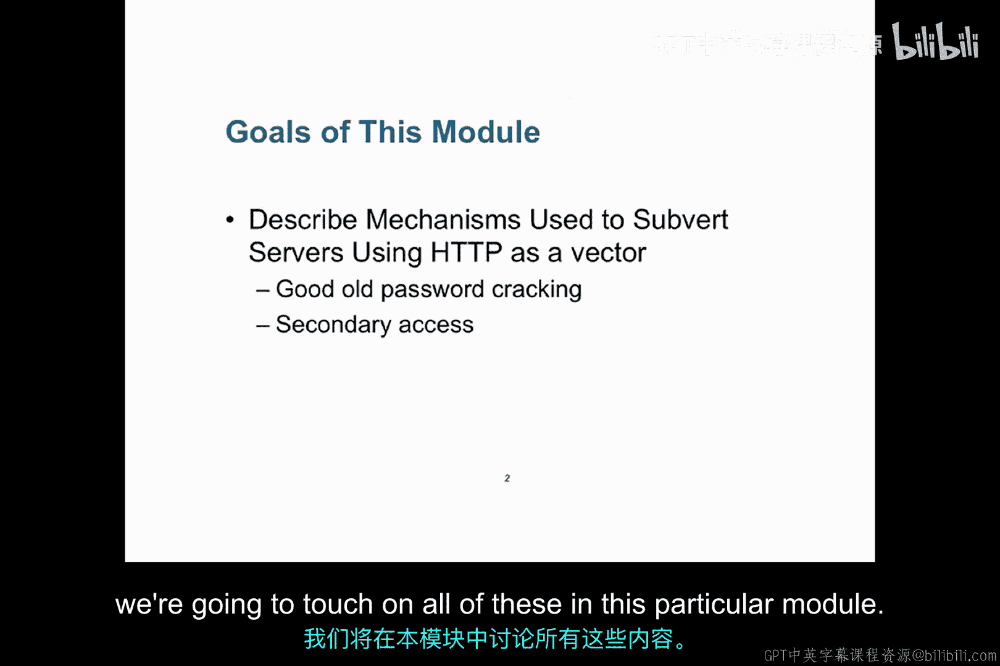

## 服务器攻击概述

服务器攻击的目标是破坏或控制服务器。这类攻击通常以HTTP协议作为攻击向量。本模块内容更侧重于破坏HTTP服务器本身，而非仅通过HTTP发起的攻击。这些攻击都属于同一领域，并会使用多种工具。

## 传统服务器接管方式

上一节我们介绍了服务器攻击的总体概念，本节中我们来看看历史上经典的服务器接管方式。传统上，接管Web服务器的方式并非直接攻击Web服务器本身。

经典的方法是攻击网站。正如我在模块32中提到的，网站最初是本地文件系统上的目录。这意味着，当你想修改网站时，你需要通过FTP传输文件。如今，这仍然在一些非常基础的低端主机托管服务中使用，但内容管理系统（CMS）已经接管了大部分此类职责。

然而，这意味着承载Web服务器的IP地址上实际上运行着多种服务。它可能是一个数据库客户端（通过端口1521和1434通信），一个FTP服务器，一个SSH服务器，一个SMTP客户端，也可能是一个Web客户端。所有这些服务都可能运行在同一台机器上，并且都可能成为攻击的入口点。特别是SSH、FTP和数据库服务，它们都容易受到密码攻击。

因此，当我们谈论Web服务器时，实际上是在谈论围绕它的一系列服务。当我们谈论服务器防御时，我们指的是检测诸如次级访问之类的事情。你需要监控和审计这些活动。为此，你需要某种形式的流量监控。在模块4中，我们将广泛介绍NetFlow，这是实现此目的的经典方法之一。你也可以查看服务器本身的日志，但这样做的问题是，你永远无法判断是否有人只是探测了你，因为除非你建立了实际的服务器会话，否则不会生成服务器日志。

以下是识别攻击者的几种技术：
*   **新IP地址**：访问服务器的用户通常来自可预测的地点。我不会从任何随机位置更新我的网站，我通常只在固定的几个地方操作，例如办公室、家或本地咖啡店。
*   **寻找笨拙行为的证据**：如果有人在服务器上漫无目的地浏览，例如只是查看文件、寻找文件或尝试访问不存在的文件，这通常表明有人在探测，而不是在寻找他们已知存在的东西。

## 密码破解攻击

上一节我们讨论了如何识别攻击者，本节中我们来看看最经典的服务器接管方式：密码破解。

密码破解仍然是接管主机的非常有效的方法，因为人们倾向于使用相当可预测的密码。如果你要求用户设置至少6个字符且必须包含数字的密码，你会发现很多人使用“123456”作为密码。

此外，请记住，许多应用程序确实存在默认密码。因此，当你设置一个应用程序时，如果攻击者知道默认密码，你可能就在安装一个安全漏洞。

## 内容管理系统（CMS）与攻击

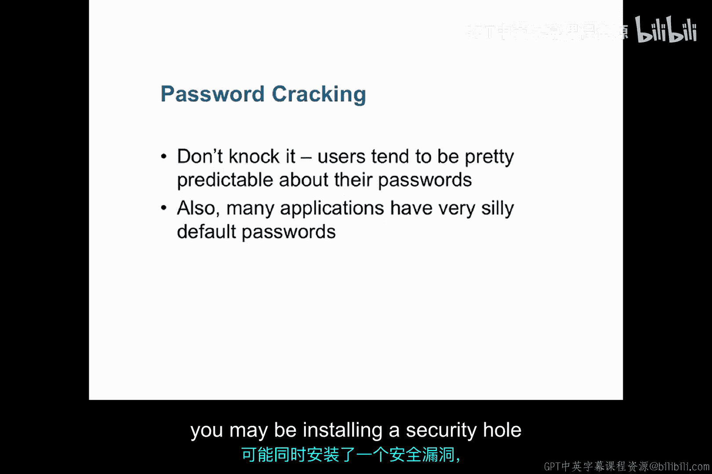

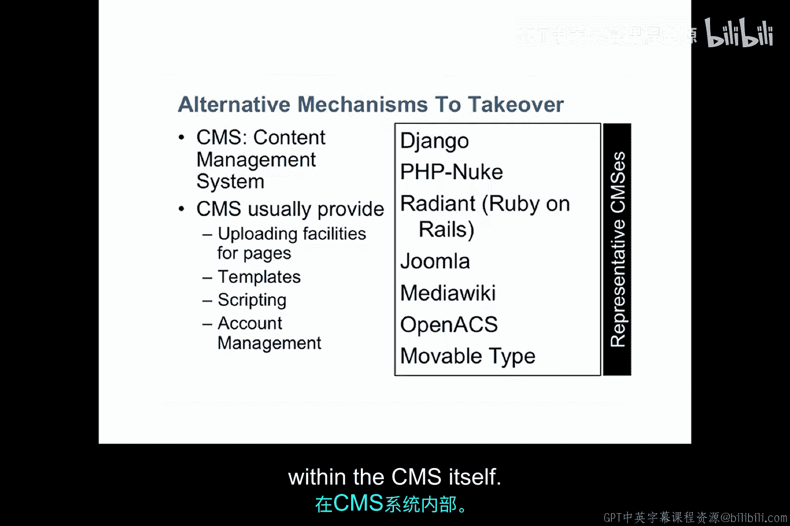

除了密码破解，还有其他接管服务器的方式。我之前提到CMS作为FTP的替代品。但CMS本身也存在安全漏洞。

CMS通常提供许多历史上需要通过多种服务才能实现的功能。它们提供上传功能、账户管理、脚本支持。通常，CMS内部还有自己的管理权限结构。这可能导致问题。

有一个非常常见的内容管理系统叫做PHP-Nuke。它是一组PHP脚本，允许你构建一个经典的LAMP系统。

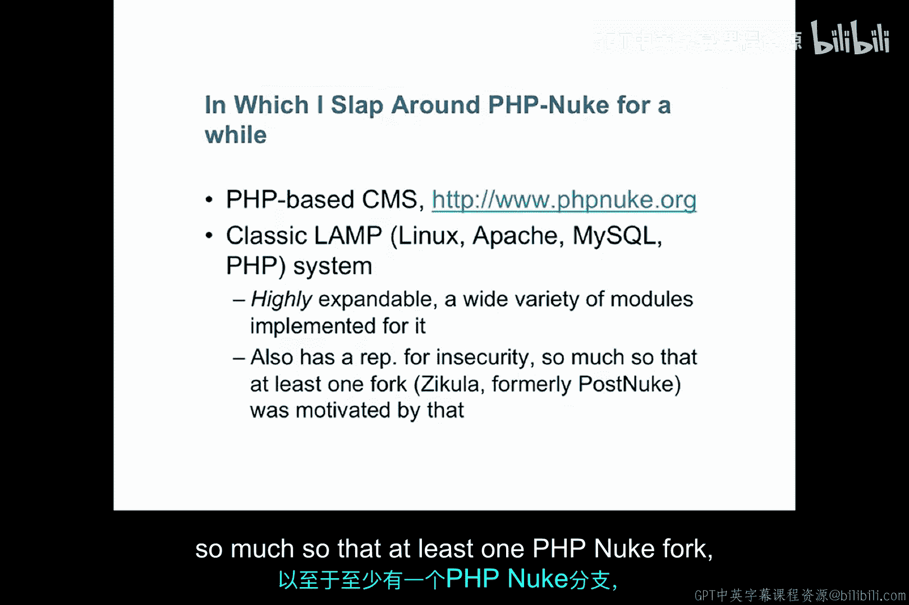

“LAMP”这个术语大约在五年前流行，也就是在Ruby on Rails和Django框架兴起之前。它指的是Linux、Apache、MySQL、PHP。这是经典的、可扩展的系统。PHP当然是一种网页脚本语言。LAMP基本上是一个用PHP实现的内容管理系统，附带一个包管理器，允许你加载各种模块。它非常易于扩展，但也长期以不安全而闻名，以至于至少有一个PHP-Nuke的分支项目——Zula——是纯粹出于安全考虑而创建的。

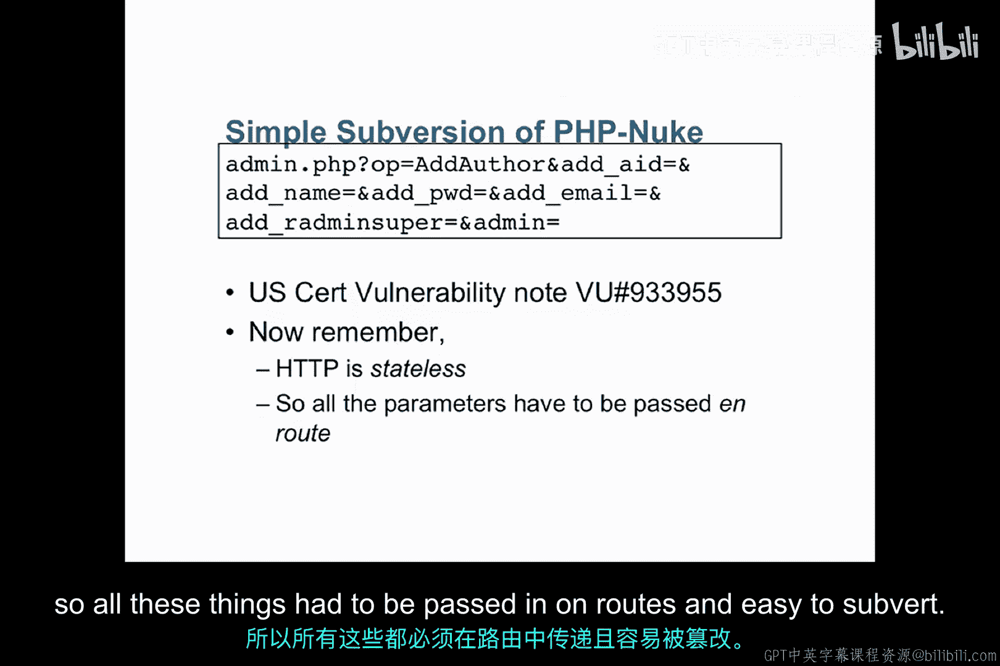

例如，如果你查看PHP-Nuke中的`admin.php`脚本，你会发现它实际上在每个消息中都传递了管理员名称、权限和权利。这是一个已知的漏洞，因此所有这些信息都必须通过路由传递，并且很容易被篡改。

## SQL注入攻击

上一节我们讨论了CMS内部的攻击，本节中我们来看看另一种更常见的基于Web的攻击形式：SQL注入。

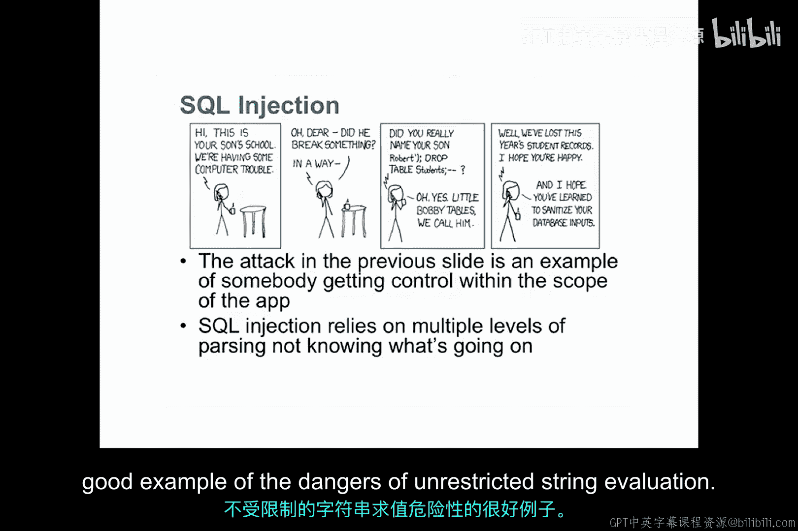

SQL注入是当前非常常见的攻击向量，在我看来，它也是无限制字符串求值危险性的一个很好的例子。以下是SQL注入的工作原理：

假设我有一个网站，出于对华夫饼的痴迷，就叫它Waffle.net。网站上有一个脚本，假设是`fix_food.php`。这个脚本具体做什么并不重要，它接收两个参数：一个ID和一个A。如果我想以某种方式“修复”华夫饼，我就会调用这个脚本。

该脚本会被翻译成一条SQL语句。例如：
```sql
UPDATE foods SET name='waffles' WHERE id=3
```

攻击者想要破坏这条语句。他的做法是，在你本应进行更新的地方，他通过字符串注入了一个终止符和一个实际的SQL命令。你会注意到代码中的两个破折号`--`，这在SQL中表示“此行之后的内容是注释”。

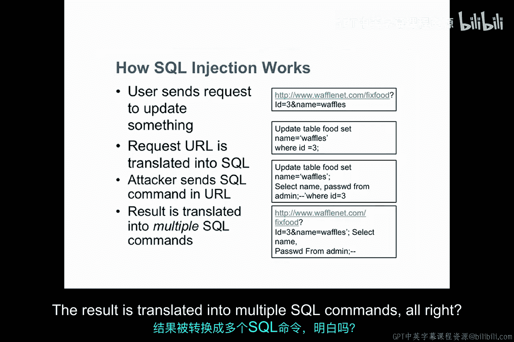

因此，这条命令现在不再是“更新foods表，将id为3的记录的name设置为waffles”，而是变成了：
```sql
UPDATE foods SET name='waffles'; SELECT name, password FROM admin; --
```
它执行了第一条更新语句（这可能无关紧要，可能只是产生乱码），但它还有另一条命令要执行：从admin表中选择name和password，后面跟着注释，所以前一条语句被终止了。

结果就是，攻击者注入并截断了原始的SQL命令，然后在后面添加了另一条命令。最终，输入被翻译成了多条SQL命令。

## SQL注入的原理与防御

SQL注入的“魔法”依赖于几件事：
1.  **变量净化不充分**。
2.  **使用双破折号`--`注释**，这用于指示其后的所有内容都可以被忽略。
3.  **人们忘记对所有输入进行净化**。以PHP-Nuke为例，它曾有一个净化问题，即不断将HTTP Referer标签作为参数传递。因此，攻击者只需将SQL注入代码放入Referer标签即可发起攻击。

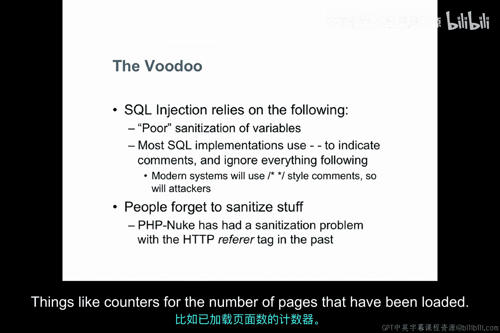

关于SQL注入，需要记住的关键点是：SQL注入是注入任意SQL语句。因此，你会看到SQL注入攻击使用最无害的变量作为攻击向量，因为攻击者只关心他们提供的变量内容会被直接传递给SQL语句。例如，已加载页面数量的计数器。

我将“不充分”加了引号，因为净化工作**很难**。当你查看一次SQL注入攻击时，你实际上看到了多级重定向：URL本身、JavaScript、CGI-BIN接口、内容管理系统、CMS使用的脚本语言，以及SQL。你必须在某个环节进行拦截。如果攻击者足够聪明，他可以利用系统的不同部分在不同层级为他处理一些求值和解析工作。攻击者会操纵文本来达到目的。

另外要记住的是，SQL注入真正伤害我们的地方在于，它是在对一个通用的HTTP请求进行操作。它基本上是将一些值放入某个东西中并运行`eval`（求值）。一般来说，`eval`是危险的。尽量避免在用户输入附近直接运行代码。

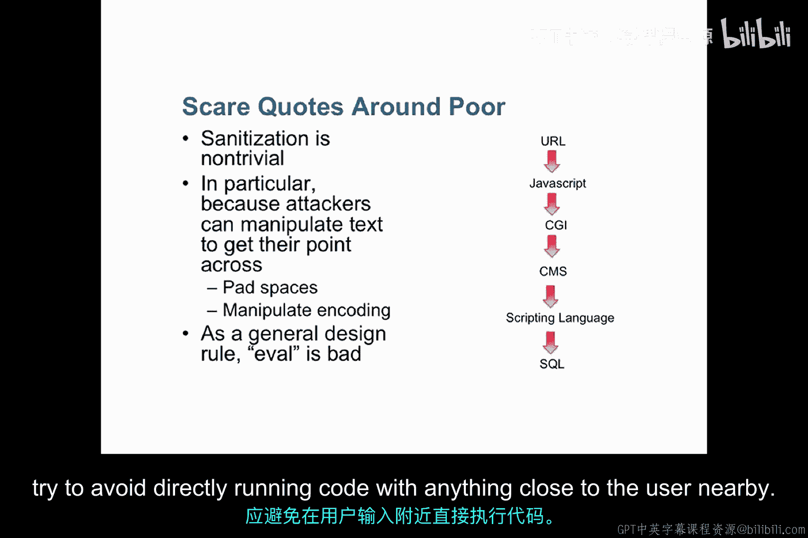

## 攻击者如何寻找目标

攻击者如何攻击网站？他们做的第一件事就是寻找漏洞。

最好的方法是使用谷歌。例如，如果我想寻找一个使用PHP-Nuke的网站，我只需让谷歌为我搜索“PHP Nuke”，然后找到一系列网站。我这里有一个例子，是寻找包含我可以探测的`cgi-bin`目录的网站。

通常，攻击者会直接寻找特定的URL。他们只会运行自动请求常见URL的机器人程序。这里的关键点是，大多数时候攻击者并不关心网站本身。他们寻找的是可利用性。因此，他们会寻找关于`cgi-bin`或`nuke`（PHP-Nuke目录）的目录，寻找公开的Perl或Python脚本等。

## 总结与核心安全理念

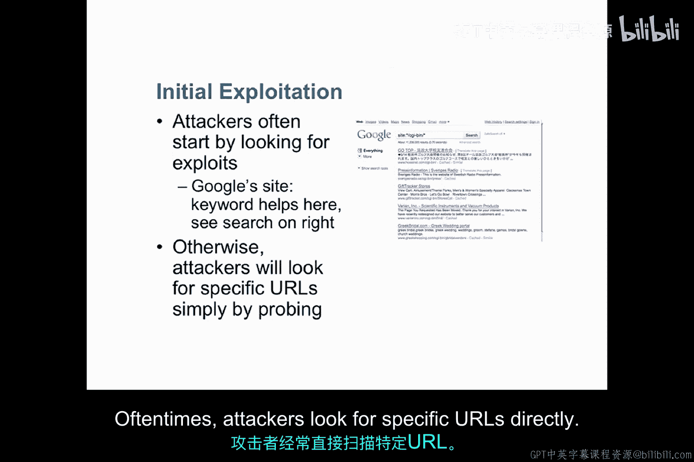

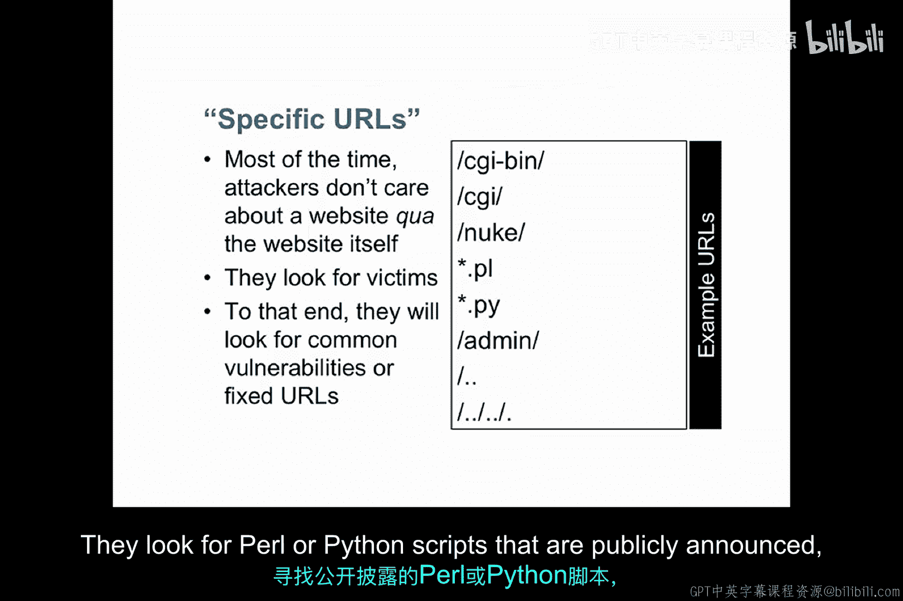

在本节课中，我们一起学习了攻击者用于接管网站的各种机制。

当你审视这些服务时，请将它们视为安全漏洞。它们确实提供了额外的功能，但当然，这样做也打开了系统被利用的大门。

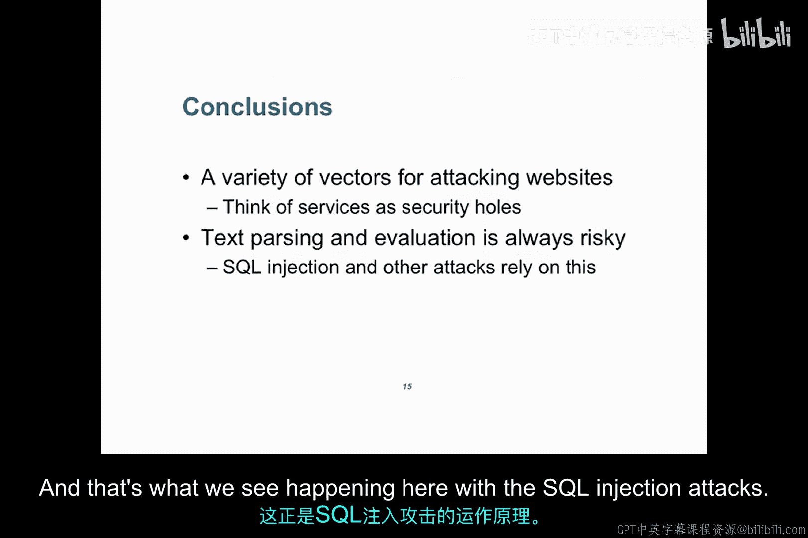

最后，另一件需要记住的事情是：文本解析和求值是危险的。我坚信我们遇到的大多数安全问题都属于有限的几个类别，其中一个重要的类别就是混淆了**控制平面**（我们如何做事）和**数据平面**（我们正在操作的信息）。SQL注入、缓冲区溢出都是这方面的例子。任何将数据字符串视为命令（而不再是数据）的情况都会导致风险。这就是我们在SQL注入攻击中看到的情况。