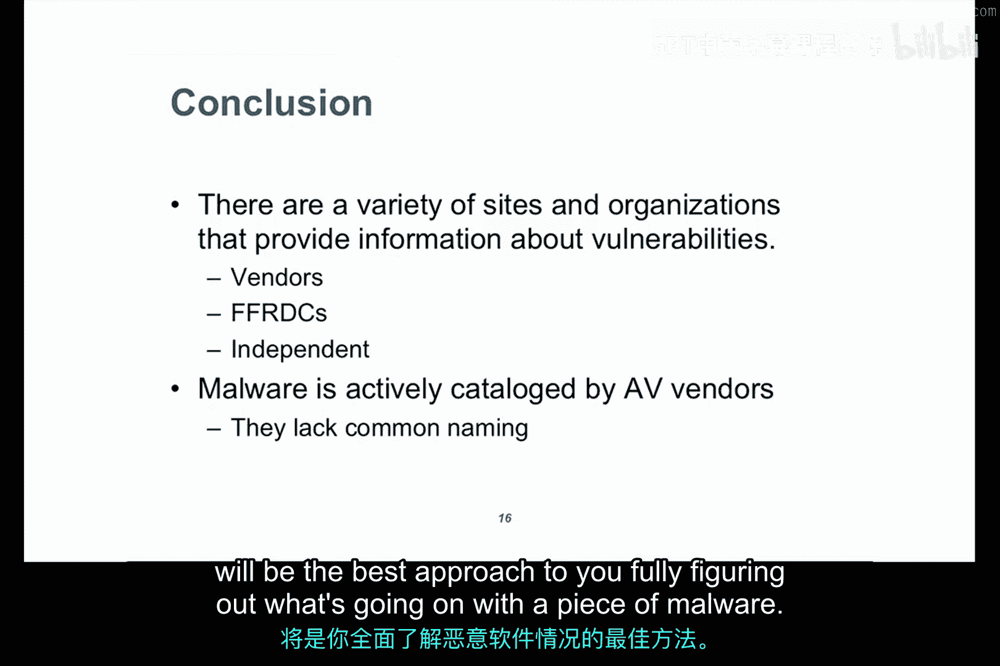

# 007：漏洞与恶意软件信息源 📚

在本节课中，我们将学习如何获取关于漏洞和恶意软件的信息。课程结束时，你将能够列举一系列提供漏洞和恶意软件信息的来源，了解它们的用途和局限性，并描述关联不同信息来源的困难。

我们经常需要处理漏洞和恶意软件的各种命名。

有多种索引和技术说明可用于追踪这些信息。问题恰恰在于追踪这些信息的索引和技术说明种类繁多。这有点像其他标准的情况。标准的“好处”在于有太多可供选择，它们做着完全相同的事情，而每个人都会围绕某个特定标准形成自己的小阵营。那么，为什么这方面会有所不同呢？你会看到很多情况，人们使用特定的命名约定，并希望坚持这些约定，他们不会让任何其他数据源来规定他们自己的命名方式。这往往会成为一个问题，但也意味着它们各自在做事方式上都非常可预测。

在深入探讨定义漏洞和利用的不同方式之前，我们需要先明确一些定义。在尝试获取与漏洞和利用相关的信息时，你会看到一个常见说法，即术语使用上的松散性。因此，让我们在这里保持简单。

## 术语定义

当谈论容错时，你会用到诸如**缺陷**、**故障**和**失效**这样的术语。

而在谈论网络安全时，你真正需要谈论的是**漏洞**和**利用**。其中，**漏洞**是一个可被敌对方利用以夺取控制权的缺陷。**利用**则是利用该漏洞以夺取控制权的工具或机制。

这是两个略有不同但又紧密相连的概念。我将**恶意软件**称为包含一个或多个利用的应用程序。漏洞是一种缺陷，但缺陷不一定是漏洞。例如，缓冲区溢出可能不会给攻击者带来任何好处，只有攻击者才能利用它。

## 漏洞信息来源

我们能够成功地对缺陷和漏洞进行分类，也能在一定程度上对特定的利用进行分类。但在准确判断恶意软件包具体使用了哪些漏洞方面，我们有时会遇到困难。

每个主要且负责任的发布商都会提供关于其当前缺陷或漏洞的技术说明。通常，这些说明与补丁相关联。

以下是主要操作系统供应商的列表。需要注意的是，这些信息源对我们和攻击者来说都是很好的资源，因为它们提供了可能被利用的路线图。如果用户没有留意这些网站的警告，他或她就可能成为勤奋攻击者的潜在受害者。请记住，你必须实际更新系统，才能免受利用特定漏洞的攻击。但并非每个人都能始终保持必要的警惕性，这就是为什么攻击者仍然可以利用这些信息来设计确实有效的攻击。

除了供应商，其他组织和机构也会跟踪漏洞状态。其中一些是政府明确授权这样做的，例如 FFRDCs 等。

另一些则是独立的组织，它们这样做是为了推动网络安全研究和整体网络安全运营。熟悉这些来源以及供应商网站的信息是一种好习惯。它们之间会有重叠，但并非完全重叠，你将从每个来源获得独特的信息。

现在，让我们更具体地了解一些信息来源。

## 具体信息源

CERT 会发布一系列公告，可以在顶部显示的 URL 找到。这是 CERT 的任务之一，即报告并随时记录这些信息。这项工作由 US-CERT 完成，它充当了漏洞信息的中央交换中心。US-CERT 发布的公告数量相对较少，大约每月三到四个，但这些往往是“重磅”消息。这里所说的“重磅”，指的是那些可能在极短时间内影响最多人群的漏洞。

接下来是 CVE，可以在显示的 URL 找到。CVE 旨在为每个重要的漏洞分配一个编号。当你发现一个漏洞时，你可以向 CNA（CVE 编号机构）请求一个编号。CVE 是一个重要的参考。你可以在一个全国维护的数据库 NVD 中查找所有编号。事实上，你将在后续的作业中使用它。

最后，我们有 SANS，可以在其网站上找到。SANS 研究所是一个为系统管理员和安全专业人员提供的分布式教育、培训和信息交流机构。它定期发布关于安全漏洞的报告，这些报告通常来自网络安全领域的从业者，并且是为网络安全从业者编写的。

## 完全披露理念

现在，我们将更深入地探讨一种更自由的漏洞报告理念——完全披露。这是一种看待安全事件的观点，在 90 年代中期发展起来。它是对该领域许多人认为 CERT 开始持有的那种“象牙塔”态度的回应。完全披露主张，所有漏洞一经确认，都应连同其信息一起公开宣布，这与供应商试图做的（即保密信息、开发补丁、发布补丁，然后才让人们知道漏洞）相反。

这是一种完全不同的意识形态。这些群体更倾向于让每个人都知道某种形式的“基本事实”，认为无知比让攻击者知道弱点所在更危险。

因此，完全披露的讨论往往围绕两个主要的邮件列表进行，我们在此列出：第一个是 Bugtraq，第二个是 Full-Disclosure。这两个列表都是可搜索的，简单的谷歌搜索就能带你直达网站，你还可以在存档中进行搜索，这非常有用。

## 恶意软件分类

我们已经讨论了如何对漏洞进行分类，现在我们来谈谈恶意软件是如何分类的。恶意软件主要由防病毒供应商进行分类。我们在此列出了其中几家。其中许多名字应该会立刻让人感到熟悉。

传统上，恶意软件公司通过在其名称末尾添加一个字母来分配变体名。这在一定程度上是有用的，可以让你知道两个恶意软件确实存在关联，但如果不亲自去它们的网站查看并进行比较，它无助于你理解它们之间的差异。

更“棒”的是，它们之间没有使用统一的命名约定。例如，这里有几个例子说明了它们各自的命名方式是如何运作的：在 McAfee，你会看到类似“受影响的OS/名称.变体”的格式；赛门铁克使用“OS.名称.变体”的格式，两者之间存在简单的映射关系，等等。问题是，尽管你确实可以在其中一些命名之间建立很好的映射关系（如果它们都保持一致维护的话），但无法保证它们都会使用一致的名称。

因此，所有这些变体都存在某种形式的冲突。上一张幻灯片中的所有变体都使用了该网站为 Conficker 蠕虫引用的名称，但这不一定是一个在所有注释中都一致的名称。尽管我觉得这很烦人，但我能理解它发生的原因，而且确实没有简单的方法来修复它。因此，目前作为分析师的你必须保持警惕，永远不要因为恶意软件没有你预期的名称而忽视它。考虑信息本身告诉你的内容，并据此开展工作。名称只是一个代号。

这些名称实际上是根据发现恶意软件的方法而产生的。例如，密集的并行研究开发可能导致实验室开始以不同的方式称呼事物，而这个名称就被传播开来。有些与蠕虫的传播方式有关。所以，这种情况的发生是可以理解的。这不是恶意的，也不是他们试图阻止你使用他们的信息。这真的只是关于实际恶意软件被发现方式的问题。

## 总结

在本节课中，我们一起学习了多种提供漏洞和利用信息的网站和组织。对于漏洞，我们有供应商网站、FFRDCs，还有独立组织收集这些信息并使其易于网络安全人员获取。恶意软件则由防病毒供应商积极进行分类。

它们没有使用相同的命名约定，但一旦你发现两个不同的名称实际上在两个不同的网站上代表同一事物，结合这些信息将是你全面了解某个恶意软件情况的最佳方法。

