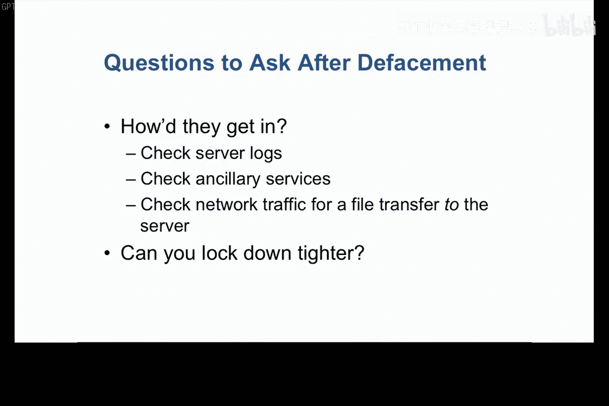

# 008：网站篡改攻击 🖥️🔓

在本节课中，我们将要学习一种最基本且易于检测的攻击类型——网站篡改攻击。这种攻击的核心目的是展示攻击者能够对他人的网站进行修改。

## 概述

网站篡改攻击，其本质类似于网络空间的涂鸦。攻击者接管系统并替换网页内容，这种行为也被称为“黑客主义”或“网络破坏”。虽然篡改本身可能只是为了炫耀，但被攻陷的网站往往会被攻击者视为后续更严重攻击的资源。

## 网站篡改的本质与动机

上一节我们介绍了网站篡改的基本概念，本节中我们来看看攻击者实施此类攻击的深层动机。

攻击者可能纯粹为了篡改网站本身而发动攻击。然而，我们预期遇到的大多数攻击者，对网站本身并无直接兴趣。事实上，在攻击者看来，一个网站是可被利用的资源，旨在为后续的真实攻击服务。

尽管Zone-H等网站只是篡改事件的存档库，但它也揭示了一个事实：网站容易受到攻击。因此，虽然网站当时只是被篡改，但它被其他方式攻陷后，未来被用于更邪恶目的的风险会显著增加。

那么，谁会在意呢？不就是一台服务器吗？实际上，服务器对攻击者而言颇具价值，甚至比个人电脑更有价值。一台被占领的HTTP服务器能为攻击者提供多种资源：它本身可作为网络钓鱼、恶意软件投放、命令与控制通道的服务器；同时，它可能包含可被窃取的用户列表及相关信息，这些信息可用于其他非法目的。

## 如何检测网站篡改

了解了攻击的动机后，一个很自然的想法是：如何检测网站是否被篡改？以下是一些有效的检测方法。

检测篡改的一个好方法是直接检查网页。最简单的方式是在本地进行。实际上，你可以设置任何基于主机的入侵检测系统（如Tripwire），来追踪系统上文件的任何更改。

你也可以采取更精细和主动的措施，例如使用爬虫定期抓取你的网站，并将结果与基准进行周期性对比。

## 事件响应与加固

假设篡改确实发生了。你实际已被攻击。此时你应该问的首要问题是：**他们是如何进入的？**

从那一刻起，你必须展开全面的调查。你需要检查服务器日志，查看系统上是否运行了额外的服务，检查之前启用但未使用的、可能被此次攻击利用的服务。同时，你也应该检查网络流量中是否有向服务器的文件传输，这是判断服务器是否被用于非法目的的有效方法。

除了“他们如何进入”，你应该问的第二个问题是：**如何更严格地锁定你的网站？**

显然，此时你的安全防护存在某些缺陷，必须加以解决。

## 总结

本节课中，我们一起学习了网站篡改攻击。我们了解到，这种攻击虽然看似简单，但被攻陷的网站往往会成为攻击者进行后续非法活动（如网络钓鱼、数据窃取）的跳板。我们探讨了通过本地监控工具（如`Tripwire`）或主动爬虫对比来检测篡改的方法。最后，我们强调了事件响应的关键：调查入侵路径并立即加固安全防线，修补存在的漏洞。