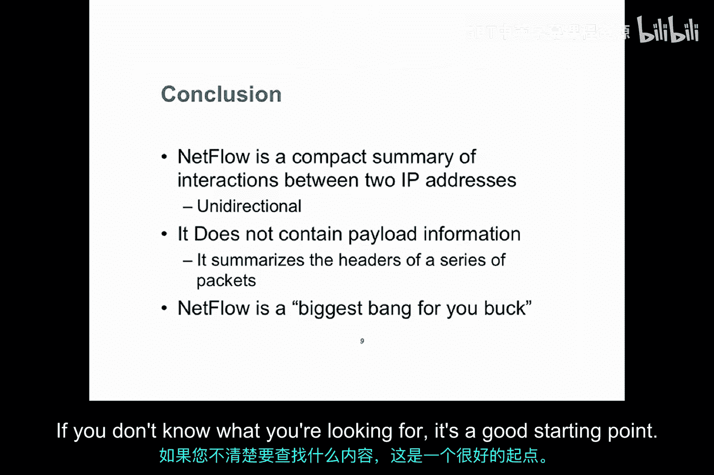

# 010：NetFlow流量分析概述 🚦

在本节课中，我们将学习NetFlow的基本概念，了解流分析与数据包分析的区别，并探讨NetFlow的优势与局限性。

## 概述

NetFlow是一种网络流量分析技术，它通过汇总数据包信息来提供网络活动的概览。与逐包分析相比，NetFlow能更高效地处理大规模数据，适用于流量统计、计费和安全监控等场景。

## 流分析与数据包分析

上一节我们介绍了课程目标，本节中我们来看看流分析与数据包分析的核心区别。

逐包分析工具（如TCPdump和Wireshark）能提供每个数据包的详细信息。然而，在处理大规模数据时，这种方法可能效率低下。例如，分析流向热门视频流的数万个中间数据包，或深入检查扫描暗网空间的每个数据包，通常既不必要也不可行。

因此，我们需要摘要技术。最常见的摘要技术就是NetFlow。

## NetFlow的起源

NetFlow最初由计算机科学家Casey Claffy在其博士论文中提出，随后被思科（Cisco）开发成调试工具。传说思科在一次演示中，客户注意到了角落里的NetFlow工具并表示想要，NetFlow便由此逐渐发展起来。

## 什么是流？

流（Flow）是指在时间上密切相关的一组数据包。

Casey Claffy的博士论文研究了一个具体问题：观察两个具有相同特征的数据包，如果它们在K秒内出现，它们属于同一个TCP会话的可能性有多大？由于脱离端点重组TCP会话计算成本极高，我们可以通过查看地址信息来合理猜测数据包是否属于同一会话。

流由我们通常所说的**五元组**定义。五元组是一个计算机科学理论术语，意指“一组事物”。

以下是定义流的五元组：
*   **源IP地址**
*   **目的IP地址**
*   **源端口**
*   **目的端口**
*   **协议**

严格来说，提及端口意味着我们主要关注TCP和UDP。但思科作为工程导向的公司，也会将其他协议（如ESP、ICMP）中源/目的端口字段位置相同的分组归入流，尽管这种关联可能很微弱。流的原始目标是重建TCP会话，为此，端口和地址信息是很好的依据。

## 流的收集与特性

流通常在路由器上收集。最初，思科将NetFlow作为路由器内部的调试工具，用于更高效地转发流量，并非为了报告。

流是基于时间的。这意味着如果一系列具有相同五元组的数据包在一个称为**活动超时**的时间段内出现，它们就会被归入一个流。与发生在瞬间的数据包不同，流具有持续时间和起始时间。

流的关键特性是：即使五个数据包地址信息相同，但如果它们在时间上不紧密相关，也会被拆分成多个子流。这对于SSH或Telnet等长会话尤其是个问题，因为它们会因保活数据包而被拆分成多个流。

## 为什么使用流？

流是对TCP会话的近似估计。由于TCP会话重组成本极高，且某些情况（如标志位组合）无法完全确定，流作为一种“足够好”的近似，适用于统计分析、流量分析、计费和安全监控。

## 流记录示例

一个流记录至少包含以下字段（不同公司的实现可能不同）：

*   **五元组字段**（始终存在）：源IP、目的IP、源端口、目的端口、协议。
*   **数据包数**：具有相同五元组的数据包总数。
*   **字节数**：这些数据包的总大小（基于三层信息，例如TCP流每个包至少40字节，UDP流每个包至少28字节）。
*   **标志位**：TCP标志位的按位或（OR）结果（对于非TCP协议可能无意义）。
*   **开始时间与结束时间**：观测到第一个和最后一个数据包的时间。
*   **持续时间**：结束时间与开始时间之差。

## 为何选择流而非完整流量转储？

完整流量转储的成本极高。这不仅涉及数据存储，还包括在大型网络上传输所有数据所需的额外网络资源。向管理层提议建设一个专用于记录和传输流量的第二网络需要极大勇气。

NetFlow是流量的紧凑表示，能将数兆字节的会话压缩至约22字节。它具有很高的性价比，当你不知道要查找什么且存储空间有限时，流记录中的字段信息是首要抓取目标。另一种方法是进行特征匹配，但这只能发现已知特征，覆盖范围很小。

## 总结

本节课中我们一起学习了NetFlow流量分析。

请记住，NetFlow是交互行为的紧凑摘要。它也是单向的，例如一个TCP会话会产生两个流（客户端到服务器，服务器到客户端）。这在IP世界中是合理的。

NetFlow不包含有效载荷信息，它只摘要信息，不包含包头数据。这导致了一个观点：NetFlow具有最高的性价比。当你不确定要查找什么时，它是一个很好的起点。