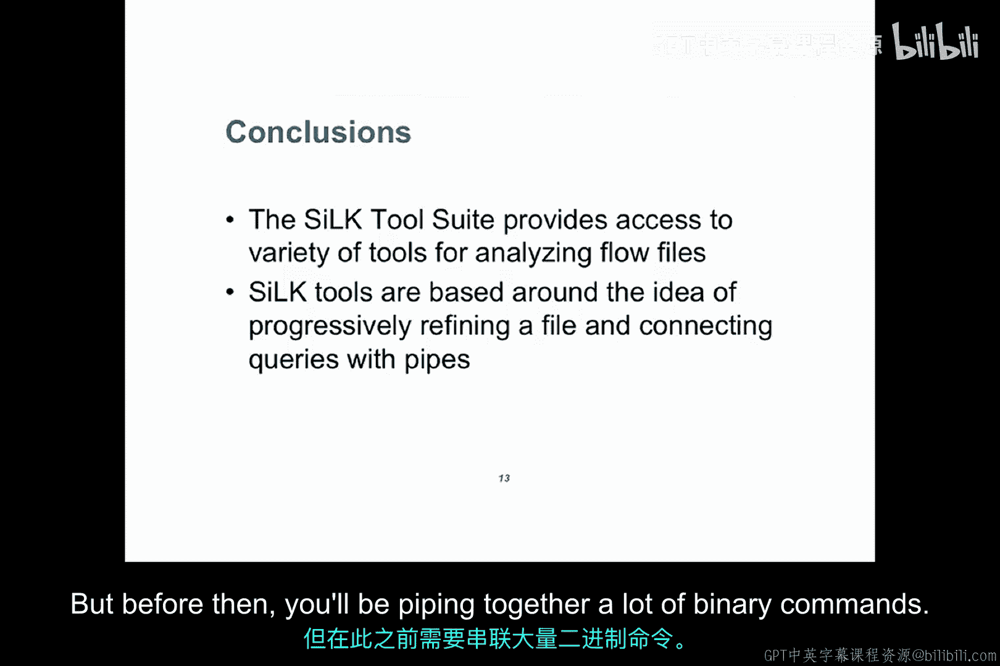

# 011：SILK网络分析工具套件 🛠️

在本节课中，我们将要学习SILK工具套件。SILK是一套用于分析大规模网络流数据的工具集。我们将了解其核心工具、基本操作流程以及如何利用其模块化特性进行数据分析。

## SILK工具套件简介


SILK是“系统级互联网知识”（System for Internet-Level Knowledge）的缩写。它由卡内基梅隆大学在2002年至2004年间开发，专门用于分析极其庞大的NetFlow数据集。至今，SILK仍由卡内基梅隆大学的CERT团队维护，这本身也说明了该工具的重要性。

SILK是一套模块化的分析工具，但其命令行界面以不友好著称。因此，我们将重点介绍其基本使用方法，帮助你理解如何利用它来回答实际的网络分析问题。


## 核心工具与基本操作

上一节我们介绍了SILK的背景，本节中我们来看看其最核心的两个工具：`rwfilter`和`rwcut`。这是使用SILK的基础。


一个最基本的SILK命令示例如下：
```bash
rwfilter --proto=6 data.rw --pass=stdout | rwcut
```
这个命令的含义是：从名为`data.rw`的流文件中，过滤出协议号为6（即TCP）的流记录，然后将结果通过管道传递给`rwcut`命令进行格式化输出。

这里需要注意几个关键点：
1.  **管道（Pipe）的使用**：SILK遵循经典的Unix哲学，即通过管道将多个小型、功能专一的工具连接起来。`rwfilter`和`rwcut`就是通过管道符`|`连接的。
2.  **`--pass=stdout`参数**：`rwfilter`的输出默认是二进制的，`--pass=stdout`指定将“通过”过滤的二进制流数据输出到标准输出，以便通过管道传递给下一个命令。
3.  **`rwcut`的作用**：二进制流数据对人类不可读。`rwcut`的作用就是接收这些二进制流，并将其转换为可读的文本格式（如CSV）输出到屏幕。


SILK工具虽然本身可能很复杂，但其操作模式依然根植于这种通过管道连接模块化工具的理念。一些命令，特别是`rwfilter`，甚至可以同时使用多个管道。

## 详解RWFilter：流量过滤引擎

`rwfilter`是SILK中最基础、最强大的工具。它的作用是让你通过命令行指定一系列针对流记录属性的测试条件（即过滤器），并根据这些条件决定每条流记录是“通过”还是“失败”。

你可以将“通过”和“失败”的流分别发送到不同的输出管道进行下一步处理。实际上，你可以连续使用多个`rwfilter`命令，这在处理像TCP标志位这类复杂过滤时很常见。

以下是`rwfilter`命令的构造方式：
*   过滤器条件之间是“与（AND）”的关系。例如，`--aport=80 --proto=6`表示同时满足“端口为80”且“协议为6”的流才会通过。
*   要表达“或（OR）”关系，需要在单个条件内完成。例如，`--aport=80`本身就是一个“或”条件，它表示源端口**或**目的端口为80的流。
*   过滤器通常接受用逗号分隔的列表或短横线表示的区间。例如：
    *   `--proto=6,17` 表示协议为6 **或** 17。
    *   `--proto=6-17` 表示协议在6到17之间（包含两端）**所有**的协议。

一个更复杂的例子：
```bash
rwfilter --start-date=2023/10/01 --end-date=2023/10/02 --aport=80 --proto=6 input.rw --pass=stdout | rwcut
```
这个命令过滤出在2023年10月1日至2日期间，使用TCP协议且端口为80的所有流。请注意，`--start-date`和`--end-date`定义的是一个时间窗口，只有**开始时间**在这个窗口内的流才会被选中，与之重叠但开始时间在外的流不会被包含。

## 详解RWCut与数据分析流程

`rwcut`是基本的探索性工具，它接收`rwfilter`输出的二进制流，并将其转换为可读格式。它有很多格式化选项，例如指定输出字段、分隔符等。

理解了基本工具后，我们来看看使用SILK分析数据的典型流程。这能帮助你理解这些工具是如何协同工作的。


SILK分析的一般思路是：你从一个源（如路由器）生成的原始流文件开始，运行`rwfilter`生成一个新的、过滤后的文件，然后对这个新文件继续运行更精细的`rwfilter`，逐步缩小范围，定位到你寻找的目标。

例如：
1.  首先，过滤出所有TCP流量：`rwfilter --proto=6 original.rw --pass=tcp.rw`
2.  用`rwcut`查看`tcp.rw`文件：`rwcut tcp.rw | less`
3.  发现某个IP地址可疑，进一步过滤与该IP相关的TCP流量：`rwfilter --sip=192.168.1.100 tcp.rw --pass=suspicious.rw`
4.  继续对`suspicious.rw`文件进行分析。

这种渐进式细化搜索，处理的数据文件会越来越小。你还可以使用`rwfileinfo`工具查看某个流文件是由哪些查询命令生成的。

当你得到一个最终的、包含目标数据的小文件后，就可以使用能生成ASCII报告的输出工具（如`rwcount`， `rwuniq`， `rwstats`）来制作图表或统计摘要。


## 高级输出工具：Count， Uniq与Stats

以下是三个主要的输出工具，用于从过滤后的数据中生成统计报告：

*   **`rwcount`**：生成适合绘制时间序列图的输出。它最初的设计几乎可以直接接入Gnuplot进行绘图。
*   **`rwuniq`**：提供分类汇总统计。你需要指定一组字段（如协议、端口），它会按这些字段的值进行分组，并计算每个分组中的流数、包数、字节数等。
*   **`rwstats`**：非常适用于生成“Top N”列表（如流量最大的前10个IP地址）。

需要记住的是，SILK是为处理**超大规模数据集**而设计的。因此，它采用了一些高度优化的算法。例如，除非必要，它不会进行全排序；`rwstats`就使用了堆（Heap）数据结构，这虽然更耗内存，但在时间效率上远高于全排序。


## 核心进阶概念：集合（Sets）与包（Bags）

基础的SILK已经很强大了，但当你开始使用**集合（Sets）**和**包（Bags）**时，它会变得更有趣、更强大。

一个**集合**是任意IP地址集合的二进制表示。它可以是一个特定网段（如`10.0.0.0/8`）内的所有IP，可以是你手动输入的列表，也可以是另一个过滤任务的结果（例如“所有与服务器通信的客户端IP”）。

集合可以从流文件生成（例如，提取所有源IP到一个集合），也可以从文本文件用`rwsetbuild`工具构建。集合之间可以进行操作，如**并集（union）**、**交集（intersect）**、**差集（difference）**。


最关键的是，`rwfilter`可以使用`sipset`、`dipset`、`any-set`等谓词，基于IP集合的内容进行过滤。例如，`rwfilter --any-set=malicious_ips.set data.rw --pass=stdout | rwcut`可以找出所有与“恶意IP集合”中任一地址通信的流。

与集合相比，**包**是“带标签的集合”。一个包包含一个IP地址以及与之关联的一个或多个值。这个值可以是自动生成的（如该IP发送的总字节数），也可以是任意你赋予的标签。你可以从流文件生成包，也可以从集合生成，并使用`rwbagtool`这个功能强大的“瑞士军刀”对包进行添加、减去、合并等操作。


## 其他实用工具与总结

最后，还有一些其他有用的工具需要了解：
*   **`rwcat`**：用于将多个流文件拼接在一起。
*   **`rwfileinfo`**：用于查看流文件的元数据和生成历史。
*   **`rwrecc`**：可以看作是`rwcut`的逆操作，它将ASCII格式的输入转换回SILK的二进制流文件格式。




本节课中我们一起学习了SILK网络分析工具套件。我们了解到，SILK提供了一系列基于管道理念连接的分析工具，核心是`rwfilter`（过滤）和`rwcut`（查看）。通过渐进式过滤和细化搜索，可以处理大规模流数据。进阶的**集合（Sets）**和**包（Bags）**功能极大地增强了基于IP地址组的复杂查询能力。最终，我们可以使用`rwcount`、`rwuniq`等工具生成可视化报告。掌握这套工具，你将能有效地对网络流量进行深度分析和安全调查。