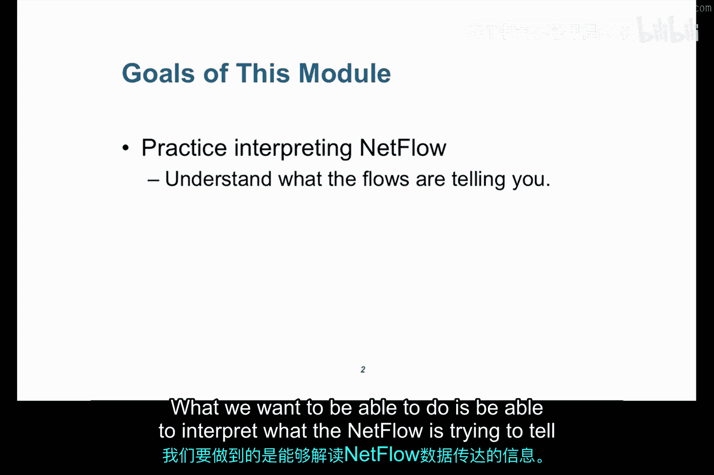
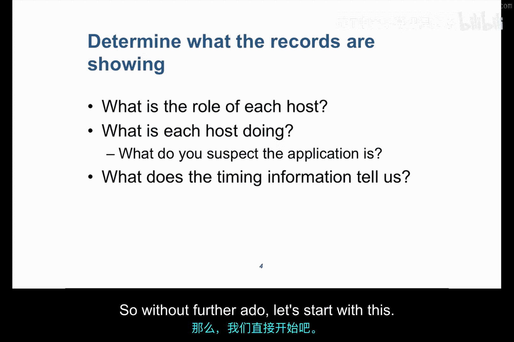
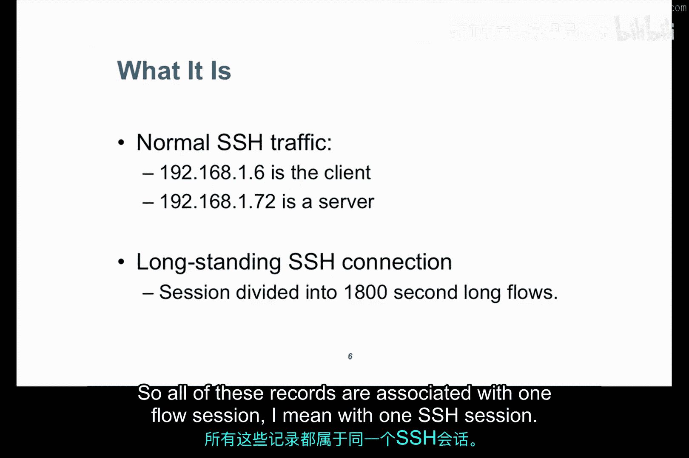
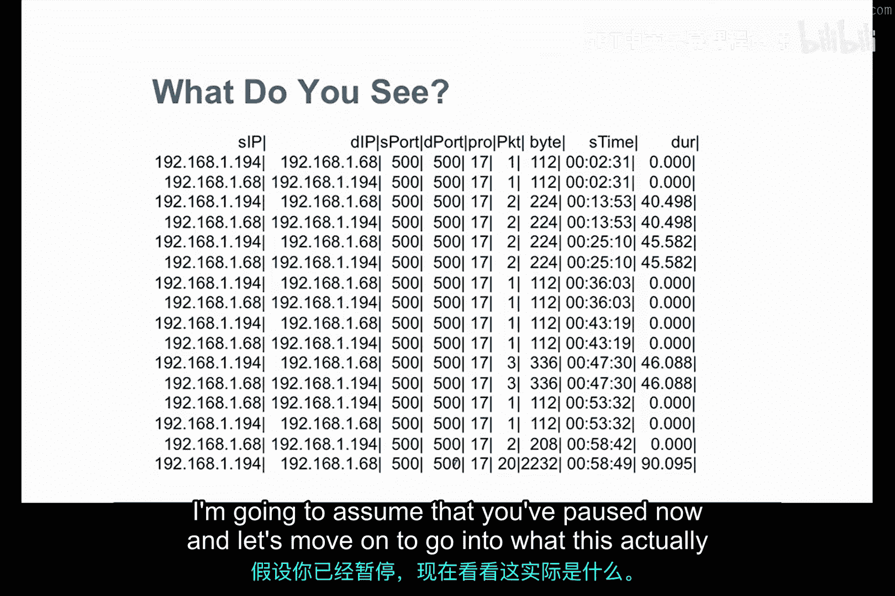
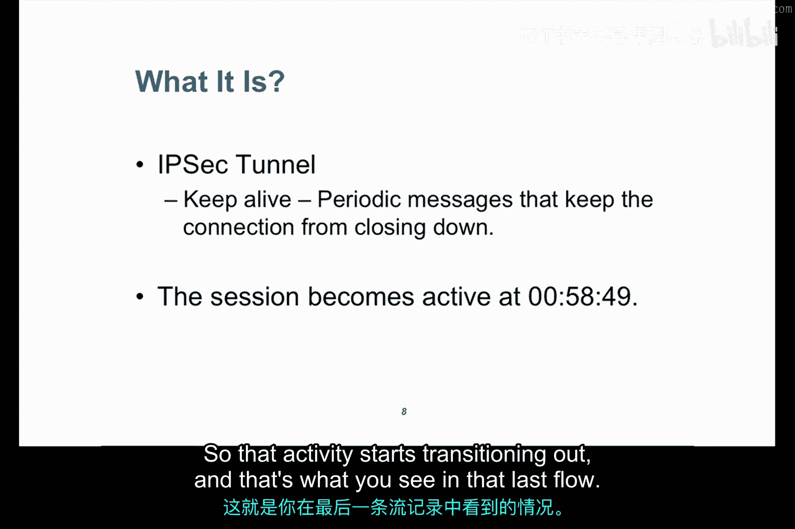
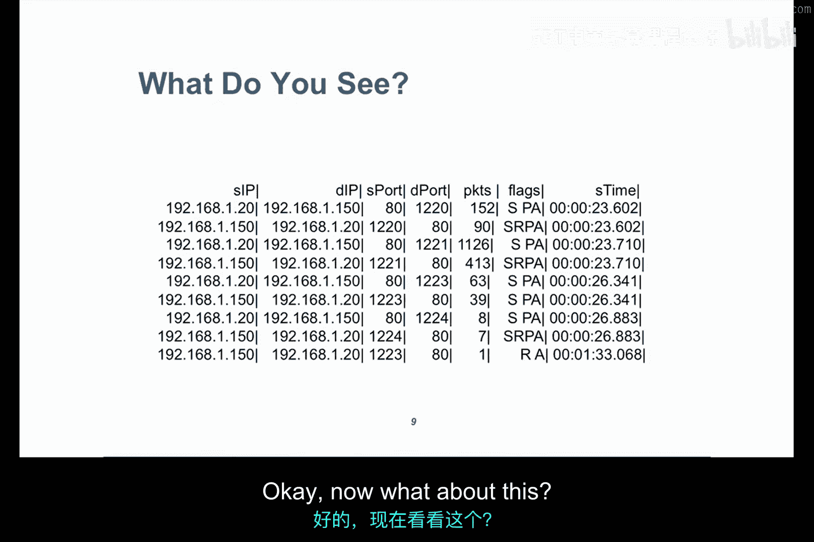
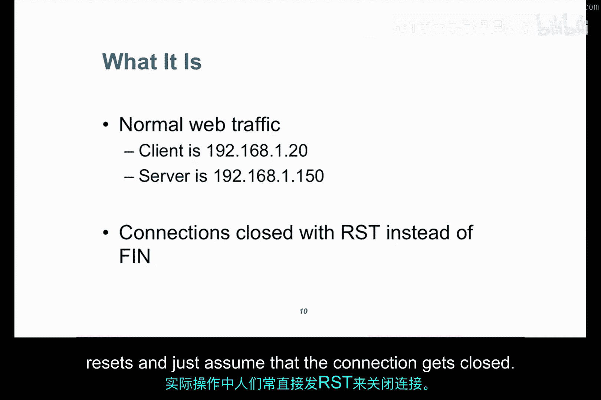
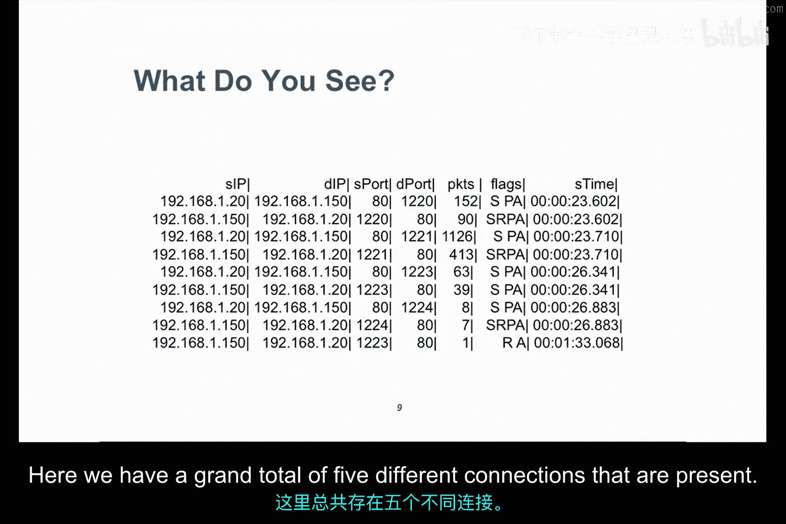
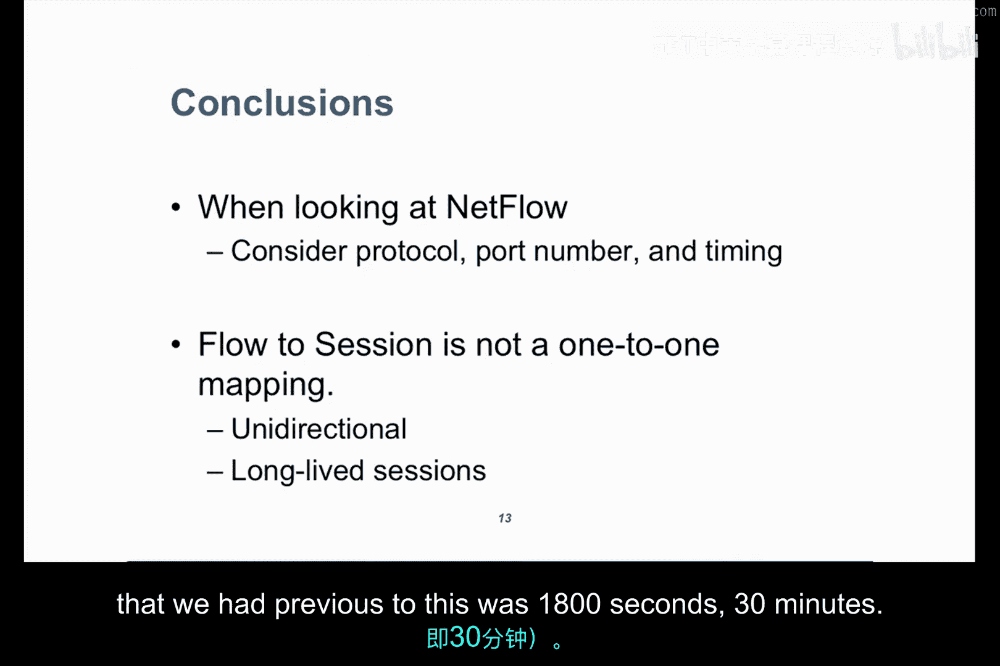

# 013：NetFlow数据分析技术 🕵️

在本节课中，我们将通过实际案例练习，学习如何解读NetFlow数据。我们的目标是理解NetFlow记录所传达的信息，并识别网络中的正常与异常活动。

上一节我们介绍了课程目标，本节中我们来看看具体的实践方法。本次练习将采用互动形式。接下来的几张幻灯片将展示不同的NetFlow数据记录。请暂停播放，仔细观察每条记录，尝试分析其中发生了什么。每张幻灯片之后，我们会给出实际的解释。请务必花时间自己分析，而不要直接翻看答案。

在开始分析前，请思考以下几个问题：
*   每个IP地址的主机扮演什么角色？
*   它们各自在进行什么活动？
*   你怀疑这是什么应用程序？
*   你认为这是正常流量吗？是否需要进一步调查？

同时，尝试利用时间信息进行分析。虽然NetFlow记录不包含数据包到达的具体时间点，但会显示会话持续时间和活动持续情况。

现在，让我们开始分析第一个案例。

***

## 案例一：持久SSH连接

以下是第一条NetFlow记录。

（请在此处暂停并分析）

***

好的，现在让我们来看看这实际上是什么。

这是一条**SSH隧道**记录。客户端是 `12.168.1.6`，它连接到服务器 `12.168.1.72`。这是一个持续时间非常长的SSH连接。

回顾之前的记录，你会发现这个会话在极长的时间内持续存在。因此，流记录被**活跃超时（active timeout）**机制分割了。在本例中，活跃超时设置为 **1800秒**。所以每过1800秒，系统就会生成一条流记录。当下一个数据包到来时，又会生成一条新记录。所有这些记录实际上都属于**同一个SSH会话**。

***

## 案例二：IPSec VPN隧道

现在，我们来看第二个案例。

（请在此处暂停并分析）

***

现在让我们揭晓答案。

这里展示的是一个**IPSec隧道**。你会看到大量**保活（keep-alive）**消息定期来回发送，以确保IPSec隧道不会断开。

请记住，建立这种隧道的过程并不快速。因此，反复断开和重连是没有意义的。一旦隧道建立，就会发送周期性数据包来维持其连接状态。

从记录中可以看到，会话在 `584` 秒后开始活跃。基本上，在很长一段时间内，这个会话没有任何实际活动。直到最后，突然有人开始进行一些操作，活动量随之上升，这体现在最后一条流记录中。

***

## 案例三：网页浏览流量

接下来，我们分析第三个案例。

（请在此处暂停并分析）

***

我猜很多人立刻根据端口号判断这是SSH或Web流量，这是正确的。

本例中，客户端是 `12.168.1.20`，服务器是 `1.168.1.5`，端口是 `150`。

这里有两点很有趣：
1.  连接是通过 **RST（复位）** 而不是 **FIN（结束）** 来关闭的。回想之前的课程，正确关闭TCP连接的方式是使用FIN握手。但现实中，人们常常直接发送RST来快速关闭连接。
2.  我们处理的不是单一连接，而是**多个Web连接**。这非常常见。需要理解的是，一个完整的网页是在客户端系统上构建的。一个主页可能指示浏览器从多个不同的站点下载各种资源（如图片、脚本）。

以下是涉及的连接情况：

我们总共有**五个不同的连接**。

***

## 案例四：网络扫描活动

最后，让我们看看这个案例。

（请在此处暂停并分析）

***

现在让我们看看这是什么。

这是 **Ping扫描**。主机 `1.2.168.1.170` 正在访问大量地址（例如 `1.168.0.0/60` 网段中的多个地址）。这里展示的只是与此次扫描相关的大量记录中的一小部分。

观察协议字段，这里使用的是 **ICMP**，这就是我们立刻能判断这是Ping扫描的原因。

***

## 总结与关键要点 🎯

本节课中我们一起学习了如何通过几个简短的NetFlow记录案例进行分析。如果你花时间仔细解读，就能获得关于如何理解流记录的宝贵经验。

在查看NetFlow时，需要考虑的关键因素包括：
*   **协议**
*   **端口号**
*   **时间信息**

但请注意：
1.  **端口号不是100%可靠的指示器**。例如，许多人会将不想被轻易发现的流量伪装成 **80端口**（HTTP）的流量，使其看起来“正常”。
2.  **NetFlow记录与会话不是一一对应的**。至少，你应该看到连接的两端。最多，一个会话可能对应任意数量的流记录。
3.  **长时间会话会表现为多条流记录**，特别是当它们超过**活跃超时**时间（在我们的例子中是1800秒，即30分钟）时。

本讲到此结束。

