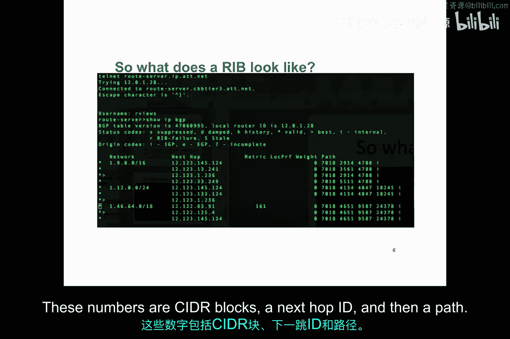
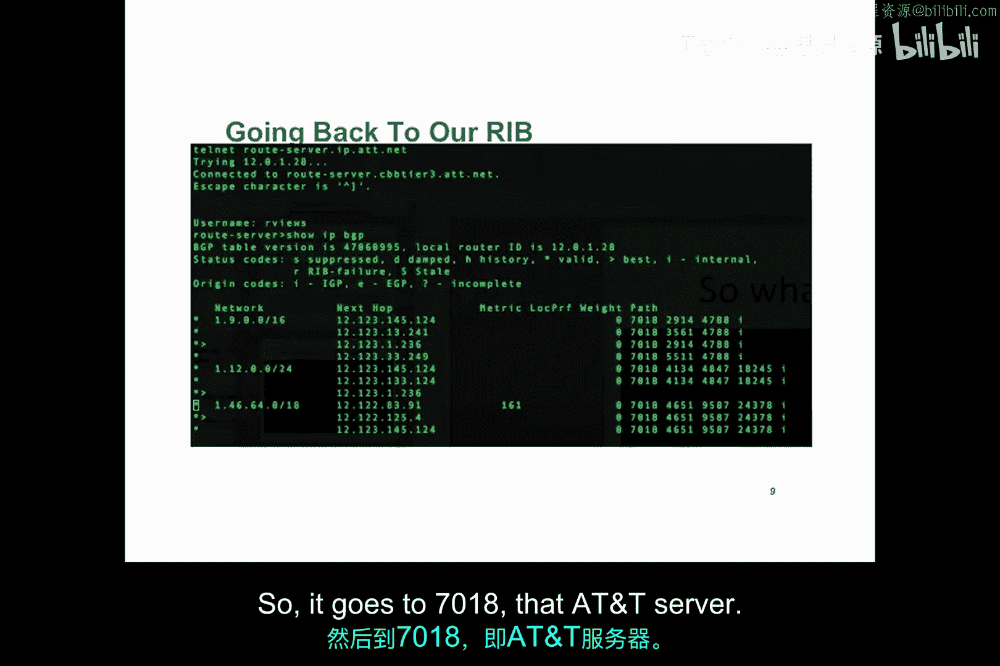
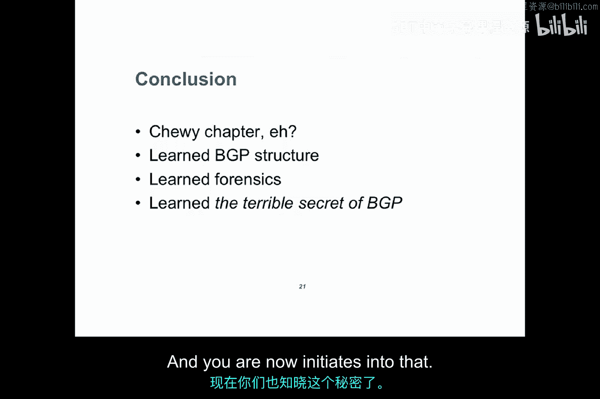

# 015：边界网关协议(BGP) 🕸️

在本节课中，我们将学习边界网关协议（BGP）的基础知识。BGP是互联网的核心路由协议，负责在不同网络之间交换路由信息。我们将探讨BGP的工作原理、如何从中提取信息，并揭示其背后一个“可怕的秘密”。

## BGP基础

BGP是一种协议。它是一种TCP协议，运行在端口179上。它名义上是一种对等协议。该协议专门由路由器使用，是路由器之间传输信息的方式。

BGP用于维护RIB，即路由信息库。RIB，简单来说，是路由器用来了解互联网如何连接的神奇知识库。之所以用“神奇”这个词，是因为BGP有一些能力，允许它根据其内部智慧决定路由路径。任何声称完全了解BGP工作原理的人都在说谎。BGP是一个非常古怪的协议。

在正常操作中，BGP路由器只是互相发送其RIB的更新信息。

## BGP的构成

BGP的核心是一系列经过深思熟虑的想法。本质上，它是一种最短路径算法，这在路由算法中并不少见。

BGP构建了一个互联网的图。这个图中的节点被称为自治系统，链接则是将这些自治系统物理连接在一起的线路。其理念是，你需要经过最少的跳数，即最少的自治系统数量，从你的起始IP到达你的目标IP。所有其他复杂的机制都建立在这个巨大的基础之上。

正如所说，它基于最短路径的理念。但除此之外，还有许多其他因素，例如本地偏好、TTL、MPLS等协议，这些协议允许你创建隧道，将其他协议封装起来，在自治系统之间传输。

## 查看RIB

现在，我们来谈谈RIB的实际样子。这是一个你可以自己做的练习。地址 `route-server.ip.att.net` 是一个路由器，你可以实际连接到它并查看BGP RIB。

如图所示，我连接到该服务器并输入了命令 `show ip bgp`，这是查看这种路由器RIB的命令。你会看到我得到了一系列数字，这些数字是CIDR块、下一跳ID和路径。

那么，我们看到了什么？我们看到了目标CIDR块、下一跳地址、自治系统间度量、本地偏好、权重和路径。所有这些分别代表什么？

首先，BGP不以IP地址为单位进行通信，BGP以自治系统为单位进行通信。一个自治系统是互联网中一个封闭的部分。自治系统的意义在于，一旦你进入一个AS，你就知道如何进入以及如何出去。你不知道里面发生了什么。它可能只有一个路由器，也可能是一打路由器组成网状框架，甚至可能是物理打印数据包并互相传递的松鼠。你不知道这些信息，也不关心。

AS的所有者声明它拥有什么以及它是如何连接的。关于它拥有什么，这是CIDR块发挥作用的地方。一个AS拥有一个CIDR块。例如，我会告诉全世界我拥有 `122.0.0.0/24`。

## 路径解析

现在，如果我们回到RIB查看，你会发现，我无法直接到达 `194.15.0.0/16`，但我可以接近它，我需要先到 `190.0.0.0/8`。要做到这一点，我必须经过一系列自治系统：`708` -> `2914` -> `4788`，然后是内部路由。

这意味着什么？这意味着，如果我想到达最终目的地，我必须经过这一系列自治系统才能到达那里。

## 取证与自治系统查询

现在，我们来谈谈取证。自治系统是有所有者的实体。因此，我可以对它们进行查询。最简单的方法是使用WHOIS服务器。例如，APNIC。我输入一个地址，可以看到当我这样做时，我从APNIC（亚太网络信息中心）获得了这个特定AS 4788的所有权信息。我可以获取信息，找出谁拥有它，了解变更记录，并获取其所有联系信息。

另一种方法是使用PeeringDB，我也可以进行类似的查询。例如，我对Telecom Malaysia进行查询。你会看到它给出了我的ASN 4788。让我们回到RIB查看片刻，你会看到主要的ASN 4788就在那里。

所以，我回到RIB查看。你可以看到4788是我到达目的地要使用的最后一个AS。实际上，你可以看到这些跳数是按从近到远的顺序排列的。如果你查看下一跳地址，你可以看到这些对等关系，它们都是 `121.23.x.x`，并且都属于 `7018`（AT&T）。

## 利用PeeringDB深入分析

我可以使用PeeringDB来查找AS信息。我可以查看它支持的协议，还会发现它与谁连接。你会注意到，所有这些连接都指向特定的互联网交换点。

让我看另一个例子。这里我希望你注意的重点不是左边的信息，而是右边的信息。你注意到所有连接都指向Equinix Ashburn吗？顺带一提，我讲课的地方在华盛顿特区附近，你们听讲的地方可能在马里兰地区，而弗吉尼亚州的阿什本拥有大量的互联网连接。

我在这里所做的基本上是遍历到达最终目的地 `7018`（AT&T）的各个步骤。让我们倒退一步：`7018` -> `2914` -> `4788`。让我们再回去看看那些数字：`7018`、`2914`、`4788`。`7018`是AT&T在美国大陆的服务器，所以数据会先到那个AT&T服务器（`7018`），然后通过阿什本的IX到达 `2914`，再到 `4788`。

因此，你实际上可以看到拥有路由的政治实体、人员和组织。我希望你记住这一点。在之前的讲座中，我谈到路由器使用PeeringDB和APNIC等资源物理连接在一起，你可以查明谁拥有特定路由，并找出他们与谁连接。

## BGP消息类型

考虑到这一点，我们来谈谈路由器本身如何交换BGP消息。主要有四种类型：OPEN、UPDATE、NOTIFICATION和KEEPALIVE。

当我们谈论BGP时，BGP是对等协议。所以我们不谈论客户端和服务器，我们谈论发言者。OPEN消息用于建立连接，两个发言者互相确认。UPDATE消息用于推送路由更新，通常发生在有新路由添加或旧路由失效时。NOTIFICATION用于错误处理。KEEPALIVE消息用于维持连接，当你启动一个BGP连接后，只需保持其运行。如果你几分钟内没有发送任何消息，你会发送一个KEEPALIVE消息，只是说“我还在这里”。

这是一个BGP OPEN消息的样子：版本号（BGP版本）、自治系统号、BGP标识符和一些可选参数。

一个UPDATE消息包含一个不可行路由列表和任何路径更新。这引出了你如何实际选择路径的问题。首先，这并不简单，有许多因素会影响路由选择，其中一些相当晦涩。关键特点是内部路由是一个黑盒。有一个权重度量应该反映这一点，但不要对权重度量过于兴奋。总的来说，你看到的是尝试经过尽可能少的自治系统。

然后有一些基本规则可以使用：最短路径、一个称为本地偏好的值、一个权重值和一个起源属性（无论它是内部、外部还是其他类型）。不幸的是，这里面有很多“巫术”。

## BGP的商业本质与“可怕的秘密”

原因是BGP是技术目标和商业目标之间的结合体。技术目标是找到从A点到B点的路由。商业目标是通过这样做赚钱。因此，出现了对等安排。根据人们如何签订协议，这也可能影响选择的路由。

让我们看看对等方是谁。对等方是路由的组织实体。如果我同意与你对等，我们就是“对等体”。有几种层次的对等协议。最神秘的是所谓的“私有对等”。在其之下是“传输对等”。除非你是一级ISP，否则你一生中处理的都是传输对等。传输对等意味着你向另一个ISP付费以传输你的数据。一级ISP，大约15个左右，如Level 3、AT&T，它们之间有关于如何移动数据的协议。

其他所有人都向它们付费。这就引出了BGP的“可怕秘密”，这在我接下来的讲座中会变得更加明显，该讲座将讨论臭名昭著的巴基斯坦屏蔽YouTube事件。但这里要理解的关键点是：互联网是由一群实际上彼此保持密切联系的人维护的。

有一个戏称叫“寿司阴谋集团”，因为他们过去常在NANOG会议期间一起去吃寿司大餐。但要明白，一级ISP的数量是有限的。二级ISP数量多一些，但这些人彼此都认识。你是AT&T的路由大神，你认识Level 3的路由大神，你认识Hurricane Electric的路由大神。你们一起参加过会议，一起踢过足球等等。实际上有大量的握手和非正式协议在管理着BGP。“寿司阴谋集团”是个玩笑，但要明白，其核心在于，这是一个由社会关系维护的协议，而不是一个自主的机械系统。这涉及到彼此认识并知道如何相互沟通和设置信息的人。这就是真实的状况。

## 总结

本节课中，我们一起学习了BGP的结构。我尝试将从RIB表中获得的路由与使用PeeringDB等资源进行的有形取证联系起来。我可以查找网络上任何特定路由组织的关联信息，并利用这些信息追踪路由。我认为关键要点是，驱动这一切的是所有权和商业关系。很容易抽象地谈论这些漂浮在空中的身份，但要明白，商业决策、个人关系，甚至常常是恩怨，驱动着这一切。这引出了我所认为的BGP的“可怕秘密”，现在你们已经入门了。祝你们有美好的一天。